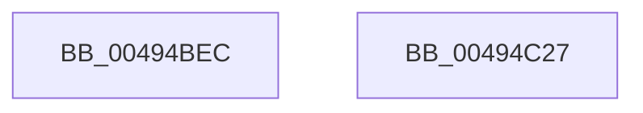

# CmSiPrefetchVirtualMemoryRange

- RVA: `0x00494BEC`–`0x00494C28` (길이 `60` bytes)
- VA: `0x0000000140494BEC`
- 실행 섹션: `.text`
- PDB 이름 있음: `예`; PDB Function 태그: `아니요`
- unwind 정보 RVA: `0x00082420`
- 디코드: `16`개 명령, `60/60` bytes 표시
- 미해석 바이트: `0` (있으면 어셈블리에 `.byte`로 보존)

> 이 문서는 커널 이미지의 기계어와 PDB 기호를 분석해 생성했습니다. 4번과 5번은 함수 원형과 자료형을 바이너리 사용 방식에서 추정한 C 해석이며 원본 소스 복구 결과는 아닙니다.

## 1. Dependencies

- 직접 호출 지점: **1**; 고유 호출 대상: **1**
- 직접 호출자로 확인된 함수: **1**
- RIP 상대 이미지 참조: **0**

### Outgoing calls
- `0x00494C1D` → [ZwSetInformationVirtualMemory](../6B/ZwSetInformationVirtualMemory_function_006B06F0.md) (function, `0x006B06F0`)

### Direct callers
- [HvpViewMapMakeViewRangeValid](../../page/9B/HvpViewMapMakeViewRangeValid_function_009B5E00.md) at `0x009B5E70`

### Static image references
- 디코드된 RIP-relative 메모리 참조가 없습니다.

## 2. Other-region calls and transfers

- 다른 실행 섹션으로 향하는 call: **0**
- 별도 외부 분기/꼬리 이동을 확인하지 못했습니다.

## 3. Assembly (complete function range)

```asm
00494BEC  48 8B C4                        mov rax, rsp
00494BEF  48 83 EC 48                     sub rsp, 0x48
00494BF3  83 60 08 00                     and dword ptr [rax + 8], 0
00494BF7  4C 8D 4C 24 30                  lea r9, [rsp + 0x30]
00494BFC  48 8B 09                        mov rcx, qword ptr [rcx]
00494BFF  48 89 50 E8                     mov qword ptr [rax - 0x18], rdx
00494C03  33 D2                           xor edx, edx
00494C05  4C 89 40 F0                     mov qword ptr [rax - 0x10], r8
00494C09  C7 40 E0 04 00 00 00            mov dword ptr [rax - 0x20], 4
00494C10  48 8D 40 08                     lea rax, [rax + 8]
00494C14  48 89 44 24 20                  mov qword ptr [rsp + 0x20], rax
00494C19  44 8D 42 01                     lea r8d, [rdx + 1]
00494C1D  E8 CE BA 21 00                  call 0x1406b06f0
00494C22  48 83 C4 48                     add rsp, 0x48
00494C26  C3                              ret
00494C27  CC                              int3
```

## 4. C-style interpretation (structured pseudocode)

```c
__int64 __fastcall CmSiPrefetchVirtualMemoryRange(__int64 a1, __int64 a2, __int64 a3)
{
    __int64 result;
    __int64 v_rsp;
    unsigned __int64 v_stack_m18;
    unsigned __int64 v_stack_m28;

    v_rsp = (v_rsp) - (72);
    *(unsigned __int64 *)(v_rsp - 24) = a2;
    a2 = 0;
    *(unsigned __int64 *)(v_rsp - 16) = a3;
    *(unsigned int *)(v_rsp - 32) = 4;
    v_stack_m28 = v_rsp + 8;
    result = ZwSetInformationVirtualMemory(*(unsigned __int64 *)(a1), a2, a2 + 1, v_stack_m18);
    v_rsp = (v_rsp) + (72);
    return result;
}
```

## 5. (Beta) C Style

```c
int64_t CmSiPrefetchVirtualMemoryRange(void *Arg1, int64_t Arg2, int64_t Arg3)
{
    uint8_t *arg1 = (uint8_t *)Arg1;

    int64_t result;
    int64_t local_rsp;
    uint64_t v_stack_m18;
    uint64_t v_stack_m28;

    local_rsp = (local_rsp) - (72);
    *(uint64_t *)(local_rsp - 0x18) = Arg2;
    Arg2 = 0;
    *(uint64_t *)(local_rsp - 0x10) = Arg3;
    *(uint32_t *)(local_rsp - 0x20) = 4;
    v_stack_m28 = local_rsp + 8;
    result = ZwSetInformationVirtualMemory(*(uint64_t *)(arg1), Arg2, Arg2 + 1, v_stack_m18);
    local_rsp = (local_rsp) + (72);
    return result;
}
```

### 관측된 메모리 오프셋

구조체 형식이 확인되지 않은 접근은 인자 기준의 오프셋으로만 기록했습니다.

| 기준 인자 | 오프셋 표현 | 폭 (bit) | 접근 |
|---|---:|---:|---|
| `Arg1` | `+ 0x0` | `64` | `R` |

## 6. Execution-region graph

[열기: 2D/3D 그래프와 함수 탐색 컨트롤 패널](../../../control-panel.html?section=text&rva=0x00494BEC&view=graph)

- 2D 그래프는 위에서 아래로 흐르고, 3D 그래프는 빈 공간을 드래그해 회전합니다. Shift+드래그는 이동, 휠은 확대·축소, 함수 노드 선택은 대상 보고서 이동입니다.

### Static fallback


