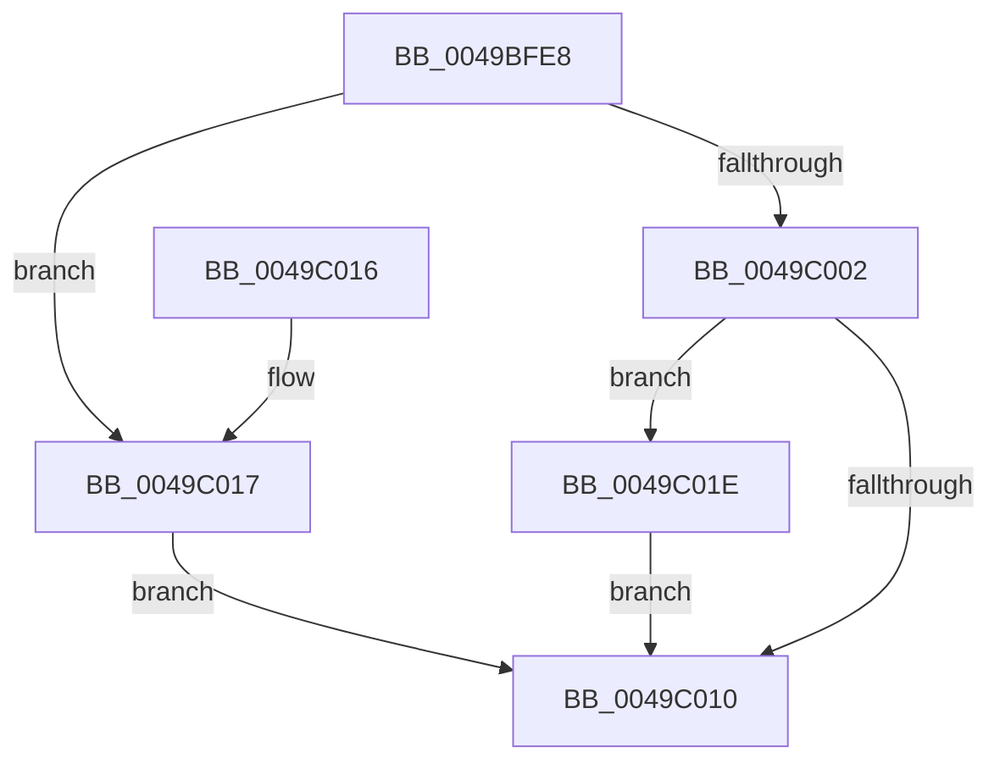

# CmpDoFileFlush

- RVA: `0x0049BFE8`–`0x0049C037` (길이 `79` bytes)
- VA: `0x000000014049BFE8`
- 실행 섹션: `.text`
- PDB 이름 있음: `예`; PDB Function 태그: `아니요`
- unwind 정보 RVA: `0x000B4A04`
- 디코드: `21`개 명령, `79/79` bytes 표시
- 미해석 바이트: `0` (있으면 어셈블리에 `.byte`로 보존)

> 이 문서는 커널 이미지의 기계어와 PDB 기호를 분석해 생성했습니다. 4번과 5번은 함수 원형과 자료형을 바이너리 사용 방식에서 추정한 C 해석이며 원본 소스 복구 결과는 아닙니다.

## 1. Dependencies

- 직접 호출 지점: **1**; 고유 호출 대상: **1**
- 직접 호출자로 확인된 함수: **1**
- RIP 상대 이미지 참조: **4**

### Outgoing calls
- `0x0049C007` → [ZwFlushBuffersFile](../6A/ZwFlushBuffersFile_function_006ADA30.md) (function, `0x006ADA30`)

### Direct callers
- [CmpFileFlush](../../page/9B/CmpFileFlush_function_009B9A04.md) at `0x009B9A17`

### Static image references
- `0x0049BFEE` → RVA `0x00FD8001` (`PAGEDATA`; read)
- `0x0049C01E` → RVA `0x00FD9EE0` (`PAGEDATA`; write)
- `0x0049C028` → RVA `0x00FD9EE8` (`PAGEDATA`; write)
- `0x0049C02F` → RVA `0x00FD9EF0` (`PAGEDATA`; write)

## 2. Other-region calls and transfers

- 다른 실행 섹션으로 향하는 call: **0**
- 별도 외부 분기/꼬리 이동을 확인하지 못했습니다.

## 3. Assembly (complete function range)

```asm
0049BFE8  40 53                           push rbx
0049BFEA  48 83 EC 30                     sub rsp, 0x30
0049BFEE  80 3D 0C C0 B3 00 00            cmp byte ptr [rip + 0xb3c00c], 0
0049BFF5  0F 57 C0                        xorps xmm0, xmm0
0049BFF8  0F 11 44 24 20                  movups xmmword ptr [rsp + 0x20], xmm0
0049BFFD  48 8B D9                        mov rbx, rcx
0049C000  75 15                           jne 0x14049c017
0049C002  48 8D 54 24 20                  lea rdx, [rsp + 0x20]
0049C007  E8 24 1A 21 00                  call 0x1406ada30
0049C00C  85 C0                           test eax, eax
0049C00E  78 0E                           js 0x14049c01e
0049C010  48 83 C4 30                     add rsp, 0x30
0049C014  5B                              pop rbx
0049C015  C3                              ret
0049C016  CC                              int3
0049C017  B8 01 00 00 C0                  mov eax, 0xc0000001
0049C01C  EB F2                           jmp 0x14049c010
0049C01E  C7 05 B8 DE B3 00 04 00 00 00   mov dword ptr [rip + 0xb3deb8], 4
0049C028  48 89 1D B9 DE B3 00            mov qword ptr [rip + 0xb3deb9], rbx
0049C02F  89 05 BB DE B3 00               mov dword ptr [rip + 0xb3debb], eax
0049C035  EB D9                           jmp 0x14049c010
```

## 4. C-style interpretation (structured pseudocode)

```c
__int64 __fastcall CmpDoFileFlush(__int64 a1)
{
    __int64 result;
    __int64 v_rsp;
    unsigned __int64 v_stack_m18;

    v_rsp = (v_rsp) - (48);
    v_stack_m18 = v_xmm0;
    if ((*(unsigned __int8 *)(v_rip + 11780108)) != 0) goto loc_0049C017;
    result = ZwFlushBuffersFile(a1, v_stack_m18, a3, a4);
    if (sign_flag) goto loc_0049C01E;
loc_0049C010:
    v_rsp = (v_rsp) + (48);
    return result;
loc_0049C017:
    goto loc_0049C010;
loc_0049C01E:
    *(unsigned int *)(v_rip + 11787960) = 4;
    *(unsigned __int64 *)(v_rip + 11787961) = a1;
    *(unsigned int *)(v_rip + 11787963) = (unsigned int)((unsigned int)(0xC0000001ULL));
    goto loc_0049C010;
}
```

## 5. (Beta) C Style

```c
int64_t CmpDoFileFlush(int64_t Arg1)
{
    int64_t result;
    int64_t local_rsp;
    uint64_t v_stack_m18;

    local_rsp = (local_rsp) - (48);
    v_stack_m18 = v_xmm0;
    if ((*(uint8_t *)(v_rip + 0xB3C00C)) != 0) goto loc_0049C017;
    result = ZwFlushBuffersFile(Arg1, v_stack_m18, a3, a4);
    if (sign_flag) goto loc_0049C01E;
loc_0049C010:
    local_rsp = (local_rsp) + (48);
    return result;
loc_0049C017:
    goto loc_0049C010;
loc_0049C01E:
    *(uint32_t *)(v_rip + 0xB3DEB8) = 4;
    *(uint64_t *)(v_rip + 0xB3DEB9) = Arg1;
    *(uint32_t *)(v_rip + 0xB3DEBB) = (uint32_t)((uint32_t)(0xC0000001ULL));
    goto loc_0049C010;
}
```

## 6. Execution-region graph

[열기: 2D/3D 그래프와 함수 탐색 컨트롤 패널](../../../control-panel.html?section=text&rva=0x0049BFE8&view=graph)

- 2D 그래프는 위에서 아래로 흐르고, 3D 그래프는 빈 공간을 드래그해 회전합니다. Shift+드래그는 이동, 휠은 확대·축소, 함수 노드 선택은 대상 보고서 이동입니다.

### Static fallback


