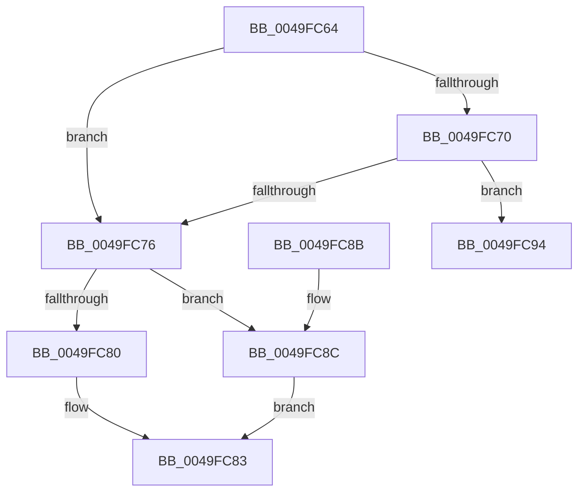

# CmpKeySecurityIncrementReferenceCount

- RVA: `0x0049FC64`–`0x0049FCB1` (길이 `77` bytes)
- VA: `0x000000014049FC64`
- 실행 섹션: `.text`
- PDB 이름 있음: `예`; PDB Function 태그: `아니요`
- unwind 정보 RVA: `0x000687C0`
- 디코드: `25`개 명령, `77/77` bytes 표시
- 미해석 바이트: `0` (있으면 어셈블리에 `.byte`로 보존)

> 이 문서는 커널 이미지의 기계어와 PDB 기호를 분석해 생성했습니다. 4번과 5번은 함수 원형과 자료형을 바이너리 사용 방식에서 추정한 C 해석이며 원본 소스 복구 결과는 아닙니다.

## 1. Dependencies

- 직접 호출 지점: **1**; 고유 호출 대상: **1**
- 직접 호출자로 확인된 함수: **4**
- RIP 상대 이미지 참조: **0**

### Outgoing calls
- `0x0049FCAB` → [KeBugCheckEx](../4F/KeBugCheckEx_function_004FD660.md) (function, `0x004FD660`)

### Direct callers
- [CmpReferenceSecurityNode](../../page/7E/CmpReferenceSecurityNode_function_007ED6A0.md) at `0x007ED6EF`
- [CmpGetSecurityDescriptorNodeEx](../../page/94/CmpGetSecurityDescriptorNodeEx_function_00949268.md) at `0x00949336`
- [CmpSetSecurityDescriptorInfo](../../page/94/CmpSetSecurityDescriptorInfo_function_00949688.md) at `0x009498CA`
- [CmpSetSecurityDescriptorInfo](../../page/94/CmpSetSecurityDescriptorInfo_function_00949688.md) at `0x00949A4A`
- [CmpCheckKey](../../page/96/CmpCheckKey_function_0096EE2C.md) at `0x0096FFE1`

### Static image references
- 디코드된 RIP-relative 메모리 참조가 없습니다.

## 2. Other-region calls and transfers

- 다른 실행 섹션으로 향하는 call: **0**
- 별도 외부 분기/꼬리 이동을 확인하지 못했습니다.

## 3. Assembly (complete function range)

```asm
0049FC64  48 83 EC 38                     sub rsp, 0x38
0049FC68  45 33 D2                        xor r10d, r10d
0049FC6B  45 84 C9                        test r9b, r9b
0049FC6E  75 06                           jne 0x14049fc76
0049FC70  44 39 51 0C                     cmp dword ptr [rcx + 0xc], r10d
0049FC74  74 1E                           je 0x14049fc94
0049FC76  8B 41 0C                        mov eax, dword ptr [rcx + 0xc]
0049FC79  8D 50 01                        lea edx, [rax + 1]
0049FC7C  3B D0                           cmp edx, eax
0049FC7E  72 0C                           jb 0x14049fc8c
0049FC80  89 51 0C                        mov dword ptr [rcx + 0xc], edx
0049FC83  41 8B C2                        mov eax, r10d
0049FC86  48 83 C4 38                     add rsp, 0x38
0049FC8A  C3                              ret
0049FC8B  CC                              int3
0049FC8C  41 BA 95 00 00 C0               mov r10d, 0xc0000095
0049FC92  EB EF                           jmp 0x14049fc83
0049FC94  41 8B C0                        mov eax, r8d
0049FC97  4C 8B CA                        mov r9, rdx
0049FC9A  BA 04 00 00 00                  mov edx, 4
0049FC9F  48 89 44 24 20                  mov qword ptr [rsp + 0x20], rax
0049FCA4  8D 4A 4D                        lea ecx, [rdx + 0x4d]
0049FCA7  44 8D 42 02                     lea r8d, [rdx + 2]
0049FCAB  E8 B0 D9 05 00                  call 0x1404fd660
0049FCB0  CC                              int3
```

## 4. C-style interpretation (structured pseudocode)

```c
__int64 __fastcall CmpKeySecurityIncrementReferenceCount(__int64 a1, __int64 a2, int a3, unsigned __int8 a4)
{
    __int64 result;
    __int64 v_r10;
    __int64 v_rsp;
    unsigned __int64 v_stack_p20;

    v_rsp = (v_rsp) - (56);
    v_r10 = 0;
    if (a4 != 0) goto loc_0049FC76;
    if ((*(unsigned int *)(a1 + 12)) == 0) goto loc_0049FC94;
loc_0049FC76:
    if (((unsigned int)((unsigned int)(*(unsigned int *)(a1 + 12)) + 1)) < ((unsigned int)((unsigned int)(*(unsigned int *)(a1 + 12))))) goto loc_0049FC8C;
    *(unsigned int *)(a1 + 12) = (unsigned int)((unsigned int)(*(unsigned int *)(a1 + 12)) + 1);
loc_0049FC83:
    v_rsp = (v_rsp) + (56);
    return 0;
loc_0049FC8C:
    goto loc_0049FC83;
loc_0049FC94:
    v_stack_p20 = (unsigned int)(a3);
    result = KeBugCheckEx(4 + 77, 4, 4 + 2, (unsigned int)(*(unsigned int *)(a1 + 12)) + 1);
    return result;
}
```

## 5. (Beta) C Style

```c
int64_t CmpKeySecurityIncrementReferenceCount(void *Arg1, int64_t Arg2, int32_t Arg3, uint8_t Arg4)
{
    uint8_t *arg1 = (uint8_t *)Arg1;

    int64_t result;
    int64_t local_r10;
    int64_t local_rsp;
    uint64_t v_stack_p20;

    local_rsp = (local_rsp) - (56);
    local_r10 = 0;
    if (Arg4 != 0) goto loc_0049FC76;
    if ((*(uint32_t *)(arg1 + 0xC)) == 0) goto loc_0049FC94;
loc_0049FC76:
    if (((uint32_t)((uint32_t)(*(uint32_t *)(arg1 + 0xC)) + 1)) < ((uint32_t)((uint32_t)(*(uint32_t *)(arg1 + 0xC))))) goto loc_0049FC8C;
    *(uint32_t *)(arg1 + 0xC) = (uint32_t)((uint32_t)(*(uint32_t *)(arg1 + 0xC)) + 1);
loc_0049FC83:
    local_rsp = (local_rsp) + (56);
    return 0;
loc_0049FC8C:
    goto loc_0049FC83;
loc_0049FC94:
    v_stack_p20 = (uint32_t)(Arg3);
    result = KeBugCheckEx(4 + 77, 4, 4 + 2, (uint32_t)(*(uint32_t *)(arg1 + 0xC)) + 1);
    return result;
}
```

### 관측된 메모리 오프셋

구조체 형식이 확인되지 않은 접근은 인자 기준의 오프셋으로만 기록했습니다.

| 기준 인자 | 오프셋 표현 | 폭 (bit) | 접근 |
|---|---:|---:|---|
| `Arg1` | `+ 0xC` | `32` | `R` |
| `Arg1` | `+ 0xC` | `32` | `W` |

## 6. Execution-region graph

[열기: 2D/3D 그래프와 함수 탐색 컨트롤 패널](../../../control-panel.html?section=text&rva=0x0049FC64&view=graph)

- 2D 그래프는 위에서 아래로 흐르고, 3D 그래프는 빈 공간을 드래그해 회전합니다. Shift+드래그는 이동, 휠은 확대·축소, 함수 노드 선택은 대상 보고서 이동입니다.

### Static fallback


