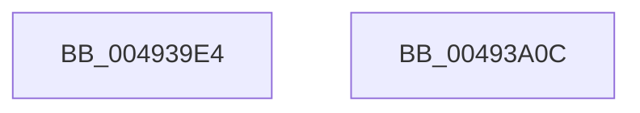

# CmpSetRespectIoPriorityThread

- RVA: `0x004939E4`–`0x00493A0D` (길이 `41` bytes)
- VA: `0x00000001404939E4`
- 실행 섹션: `.text`
- PDB 이름 있음: `예`; PDB Function 태그: `아니요`
- unwind 정보 RVA: `0x000DB714`
- 디코드: `12`개 명령, `41/41` bytes 표시
- 미해석 바이트: `0` (있으면 어셈블리에 `.byte`로 보존)

> 이 문서는 커널 이미지의 기계어와 PDB 기호를 분석해 생성했습니다. 4번과 5번은 함수 원형과 자료형을 바이너리 사용 방식에서 추정한 C 해석이며 원본 소스 복구 결과는 아닙니다.

## 1. Dependencies

- 직접 호출 지점: **0**; 고유 호출 대상: **0**
- 직접 호출자로 확인된 함수: **1**
- RIP 상대 이미지 참조: **0**

### Outgoing calls
- 직접 디코드된 call 명령이 없습니다.

### Direct callers
- [CmpDoFileWrite](../../page/A6/CmpDoFileWrite_function_00A65880.md) at `0x00A65932`
- [CmpDoFileWrite](../../page/A6/CmpDoFileWrite_function_00A65880.md) at `0x00A65C07`

### Static image references
- 디코드된 RIP-relative 메모리 참조가 없습니다.

## 2. Other-region calls and transfers

- 다른 실행 섹션으로 향하는 call: **0**
- 별도 외부 분기/꼬리 이동을 확인하지 못했습니다.

## 3. Assembly (complete function range)

```asm
004939E4  44 8B 81 A4 05 00 00            mov r8d, dword ptr [rcx + 0x5a4]
004939EB  41 8B C0                        mov eax, r8d
004939EE  0F B6 D2                        movzx edx, dl
004939F1  C1 E2 07                        shl edx, 7
004939F4  41 33 D0                        xor edx, r8d
004939F7  C1 E8 07                        shr eax, 7
004939FA  81 E2 80 00 00 00               and edx, 0x80
00493A00  24 01                           and al, 1
00493A02  41 33 D0                        xor edx, r8d
00493A05  89 91 A4 05 00 00               mov dword ptr [rcx + 0x5a4], edx
00493A0B  C3                              ret
00493A0C  CC                              int3
```

## 4. C-style interpretation (structured pseudocode)

```c
__int64 __fastcall CmpSetRespectIoPriorityThread(__int64 a1, unsigned __int8 a2)
{
    __int64 result;

    a2 = (unsigned int)((a2) << (7));
    a2 = (unsigned int)((a2) ^ ((unsigned int)((unsigned int)(*(unsigned int *)(a1 + 1444)))));
    result = (unsigned int)(((unsigned int)((unsigned int)((unsigned int)(*(unsigned int *)(a1 + 1444))))) >> (7));
    a2 = (unsigned int)((a2) & (128));
    result = (unsigned __int8)((result) & (1));
    a2 = (unsigned int)((a2) ^ ((unsigned int)((unsigned int)(*(unsigned int *)(a1 + 1444)))));
    *(unsigned int *)(a1 + 1444) = a2;
    return result;
}
```

## 5. (Beta) C Style

```c
int64_t CmpSetRespectIoPriorityThread(void *Arg1, uint8_t Arg2)
{
    uint8_t *arg1 = (uint8_t *)Arg1;

    int64_t result;

    Arg2 = (uint32_t)((Arg2) << (7));
    Arg2 = (uint32_t)((Arg2) ^ ((uint32_t)((uint32_t)(*(uint32_t *)(arg1 + 0x5A4)))));
    result = (uint32_t)(((uint32_t)((uint32_t)((uint32_t)(*(uint32_t *)(arg1 + 0x5A4))))) >> (7));
    Arg2 = (uint32_t)((Arg2) & (128));
    result = (uint8_t)((result) & (1));
    Arg2 = (uint32_t)((Arg2) ^ ((uint32_t)((uint32_t)(*(uint32_t *)(arg1 + 0x5A4)))));
    *(uint32_t *)(arg1 + 0x5A4) = Arg2;
    return result;
}
```

### 관측된 메모리 오프셋

구조체 형식이 확인되지 않은 접근은 인자 기준의 오프셋으로만 기록했습니다.

| 기준 인자 | 오프셋 표현 | 폭 (bit) | 접근 |
|---|---:|---:|---|
| `Arg1` | `+ 0x5A4` | `32` | `R` |
| `Arg1` | `+ 0x5A4` | `32` | `W` |

## 6. Execution-region graph

[열기: 2D/3D 그래프와 함수 탐색 컨트롤 패널](../../../control-panel.html?section=text&rva=0x004939E4&view=graph)

- 2D 그래프는 위에서 아래로 흐르고, 3D 그래프는 빈 공간을 드래그해 회전합니다. Shift+드래그는 이동, 휠은 확대·축소, 함수 노드 선택은 대상 보고서 이동입니다.

### Static fallback


