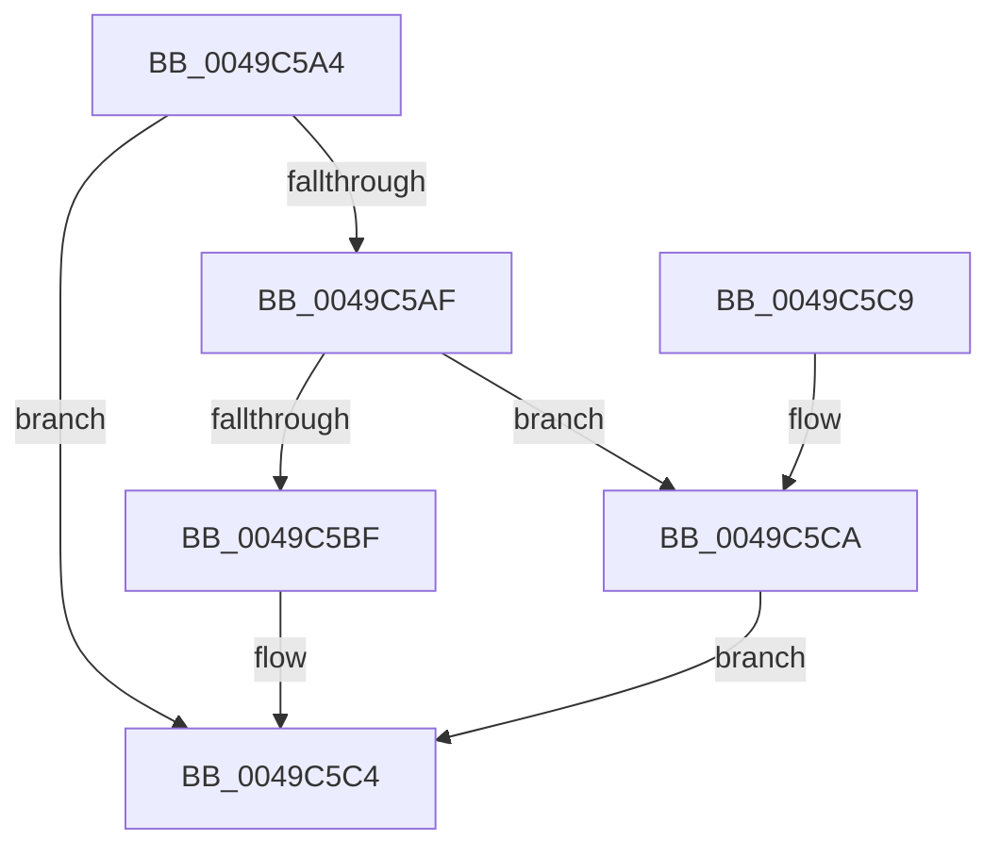

# CmpValueEnumStackEntryCleanup

- RVA: `0x0049C5A4`–`0x0049C5D1` (길이 `45` bytes)
- VA: `0x000000014049C5A4`
- 실행 섹션: `.text`
- PDB 이름 있음: `예`; PDB Function 태그: `아니요`
- unwind 정보 RVA: `0x0005CEE8`
- 디코드: `13`개 명령, `45/45` bytes 표시
- 미해석 바이트: `0` (있으면 어셈블리에 `.byte`로 보존)

> 이 문서는 커널 이미지의 기계어와 PDB 기호를 분석해 생성했습니다. 4번과 5번은 함수 원형과 자료형을 바이너리 사용 방식에서 추정한 C 해석이며 원본 소스 복구 결과는 아닙니다.

## 1. Dependencies

- 직접 호출 지점: **2**; 고유 호출 대상: **2**
- 직접 호출자로 확인된 함수: **1**
- RIP 상대 이미지 참조: **0**

### Outgoing calls
- `0x0049C5BF` → [HvpReleaseCellPaged](../../page/85/HvpReleaseCellPaged_function_00855F40.md) (function, `0x00855F40`)
- `0x0049C5CA` → [HvpReleaseCellFlat](../../page/85/HvpReleaseCellFlat_function_0085CC20.md) (function, `0x0085CC20`)

### Direct callers
- [CmpValueEnumStackCleanup](../../page/8B/CmpValueEnumStackCleanup_function_008B1F04.md) at `0x008B1F2F`

### Static image references
- 디코드된 RIP-relative 메모리 참조가 없습니다.

## 2. Other-region calls and transfers

- 다른 실행 섹션으로 향하는 call: **2**
  - `0x0049C5BF` → [HvpReleaseCellPaged](../../page/85/HvpReleaseCellPaged_function_00855F40.md) (`.text` → `PAGE`)
  - `0x0049C5CA` → [HvpReleaseCellFlat](../../page/85/HvpReleaseCellFlat_function_0085CC20.md) (`.text` → `PAGE`)
- 별도 외부 분기/꼬리 이동을 확인하지 못했습니다.

## 3. Assembly (complete function range)

```asm
0049C5A4  48 83 EC 28                     sub rsp, 0x28
0049C5A8  48 83 79 08 00                  cmp qword ptr [rcx + 8], 0
0049C5AD  74 15                           je 0x14049c5c4
0049C5AF  48 8D 51 10                     lea rdx, [rcx + 0x10]
0049C5B3  48 8B 09                        mov rcx, qword ptr [rcx]
0049C5B6  F6 81 8C 00 00 00 01            test byte ptr [rcx + 0x8c], 1
0049C5BD  75 0B                           jne 0x14049c5ca
0049C5BF  E8 7C 99 3B 00                  call 0x140855f40
0049C5C4  48 83 C4 28                     add rsp, 0x28
0049C5C8  C3                              ret
0049C5C9  CC                              int3
0049C5CA  E8 51 06 3C 00                  call 0x14085cc20
0049C5CF  EB F3                           jmp 0x14049c5c4
```

## 4. C-style interpretation (structured pseudocode)

```c
__int64 __fastcall CmpValueEnumStackEntryCleanup(__int64 a1)
{
    __int64 result;
    __int64 v_rsp;

    v_rsp = (v_rsp) - (40);
    if ((*(unsigned __int64 *)(a1 + 8)) == 0) goto loc_0049C5C4;
    if (((*(unsigned __int8 *)(*(unsigned __int64 *)(a1) + 140)) & (1)) != 0) goto loc_0049C5CA;
    result = HvpReleaseCellPaged(*(unsigned __int64 *)(a1), a1 + 16, a3, a4);
loc_0049C5C4:
    v_rsp = (v_rsp) + (40);
    return result;
loc_0049C5CA:
    result = HvpReleaseCellFlat(*(unsigned __int64 *)(a1), a1 + 16, a3, a4);
    goto loc_0049C5C4;
}
```

## 5. (Beta) C Style

```c
int64_t CmpValueEnumStackEntryCleanup(void *Arg1)
{
    uint8_t *arg1 = (uint8_t *)Arg1;

    int64_t result;
    int64_t local_rsp;

    local_rsp = (local_rsp) - (40);
    if ((*(uint64_t *)(arg1 + 0x8)) == 0) goto loc_0049C5C4;
    if (((*(uint8_t *)(*(uint64_t *)(arg1) + 0x8C)) & (1)) != 0) goto loc_0049C5CA;
    result = HvpReleaseCellPaged(*(uint64_t *)(arg1), Arg1 + 16, a3, a4);
loc_0049C5C4:
    local_rsp = (local_rsp) + (40);
    return result;
loc_0049C5CA:
    result = HvpReleaseCellFlat(*(uint64_t *)(arg1), Arg1 + 16, a3, a4);
    goto loc_0049C5C4;
}
```

### 관측된 메모리 오프셋

구조체 형식이 확인되지 않은 접근은 인자 기준의 오프셋으로만 기록했습니다.

| 기준 인자 | 오프셋 표현 | 폭 (bit) | 접근 |
|---|---:|---:|---|
| `Arg1` | `+ 0x0` | `64` | `R` |
| `Arg1` | `+ 0x8` | `64` | `R` |
| `Arg1` | `+ 0x10` | `64` | `R` |

## 6. Execution-region graph

[열기: 2D/3D 그래프와 함수 탐색 컨트롤 패널](../../../control-panel.html?section=text&rva=0x0049C5A4&view=graph)

- 2D 그래프는 위에서 아래로 흐르고, 3D 그래프는 빈 공간을 드래그해 회전합니다. Shift+드래그는 이동, 휠은 확대·축소, 함수 노드 선택은 대상 보고서 이동입니다.

### Static fallback


