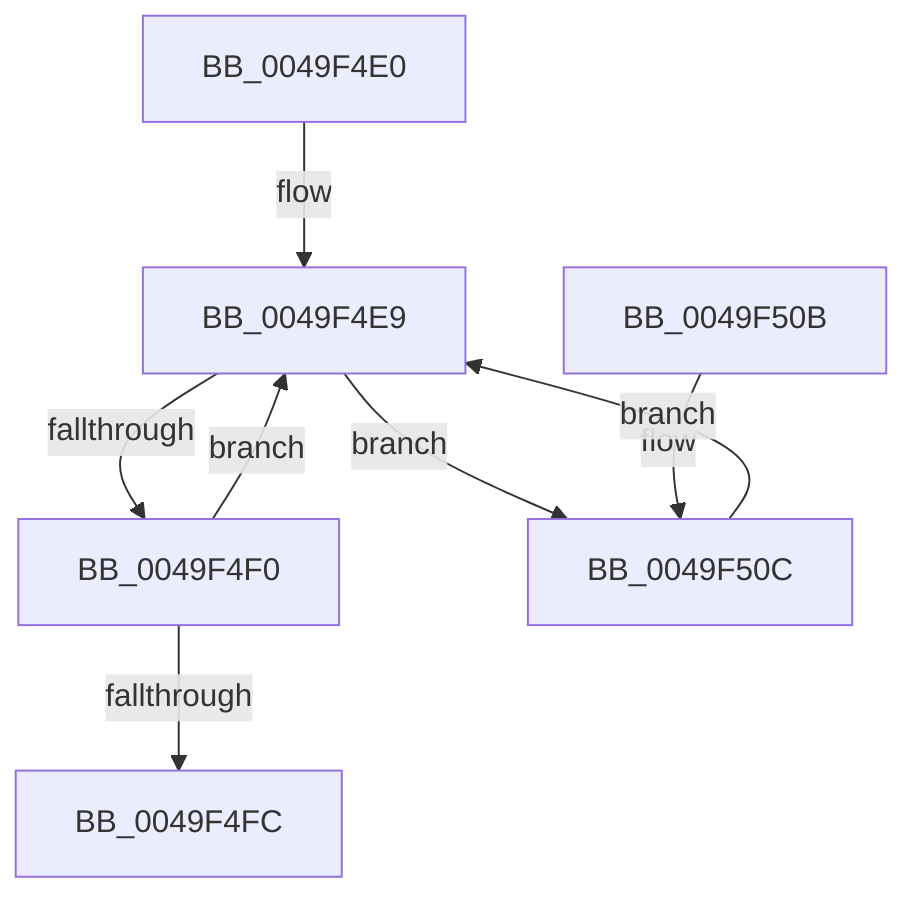

# CmpWorkItemWrapper

- RVA: `0x0049F4E0`–`0x0049F524` (길이 `68` bytes)
- VA: `0x000000014049F4E0`
- 실행 섹션: `.text`
- PDB 이름 있음: `예`; PDB Function 태그: `아니요`
- unwind 정보 RVA: `0x0008C174`
- 디코드: `22`개 명령, `68/68` bytes 표시
- 미해석 바이트: `0` (있으면 어셈블리에 `.byte`로 보존)

> 이 문서는 커널 이미지의 기계어와 PDB 기호를 분석해 생성했습니다. 4번과 5번은 함수 원형과 자료형을 바이너리 사용 방식에서 추정한 C 해석이며 원본 소스 복구 결과는 아닙니다.

## 1. Dependencies

- 직접 호출 지점: **2**; 고유 호출 대상: **2**
- 직접 호출자로 확인된 함수: **0**
- RIP 상대 이미지 참조: **0**

### Outgoing calls
- `0x0049F500` → [ExReleaseRundownProtection](../34/ExReleaseRundownProtection_function_00349E80.md) (function, `0x00349E80`)
- `0x0049F51D` → [guard_dispatch_icall](../6B/guard_dispatch_icall_function_006BAAD0.md) (function, `0x006BAAD0`)

### Direct callers
- 이 함수 시작 RVA로 연결되는 직접 call은 확인되지 않았습니다. 간접 호출은 완전히 역산할 수 없습니다.

### Static image references
- 디코드된 RIP-relative 메모리 참조가 없습니다.

## 2. Other-region calls and transfers

- 다른 실행 섹션으로 향하는 call: **0**
- 별도 외부 분기/꼬리 이동을 확인하지 못했습니다.

## 3. Assembly (complete function range)

```asm
0049F4E0  40 53                           push rbx
0049F4E2  48 83 EC 20                     sub rsp, 0x20
0049F4E6  48 8B D9                        mov rbx, rcx
0049F4E9  8B 43 28                        mov eax, dword ptr [rbx + 0x28]
0049F4EC  A8 02                           test al, 2
0049F4EE  75 1C                           jne 0x14049f50c
0049F4F0  8B C8                           mov ecx, eax
0049F4F2  83 E1 FE                        and ecx, 0xfffffffe
0049F4F5  F0 0F B1 4B 28                  lock cmpxchg dword ptr [rbx + 0x28], ecx
0049F4FA  75 ED                           jne 0x14049f4e9
0049F4FC  48 8D 4B 20                     lea rcx, [rbx + 0x20]
0049F500  E8 7B A9 EA FF                  call 0x140349e80
0049F505  48 83 C4 20                     add rsp, 0x20
0049F509  5B                              pop rbx
0049F50A  C3                              ret
0049F50B  CC                              int3
0049F50C  F0 0F BA 73 28 01               lock btr dword ptr [rbx + 0x28], 1
0049F512  48 8B 43 30                     mov rax, qword ptr [rbx + 0x30]
0049F516  48 8B CB                        mov rcx, rbx
0049F519  48 8B 53 38                     mov rdx, qword ptr [rbx + 0x38]
0049F51D  E8 AE B5 21 00                  call 0x1406baad0
0049F522  EB C5                           jmp 0x14049f4e9
```

## 4. C-style interpretation (structured pseudocode)

```c
__int64 __fastcall CmpWorkItemWrapper(__int64 a1)
{
    __int64 result;
    __int64 v_rsp;

    v_rsp = (v_rsp) - (32);
loc_0049F4E9:
    if ((((unsigned __int8)((unsigned int)(*(unsigned int *)(a1 + 40)))) & (2)) != 0) goto loc_0049F50C;
    a1 = (unsigned int)(((unsigned int)((unsigned int)((unsigned int)(*(unsigned int *)(a1 + 40))))) & (0xFFFFFFFEULL));
    if (condition_is_not_equal) goto loc_0049F4E9;
    result = ExReleaseRundownProtection(a1 + 32, a2, a3, a4);
    v_rsp = (v_rsp) + (32);
    return result;
loc_0049F50C:
    result = guard_dispatch_icall(a1, *(unsigned __int64 *)(a1 + 56), a3, a4);
    goto loc_0049F4E9;
}
```

## 5. (Beta) C Style

```c
int64_t CmpWorkItemWrapper(void *Arg1)
{
    uint8_t *arg1 = (uint8_t *)Arg1;

    int64_t result;
    int64_t local_rsp;

    local_rsp = (local_rsp) - (32);
loc_0049F4E9:
    if ((((uint8_t)((uint32_t)(*(uint32_t *)(arg1 + 0x28)))) & (2)) != 0) goto loc_0049F50C;
    Arg1 = (uint32_t)(((uint32_t)((uint32_t)((uint32_t)(*(uint32_t *)(arg1 + 0x28))))) & (0xFFFFFFFEULL));
    if (condition_is_not_equal) goto loc_0049F4E9;
    result = ExReleaseRundownProtection(Arg1 + 32, a2, a3, a4);
    local_rsp = (local_rsp) + (32);
    return result;
loc_0049F50C:
    result = guard_dispatch_icall(Arg1, *(uint64_t *)(arg1 + 0x38), a3, a4);
    goto loc_0049F4E9;
}
```

### 관측된 메모리 오프셋

구조체 형식이 확인되지 않은 접근은 인자 기준의 오프셋으로만 기록했습니다.

| 기준 인자 | 오프셋 표현 | 폭 (bit) | 접근 |
|---|---:|---:|---|
| `Arg1` | `+ 0x20` | `64` | `R` |
| `Arg1` | `+ 0x28` | `32` | `R` |
| `Arg1` | `+ 0x28` | `32` | `R/W` |
| `Arg1` | `+ 0x30` | `64` | `R` |
| `Arg1` | `+ 0x38` | `64` | `R` |

## 6. Execution-region graph

[열기: 2D/3D 그래프와 함수 탐색 컨트롤 패널](../../../control-panel.html?section=text&rva=0x0049F4E0&view=graph)

- 2D 그래프는 위에서 아래로 흐르고, 3D 그래프는 빈 공간을 드래그해 회전합니다. Shift+드래그는 이동, 휠은 확대·축소, 함수 노드 선택은 대상 보고서 이동입니다.

### Static fallback


