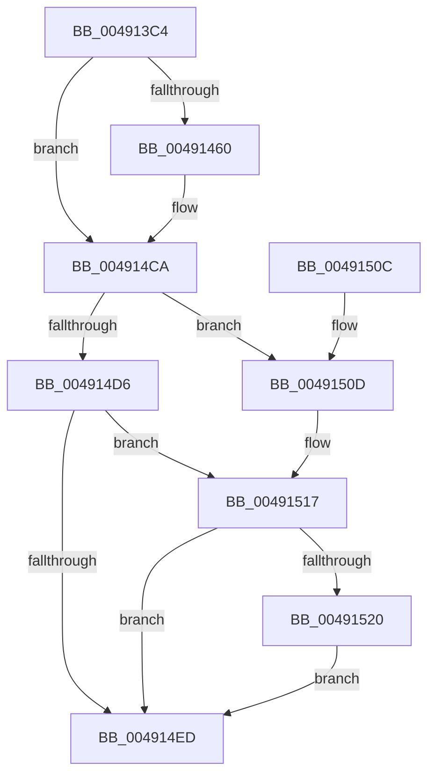

# DbgkPostModuleMessage

- RVA: `0x004913C4`–`0x00491529` (길이 `357` bytes)
- VA: `0x00000001404913C4`
- 실행 섹션: `.text`
- PDB 이름 있음: `예`; PDB Function 태그: `아니요`
- unwind 정보 RVA: `0x000B2CD8`
- 디코드: `91`개 명령, `357/357` bytes 표시
- 미해석 바이트: `0` (있으면 어셈블리에 `.byte`로 보존)

> 이 문서는 커널 이미지의 기계어와 PDB 기호를 분석해 생성했습니다. 4번과 5번은 함수 원형과 자료형을 바이너리 사용 방식에서 추정한 C 해석이며 원본 소스 복구 결과는 아닙니다.

## 1. Dependencies

- 직접 호출 지점: **8**; 고유 호출 대상: **8**
- 직접 호출자로 확인된 함수: **3**
- RIP 상대 이미지 참조: **1**

### Outgoing calls
- `0x00491431` → [memset](../6C/memset_function_006C6C40.md) (function, `0x006C6C40`)
- `0x00491455` → [MmGetFileNameForAddress](../../page/A2/MmGetFileNameForAddress_function_00A2B878.md) (function, `0x00A2B878`)
- `0x004914AB` → [ZwOpenFile](../6A/ZwOpenFile_function_006AD730.md) (function, `0x006AD730`)
- `0x004914C5` → [ExFreePoolWithTag](../../poolcode/B8/ExFreePoolWithTag_function_00B82870.md) (function, `0x00B82870`)
- `0x004914E4` → [DbgkpQueueMessage](../../page/8A/DbgkpQueueMessage_function_008A31C0.md) (function, `0x008A31C0`)
- `0x004914F7` → [_security_check_cookie](../6A/_security_check_cookie_function_006AC640.md) (function, `0x006AC640`)
- `0x00491512` → [DbgkpSendApiMessage](../../page/A7/DbgkpSendApiMessage_function_00A79458.md) (function, `0x00A79458`)
- `0x00491522` → [ObCloseHandle](../../page/8A/ObCloseHandle_function_008A1870.md) (function, `0x008A1870`)

### Direct callers
- [DbgkPostEnclaveModuleMessages](../57/DbgkPostEnclaveModuleMessages_function_0057FCDC.md) at `0x0057FD25`
- [sub_006F88AE](../6F/Unknown_function_006F88AE.md) at `0x006F8CF3`
- [DbgkpPostModuleMessages](../../page/A5/DbgkpPostModuleMessages_function_00A5F86C.md) at `0x00A5F962`
- [DbgkpPostModuleMessages](../../page/A5/DbgkpPostModuleMessages_function_00A5F86C.md) at `0x00A5FAC7`

### Static image references
- `0x004913DC` → RVA `0x00E0A740` (`.data`; read)

## 2. Other-region calls and transfers

- 다른 실행 섹션으로 향하는 call: **5**
  - `0x00491455` → [MmGetFileNameForAddress](../../page/A2/MmGetFileNameForAddress_function_00A2B878.md) (`.text` → `PAGE`)
  - `0x004914C5` → [ExFreePoolWithTag](../../poolcode/B8/ExFreePoolWithTag_function_00B82870.md) (`.text` → `POOLCODE`)
  - `0x004914E4` → [DbgkpQueueMessage](../../page/8A/DbgkpQueueMessage_function_008A31C0.md) (`.text` → `PAGE`)
  - `0x00491512` → [DbgkpSendApiMessage](../../page/A7/DbgkpSendApiMessage_function_00A79458.md) (`.text` → `PAGE`)
  - `0x00491522` → [ObCloseHandle](../../page/8A/ObCloseHandle_function_008A1870.md) (`.text` → `PAGE`)
- 별도 외부 분기/꼬리 이동을 확인하지 못했습니다.

## 3. Assembly (complete function range)

```asm
004913C4  40 55                           push rbp
004913C6  53                              push rbx
004913C7  56                              push rsi
004913C8  57                              push rdi
004913C9  41 56                           push r14
004913CB  41 57                           push r15
004913CD  48 8D AC 24 58 FF FF FF         lea rbp, [rsp - 0xa8]
004913D5  48 81 EC A8 01 00 00            sub rsp, 0x1a8
004913DC  48 8B 05 5D 93 97 00            mov rax, qword ptr [rip + 0x97935d]
004913E3  48 33 C4                        xor rax, rsp
004913E6  48 89 85 90 00 00 00            mov qword ptr [rbp + 0x90], rax
004913ED  48 8B B5 08 01 00 00            mov rsi, qword ptr [rbp + 0x108]
004913F4  0F 57 C0                        xorps xmm0, xmm0
004913F7  33 C0                           xor eax, eax
004913F9  49 8B F8                        mov rdi, r8
004913FC  4C 8B FA                        mov r15, rdx
004913FF  48 89 44 24 60                  mov qword ptr [rsp + 0x60], rax
00491404  4C 8B F1                        mov r14, rcx
00491407  89 44 24 68                     mov dword ptr [rsp + 0x68], eax
0049140B  0F 57 C9                        xorps xmm1, xmm1
0049140E  48 8D 4D 80                     lea rcx, [rbp - 0x80]
00491412  33 D2                           xor edx, edx
00491414  41 B8 10 01 00 00               mov r8d, 0x110
0049141A  0F 11 44 24 70                  movups xmmword ptr [rsp + 0x70], xmm0
0049141F  41 8B D9                        mov ebx, r9d
00491422  0F 11 4C 24 30                  movups xmmword ptr [rsp + 0x30], xmm1
00491427  0F 11 44 24 40                  movups xmmword ptr [rsp + 0x40], xmm0
0049142C  0F 11 44 24 50                  movups xmmword ptr [rsp + 0x50], xmm0
00491431  E8 0A 58 23 00                  call 0x1406c6c40
00491436  8B 85 00 01 00 00               mov eax, dword ptr [rbp + 0x100]
0049143C  48 8D 54 24 30                  lea rdx, [rsp + 0x30]
00491441  48 8B CF                        mov rcx, rdi
00491444  89 45 C4                        mov dword ptr [rbp - 0x3c], eax
00491447  C7 45 A8 05 00 00 00            mov dword ptr [rbp - 0x58], 5
0049144E  48 89 7D B8                     mov qword ptr [rbp - 0x48], rdi
00491452  89 5D C0                        mov dword ptr [rbp - 0x40], ebx
00491455  E8 1E A4 59 00                  call 0x140a2b878
0049145A  33 DB                           xor ebx, ebx
0049145C  85 C0                           test eax, eax
0049145E  78 6A                           js 0x1404914ca
00491460  48 8D 44 24 30                  lea rax, [rsp + 0x30]
00491465  C7 44 24 28 20 00 00 00         mov dword ptr [rsp + 0x28], 0x20
0049146D  0F 57 C0                        xorps xmm0, xmm0
00491470  48 89 44 24 50                  mov qword ptr [rsp + 0x50], rax
00491475  4C 8D 4C 24 70                  lea r9, [rsp + 0x70]
0049147A  C7 44 24 40 30 00 00 00         mov dword ptr [rsp + 0x40], 0x30
00491482  4C 8D 44 24 40                  lea r8, [rsp + 0x40]
00491487  48 89 5C 24 48                  mov qword ptr [rsp + 0x48], rbx
0049148C  BA 00 00 10 80                  mov edx, 0x80100000
00491491  C7 44 24 58 40 06 00 00         mov dword ptr [rsp + 0x58], 0x640
00491499  48 8D 4D B0                     lea rcx, [rbp - 0x50]
0049149D  C7 44 24 20 07 00 00 00         mov dword ptr [rsp + 0x20], 7
004914A5  F3 0F 7F 44 24 60               movdqu xmmword ptr [rsp + 0x60], xmm0
004914AB  E8 80 C2 21 00                  call 0x1406ad730
004914B0  4C 8B 45 B0                     mov r8, qword ptr [rbp - 0x50]
004914B4  85 C0                           test eax, eax
004914B6  48 8B 4C 24 38                  mov rcx, qword ptr [rsp + 0x38]
004914BB  4C 0F 48 C3                     cmovs r8, rbx
004914BF  33 D2                           xor edx, edx
004914C1  4C 89 45 B0                     mov qword ptr [rbp - 0x50], r8
004914C5  E8 A6 13 6F 00                  call 0x140b82870
004914CA  4C 8D 45 80                     lea r8, [rbp - 0x80]
004914CE  49 8B CE                        mov rcx, r14
004914D1  48 85 F6                        test rsi, rsi
004914D4  74 37                           je 0x14049150d
004914D6  41 B9 02 00 00 00               mov r9d, 2
004914DC  48 89 74 24 20                  mov qword ptr [rsp + 0x20], rsi
004914E1  49 8B D7                        mov rdx, r15
004914E4  E8 D7 1C 41 00                  call 0x1408a31c0
004914E9  85 C0                           test eax, eax
004914EB  78 2A                           js 0x140491517
004914ED  48 8B 8D 90 00 00 00            mov rcx, qword ptr [rbp + 0x90]
004914F4  48 33 CC                        xor rcx, rsp
004914F7  E8 44 B1 21 00                  call 0x1406ac640
004914FC  48 81 C4 A8 01 00 00            add rsp, 0x1a8
00491503  41 5F                           pop r15
00491505  41 5E                           pop r14
00491507  5F                              pop rdi
00491508  5E                              pop rsi
00491509  5B                              pop rbx
0049150A  5D                              pop rbp
0049150B  C3                              ret
0049150C  CC                              int3
0049150D  BA 03 00 00 00                  mov edx, 3
00491512  E8 41 7F 5E 00                  call 0x140a79458
00491517  48 8B 4D B0                     mov rcx, qword ptr [rbp - 0x50]
0049151B  48 85 C9                        test rcx, rcx
0049151E  74 CD                           je 0x1404914ed
00491520  33 D2                           xor edx, edx
00491522  E8 49 03 41 00                  call 0x1408a1870
00491527  EB C4                           jmp 0x1404914ed
```

## 4. C-style interpretation (structured pseudocode)

```c
__int64 __fastcall DbgkPostModuleMessage(__int64 a1, __int64 a2, __int64 a3, int a4, unsigned int a5, __int64 a6)
{
    __int64 result;
    __int64 v_rbx;
    __int64 v_rsp;
    unsigned int v_stack_m114;
    unsigned int v_stack_m118;
    unsigned __int64 v_stack_m120;
    unsigned __int64 v_stack_m128;
    unsigned int v_stack_m130;
    unsigned __int64 v_stack_m158;
    unsigned __int64 v_stack_m168;
    unsigned int v_stack_m170;
    unsigned __int64 v_stack_m178;
    unsigned int v_stack_m180;
    unsigned __int64 v_stack_m188;
    unsigned __int64 v_stack_m190;
    unsigned __int64 v_stack_m198;
    unsigned __int64 v_stack_m1A0;
    unsigned __int64 v_stack_m1A8;
    unsigned int v_stack_m1B0;
    unsigned int v_stack_m1B8;
    unsigned __int64 v_stack_m48;
    unsigned __int64 v_stack_mD8;

    v_rsp = (v_rsp) - (424);
    result = (*(unsigned __int64 *)(v_rip + 9933661)) ^ (v_rsp);
    v_stack_m48 = result;
    result = 0;
    v_stack_m178 = 0;
    v_stack_m170 = 0;
    a2 = 0;
    v_stack_m168 = v_xmm0;
    v_stack_m1A8 = v_xmm1;
    v_stack_m198 = v_xmm0;
    v_stack_m188 = v_xmm0;
    result = memset(v_stack_m158, a2, 272, a4);
    v_stack_m114 = (unsigned int)((unsigned int)(a5));
    v_stack_m130 = 5;
    v_stack_m120 = a3;
    v_stack_m118 = (unsigned int)((unsigned int)(a4));
    result = MmGetFileNameForAddress(a3, v_stack_m1A8, 272, a4);
    v_rbx = 0;
    if (!(sign_flag)) {
        result = v_stack_m1A8;
        v_stack_m1B0 = 32;
        v_stack_m188 = result;
        a4 = v_stack_m168;
        v_stack_m198 = 48;
        a3 = v_stack_m198;
        v_stack_m190 = 0;
        a2 = 0x80100000ULL;
        v_stack_m180 = 0x640ULL;
        a1 = v_stack_m128;
        v_stack_m1B8 = 7;
        v_stack_m178 = v_xmm0;
        result = ZwOpenFile(a1, a2, a3, a4);
        a3 = v_stack_m128;
        a1 = v_stack_m1A0;
        if (sign_flag) { a3 = 0; }
        a2 = 0;
        v_stack_m128 = a3;
        result = ExFreePoolWithTag(a1, a2, a3, a4);
    }
    if (a6 == 0) goto loc_0049150D;
    v_stack_m1B8 = a6;
    result = DbgkpQueueMessage(a1, 0, v_stack_m158, 2);
    if (sign_flag) goto loc_00491517;
loc_004914ED:
    a1 = (v_stack_m48) ^ (v_rsp);
    result = _security_check_cookie(a1, 0, v_stack_m158, 2);
    v_rsp = (v_rsp) + (424);
    return result;
loc_0049150D:
    result = DbgkpSendApiMessage(a1, 3, v_stack_m158, 2);
loc_00491517:
    if (v_stack_m128 == 0) goto loc_004914ED;
    a2 = 0;
    result = ObCloseHandle(v_stack_m128, a2, v_stack_m158, 2);
    goto loc_004914ED;
}
```

## 5. (Beta) C Style

```c
int64_t DbgkPostModuleMessage(int64_t Arg1, int64_t Arg2, int64_t Arg3, int32_t Arg4, uint32_t Arg5, int64_t Arg6)
{
    int64_t result;
    int64_t local_rbx;
    int64_t local_rsp;
    uint32_t v_stack_m114;
    uint32_t v_stack_m118;
    uint64_t v_stack_m120;
    uint64_t v_stack_m128;
    uint32_t v_stack_m130;
    uint64_t v_stack_m158;
    uint64_t v_stack_m168;
    uint32_t v_stack_m170;
    uint64_t v_stack_m178;
    uint32_t v_stack_m180;
    uint64_t v_stack_m188;
    uint64_t v_stack_m190;
    uint64_t v_stack_m198;
    uint64_t v_stack_m1A0;
    uint64_t v_stack_m1A8;
    uint32_t v_stack_m1B0;
    uint32_t v_stack_m1B8;
    uint64_t v_stack_m48;
    uint64_t v_stack_mD8;

    local_rsp = (local_rsp) - (424);
    result = (*(uint64_t *)(v_rip + 0x97935D)) ^ (local_rsp);
    v_stack_m48 = result;
    result = 0;
    v_stack_m178 = 0;
    v_stack_m170 = 0;
    Arg2 = 0;
    v_stack_m168 = v_xmm0;
    v_stack_m1A8 = v_xmm1;
    v_stack_m198 = v_xmm0;
    v_stack_m188 = v_xmm0;
    result = memset(v_stack_m158, Arg2, 272, Arg4);
    v_stack_m114 = (uint32_t)((uint32_t)(Arg5));
    v_stack_m130 = 5;
    v_stack_m120 = Arg3;
    v_stack_m118 = (uint32_t)((uint32_t)(Arg4));
    result = MmGetFileNameForAddress(Arg3, v_stack_m1A8, 272, Arg4);
    local_rbx = 0;
    if (!(sign_flag)) {
        result = v_stack_m1A8;
        v_stack_m1B0 = 32;
        v_stack_m188 = result;
        Arg4 = v_stack_m168;
        v_stack_m198 = 48;
        Arg3 = v_stack_m198;
        v_stack_m190 = 0;
        Arg2 = 0x80100000ULL;
        v_stack_m180 = 0x640ULL;
        Arg1 = v_stack_m128;
        v_stack_m1B8 = 7;
        v_stack_m178 = v_xmm0;
        result = ZwOpenFile(Arg1, Arg2, Arg3, Arg4);
        Arg3 = v_stack_m128;
        Arg1 = v_stack_m1A0;
        if (sign_flag) { Arg3 = 0; }
        Arg2 = 0;
        v_stack_m128 = Arg3;
        result = ExFreePoolWithTag(Arg1, Arg2, Arg3, Arg4);
    }
    if (Arg6 == 0) goto loc_0049150D;
    v_stack_m1B8 = Arg6;
    result = DbgkpQueueMessage(Arg1, 0, v_stack_m158, 2);
    if (sign_flag) goto loc_00491517;
loc_004914ED:
    Arg1 = (v_stack_m48) ^ (local_rsp);
    result = _security_check_cookie(Arg1, 0, v_stack_m158, 2);
    local_rsp = (local_rsp) + (424);
    return result;
loc_0049150D:
    result = DbgkpSendApiMessage(Arg1, 3, v_stack_m158, 2);
loc_00491517:
    if (v_stack_m128 == 0) goto loc_004914ED;
    Arg2 = 0;
    result = ObCloseHandle(v_stack_m128, Arg2, v_stack_m158, 2);
    goto loc_004914ED;
}
```

## 6. Execution-region graph

[열기: 2D/3D 그래프와 함수 탐색 컨트롤 패널](../../../control-panel.html?section=text&rva=0x004913C4&view=graph)

- 2D 그래프는 위에서 아래로 흐르고, 3D 그래프는 빈 공간을 드래그해 회전합니다. Shift+드래그는 이동, 휠은 확대·축소, 함수 노드 선택은 대상 보고서 이동입니다.

### Static fallback


