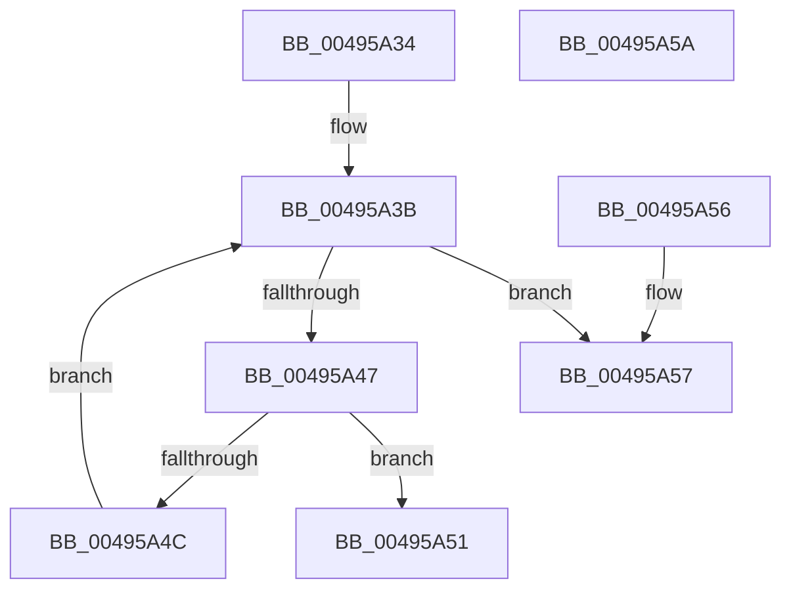

# DifGetAPIThunkContextById

- RVA: `0x00495A34`–`0x00495A5B` (길이 `39` bytes)
- VA: `0x0000000140495A34`
- 실행 섹션: `.text`
- PDB 이름 있음: `예`; PDB Function 태그: `아니요`
- unwind 정보 RVA: `0x000DB714`
- 디코드: `14`개 명령, `39/39` bytes 표시
- 미해석 바이트: `0` (있으면 어셈블리에 `.byte`로 보존)

> 이 문서는 커널 이미지의 기계어와 PDB 기호를 분석해 생성했습니다. 4번과 5번은 함수 원형과 자료형을 바이너리 사용 방식에서 추정한 C 해석이며 원본 소스 복구 결과는 아닙니다.

## 1. Dependencies

- 직접 호출 지점: **0**; 고유 호출 대상: **0**
- 직접 호출자로 확인된 함수: **504**
- RIP 상대 이미지 참조: **1**

### Outgoing calls
- 직접 디코드된 call 명령이 없습니다.

### Direct callers
- [DifRegisterPlugin](../61/DifRegisterPlugin_function_0061ABE0.md) at `0x0061AC93`
- [DifAddDeviceWrapper](../61/DifAddDeviceWrapper_function_0061BF70.md) at `0x0061BF9E`
- [DifCcCopyWriteExWrapper](../61/DifCcCopyWriteExWrapper_function_0061C0E0.md) at `0x0061C126`
- [DifCcCopyWriteWrapper](../61/DifCcCopyWriteWrapper_function_0061C2A0.md) at `0x0061C2E0`
- [DifCcDeferWriteWrapper](../61/DifCcDeferWriteWrapper_function_0061C450.md) at `0x0061C490`
- [DifCcFastCopyWriteWrapper](../61/DifCcFastCopyWriteWrapper_function_0061C5F0.md) at `0x0061C628`
- [DifCmRegisterCallbackExWrapper](../61/DifCmRegisterCallbackExWrapper_function_0061C780.md) at `0x0061C7C0`
- [DifCmRegisterCallbackWrapper](../61/DifCmRegisterCallbackWrapper_function_0061C930.md) at `0x0061C96E`
- [DifCmUnRegisterCallbackWrapper](../61/DifCmUnRegisterCallbackWrapper_function_0061CAB0.md) at `0x0061CADF`
- [DifDriverCancelWrapper](../61/DifDriverCancelWrapper_function_0061CC20.md) at `0x0061CC59`
- [DifDriverEntryWrapper](../61/DifDriverEntryWrapper_function_0061CD80.md) at `0x0061CDAE`
- [DifDriverStartIoWrapper](../61/DifDriverStartIoWrapper_function_0061CEE0.md) at `0x0061CF11`
- [DifDriverUnloadWrapper](../61/DifDriverUnloadWrapper_function_0061D050.md) at `0x0061D078`
- [DifEtwRegisterWrapper](../61/DifEtwRegisterWrapper_function_0061D1A0.md) at `0x0061D1E0`
- [DifEtwUnregisterWrapper](../61/DifEtwUnregisterWrapper_function_0061D330.md) at `0x0061D35F`
- [DifExAcquireFastMutexUnsafeWrapper](../61/DifExAcquireFastMutexUnsafeWrapper_function_0061D4A0.md) at `0x0061D4C8`
- [DifExAcquireFastMutexWrapper](../61/DifExAcquireFastMutexWrapper_function_0061D600.md) at `0x0061D628`
- [DifExAcquireFastResourceExclusiveWrapper](../61/DifExAcquireFastResourceExclusiveWrapper_function_0061D760.md) at `0x0061D79E`
- [DifExAcquireFastResourceSharedStarveExclusiveWrapper](../61/DifExAcquireFastResourceSharedStarveExclusiveWrapper_function_0061D8E0.md) at `0x0061D91E`
- [DifExAcquireFastResourceSharedWrapper](../61/DifExAcquireFastResourceSharedWrapper_function_0061DA60.md) at `0x0061DA9E`
- [DifExAcquireResourceExclusiveLiteWrapper](../61/DifExAcquireResourceExclusiveLiteWrapper_function_0061DBE0.md) at `0x0061DC0E`
- [DifExAcquireResourceSharedLiteWrapper](../61/DifExAcquireResourceSharedLiteWrapper_function_0061DD50.md) at `0x0061DD7E`
- [DifExAcquireSharedStarveExclusiveWrapper](../61/DifExAcquireSharedStarveExclusiveWrapper_function_0061DEC0.md) at `0x0061DEEE`
- [DifExAcquireSharedWaitForExclusiveWrapper](../61/DifExAcquireSharedWaitForExclusiveWrapper_function_0061E030.md) at `0x0061E05E`
- [DifExAllocateCacheAwareRundownProtectionWrapper](../61/DifExAllocateCacheAwareRundownProtectionWrapper_function_0061E1A0.md) at `0x0061E1D1`
- [DifExAllocatePool2Wrapper](../61/DifExAllocatePool2Wrapper_function_0061E310.md) at `0x0061E353`
- [DifExAllocatePool3Wrapper](../61/DifExAllocatePool3Wrapper_function_0061E4E0.md) at `0x0061E523`
- [DifExAllocatePoolWithQuotaTagWrapper](../61/DifExAllocatePoolWithQuotaTagWrapper_function_0061E6B0.md) at `0x0061E6F3`
- [DifExAllocatePoolWithQuotaWrapper](../61/DifExAllocatePoolWithQuotaWrapper_function_0061E880.md) at `0x0061E8C3`
- [DifExAllocatePoolWithTagPriorityWrapper](../61/DifExAllocatePoolWithTagPriorityWrapper_function_0061EA50.md) at `0x0061EA93`
- [DifExAllocatePoolWithTagWrapper](../61/DifExAllocatePoolWithTagWrapper_function_0061EC20.md) at `0x0061EC63`
- [DifExAllocatePoolWrapper](../61/DifExAllocatePoolWrapper_function_0061EDF0.md) at `0x0061EE33`
- [DifExConvertExclusiveToSharedLiteWrapper](../61/DifExConvertExclusiveToSharedLiteWrapper_function_0061EFC0.md) at `0x0061EFE8`
- [DifExConvertFastResourceExclusiveToSharedWrapper](../61/DifExConvertFastResourceExclusiveToSharedWrapper_function_0061F120.md) at `0x0061F151`
- [DifExCreateCallbackWrapper](../61/DifExCreateCallbackWrapper_function_0061F290.md) at `0x0061F2D2`
- [DifExDeleteFastResourceWrapper](../61/DifExDeleteFastResourceWrapper_function_0061F420.md) at `0x0061F448`
- [DifExDeleteLookasideListExWrapper](../61/DifExDeleteLookasideListExWrapper_function_0061F5F0.md) at `0x0061F618`
- [DifExDeleteNPagedLookasideListWrapper](../61/DifExDeleteNPagedLookasideListWrapper_function_0061F750.md) at `0x0061F778`
- [DifExDeletePagedLookasideListWrapper](../61/DifExDeletePagedLookasideListWrapper_function_0061F8B0.md) at `0x0061F8D8`
- [DifExDeleteResourceLiteWrapper](../61/DifExDeleteResourceLiteWrapper_function_0061FA10.md) at `0x0061FA3F`
- [DifExDisownFastResourceWrapper](../61/DifExDisownFastResourceWrapper_function_0061FB80.md) at `0x0061FBB1`
- [DifExEnterCriticalRegionAndAcquireResourceExclusiveWrapper](../61/DifExEnterCriticalRegionAndAcquireResourceExclusiveWrapper_function_0061FCF0.md) at `0x0061FD1F`
- [DifExEnterCriticalRegionAndAcquireResourceSharedWrapper](../61/DifExEnterCriticalRegionAndAcquireResourceSharedWrapper_function_0061FE60.md) at `0x0061FE8F`
- [DifExEnterCriticalRegionAndAcquireSharedWaitForExclusiveWrapper](../61/DifExEnterCriticalRegionAndAcquireSharedWaitForExclusiveWrapper_function_0061FFD0.md) at `0x0061FFFF`
- [DifExEnterPriorityRegionAndAcquireResourceExclusiveWrapper](../62/DifExEnterPriorityRegionAndAcquireResourceExclusiveWrapper_function_00620140.md) at `0x0062016F`
- [DifExEnterPriorityRegionAndAcquireResourceSharedWrapper](../62/DifExEnterPriorityRegionAndAcquireResourceSharedWrapper_function_006202B0.md) at `0x006202DF`
- [DifExFreePoolWithTagWrapper](../62/DifExFreePoolWithTagWrapper_function_00620420.md) at `0x00620451`
- [DifExFreePoolWrapper](../62/DifExFreePoolWrapper_function_00620590.md) at `0x006205B8`
- [DifExInitializeFastOwnerEntryWrapper](../62/DifExInitializeFastOwnerEntryWrapper_function_006206F0.md) at `0x00620718`
- [DifExInitializeFastResourceAcquiredWrapper](../62/DifExInitializeFastResourceAcquiredWrapper_function_00620850.md) at `0x00620886`
- [DifExInitializeFastResourceWrapper](../62/DifExInitializeFastResourceWrapper_function_006209D0.md) at `0x00620A01`
- [DifExInitializeLookasideListExWrapper](../62/DifExInitializeLookasideListExWrapper_function_00620B40.md) at `0x00620B84`
- [DifExInitializeNPagedLookasideListWrapper](../62/DifExInitializeNPagedLookasideListWrapper_function_00620D20.md) at `0x00620D64`
- [DifExInitializePagedLookasideListWrapper](../62/DifExInitializePagedLookasideListWrapper_function_00620EF0.md) at `0x00620F34`
- [DifExInitializeResourceLiteWrapper](../62/DifExInitializeResourceLiteWrapper_function_006210C0.md) at `0x006210EF`
- [DifExIsFastResourceContendedWrapper](../62/DifExIsFastResourceContendedWrapper_function_00621230.md) at `0x0062125F`
- [DifExIsFastResourceHeldExclusiveWrapper](../62/DifExIsFastResourceHeldExclusiveWrapper_function_006213A0.md) at `0x006213CF`
- [DifExIsFastResourceHeldWrapper](../62/DifExIsFastResourceHeldWrapper_function_00621510.md) at `0x0062153F`
- [DifExIsProcessorFeaturePresentWrapper](../62/DifExIsProcessorFeaturePresentWrapper_function_00621680.md) at `0x006216A7`
- [DifExIsResourceAcquiredExclusiveLiteWrapper](../62/DifExIsResourceAcquiredExclusiveLiteWrapper_function_006217E0.md) at `0x0062180F`
- [DifExIsResourceAcquiredSharedLiteWrapper](../62/DifExIsResourceAcquiredSharedLiteWrapper_function_00621950.md) at `0x0062197F`
- [DifExRaiseAccessViolationWrapper](../62/DifExRaiseAccessViolationWrapper_function_00621AC0.md) at `0x00621ADA`
- [DifExRaiseDatatypeMisalignmentWrapper](../62/DifExRaiseDatatypeMisalignmentWrapper_function_00621B80.md) at `0x00621B9A`
- [DifExRaiseStatusWrapper](../62/DifExRaiseStatusWrapper_function_00621C40.md) at `0x00621C62`
- [DifExRegisterCallbackWrapper](../62/DifExRegisterCallbackWrapper_function_00621D10.md) at `0x00621D4E`
- [DifExReinitializeFastResourceWrapper](../62/DifExReinitializeFastResourceWrapper_function_00621E90.md) at `0x00621EB8`
- [DifExReleaseDisownedFastResourceExclusiveWrapper](../62/DifExReleaseDisownedFastResourceExclusiveWrapper_function_00621FF0.md) at `0x00622021`
- [DifExReleaseDisownedFastResourceSharedWrapper](../62/DifExReleaseDisownedFastResourceSharedWrapper_function_00622160.md) at `0x00622191`
- [DifExReleaseDisownedFastResourceWrapper](../62/DifExReleaseDisownedFastResourceWrapper_function_006222D0.md) at `0x00622301`
- [DifExReleaseFastMutexUnsafeWrapper](../62/DifExReleaseFastMutexUnsafeWrapper_function_00622440.md) at `0x00622468`
- [DifExReleaseFastMutexWrapper](../62/DifExReleaseFastMutexWrapper_function_006225A0.md) at `0x006225C8`
- [DifExReleaseFastResourceExclusiveWrapper](../62/DifExReleaseFastResourceExclusiveWrapper_function_00622700.md) at `0x00622731`
- [DifExReleaseFastResourceSharedWrapper](../62/DifExReleaseFastResourceSharedWrapper_function_00622870.md) at `0x006228A1`
- [DifExReleaseFastResourceWrapper](../62/DifExReleaseFastResourceWrapper_function_006229E0.md) at `0x00622A11`
- [DifExReleaseResourceAndLeaveCriticalRegionWrapper](../62/DifExReleaseResourceAndLeaveCriticalRegionWrapper_function_00622B50.md) at `0x00622B78`
- [DifExReleaseResourceAndLeavePriorityRegionWrapper](../62/DifExReleaseResourceAndLeavePriorityRegionWrapper_function_00622CB0.md) at `0x00622CD8`
- [DifExReleaseResourceForThreadLiteWrapper](../62/DifExReleaseResourceForThreadLiteWrapper_function_00622E10.md) at `0x00622E41`
- [DifExReleaseResourceLiteWrapper](../62/DifExReleaseResourceLiteWrapper_function_00622F80.md) at `0x00622FA8`
- [DifExSetTimerResolutionWrapper](../62/DifExSetTimerResolutionWrapper_function_006230E0.md) at `0x00623111`
- [DifExTryToAcquireFastMutexWrapper](../62/DifExTryToAcquireFastMutexWrapper_function_00623250.md) at `0x0062327F`
- [DifExTryToAcquireResourceExclusiveLiteWrapper](../62/DifExTryToAcquireResourceExclusiveLiteWrapper_function_006233C0.md) at `0x006233EF`
- [DifExTryToConvertFastResourceSharedToExclusiveWrapper](../62/DifExTryToConvertFastResourceSharedToExclusiveWrapper_function_00623530.md) at `0x0062355E`
- [DifExUnregisterCallbackWrapper](../62/DifExUnregisterCallbackWrapper_function_006236A0.md) at `0x006236C8`
- [DifExUuidCreateWrapper](../62/DifExUuidCreateWrapper_function_00623800.md) at `0x0062382F`
- [DifExfAcquirePushLockExclusiveWrapper](../62/DifExfAcquirePushLockExclusiveWrapper_function_00623970.md) at `0x00623998`
- [DifExfAcquirePushLockSharedWrapper](../62/DifExfAcquirePushLockSharedWrapper_function_00623AD0.md) at `0x00623AF8`
- [DifExfReleasePushLockSharedWrapper](../62/DifExfReleasePushLockSharedWrapper_function_00623C30.md) at `0x00623C58`
- [DifExfReleasePushLockWrapper](../62/DifExfReleasePushLockWrapper_function_00623D90.md) at `0x00623DB8`
- [DifExfTryAcquirePushLockSharedWrapper](../62/DifExfTryAcquirePushLockSharedWrapper_function_00623EF0.md) at `0x00623F1F`
- [DifExfTryToWakePushLockWrapper](../62/DifExfTryToWakePushLockWrapper_function_00624060.md) at `0x00624088`
- [DifHalAllocateCrashDumpRegistersWrapper](../62/DifHalAllocateCrashDumpRegistersWrapper_function_006241C0.md) at `0x006241EE`
- [DifHalDmaAllocateCrashDumpRegistersExWrapper](../62/DifHalDmaAllocateCrashDumpRegistersExWrapper_function_00624330.md) at `0x00624370`
- [DifHalDmaFreeCrashDumpRegistersExWrapper](../62/DifHalDmaFreeCrashDumpRegistersExWrapper_function_006244D0.md) at `0x006244FE`
- [DifIRP_MJ_CLEANUPWrapper](../62/DifIRP_MJ_CLEANUPWrapper_function_00624640.md) at `0x0062466E`
- [DifIRP_MJ_CLOSEWrapper](../62/DifIRP_MJ_CLOSEWrapper_function_006247D0.md) at `0x006247FE`
- [DifIRP_MJ_CREATEWrapper](../62/DifIRP_MJ_CREATEWrapper_function_00624960.md) at `0x0062498E`
- [DifIRP_MJ_CREATE_MAILSLOTWrapper](../62/DifIRP_MJ_CREATE_MAILSLOTWrapper_function_00624AF0.md) at `0x00624B1E`
- [DifIRP_MJ_CREATE_NAMED_PIPEWrapper](../62/DifIRP_MJ_CREATE_NAMED_PIPEWrapper_function_00624C80.md) at `0x00624CAE`
- [DifIRP_MJ_DEVICE_CHANGEWrapper](../62/DifIRP_MJ_DEVICE_CHANGEWrapper_function_00624E10.md) at `0x00624E3E`
- [DifIRP_MJ_DEVICE_CONTROLWrapper](../62/DifIRP_MJ_DEVICE_CONTROLWrapper_function_00624FA0.md) at `0x00624FCE`
- [DifIRP_MJ_DIRECTORY_CONTROLWrapper](../62/DifIRP_MJ_DIRECTORY_CONTROLWrapper_function_00625130.md) at `0x0062515E`
- [DifIRP_MJ_FILE_SYSTEM_CONTROLWrapper](../62/DifIRP_MJ_FILE_SYSTEM_CONTROLWrapper_function_006252C0.md) at `0x006252EE`
- [DifIRP_MJ_FLUSH_BUFFERSWrapper](../62/DifIRP_MJ_FLUSH_BUFFERSWrapper_function_00625450.md) at `0x0062547E`
- [DifIRP_MJ_INTERNAL_DEVICE_CONTROLWrapper](../62/DifIRP_MJ_INTERNAL_DEVICE_CONTROLWrapper_function_006255E0.md) at `0x0062560E`
- [DifIRP_MJ_LOCK_CONTROLWrapper](../62/DifIRP_MJ_LOCK_CONTROLWrapper_function_00625770.md) at `0x0062579E`
- [DifIRP_MJ_PNPWrapper](../62/DifIRP_MJ_PNPWrapper_function_00625900.md) at `0x0062592E`
- [DifIRP_MJ_POWERWrapper](../62/DifIRP_MJ_POWERWrapper_function_00625A90.md) at `0x00625ABE`
- [DifIRP_MJ_QUERY_EAWrapper](../62/DifIRP_MJ_QUERY_EAWrapper_function_00625C20.md) at `0x00625C4E`
- [DifIRP_MJ_QUERY_INFORMATIONWrapper](../62/DifIRP_MJ_QUERY_INFORMATIONWrapper_function_00625DB0.md) at `0x00625DDE`
- [DifIRP_MJ_QUERY_QUOTAWrapper](../62/DifIRP_MJ_QUERY_QUOTAWrapper_function_00625F40.md) at `0x00625F6E`
- [DifIRP_MJ_QUERY_SECURITYWrapper](../62/DifIRP_MJ_QUERY_SECURITYWrapper_function_006260D0.md) at `0x006260FE`
- [DifIRP_MJ_QUERY_VOLUME_INFORMATIONWrapper](../62/DifIRP_MJ_QUERY_VOLUME_INFORMATIONWrapper_function_00626260.md) at `0x0062628E`
- [DifIRP_MJ_READWrapper](../62/DifIRP_MJ_READWrapper_function_006263F0.md) at `0x0062641E`
- [DifIRP_MJ_SET_EAWrapper](../62/DifIRP_MJ_SET_EAWrapper_function_00626580.md) at `0x006265AE`
- [DifIRP_MJ_SET_INFORMATIONWrapper](../62/DifIRP_MJ_SET_INFORMATIONWrapper_function_00626710.md) at `0x0062673E`
- [DifIRP_MJ_SET_QUOTAWrapper](../62/DifIRP_MJ_SET_QUOTAWrapper_function_006268A0.md) at `0x006268CE`
- [DifIRP_MJ_SET_SECURITYWrapper](../62/DifIRP_MJ_SET_SECURITYWrapper_function_00626A30.md) at `0x00626A5E`
- [DifIRP_MJ_SET_VOLUME_INFORMATIONWrapper](../62/DifIRP_MJ_SET_VOLUME_INFORMATIONWrapper_function_00626BC0.md) at `0x00626BEE`
- [DifIRP_MJ_SHUTDOWNWrapper](../62/DifIRP_MJ_SHUTDOWNWrapper_function_00626D50.md) at `0x00626D7E`
- [DifIRP_MJ_SYSTEM_CONTROLWrapper](../62/DifIRP_MJ_SYSTEM_CONTROLWrapper_function_00626EE0.md) at `0x00626F0E`
- [DifIRP_MJ_WRITEWrapper](../62/DifIRP_MJ_WRITEWrapper_function_00627070.md) at `0x0062709E`
- [DifIoAcquireRemoveLockExWrapper](../62/DifIoAcquireRemoveLockExWrapper_function_00627200.md) at `0x00627240`
- [DifIoAllocateControllerWrapper](../62/DifIoAllocateControllerWrapper_function_006273A0.md) at `0x006273E0`
- [DifIoAllocateDriverObjectExtensionWrapper](../62/DifIoAllocateDriverObjectExtensionWrapper_function_00627530.md) at `0x00627570`
- [DifIoAllocateErrorLogEntryWrapper](../62/DifIoAllocateErrorLogEntryWrapper_function_006276C0.md) at `0x006276EE`
- [DifIoAllocateIrpExWrapper](../62/DifIoAllocateIrpExWrapper_function_00627830.md) at `0x00627872`
- [DifIoAllocateIrpWrapper](../62/DifIoAllocateIrpWrapper_function_006279D0.md) at `0x00627A12`
- [DifIoAllocateMdlWrapper](../62/DifIoAllocateMdlWrapper_function_00627B70.md) at `0x00627BB0`
- [DifIoAllocateWorkItemWrapper](../62/DifIoAllocateWorkItemWrapper_function_00627D30.md) at `0x00627D66`
- [DifIoAttachDeviceWrapper](../62/DifIoAttachDeviceWrapper_function_00627EB0.md) at `0x00627EEE`
- [DifIoBuildAsynchronousFsdRequestWrapper](../62/DifIoBuildAsynchronousFsdRequestWrapper_function_00628030.md) at `0x00628073`
- [DifIoBuildDeviceIoControlRequestWrapper](../62/DifIoBuildDeviceIoControlRequestWrapper_function_00628200.md) at `0x00628243`
- [DifIoBuildSynchronousFsdRequestWrapper](../62/DifIoBuildSynchronousFsdRequestWrapper_function_00628400.md) at `0x00628443`
- [DifIoCheckShareAccessWrapper](../62/DifIoCheckShareAccessWrapper_function_006285E0.md) at `0x0062861F`
- [DifIoConnectInterruptExWrapper](../62/DifIoConnectInterruptExWrapper_function_00628780.md) at `0x006287AF`
- [DifIoConnectInterruptWrapper](../62/DifIoConnectInterruptWrapper_function_006288F0.md) at `0x00628934`
- [DifIoCreateControllerWrapper](../62/DifIoCreateControllerWrapper_function_00628AF0.md) at `0x00628B1E`
- [DifIoCreateDeviceWrapper](../62/DifIoCreateDeviceWrapper_function_00628C60.md) at `0x00628CA3`
- [DifIoCreateFileExWrapper](../62/DifIoCreateFileExWrapper_function_00628E20.md) at `0x00628E64`
- [DifIoCreateFileSpecifyDeviceObjectHintWrapper](../62/DifIoCreateFileSpecifyDeviceObjectHintWrapper_function_00629070.md) at `0x006290B4`
- [DifIoCreateFileWrapper](../62/DifIoCreateFileWrapper_function_006292C0.md) at `0x00629304`
- [DifIoCreateNotificationEventWrapper](../62/DifIoCreateNotificationEventWrapper_function_00629500.md) at `0x0062952E`
- [DifIoCreateSymbolicLinkWrapper](../62/DifIoCreateSymbolicLinkWrapper_function_00629670.md) at `0x0062969E`
- [DifIoCreateSynchronizationEventWrapper](../62/DifIoCreateSynchronizationEventWrapper_function_006297E0.md) at `0x0062980E`
- [DifIoCreateUnprotectedSymbolicLinkWrapper](../62/DifIoCreateUnprotectedSymbolicLinkWrapper_function_00629950.md) at `0x0062997E`
- [DifIoDeleteControllerWrapper](../62/DifIoDeleteControllerWrapper_function_00629AC0.md) at `0x00629AE8`
- [DifIoDeleteDeviceWrapper](../62/DifIoDeleteDeviceWrapper_function_00629C20.md) at `0x00629C48`
- [DifIoDeleteSymbolicLinkWrapper](../62/DifIoDeleteSymbolicLinkWrapper_function_00629D80.md) at `0x00629DAF`
- [DifIoDetachDeviceWrapper](../62/DifIoDetachDeviceWrapper_function_00629EF0.md) at `0x00629F18`
- [DifIoDisconnectInterruptExWrapper](../62/DifIoDisconnectInterruptExWrapper_function_0062A050.md) at `0x0062A078`
- [DifIoDisconnectInterruptWrapper](../62/DifIoDisconnectInterruptWrapper_function_0062A1B0.md) at `0x0062A1D8`
- [DifIoFreeControllerWrapper](../62/DifIoFreeControllerWrapper_function_0062A310.md) at `0x0062A338`
- [DifIoFreeIrpWrapper](../62/DifIoFreeIrpWrapper_function_0062A470.md) at `0x0062A498`
- [DifIoFreeMdlWrapper](../62/DifIoFreeMdlWrapper_function_0062A5D0.md) at `0x0062A5F8`
- [DifIoGetConfigurationInformationWrapper](../62/DifIoGetConfigurationInformationWrapper_function_0062A730.md) at `0x0062A751`
- [DifIoGetDeviceDirectoryWrapper](../62/DifIoGetDeviceDirectoryWrapper_function_0062A880.md) at `0x0062A8C0`
- [DifIoGetDeviceObjectPointerWrapper](../62/DifIoGetDeviceObjectPointerWrapper_function_0062AA20.md) at `0x0062AA60`
- [DifIoGetDeviceToVerifyWrapper](../62/DifIoGetDeviceToVerifyWrapper_function_0062ABB0.md) at `0x0062ABDF`
- [DifIoGetDmaAdapterWrapper](../62/DifIoGetDmaAdapterWrapper_function_0062AD20.md) at `0x0062AD5E`
- [DifIoGetDriverDirectoryWrapper](../62/DifIoGetDriverDirectoryWrapper_function_0062AEA0.md) at `0x0062AEE2`
- [DifIoGetFileObjectGenericMappingWrapper](../62/DifIoGetFileObjectGenericMappingWrapper_function_0062B030.md) at `0x0062B051`
- [DifIoGetInitialStackWrapper](../62/DifIoGetInitialStackWrapper_function_0062B180.md) at `0x0062B1A1`
- [DifIoInitializeRemoveLockExWrapper](../62/DifIoInitializeRemoveLockExWrapper_function_0062B2D0.md) at `0x0062B308`
- [DifIoInitializeTimerWrapper](../62/DifIoInitializeTimerWrapper_function_0062B470.md) at `0x0062B4AE`
- [DifIoInitializeWorkItemWrapper](../62/DifIoInitializeWorkItemWrapper_function_0062B5F0.md) at `0x0062B621`
- [DifIoIsWdmVersionAvailableWrapper](../62/DifIoIsWdmVersionAvailableWrapper_function_0062B760.md) at `0x0062B78A`
- [DifIoOpenDeviceInterfaceRegistryKeyWrapper](../62/DifIoOpenDeviceInterfaceRegistryKeyWrapper_function_0062B8D0.md) at `0x0062B90E`
- [DifIoOpenDeviceRegistryKeyWrapper](../62/DifIoOpenDeviceRegistryKeyWrapper_function_0062BA50.md) at `0x0062BA92`
- [DifIoOpenDriverRegistryKeyWrapper](../62/DifIoOpenDriverRegistryKeyWrapper_function_0062BBE0.md) at `0x0062BC20`
- [DifIoRaiseHardErrorWrapper](../62/DifIoRaiseHardErrorWrapper_function_0062BD80.md) at `0x0062BDB6`
- [DifIoRaiseInformationalHardErrorWrapper](../62/DifIoRaiseInformationalHardErrorWrapper_function_0062BF00.md) at `0x0062BF36`
- [DifIoReadPartitionTableWrapper](../62/DifIoReadPartitionTableWrapper_function_0062C080.md) at `0x0062C0C2`
- [DifIoRegisterDeviceInterfaceWrapper](../62/DifIoRegisterDeviceInterfaceWrapper_function_0062C210.md) at `0x0062C250`
- [DifIoRegisterDriverReinitializationWrapper](../62/DifIoRegisterDriverReinitializationWrapper_function_0062C3A0.md) at `0x0062C3D6`
- [DifIoRegisterShutdownNotificationWrapper](../62/DifIoRegisterShutdownNotificationWrapper_function_0062C520.md) at `0x0062C54F`
- [DifIoReleaseRemoveLockAndWaitExWrapper](../62/DifIoReleaseRemoveLockAndWaitExWrapper_function_0062C690.md) at `0x0062C6C6`
- [DifIoReleaseRemoveLockExWrapper](../62/DifIoReleaseRemoveLockExWrapper_function_0062C810.md) at `0x0062C846`
- [DifIoRemoveShareAccessWrapper](../62/DifIoRemoveShareAccessWrapper_function_0062C990.md) at `0x0062C9C1`
- [DifIoSetCompletionRoutineExWrapper](../62/DifIoSetCompletionRoutineExWrapper_function_0062CB00.md) at `0x0062CB49`
- [DifIoSetDeviceInterfaceStateWrapper](../62/DifIoSetDeviceInterfaceStateWrapper_function_0062CCC0.md) at `0x0062CCEE`
- [DifIoSetDeviceToVerifyWrapper](../62/DifIoSetDeviceToVerifyWrapper_function_0062CE30.md) at `0x0062CE61`
- [DifIoSetPartitionInformationWrapper](../62/DifIoSetPartitionInformationWrapper_function_0062CFA0.md) at `0x0062CFE2`
- [DifIoSetShareAccessWrapper](../62/DifIoSetShareAccessWrapper_function_0062D130.md) at `0x0062D168`
- [DifIoStartNextPacketWrapper](../62/DifIoStartNextPacketWrapper_function_0062D2C0.md) at `0x0062D2F1`
- [DifIoUnregisterShutdownNotificationWrapper](../62/DifIoUnregisterShutdownNotificationWrapper_function_0062D430.md) at `0x0062D458`
- [DifIoUpdateShareAccessWrapper](../62/DifIoUpdateShareAccessWrapper_function_0062D590.md) at `0x0062D5C1`
- [DifIoWMIAllocateInstanceIdsWrapper](../62/DifIoWMIAllocateInstanceIdsWrapper_function_0062D700.md) at `0x0062D73E`
- [DifIoWMIRegistrationControlWrapper](../62/DifIoWMIRegistrationControlWrapper_function_0062D880.md) at `0x0062D8AE`
- [DifIoWriteErrorLogEntryWrapper](../62/DifIoWriteErrorLogEntryWrapper_function_0062D9F0.md) at `0x0062DA18`
- [DifIoWritePartitionTableWrapper](../62/DifIoWritePartitionTableWrapper_function_0062DB50.md) at `0x0062DB90`
- [DifIofCallDriverWrapper](../62/DifIofCallDriverWrapper_function_0062DCF0.md) at `0x0062DD32`
- [DifIofCompleteRequestWrapper](../62/DifIofCompleteRequestWrapper_function_0062DE80.md) at `0x0062DEB1`
- [DifKeAcquireGuardedMutexUnsafeWrapper](../62/DifKeAcquireGuardedMutexUnsafeWrapper_function_0062DFF0.md) at `0x0062E018`
- [DifKeAcquireGuardedMutexWrapper](../62/DifKeAcquireGuardedMutexWrapper_function_0062E150.md) at `0x0062E178`
- [DifKeAcquireInStackQueuedSpinLockAtDpcLevelWrapper](../62/DifKeAcquireInStackQueuedSpinLockAtDpcLevelWrapper_function_0062E2B0.md) at `0x0062E2E1`
- [DifKeAcquireInStackQueuedSpinLockForDpcWrapper](../62/DifKeAcquireInStackQueuedSpinLockForDpcWrapper_function_0062E420.md) at `0x0062E451`
- [DifKeAcquireInStackQueuedSpinLockRaiseToSynchWrapper](../62/DifKeAcquireInStackQueuedSpinLockRaiseToSynchWrapper_function_0062E590.md) at `0x0062E5C1`
- [DifKeAcquireInStackQueuedSpinLockWrapper](../62/DifKeAcquireInStackQueuedSpinLockWrapper_function_0062E700.md) at `0x0062E731`
- [DifKeAcquireQueuedSpinLockRaiseToSynchWrapper](../62/DifKeAcquireQueuedSpinLockRaiseToSynchWrapper_function_0062E870.md) at `0x0062E89F`
- [DifKeAcquireQueuedSpinLockWrapper](../62/DifKeAcquireQueuedSpinLockWrapper_function_0062E9E0.md) at `0x0062EA0F`
- [DifKeAcquireSpinLockAtDpcLevelWrapper](../62/DifKeAcquireSpinLockAtDpcLevelWrapper_function_0062EB50.md) at `0x0062EB78`
- [DifKeAcquireSpinLockRaiseToDpcWrapper](../62/DifKeAcquireSpinLockRaiseToDpcWrapper_function_0062ECB0.md) at `0x0062ECDF`
- [DifKeCancelTimerWrapper](../62/DifKeCancelTimerWrapper_function_0062EE20.md) at `0x0062EE4F`
- [DifKeClearEventWrapper](../62/DifKeClearEventWrapper_function_0062EF90.md) at `0x0062EFB8`
- [DifKeDelayExecutionThreadWrapper](../62/DifKeDelayExecutionThreadWrapper_function_0062F0F0.md) at `0x0062F129`
- [DifKeDeregisterNmiCallbackWrapper](../62/DifKeDeregisterNmiCallbackWrapper_function_0062F280.md) at `0x0062F2AF`
- [DifKeEnterCriticalRegionWrapper](../62/DifKeEnterCriticalRegionWrapper_function_0062F3F0.md) at `0x0062F40F`
- [DifKeEnterGuardedRegionWrapper](../62/DifKeEnterGuardedRegionWrapper_function_0062F540.md) at `0x0062F55F`
- [DifKeInitializeDeviceQueueWrapper](../62/DifKeInitializeDeviceQueueWrapper_function_0062F690.md) at `0x0062F6B8`
- [DifKeInitializeEventWrapper](../62/DifKeInitializeEventWrapper_function_0062F800.md) at `0x0062F83A`
- [DifKeInitializeMutantWrapper](../62/DifKeInitializeMutantWrapper_function_0062F990.md) at `0x0062F9C1`
- [DifKeInitializeMutexWrapper](../62/DifKeInitializeMutexWrapper_function_0062FB00.md) at `0x0062FB31`
- [DifKeInitializeSemaphoreWrapper](../62/DifKeInitializeSemaphoreWrapper_function_0062FC70.md) at `0x0062FCA9`
- [DifKeInitializeTimerExWrapper](../62/DifKeInitializeTimerExWrapper_function_0062FE00.md) at `0x0062FE36`
- [DifKeInitializeTimerWrapper](../62/DifKeInitializeTimerWrapper_function_0062FF90.md) at `0x0062FFB7`
- [DifKeInsertByKeyDeviceQueueWrapper](../63/DifKeInsertByKeyDeviceQueueWrapper_function_00630100.md) at `0x0063013E`
- [DifKeInsertDeviceQueueWrapper](../63/DifKeInsertDeviceQueueWrapper_function_00630280.md) at `0x006302AE`
- [DifKeInsertQueueDpcWrapper](../63/DifKeInsertQueueDpcWrapper_function_006303F0.md) at `0x0063042E`
- [DifKeLeaveCriticalRegionWrapper](../63/DifKeLeaveCriticalRegionWrapper_function_00630570.md) at `0x0063058F`
- [DifKeLeaveGuardedRegionWrapper](../63/DifKeLeaveGuardedRegionWrapper_function_006306C0.md) at `0x006306DF`
- [DifKeLowerIrqlWrapper](../63/DifKeLowerIrqlWrapper_function_00630810.md) at `0x00630838`
- [DifKePulseEventWrapper](../63/DifKePulseEventWrapper_function_00630980.md) at `0x006309B6`
- [DifKeRaiseIrqlToDpcLevelWrapper](../63/DifKeRaiseIrqlToDpcLevelWrapper_function_00630B00.md) at `0x00630B21`
- [DifKeReadStateEventWrapper](../63/DifKeReadStateEventWrapper_function_00630C70.md) at `0x00630C9F`
- [DifKeReadStateTimerWrapper](../63/DifKeReadStateTimerWrapper_function_00630DD0.md) at `0x00630DFF`
- [DifKeRegisterNmiCallbackWrapper](../63/DifKeRegisterNmiCallbackWrapper_function_00630F30.md) at `0x00630F5E`
- [DifKeReleaseGuardedMutexUnsafeWrapper](../63/DifKeReleaseGuardedMutexUnsafeWrapper_function_006310F0.md) at `0x00631118`
- [DifKeReleaseGuardedMutexWrapper](../63/DifKeReleaseGuardedMutexWrapper_function_00631250.md) at `0x00631278`
- [DifKeReleaseInStackQueuedSpinLockForDpcWrapper](../63/DifKeReleaseInStackQueuedSpinLockForDpcWrapper_function_006313B0.md) at `0x006313D8`
- [DifKeReleaseInStackQueuedSpinLockFromDpcLevelWrapper](../63/DifKeReleaseInStackQueuedSpinLockFromDpcLevelWrapper_function_00631510.md) at `0x00631538`
- [DifKeReleaseInStackQueuedSpinLockWrapper](../63/DifKeReleaseInStackQueuedSpinLockWrapper_function_00631670.md) at `0x00631698`
- [DifKeReleaseMutantWrapper](../63/DifKeReleaseMutantWrapper_function_006317D0.md) at `0x0063180C`
- [DifKeReleaseMutexWrapper](../63/DifKeReleaseMutexWrapper_function_00631960.md) at `0x0063198E`
- [DifKeReleaseQueuedSpinLockWrapper](../63/DifKeReleaseQueuedSpinLockWrapper_function_00631AE0.md) at `0x00631B11`
- [DifKeReleaseSpinLockFromDpcLevelWrapper](../63/DifKeReleaseSpinLockFromDpcLevelWrapper_function_00631C50.md) at `0x00631C78`
- [DifKeReleaseSpinLockWrapper](../63/DifKeReleaseSpinLockWrapper_function_00631DB0.md) at `0x00631DE1`
- [DifKeRemoveByKeyDeviceQueueWrapper](../63/DifKeRemoveByKeyDeviceQueueWrapper_function_00631F20.md) at `0x00631F4E`
- [DifKeRemoveDeviceQueueWrapper](../63/DifKeRemoveDeviceQueueWrapper_function_00632090.md) at `0x006320BF`
- [DifKeRemoveEntryDeviceQueueWrapper](../63/DifKeRemoveEntryDeviceQueueWrapper_function_00632200.md) at `0x0063222E`
- [DifKeRemoveQueueDpcWrapper](../63/DifKeRemoveQueueDpcWrapper_function_00632370.md) at `0x0063239F`
- [DifKeResetEventWrapper](../63/DifKeResetEventWrapper_function_006324E0.md) at `0x0063250F`
- [DifKeRestoreExtendedProcessorStateWrapper](../63/DifKeRestoreExtendedProcessorStateWrapper_function_00632650.md) at `0x00632678`
- [DifKeSaveExtendedProcessorStateWrapper](../63/DifKeSaveExtendedProcessorStateWrapper_function_006327B0.md) at `0x006327DE`
- [DifKeSetEventWrapper](../63/DifKeSetEventWrapper_function_00632920.md) at `0x00632956`
- [DifKeSetTimerExWrapper](../63/DifKeSetTimerExWrapper_function_00632AA0.md) at `0x00632AE0`
- [DifKeSetTimerWrapper](../63/DifKeSetTimerWrapper_function_00632C30.md) at `0x00632C6E`
- [DifKeSynchronizeExecutionWrapper](../63/DifKeSynchronizeExecutionWrapper_function_00632DC0.md) at `0x00632DFE`
- [DifKeTryToAcquireGuardedMutexWrapper](../63/DifKeTryToAcquireGuardedMutexWrapper_function_00632F40.md) at `0x00632F6F`
- [DifKeTryToAcquireQueuedSpinLockRaiseToSynchWrapper](../63/DifKeTryToAcquireQueuedSpinLockRaiseToSynchWrapper_function_006330B0.md) at `0x006330DE`
- [DifKeTryToAcquireQueuedSpinLockWrapper](../63/DifKeTryToAcquireQueuedSpinLockWrapper_function_00633220.md) at `0x0063324E`
- [DifKeTryToAcquireSpinLockAtDpcLevelWrapper](../63/DifKeTryToAcquireSpinLockAtDpcLevelWrapper_function_00633390.md) at `0x006333BF`
- [DifKeWaitForMultipleObjectsWrapper](../63/DifKeWaitForMultipleObjectsWrapper_function_00633500.md) at `0x00633548`
- [DifKeWaitForSingleObjectWrapper](../63/DifKeWaitForSingleObjectWrapper_function_006336D0.md) at `0x00633712`
- [DifKfRaiseIrqlWrapper](../63/DifKfRaiseIrqlWrapper_function_00633870.md) at `0x00633898`
- [DifMmAllocateContiguousMemoryExWrapper](../63/DifMmAllocateContiguousMemoryExWrapper_function_006339F0.md) at `0x00633A34`
- [DifMmAllocateContiguousMemorySpecifyCacheNodeWrapper](../63/DifMmAllocateContiguousMemorySpecifyCacheNodeWrapper_function_00633BE0.md) at `0x00633C26`
- [DifMmAllocateContiguousMemorySpecifyCacheWrapper](../63/DifMmAllocateContiguousMemorySpecifyCacheWrapper_function_00633D90.md) at `0x00633DD6`
- [DifMmAllocateContiguousMemoryWrapper](../63/DifMmAllocateContiguousMemoryWrapper_function_00633F40.md) at `0x00633F6E`
- [DifMmAllocateContiguousNodeMemoryWrapper](../63/DifMmAllocateContiguousNodeMemoryWrapper_function_006340B0.md) at `0x006340F6`
- [DifMmAllocateMappingAddressExWrapper](../63/DifMmAllocateMappingAddressExWrapper_function_00634260.md) at `0x00634296`
- [DifMmAllocateMappingAddressWrapper](../63/DifMmAllocateMappingAddressWrapper_function_006343F0.md) at `0x0063441E`
- [DifMmAllocateNodePagesForMdlExWrapper](../63/DifMmAllocateNodePagesForMdlExWrapper_function_00634560.md) at `0x006345A3`
- [DifMmAllocateNonCachedMemoryWrapper](../63/DifMmAllocateNonCachedMemoryWrapper_function_00634720.md) at `0x0063474F`
- [DifMmAllocatePagesForMdlExWrapper](../63/DifMmAllocatePagesForMdlExWrapper_function_00634890.md) at `0x006348D6`
- [DifMmAllocatePagesForMdlWrapper](../63/DifMmAllocatePagesForMdlWrapper_function_00634A40.md) at `0x00634A80`
- [DifMmBuildMdlForNonPagedPoolWrapper](../63/DifMmBuildMdlForNonPagedPoolWrapper_function_00634BD0.md) at `0x00634BF8`
- [DifMmCreateMdlWrapper](../63/DifMmCreateMdlWrapper_function_00634D30.md) at `0x00634D6E`
- [DifMmCreateSectionWrapper](../63/DifMmCreateSectionWrapper_function_00634EB0.md) at `0x00634EF4`
- [DifMmFreeContiguousMemorySpecifyCacheWrapper](../63/DifMmFreeContiguousMemorySpecifyCacheWrapper_function_00635080.md) at `0x006350B2`
- [DifMmFreeContiguousMemoryWrapper](../63/DifMmFreeContiguousMemoryWrapper_function_006351F0.md) at `0x00635218`
- [DifMmFreeMappingAddressWrapper](../63/DifMmFreeMappingAddressWrapper_function_00635350.md) at `0x00635381`
- [DifMmFreeNonCachedMemoryWrapper](../63/DifMmFreeNonCachedMemoryWrapper_function_006354C0.md) at `0x006354F1`
- [DifMmFreePagesFromMdlWrapper](../63/DifMmFreePagesFromMdlWrapper_function_00635630.md) at `0x00635658`
- [DifMmLockPagableDataSectionWrapper](../63/DifMmLockPagableDataSectionWrapper_function_00635790.md) at `0x006357BF`
- [DifMmLockPagableSectionByHandleWrapper](../63/DifMmLockPagableSectionByHandleWrapper_function_00635900.md) at `0x00635928`
- [DifMmMapIoSpaceExWrapper](../63/DifMmMapIoSpaceExWrapper_function_00635A60.md) at `0x00635A9E`
- [DifMmMapIoSpaceWrapper](../63/DifMmMapIoSpaceWrapper_function_00635BE0.md) at `0x00635C1E`
- [DifMmMapLockedPagesSpecifyCacheWrapper](../63/DifMmMapLockedPagesSpecifyCacheWrapper_function_00635D60.md) at `0x00635DA0`
- [DifMmMapLockedPagesWrapper](../63/DifMmMapLockedPagesWrapper_function_00635F10.md) at `0x00635F3E`
- [DifMmMapViewOfSectionWrapper](../63/DifMmMapViewOfSectionWrapper_function_006360A0.md) at `0x006360E4`
- [DifMmPageEntireDriverWrapper](../63/DifMmPageEntireDriverWrapper_function_00636290.md) at `0x006362BF`
- [DifMmProbeAndLockPagesWrapper](../63/DifMmProbeAndLockPagesWrapper_function_00636400.md) at `0x00636439`
- [DifMmProbeAndLockProcessPagesWrapper](../63/DifMmProbeAndLockProcessPagesWrapper_function_00636580.md) at `0x006365B8`
- [DifMmProtectMdlSystemAddressWrapper](../63/DifMmProtectMdlSystemAddressWrapper_function_00636710.md) at `0x0063673E`
- [DifMmResetDriverPagingWrapper](../63/DifMmResetDriverPagingWrapper_function_00636880.md) at `0x006368A8`
- [DifMmSecureVirtualMemoryWrapper](../63/DifMmSecureVirtualMemoryWrapper_function_006369E0.md) at `0x00636A1E`
- [DifMmUnlockPagableImageSectionWrapper](../63/DifMmUnlockPagableImageSectionWrapper_function_00636B60.md) at `0x00636B88`
- [DifMmUnlockPagesWrapper](../63/DifMmUnlockPagesWrapper_function_00636CC0.md) at `0x00636CE8`
- [DifMmUnmapIoSpaceWrapper](../63/DifMmUnmapIoSpaceWrapper_function_00636E20.md) at `0x00636E51`
- [DifMmUnmapLockedPagesWrapper](../63/DifMmUnmapLockedPagesWrapper_function_00636F90.md) at `0x00636FC1`
- [DifMmUnsecureVirtualMemoryWrapper](../63/DifMmUnsecureVirtualMemoryWrapper_function_00637100.md) at `0x00637128`
- [DifNtCreateFileWrapper](../63/DifNtCreateFileWrapper_function_00637260.md) at `0x006372A4`
- [DifNtCreateSectionWrapper](../63/DifNtCreateSectionWrapper_function_00637460.md) at `0x006374A3`
- [DifNtDeleteFileWrapper](../63/DifNtDeleteFileWrapper_function_00637620.md) at `0x0063764F`
- [DifNtMapViewOfSectionWrapper](../63/DifNtMapViewOfSectionWrapper_function_00637790.md) at `0x006377D4`
- [DifNtOpenFileWrapper](../63/DifNtOpenFileWrapper_function_00637980.md) at `0x006379C6`
- [DifNtSetInformationFileWrapper](../63/DifNtSetInformationFileWrapper_function_00637B30.md) at `0x00637B70`
- [DifNtWriteFileWrapper](../63/DifNtWriteFileWrapper_function_00637CD0.md) at `0x00637D14`
- [DifObGetObjectSecurityWrapper](../63/DifObGetObjectSecurityWrapper_function_00637EC0.md) at `0x00637EFE`
- [DifObReferenceObjectByHandleWrapper](../63/DifObReferenceObjectByHandleWrapper_function_00638040.md) at `0x00638083`
- [DifObReferenceObjectByPointerWithTagWrapper](../63/DifObReferenceObjectByPointerWithTagWrapper_function_00638210.md) at `0x00638250`
- [DifObReferenceObjectByPointerWrapper](../63/DifObReferenceObjectByPointerWrapper_function_006383B0.md) at `0x006383F0`
- [DifObReleaseObjectSecurityWrapper](../63/DifObReleaseObjectSecurityWrapper_function_00638550.md) at `0x00638581`
- [DifObfDereferenceObjectWithTagWrapper](../63/DifObfDereferenceObjectWithTagWrapper_function_006386C0.md) at `0x006386EE`
- [DifObfDereferenceObjectWrapper](../63/DifObfDereferenceObjectWrapper_function_00638830.md) at `0x0063885F`
- [DifObfReferenceObjectWithTagWrapper](../63/DifObfReferenceObjectWithTagWrapper_function_006389A0.md) at `0x006389CE`
- [DifObfReferenceObjectWrapper](../63/DifObfReferenceObjectWrapper_function_00638B10.md) at `0x00638B3F`
- [DifPoCallDriverWrapper](../63/DifPoCallDriverWrapper_function_00638C80.md) at `0x00638CC2`
- [DifPoFxActivateComponentWrapper](../63/DifPoFxActivateComponentWrapper_function_00638E10.md) at `0x00638E49`
- [DifPoFxCompleteDevicePowerNotRequiredWrapper](../63/DifPoFxCompleteDevicePowerNotRequiredWrapper_function_00638F90.md) at `0x00638FB8`
- [DifPoFxCompleteIdleConditionWrapper](../63/DifPoFxCompleteIdleConditionWrapper_function_006390F0.md) at `0x00639121`
- [DifPoFxCompleteIdleStateWrapper](../63/DifPoFxCompleteIdleStateWrapper_function_00639260.md) at `0x00639291`
- [DifPoFxIdleComponentWrapper](../63/DifPoFxIdleComponentWrapper_function_006393D0.md) at `0x00639409`
- [DifPoFxNotifySurprisePowerOnWrapper](../63/DifPoFxNotifySurprisePowerOnWrapper_function_00639550.md) at `0x00639578`
- [DifPoFxPowerControlWrapper](../63/DifPoFxPowerControlWrapper_function_006396B0.md) at `0x006396F4`
- [DifPoFxRegisterDeviceWrapper](../63/DifPoFxRegisterDeviceWrapper_function_00639880.md) at `0x006398BE`
- [DifPoFxReportDevicePoweredOnWrapper](../63/DifPoFxReportDevicePoweredOnWrapper_function_00639A00.md) at `0x00639A28`
- [DifPoFxSetComponentLatencyWrapper](../63/DifPoFxSetComponentLatencyWrapper_function_00639B60.md) at `0x00639B96`
- [DifPoFxSetComponentResidencyWrapper](../63/DifPoFxSetComponentResidencyWrapper_function_00639CE0.md) at `0x00639D16`
- [DifPoFxSetComponentWakeWrapper](../63/DifPoFxSetComponentWakeWrapper_function_00639E60.md) at `0x00639E99`
- [DifPoFxSetDeviceIdleTimeoutWrapper](../63/DifPoFxSetDeviceIdleTimeoutWrapper_function_00639FE0.md) at `0x0063A011`
- [DifPoFxStartDevicePowerManagementWrapper](../63/DifPoFxStartDevicePowerManagementWrapper_function_0063A150.md) at `0x0063A178`
- [DifPoFxUnregisterDeviceWrapper](../63/DifPoFxUnregisterDeviceWrapper_function_0063A2B0.md) at `0x0063A2D8`
- [DifPoRequestPowerIrpWrapper](../63/DifPoRequestPowerIrpWrapper_function_0063A410.md) at `0x0063A459`
- [DifProbeForReadWrapper](../63/DifProbeForReadWrapper_function_0063A5D0.md) at `0x0063A606`
- [DifProbeForWriteWrapper](../63/DifProbeForWriteWrapper_function_0063A770.md) at `0x0063A7A6`
- [DifPsCreateSystemThreadWrapper](../63/DifPsCreateSystemThreadWrapper_function_0063A8F0.md) at `0x0063A934`
- [DifPsGetVersionWrapper](../63/DifPsGetVersionWrapper_function_0063AAC0.md) at `0x0063AB00`
- [DifPsSetCreateProcessNotifyRoutineWrapper](../63/DifPsSetCreateProcessNotifyRoutineWrapper_function_0063AC50.md) at `0x0063AC7E`
- [DifPsSetCreateThreadNotifyRoutineWrapper](../63/DifPsSetCreateThreadNotifyRoutineWrapper_function_0063ADC0.md) at `0x0063ADEF`
- [DifPsSetLoadImageNotifyRoutineWrapper](../63/DifPsSetLoadImageNotifyRoutineWrapper_function_0063AF30.md) at `0x0063AF5F`
- [DifPsTerminateSystemThreadWrapper](../63/DifPsTerminateSystemThreadWrapper_function_0063B0A0.md) at `0x0063B0C7`
- [DifRtlAnsiStringToUnicodeStringWrapper](../63/DifRtlAnsiStringToUnicodeStringWrapper_function_0063B200.md) at `0x0063B23E`
- [DifRtlCheckRegistryKeyWrapper](../63/DifRtlCheckRegistryKeyWrapper_function_0063B380.md) at `0x0063B3B1`
- [DifRtlCreateRegistryKeyWrapper](../63/DifRtlCreateRegistryKeyWrapper_function_0063B4F0.md) at `0x0063B521`
- [DifRtlCreateSystemVolumeInformationFolderWrapper](../63/DifRtlCreateSystemVolumeInformationFolderWrapper_function_0063B660.md) at `0x0063B68F`
- [DifRtlCreateUnicodeStringWrapper](../63/DifRtlCreateUnicodeStringWrapper_function_0063B7D0.md) at `0x0063B7FE`
- [DifRtlDeleteRegistryValueWrapper](../63/DifRtlDeleteRegistryValueWrapper_function_0063B940.md) at `0x0063B976`
- [DifRtlDowncaseUnicodeStringWrapper](../63/DifRtlDowncaseUnicodeStringWrapper_function_0063BAC0.md) at `0x0063BAFE`
- [DifRtlDuplicateUnicodeStringWrapper](../63/DifRtlDuplicateUnicodeStringWrapper_function_0063BC40.md) at `0x0063BC76`
- [DifRtlOemStringToCountedUnicodeStringWrapper](../63/DifRtlOemStringToCountedUnicodeStringWrapper_function_0063BDC0.md) at `0x0063BDFE`
- [DifRtlOemStringToUnicodeStringWrapper](../63/DifRtlOemStringToUnicodeStringWrapper_function_0063BF40.md) at `0x0063BF7E`
- [DifRtlQueryRegistryValueWithFallbackWrapper](../63/DifRtlQueryRegistryValueWithFallbackWrapper_function_0063C0C0.md) at `0x0063C104`
- [DifRtlQueryRegistryValuesExWrapper](../63/DifRtlQueryRegistryValuesExWrapper_function_0063C290.md) at `0x0063C2CF`
- [DifRtlQueryRegistryValuesWrapper](../63/DifRtlQueryRegistryValuesWrapper_function_0063C430.md) at `0x0063C46F`
- [DifRtlUnicodeStringToAnsiStringWrapper](../63/DifRtlUnicodeStringToAnsiStringWrapper_function_0063C5D0.md) at `0x0063C60E`
- [DifRtlUnicodeStringToCountedOemStringWrapper](../63/DifRtlUnicodeStringToCountedOemStringWrapper_function_0063C750.md) at `0x0063C78E`
- [DifRtlUnicodeStringToOemStringWrapper](../63/DifRtlUnicodeStringToOemStringWrapper_function_0063C8D0.md) at `0x0063C90E`
- [DifRtlUpcaseUnicodeStringToAnsiStringWrapper](../63/DifRtlUpcaseUnicodeStringToAnsiStringWrapper_function_0063CA50.md) at `0x0063CA8E`
- [DifRtlUpcaseUnicodeStringToCountedOemStringWrapper](../63/DifRtlUpcaseUnicodeStringToCountedOemStringWrapper_function_0063CBD0.md) at `0x0063CC0E`
- [DifRtlUpcaseUnicodeStringToOemStringWrapper](../63/DifRtlUpcaseUnicodeStringToOemStringWrapper_function_0063CD50.md) at `0x0063CD8E`
- [DifRtlUpcaseUnicodeStringWrapper](../63/DifRtlUpcaseUnicodeStringWrapper_function_0063CED0.md) at `0x0063CF0E`
- [DifRtlWriteRegistryValueWrapper](../63/DifRtlWriteRegistryValueWrapper_function_0063D050.md) at `0x0063D095`
- [DifZwAccessCheckAndAuditAlarmWrapper](../63/DifZwAccessCheckAndAuditAlarmWrapper_function_0063D200.md) at `0x0063D244`
- [DifZwAddBootEntryWrapper](../63/DifZwAddBootEntryWrapper_function_0063D410.md) at `0x0063D43E`
- [DifZwAddDriverEntryWrapper](../63/DifZwAddDriverEntryWrapper_function_0063D580.md) at `0x0063D5AE`
- [DifZwAdjustPrivilegesTokenWrapper](../63/DifZwAdjustPrivilegesTokenWrapper_function_0063D6F0.md) at `0x0063D730`
- [DifZwAllocateVirtualMemoryWrapper](../63/DifZwAllocateVirtualMemoryWrapper_function_0063D8A0.md) at `0x0063D8E6`
- [DifZwAlpcAcceptConnectPortWrapper](../63/DifZwAlpcAcceptConnectPortWrapper_function_0063DA50.md) at `0x0063DA94`
- [DifZwAlpcConnectPortWrapper](../63/DifZwAlpcConnectPortWrapper_function_0063DC40.md) at `0x0063DC84`
- [DifZwAlpcCreatePortSectionWrapper](../63/DifZwAlpcCreatePortSectionWrapper_function_0063DE50.md) at `0x0063DE90`
- [DifZwAlpcCreatePortWrapper](../63/DifZwAlpcCreatePortWrapper_function_0063E000.md) at `0x0063E03E`
- [DifZwAlpcCreateResourceReserveWrapper](../63/DifZwAlpcCreateResourceReserveWrapper_function_0063E180.md) at `0x0063E1C0`
- [DifZwAlpcCreateSectionViewWrapper](../63/DifZwAlpcCreateSectionViewWrapper_function_0063E310.md) at `0x0063E34E`
- [DifZwAlpcCreateSecurityContextWrapper](../63/DifZwAlpcCreateSecurityContextWrapper_function_0063E490.md) at `0x0063E4CE`
- [DifZwAlpcQueryInformationWrapper](../63/DifZwAlpcQueryInformationWrapper_function_0063E610.md) at `0x0063E656`
- [DifZwAlpcSendWaitReceivePortWrapper](../63/DifZwAlpcSendWaitReceivePortWrapper_function_0063E7C0.md) at `0x0063E804`
- [DifZwAlpcSetInformationWrapper](../63/DifZwAlpcSetInformationWrapper_function_0063E9A0.md) at `0x0063E9E0`
- [DifZwCancelIoFileWrapper](../63/DifZwCancelIoFileWrapper_function_0063EB30.md) at `0x0063EB5E`
- [DifZwCancelTimerWrapper](../63/DifZwCancelTimerWrapper_function_0063ECA0.md) at `0x0063ECCE`
- [DifZwCloseObjectAuditAlarmWrapper](../63/DifZwCloseObjectAuditAlarmWrapper_function_0063EE10.md) at `0x0063EE4E`
- [DifZwCloseWrapper](../63/DifZwCloseWrapper_function_0063EF90.md) at `0x0063EFBF`
- [DifZwCommitEnlistmentWrapper](../63/DifZwCommitEnlistmentWrapper_function_0063F100.md) at `0x0063F12E`
- [DifZwConnectPortWrapper](../63/DifZwConnectPortWrapper_function_0063F270.md) at `0x0063F2B4`
- [DifZwCreateDirectoryObjectWrapper](../63/DifZwCreateDirectoryObjectWrapper_function_0063F450.md) at `0x0063F48C`
- [DifZwCreateEnlistmentWrapper](../63/DifZwCreateEnlistmentWrapper_function_0063F5D0.md) at `0x0063F614`
- [DifZwCreateEventWrapper](../63/DifZwCreateEventWrapper_function_0063F7A0.md) at `0x0063F7E0`
- [DifZwCreateFileWrapper](../63/DifZwCreateFileWrapper_function_0063F940.md) at `0x0063F984`
- [DifZwCreateJobObjectWrapper](../63/DifZwCreateJobObjectWrapper_function_0063FB40.md) at `0x0063FB7C`
- [DifZwCreateKeyTransactedWrapper](../63/DifZwCreateKeyTransactedWrapper_function_0063FCC0.md) at `0x0063FD04`
- [DifZwCreateKeyWrapper](../63/DifZwCreateKeyWrapper_function_0063FE90.md) at `0x0063FED4`
- [DifZwCreateResourceManagerWrapper](../64/DifZwCreateResourceManagerWrapper_function_00640050.md) at `0x00640094`
- [DifZwCreateSectionWrapper](../64/DifZwCreateSectionWrapper_function_00640210.md) at `0x00640253`
- [DifZwCreateSymbolicLinkObjectWrapper](../64/DifZwCreateSymbolicLinkObjectWrapper_function_006403D0.md) at `0x00640410`
- [DifZwCreateTimerWrapper](../64/DifZwCreateTimerWrapper_function_00640560.md) at `0x006405A0`
- [DifZwCreateTransactionManagerWrapper](../64/DifZwCreateTransactionManagerWrapper_function_006406F0.md) at `0x00640734`
- [DifZwCreateTransactionWrapper](../64/DifZwCreateTransactionWrapper_function_006408A0.md) at `0x006408E4`
- [DifZwDeleteBootEntryWrapper](../64/DifZwDeleteBootEntryWrapper_function_00640A90.md) at `0x00640AB7`
- [DifZwDeleteFileWrapper](../64/DifZwDeleteFileWrapper_function_00640BF0.md) at `0x00640C1D`
- [DifZwDeleteKeyWrapper](../64/DifZwDeleteKeyWrapper_function_00640D60.md) at `0x00640D8D`
- [DifZwDeleteValueKeyWrapper](../64/DifZwDeleteValueKeyWrapper_function_00640ED0.md) at `0x00640EFE`
- [DifZwDeviceIoControlFileWrapper](../64/DifZwDeviceIoControlFileWrapper_function_00641040.md) at `0x00641084`
- [DifZwDisplayStringWrapper](../64/DifZwDisplayStringWrapper_function_00641230.md) at `0x0064125D`
- [DifZwDuplicateObjectWrapper](../64/DifZwDuplicateObjectWrapper_function_006413A0.md) at `0x006413E3`
- [DifZwDuplicateTokenWrapper](../64/DifZwDuplicateTokenWrapper_function_00641560.md) at `0x006415A4`
- [DifZwEnumerateBootEntriesWrapper](../64/DifZwEnumerateBootEntriesWrapper_function_00641710.md) at `0x0064173E`
- [DifZwEnumerateDriverEntriesWrapper](../64/DifZwEnumerateDriverEntriesWrapper_function_00641880.md) at `0x006418AE`
- [DifZwEnumerateKeyWrapper](../64/DifZwEnumerateKeyWrapper_function_006419F0.md) at `0x00641A34`
- [DifZwEnumerateValueKeyWrapper](../64/DifZwEnumerateValueKeyWrapper_function_00641BA0.md) at `0x00641BE4`
- [DifZwFlushBuffersFileExWrapper](../64/DifZwFlushBuffersFileExWrapper_function_00641D50.md) at `0x00641D94`
- [DifZwFlushBuffersFileWrapper](../64/DifZwFlushBuffersFileWrapper_function_00641F00.md) at `0x00641F2E`
- [DifZwFlushInstructionCacheWrapper](../64/DifZwFlushInstructionCacheWrapper_function_00642070.md) at `0x006420AC`
- [DifZwFlushKeyWrapper](../64/DifZwFlushKeyWrapper_function_006421F0.md) at `0x0064221D`
- [DifZwFlushVirtualMemoryWrapper](../64/DifZwFlushVirtualMemoryWrapper_function_00642360.md) at `0x006423A0`
- [DifZwFreeVirtualMemoryWrapper](../64/DifZwFreeVirtualMemoryWrapper_function_006424F0.md) at `0x00642530`
- [DifZwFsControlFileWrapper](../64/DifZwFsControlFileWrapper_function_00642680.md) at `0x006426C5`
- [DifZwGetNotificationResourceManagerWrapper](../64/DifZwGetNotificationResourceManagerWrapper_function_00642870.md) at `0x006428B4`
- [DifZwLoadDriverWrapper](../64/DifZwLoadDriverWrapper_function_00642A30.md) at `0x00642A5D`
- [DifZwLoadKeyWrapper](../64/DifZwLoadKeyWrapper_function_00642BA0.md) at `0x00642BCE`
- [DifZwMapViewOfSectionWrapper](../64/DifZwMapViewOfSectionWrapper_function_00642D10.md) at `0x00642D54`
- [DifZwModifyBootEntryWrapper](../64/DifZwModifyBootEntryWrapper_function_00642F00.md) at `0x00642F2D`
- [DifZwModifyDriverEntryWrapper](../64/DifZwModifyDriverEntryWrapper_function_00643070.md) at `0x0064309D`
- [DifZwNotifyChangeKeyWrapper](../64/DifZwNotifyChangeKeyWrapper_function_006431E0.md) at `0x00643224`
- [DifZwOpenDirectoryObjectWrapper](../64/DifZwOpenDirectoryObjectWrapper_function_006433D0.md) at `0x0064340C`
- [DifZwOpenEnlistmentWrapper](../64/DifZwOpenEnlistmentWrapper_function_00643550.md) at `0x00643594`
- [DifZwOpenEventWrapper](../64/DifZwOpenEventWrapper_function_00643700.md) at `0x0064373C`
- [DifZwOpenFileWrapper](../64/DifZwOpenFileWrapper_function_00643880.md) at `0x006438C4`
- [DifZwOpenJobObjectWrapper](../64/DifZwOpenJobObjectWrapper_function_00643A30.md) at `0x00643A6C`
- [DifZwOpenKeyExWrapper](../64/DifZwOpenKeyExWrapper_function_00643BB0.md) at `0x00643BF0`
- [DifZwOpenKeyTransactedExWrapper](../64/DifZwOpenKeyTransactedExWrapper_function_00643D40.md) at `0x00643D84`
- [DifZwOpenKeyTransactedWrapper](../64/DifZwOpenKeyTransactedWrapper_function_00643EF0.md) at `0x00643F30`
- [DifZwOpenKeyWrapper](../64/DifZwOpenKeyWrapper_function_00644080.md) at `0x006440BC`
- [DifZwOpenProcessTokenExWrapper](../64/DifZwOpenProcessTokenExWrapper_function_00644200.md) at `0x00644240`
- [DifZwOpenProcessTokenWrapper](../64/DifZwOpenProcessTokenWrapper_function_00644390.md) at `0x006443CC`
- [DifZwOpenProcessWrapper](../64/DifZwOpenProcessWrapper_function_00644510.md) at `0x00644550`
- [DifZwOpenResourceManagerWrapper](../64/DifZwOpenResourceManagerWrapper_function_006446A0.md) at `0x006446E4`
- [DifZwOpenSectionWrapper](../64/DifZwOpenSectionWrapper_function_00644850.md) at `0x0064488C`
- [DifZwOpenSymbolicLinkObjectWrapper](../64/DifZwOpenSymbolicLinkObjectWrapper_function_006449D0.md) at `0x00644A0C`
- [DifZwOpenThreadTokenExWrapper](../64/DifZwOpenThreadTokenExWrapper_function_00644B50.md) at `0x00644B90`
- [DifZwOpenThreadTokenWrapper](../64/DifZwOpenThreadTokenWrapper_function_00644CF0.md) at `0x00644D30`
- [DifZwOpenThreadWrapper](../64/DifZwOpenThreadWrapper_function_00644E80.md) at `0x00644EC0`
- [DifZwOpenTimerWrapper](../64/DifZwOpenTimerWrapper_function_00645010.md) at `0x0064504C`
- [DifZwOpenTransactionManagerWrapper](../64/DifZwOpenTransactionManagerWrapper_function_00645190.md) at `0x006451D0`
- [DifZwOpenTransactionWrapper](../64/DifZwOpenTransactionWrapper_function_00645340.md) at `0x00645384`
- [DifZwPowerInformationWrapper](../64/DifZwPowerInformationWrapper_function_006454F0.md) at `0x0064552F`
- [DifZwPrePrepareEnlistmentWrapper](../64/DifZwPrePrepareEnlistmentWrapper_function_00645690.md) at `0x006456BE`
- [DifZwPrepareCompleteWrapper](../64/DifZwPrepareCompleteWrapper_function_00645800.md) at `0x0064582E`
- [DifZwPrepareEnlistmentWrapper](../64/DifZwPrepareEnlistmentWrapper_function_00645970.md) at `0x0064599E`
- [DifZwProtectVirtualMemoryWrapper](../64/DifZwProtectVirtualMemoryWrapper_function_00645AE0.md) at `0x00645B24`
- [DifZwPulseEventWrapper](../64/DifZwPulseEventWrapper_function_00645C90.md) at `0x00645CBE`
- [DifZwQueryBootEntryOrderWrapper](../64/DifZwQueryBootEntryOrderWrapper_function_00645E00.md) at `0x00645E2E`
- [DifZwQueryBootOptionsWrapper](../64/DifZwQueryBootOptionsWrapper_function_00645F70.md) at `0x00645F9E`
- [DifZwQueryDefaultLocaleWrapper](../64/DifZwQueryDefaultLocaleWrapper_function_006460E0.md) at `0x0064610F`
- [DifZwQueryDefaultUILanguageWrapper](../64/DifZwQueryDefaultUILanguageWrapper_function_00646250.md) at `0x0064627D`
- [DifZwQueryDirectoryFileExWrapper](../64/DifZwQueryDirectoryFileExWrapper_function_006463C0.md) at `0x00646404`
- [DifZwQueryDirectoryFileWrapper](../64/DifZwQueryDirectoryFileWrapper_function_006465B0.md) at `0x006465F4`
- [DifZwQueryDirectoryObjectWrapper](../64/DifZwQueryDirectoryObjectWrapper_function_006467B0.md) at `0x006467F7`
- [DifZwQueryDriverEntryOrderWrapper](../64/DifZwQueryDriverEntryOrderWrapper_function_00646980.md) at `0x006469AE`
- [DifZwQueryEaFileWrapper](../64/DifZwQueryEaFileWrapper_function_00646AF0.md) at `0x00646B34`
- [DifZwQueryFullAttributesFileWrapper](../64/DifZwQueryFullAttributesFileWrapper_function_00646CD0.md) at `0x00646CFE`
- [DifZwQueryInformationEnlistmentWrapper](../64/DifZwQueryInformationEnlistmentWrapper_function_00646E40.md) at `0x00646E84`
- [DifZwQueryInformationFileWrapper](../64/DifZwQueryInformationFileWrapper_function_00646FF0.md) at `0x00647030`
- [DifZwQueryInformationJobObjectWrapper](../64/DifZwQueryInformationJobObjectWrapper_function_00647190.md) at `0x006471D4`
- [DifZwQueryInformationProcessWrapper](../64/DifZwQueryInformationProcessWrapper_function_00647340.md) at `0x00647384`
- [DifZwQueryInformationResourceManagerWrapper](../64/DifZwQueryInformationResourceManagerWrapper_function_006474F0.md) at `0x00647534`
- [DifZwQueryInformationThreadWrapper](../64/DifZwQueryInformationThreadWrapper_function_006476A0.md) at `0x006476E4`
- [DifZwQueryInformationTokenWrapper](../64/DifZwQueryInformationTokenWrapper_function_00647850.md) at `0x00647894`
- [DifZwQueryInformationTransactionManagerWrapper](../64/DifZwQueryInformationTransactionManagerWrapper_function_00647A00.md) at `0x00647A44`
- [DifZwQueryInformationTransactionWrapper](../64/DifZwQueryInformationTransactionWrapper_function_00647BB0.md) at `0x00647BF4`
- [DifZwQueryInstallUILanguageWrapper](../64/DifZwQueryInstallUILanguageWrapper_function_00647D60.md) at `0x00647D8D`
- [DifZwQueryKeyWrapper](../64/DifZwQueryKeyWrapper_function_00647ED0.md) at `0x00647F14`
- [DifZwQueryLicenseValueWrapper](../64/DifZwQueryLicenseValueWrapper_function_00648080.md) at `0x006480C4`
- [DifZwQueryObjectWrapper](../64/DifZwQueryObjectWrapper_function_00648230.md) at `0x00648274`
- [DifZwQuerySectionWrapper](../64/DifZwQuerySectionWrapper_function_006483E0.md) at `0x00648424`
- [DifZwQuerySecurityObjectWrapper](../64/DifZwQuerySecurityObjectWrapper_function_00648590.md) at `0x006485D4`
- [DifZwQuerySymbolicLinkObjectWrapper](../64/DifZwQuerySymbolicLinkObjectWrapper_function_00648740.md) at `0x0064877C`
- [DifZwQuerySystemInformationWrapper](../64/DifZwQuerySystemInformationWrapper_function_006488C0.md) at `0x006488FF`
- [DifZwQueryValueKeyWrapper](../64/DifZwQueryValueKeyWrapper_function_00648A50.md) at `0x00648A90`
- [DifZwQueryVolumeInformationFileWrapper](../64/DifZwQueryVolumeInformationFileWrapper_function_00648C00.md) at `0x00648C40`
- [DifZwReadFileWrapper](../64/DifZwReadFileWrapper_function_00648DA0.md) at `0x00648DE4`
- [DifZwRemoveIoCompletionExWrapper](../64/DifZwRemoveIoCompletionExWrapper_function_00648F90.md) at `0x00648FD0`
- [DifZwRenameKeyWrapper](../64/DifZwRenameKeyWrapper_function_00649140.md) at `0x0064916E`
- [DifZwReplaceKeyWrapper](../64/DifZwReplaceKeyWrapper_function_006492B0.md) at `0x006492EC`
- [DifZwRequestWaitReplyPortWrapper](../64/DifZwRequestWaitReplyPortWrapper_function_00649430.md) at `0x0064946C`
- [DifZwResetEventWrapper](../64/DifZwResetEventWrapper_function_006495B0.md) at `0x006495DE`
- [DifZwRestoreKeyWrapper](../64/DifZwRestoreKeyWrapper_function_00649720.md) at `0x0064975C`
- [DifZwRollbackEnlistmentWrapper](../64/DifZwRollbackEnlistmentWrapper_function_006498A0.md) at `0x006498CE`
- [DifZwSetBootEntryOrderWrapper](../64/DifZwSetBootEntryOrderWrapper_function_00649A10.md) at `0x00649A3E`
- [DifZwSetBootOptionsWrapper](../64/DifZwSetBootOptionsWrapper_function_00649B80.md) at `0x00649BAE`
- [DifZwSetDriverEntryOrderWrapper](../64/DifZwSetDriverEntryOrderWrapper_function_00649CF0.md) at `0x00649D1E`
- [DifZwSetEaFileWrapper](../64/DifZwSetEaFileWrapper_function_00649E60.md) at `0x00649EA0`
- [DifZwSetEventWrapper](../64/DifZwSetEventWrapper_function_00649FF0.md) at `0x0064A01E`
- [DifZwSetInformationEnlistmentWrapper](../64/DifZwSetInformationEnlistmentWrapper_function_0064A160.md) at `0x0064A1A0`
- [DifZwSetInformationFileWrapper](../64/DifZwSetInformationFileWrapper_function_0064A2F0.md) at `0x0064A330`
- [DifZwSetInformationJobObjectWrapper](../64/DifZwSetInformationJobObjectWrapper_function_0064A490.md) at `0x0064A4D0`
- [DifZwSetInformationKeyWrapper](../64/DifZwSetInformationKeyWrapper_function_0064A620.md) at `0x0064A660`
- [DifZwSetInformationObjectWrapper](../64/DifZwSetInformationObjectWrapper_function_0064A7B0.md) at `0x0064A7F0`
- [DifZwSetInformationProcessWrapper](../64/DifZwSetInformationProcessWrapper_function_0064A940.md) at `0x0064A980`
- [DifZwSetInformationThreadWrapper](../64/DifZwSetInformationThreadWrapper_function_0064AAD0.md) at `0x0064AB10`
- [DifZwSetInformationTransactionWrapper](../64/DifZwSetInformationTransactionWrapper_function_0064AC60.md) at `0x0064ACA0`
- [DifZwSetSecurityObjectWrapper](../64/DifZwSetSecurityObjectWrapper_function_0064ADF0.md) at `0x0064AE2C`
- [DifZwSetSystemInformationWrapper](../64/DifZwSetSystemInformationWrapper_function_0064AF70.md) at `0x0064AFA6`
- [DifZwSetSystemTimeWrapper](../64/DifZwSetSystemTimeWrapper_function_0064B0F0.md) at `0x0064B11E`
- [DifZwSetTimerWrapper](../64/DifZwSetTimerWrapper_function_0064B260.md) at `0x0064B2A3`
- [DifZwSetValueKeyWrapper](../64/DifZwSetValueKeyWrapper_function_0064B420.md) at `0x0064B464`
- [DifZwSetVolumeInformationFileWrapper](../64/DifZwSetVolumeInformationFileWrapper_function_0064B5D0.md) at `0x0064B610`
- [DifZwTranslateFilePathWrapper](../64/DifZwTranslateFilePathWrapper_function_0064B770.md) at `0x0064B7B0`
- [DifZwUnloadDriverWrapper](../64/DifZwUnloadDriverWrapper_function_0064B900.md) at `0x0064B92D`
- [DifZwUnloadKeyWrapper](../64/DifZwUnloadKeyWrapper_function_0064BA70.md) at `0x0064BA9D`
- [DifZwWaitForMultipleObjectsWrapper](../64/DifZwWaitForMultipleObjectsWrapper_function_0064BBE0.md) at `0x0064BC1F`
- [DifZwWaitForSingleObjectWrapper](../64/DifZwWaitForSingleObjectWrapper_function_0064BD80.md) at `0x0064BDBC`
- [DifZwWriteFileWrapper](../64/DifZwWriteFileWrapper_function_0064BF00.md) at `0x0064BF41`
- [DifDllInitializeWrapper](../6A/DifDllInitializeWrapper_function_006AAEBC.md) at `0x006AAF08`
- [DifDllUnloadWrapper](../6A/DifDllUnloadWrapper_function_006AB030.md) at `0x006AB06A`

### Static image references
- `0x00495A34` → RVA `0x00F03E90` (`.data`; read)

## 2. Other-region calls and transfers

- 다른 실행 섹션으로 향하는 call: **0**
- 별도 외부 분기/꼬리 이동을 확인하지 못했습니다.

## 3. Assembly (complete function range)

```asm
00495A34  48 8B 05 55 E4 A6 00            mov rax, qword ptr [rip + 0xa6e455]
00495A3B  48 8D 15 4E E4 A6 00            lea rdx, [rip + 0xa6e44e]
00495A42  48 3B C2                        cmp rax, rdx
00495A45  74 10                           je 0x140495a57
00495A47  3B 48 F8                        cmp ecx, dword ptr [rax - 8]
00495A4A  74 05                           je 0x140495a51
00495A4C  48 8B 00                        mov rax, qword ptr [rax]
00495A4F  EB EA                           jmp 0x140495a3b
00495A51  48 83 C0 F0                     add rax, -0x10
00495A55  C3                              ret
00495A56  CC                              int3
00495A57  33 C0                           xor eax, eax
00495A59  C3                              ret
00495A5A  CC                              int3
```

## 4. C-style interpretation (structured pseudocode)

```c
__int64 __fastcall DifGetAPIThunkContextById(int a1)
{
    __int64 result;

loc_00495A3B:
    if ((*(unsigned __int64 *)(v_rip + 10937429)) == (v_rip + 10937422)) goto loc_00495A57;
    if (a1 == (*(unsigned int *)(*(unsigned __int64 *)(v_rip + 10937429) - 8))) goto loc_00495A51;
    goto loc_00495A3B;
loc_00495A51:
    result = (*(unsigned __int64 *)(*(unsigned __int64 *)(v_rip + 10937429))) + (-16);
    return result;
loc_00495A57:
    result = 0;
    return result;
}
```

## 5. (Beta) C Style

```c
int64_t DifGetAPIThunkContextById(int32_t Arg1)
{
    int64_t result;

loc_00495A3B:
    if ((*(uint64_t *)(v_rip + 0xA6E455)) == (v_rip + 10937422)) goto loc_00495A57;
    if (Arg1 == (*(uint32_t *)(*(uint64_t *)(v_rip + 0xA6E455) - 0x8))) goto loc_00495A51;
    goto loc_00495A3B;
loc_00495A51:
    result = (*(uint64_t *)(*(uint64_t *)(v_rip + 0xA6E455))) + (-16);
    return result;
loc_00495A57:
    result = 0;
    return result;
}
```

## 6. Execution-region graph

[열기: 2D/3D 그래프와 함수 탐색 컨트롤 패널](../../../control-panel.html?section=text&rva=0x00495A34&view=graph)

- 2D 그래프는 위에서 아래로 흐르고, 3D 그래프는 빈 공간을 드래그해 회전합니다. Shift+드래그는 이동, 휠은 확대·축소, 함수 노드 선택은 대상 보고서 이동입니다.

### Static fallback


