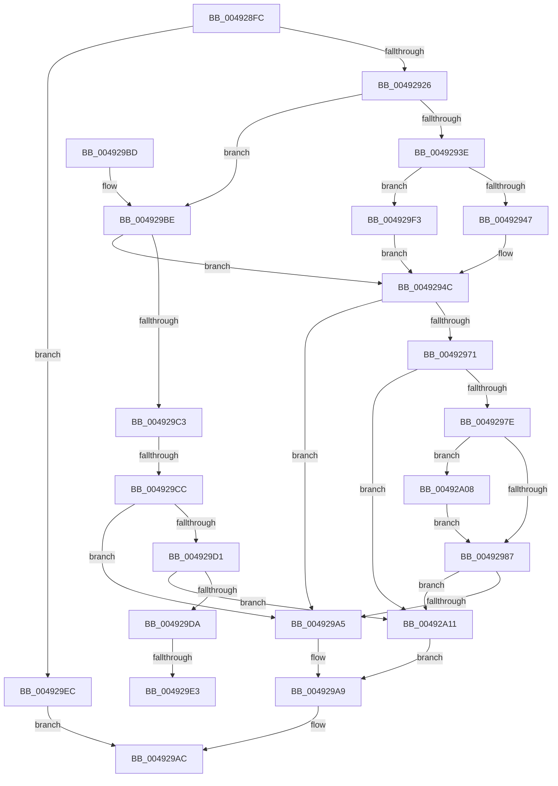

# EmonIsModifiedByBadActorInternalOriginal

- RVA: `0x004928FC`–`0x00492A16` (길이 `282` bytes)
- VA: `0x00000001404928FC`
- 실행 섹션: `.text`
- PDB 이름 있음: `예`; PDB Function 태그: `예`
- unwind 정보 RVA: `0x000B2F48`
- 디코드: `75`개 명령, `282/282` bytes 표시
- 미해석 바이트: `0` (있으면 어셈블리에 `.byte`로 보존)

> 이 문서는 커널 이미지의 기계어와 PDB 기호를 분석해 생성했습니다. 4번과 5번은 함수 원형과 자료형을 바이너리 사용 방식에서 추정한 C 해석이며 원본 소스 복구 결과는 아닙니다.

## 1. Dependencies

- 직접 호출 지점: **0**; 고유 호출 대상: **0**
- 직접 호출자로 확인된 함수: **3**
- RIP 상대 이미지 참조: **1**

### Outgoing calls
- 직접 디코드된 call 명령이 없습니다.

### Direct callers
- [EmonIsModifiedByBadActorOriginal](EmonIsModifiedByBadActorOriginal_function_00492850.md) at `0x004928A9`
- [EmonOverflowHandlerInternalV1Original](../55/EmonOverflowHandlerInternalV1Original_function_0055DCD8.md) at `0x0055E068`
- [EmonOverflowHandlerInternalV2Original](../55/EmonOverflowHandlerInternalV2Original_function_0055E5BC.md) at `0x0055E9A3`

### Static image references
- `0x00492971` → RVA `0x00F8FDE0` (`.data`; read)

## 2. Other-region calls and transfers

- 다른 실행 섹션으로 향하는 call: **0**
- call이 아닌 외부 분기/꼬리 이동: **3**
  - `0x004929C6` → [sub_006F70DA + 0x33](../6F/Unknown_function_006F70DA.md) (`tail-transfer`)
  - `0x004929DD` → [sub_006F70DA](../6F/Unknown_function_006F70DA.md) (`tail-transfer`)
  - `0x004929E7` → [sub_006F70DA](../6F/Unknown_function_006F70DA.md) (`tail-transfer`)

## 3. Assembly (complete function range)

```asm
004928FC  48 89 5C 24 08                  mov qword ptr [rsp + 8], rbx
00492901  48 89 6C 24 18                  mov qword ptr [rsp + 0x18], rbp
00492906  48 89 74 24 20                  mov qword ptr [rsp + 0x20], rsi
0049290B  57                              push rdi
0049290C  8B 3A                           mov edi, dword ptr [rdx]
0049290E  45 33 D2                        xor r10d, r10d
00492911  49 8B E8                        mov rbp, r8
00492914  48 8B DA                        mov rbx, rdx
00492917  41 8B F2                        mov esi, r10d
0049291A  44 8B D9                        mov r11d, ecx
0049291D  3B 4A 04                        cmp ecx, dword ptr [rdx + 4]
00492920  0F 83 C6 00 00 00               jae 0x1404929ec
00492926  48 8B 4A 10                     mov rcx, qword ptr [rdx + 0x10]
0049292A  4F 8D 04 5B                     lea r8, [r11 + r11*2]
0049292E  4D 03 C0                        add r8, r8
00492931  42 8B 54 C1 18                  mov edx, dword ptr [rcx + r8*8 + 0x18]
00492936  85 D2                           test edx, edx
00492938  0F 85 80 00 00 00               jne 0x1404929be
0049293E  83 FF 01                        cmp edi, 1
00492941  0F 84 AC 00 00 00               je 0x1404929f3
00492947  BE 00 00 10 00                  mov esi, 0x100000
0049294C  0F AE E8                        lfence
0049294F  48 8B 43 10                     mov rax, qword ptr [rbx + 0x10]
00492953  48 8B D6                        mov rdx, rsi
00492956  48 0F BA EA 16                  bts rdx, 0x16
0049295B  83 FF 01                        cmp edi, 1
0049295E  4A 8B 4C C0 10                  mov rcx, qword ptr [rax + r8*8 + 0x10]
00492963  48 0F 44 D6                     cmove rdx, rsi
00492967  8B 01                           mov eax, dword ptr [rcx]
00492969  48 0B D0                        or rdx, rax
0049296C  48 3B EA                        cmp rbp, rdx
0049296F  75 34                           jne 0x1404929a5
00492971  83 3D 68 D4 AF 00 02            cmp dword ptr [rip + 0xafd468], 2
00492978  0F 82 93 00 00 00               jb 0x140492a11
0049297E  83 3B 01                        cmp dword ptr [rbx], 1
00492981  0F 84 81 00 00 00               je 0x140492a08
00492987  B9 8F 03 00 00                  mov ecx, 0x38f
0049298C  0F 32                           rdmsr
0049298E  48 C1 E2 20                     shl rdx, 0x20
00492992  41 8B CB                        mov ecx, r11d
00492995  48 0B D0                        or rdx, rax
00492998  B8 01 00 00 00                  mov eax, 1
0049299D  48 D3 E0                        shl rax, cl
004929A0  48 85 D0                        test rax, rdx
004929A3  75 6C                           jne 0x140492a11
004929A5  41 C6 01 01                     mov byte ptr [r9], 1
004929A9  41 8B C2                        mov eax, r10d
004929AC  48 8B 5C 24 10                  mov rbx, qword ptr [rsp + 0x10]
004929B1  48 8B 6C 24 20                  mov rbp, qword ptr [rsp + 0x20]
004929B6  48 8B 74 24 28                  mov rsi, qword ptr [rsp + 0x28]
004929BB  5F                              pop rdi
004929BC  C3                              ret
004929BD  CC                              int3
004929BE  83 EA 01                        sub edx, 1
004929C1  74 89                           je 0x14049294c
004929C3  83 FA 01                        cmp edx, 1
004929C6  0F 84 41 47 26 00               je 0x1406f710d
004929CC  48 85 ED                        test rbp, rbp
004929CF  75 D4                           jne 0x1404929a5
004929D1  83 3D 08 D4 AF 00 02            cmp dword ptr [rip + 0xafd408], 2
004929D8  72 37                           jb 0x140492a11
004929DA  83 FF 01                        cmp edi, 1
004929DD  0F 85 F7 46 26 00               jne 0x1406f70da
004929E3  41 83 C3 20                     add r11d, 0x20
004929E7  E9 EE 46 26 00                  jmp 0x1406f70da
004929EC  B8 EF 00 00 C0                  mov eax, 0xc00000ef
004929F1  EB B9                           jmp 0x1404929ac
004929F3  42 8D 0C 9D 00 00 00 00         lea ecx, [r11*4]
004929FB  BE 08 00 00 00                  mov esi, 8
00492A00  48 D3 E6                        shl rsi, cl
00492A03  E9 44 FF FF FF                  jmp 0x14049294c
00492A08  41 83 C3 20                     add r11d, 0x20
00492A0C  E9 76 FF FF FF                  jmp 0x140492987
00492A11  45 88 11                        mov byte ptr [r9], r10b
00492A14  EB 93                           jmp 0x1404929a9
```

## 4. C-style interpretation (structured pseudocode)

```c
__int64 __fastcall EmonIsModifiedByBadActorInternalOriginal(int a1, __int64 a2, __int64 a3, __int64 a4)
{
    __int64 result;
    __int64 v_r10;
    __int64 v_r11;
    __int64 v_rsi;
    unsigned __int64 v_stack_p18;
    unsigned __int64 v_stack_p20;
    unsigned __int64 v_stack_p8;

    v_stack_p8 = v_rbx;
    v_stack_p18 = v_rbp;
    v_stack_p20 = v_rsi;
    v_r10 = 0;
    if (a1 >= (*(unsigned int *)(a2 + 4))) goto loc_004929EC;
    a3 = ((unsigned int)(a1) + (unsigned int)(a1) * 2) + ((unsigned int)(a1) + (unsigned int)(a1) * 2);
    if ((unsigned int)((unsigned int)(*(unsigned int *)(*(unsigned __int64 *)(a2 + 16) + a3 * 8 + 24))) != 0) goto loc_004929BE;
    if (((unsigned int)((unsigned int)(*(unsigned int *)(a2)))) == 1) goto loc_004929F3;
loc_0049294C:
    a2 = (unsigned int)(0x100000ULL);
    if (((unsigned int)((unsigned int)(*(unsigned int *)(a2)))) == 1) { a2 = (unsigned int)(0x100000ULL); }
    a2 = (a2) | ((unsigned int)(*(unsigned int *)(*(unsigned __int64 *)(*(unsigned __int64 *)(a2 + 16) + a3 * 8 + 16))));
    if (a3 != a2) goto loc_004929A5;
    if ((*(unsigned int *)(v_rip + 11523176)) < 2) goto loc_00492A11;
    if ((*(unsigned int *)(a2)) == 1) goto loc_00492A08;
loc_00492987:
    a2 = (a2) << (32);
    a2 = (a2) | ((unsigned int)(*(unsigned int *)(*(unsigned __int64 *)(*(unsigned __int64 *)(a2 + 16) + a3 * 8 + 16))));
    result = (1) << ((unsigned __int8)((unsigned int)((unsigned int)((unsigned int)(a1)))));
    if (((result) & (a2)) != 0) goto loc_00492A11;
loc_004929A5:
    *(unsigned __int8 *)(a4) = 1;
loc_004929A9:
loc_004929AC:
    return 0;
loc_004929BE:
    a2 = (unsigned int)((a2) - (1));
    if (condition_is_equal) goto loc_0049294C;
    if (v_stack_p18 != 0) goto loc_004929A5;
    if ((*(unsigned int *)(v_rip + 11523080)) < 2) goto loc_00492A11;
    v_r11 = (unsigned int)(((unsigned int)(a1)) + (32));
loc_004929EC:
    goto loc_004929AC;
loc_004929F3:
    v_rsi = (8) << ((unsigned __int8)(v_r11 * 4));
    goto loc_0049294C;
loc_00492A08:
    v_r11 = (unsigned int)((v_r11) + (32));
    goto loc_00492987;
loc_00492A11:
    *(unsigned __int8 *)(a4) = 0;
    goto loc_004929A9;
}
```

## 5. (Beta) C Style

```c
int64_t EmonIsModifiedByBadActorInternalOriginal(void *Arg1, void *Arg2, int64_t Arg3, void *Arg4)
{
    uint8_t *arg1 = (uint8_t *)Arg1;
    uint8_t *arg2 = (uint8_t *)Arg2;
    uint8_t *arg4 = (uint8_t *)Arg4;

    int64_t result;
    int64_t local_r10;
    int64_t local_r11;
    int64_t local_rsi;
    uint64_t v_stack_p18;
    uint64_t v_stack_p20;
    uint64_t v_stack_p8;

    v_stack_p8 = local_rbx;
    v_stack_p18 = local_rbp;
    v_stack_p20 = local_rsi;
    local_r10 = 0;
    if (Arg1 >= (*(uint32_t *)(arg2 + 0x4))) goto loc_004929EC;
    Arg3 = ((uint32_t)(Arg1) + (uint32_t)(Arg1) * 2) + ((uint32_t)(Arg1) + (uint32_t)(Arg1) * 2);
    if ((uint32_t)((uint32_t)(*(uint32_t *)(*(uint64_t *)(arg2 + 0x10) + Arg3 * 8 + 0x18))) != 0) goto loc_004929BE;
    if (((uint32_t)((uint32_t)(*(uint32_t *)(arg2)))) == 1) goto loc_004929F3;
loc_0049294C:
    Arg2 = (uint32_t)(0x100000ULL);
    if (((uint32_t)((uint32_t)(*(uint32_t *)(arg2)))) == 1) { Arg2 = (uint32_t)(0x100000ULL); }
    Arg2 = (Arg2) | ((uint32_t)(*(uint32_t *)(*(uint64_t *)(*(uint64_t *)(arg2 + 0x10) + Arg3 * 8 + 0x10))));
    if (Arg3 != Arg2) goto loc_004929A5;
    if ((*(uint32_t *)(v_rip + 0xAFD468)) < 2) goto loc_00492A11;
    if ((*(uint32_t *)(arg2)) == 1) goto loc_00492A08;
loc_00492987:
    Arg2 = (Arg2) << (32);
    Arg2 = (Arg2) | ((uint32_t)(*(uint32_t *)(*(uint64_t *)(*(uint64_t *)(arg2 + 0x10) + Arg3 * 8 + 0x10))));
    result = (1) << ((uint8_t)((uint32_t)((uint32_t)((uint32_t)(Arg1)))));
    if (((result) & (Arg2)) != 0) goto loc_00492A11;
loc_004929A5:
    *(uint8_t *)(arg4) = 1;
loc_004929A9:
loc_004929AC:
    return 0;
loc_004929BE:
    Arg2 = (uint32_t)((Arg2) - (1));
    if (condition_is_equal) goto loc_0049294C;
    if (v_stack_p18 != 0) goto loc_004929A5;
    if ((*(uint32_t *)(v_rip + 0xAFD408)) < 2) goto loc_00492A11;
    local_r11 = (uint32_t)(((uint32_t)(Arg1)) + (32));
loc_004929EC:
    goto loc_004929AC;
loc_004929F3:
    local_rsi = (8) << ((uint8_t)(local_r11 * 4));
    goto loc_0049294C;
loc_00492A08:
    local_r11 = (uint32_t)((local_r11) + (32));
    goto loc_00492987;
loc_00492A11:
    *(uint8_t *)(arg4) = 0;
    goto loc_004929A9;
}
```

### 관측된 메모리 오프셋

구조체 형식이 확인되지 않은 접근은 인자 기준의 오프셋으로만 기록했습니다.

| 기준 인자 | 오프셋 표현 | 폭 (bit) | 접근 |
|---|---:|---:|---|
| `Arg1` | `+ 0x0 + r11*2` | `64` | `R` |
| `Arg2` | `+ 0x0` | `32` | `R` |
| `Arg2` | `+ 0x4` | `32` | `R` |
| `Arg2` | `+ 0x10` | `64` | `R` |
| `Arg4` | `+ 0x0` | `8` | `W` |

## 6. Execution-region graph

[열기: 2D/3D 그래프와 함수 탐색 컨트롤 패널](../../../control-panel.html?section=text&rva=0x004928FC&view=graph)

- 2D 그래프는 위에서 아래로 흐르고, 3D 그래프는 빈 공간을 드래그해 회전합니다. Shift+드래그는 이동, 휠은 확대·축소, 함수 노드 선택은 대상 보고서 이동입니다.

### Static fallback


