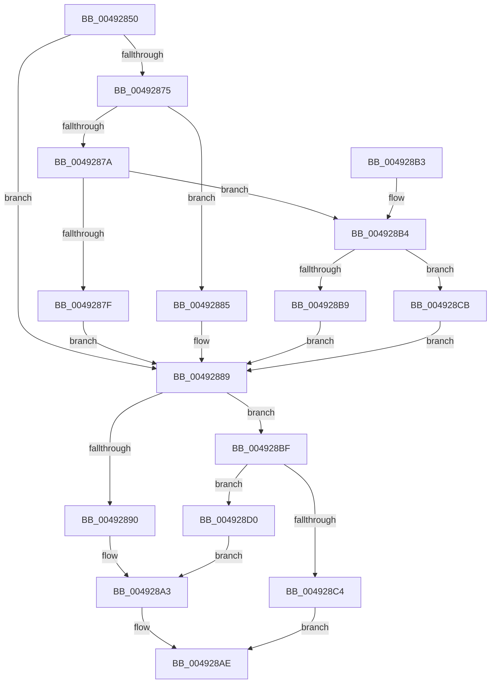

# EmonIsModifiedByBadActorOriginal

- RVA: `0x00492850`–`0x004928F6` (길이 `166` bytes)
- VA: `0x0000000140492850`
- 실행 섹션: `.text`
- PDB 이름 있음: `예`; PDB Function 태그: `아니요`
- unwind 정보 RVA: `0x00067BB4`
- 디코드: `50`개 명령, `166/166` bytes 표시
- 미해석 바이트: `0` (있으면 어셈블리에 `.byte`로 보존)

> 이 문서는 커널 이미지의 기계어와 PDB 기호를 분석해 생성했습니다. 4번과 5번은 함수 원형과 자료형을 바이너리 사용 방식에서 추정한 C 해석이며 원본 소스 복구 결과는 아닙니다.

## 1. Dependencies

- 직접 호출 지점: **1**; 고유 호출 대상: **1**
- 직접 호출자로 확인된 함수: **0**
- RIP 상대 이미지 참조: **1**

### Outgoing calls
- `0x004928A9` → [EmonIsModifiedByBadActorInternalOriginal](EmonIsModifiedByBadActorInternalOriginal_function_004928FC.md) (function, `0x004928FC`)

### Direct callers
- 이 함수 시작 RVA로 연결되는 직접 call은 확인되지 않았습니다. 간접 호출은 완전히 역산할 수 없습니다.

### Static image references
- `0x0049285F` → RVA `0x00FC8C40` (`ALMOSTRO`; read)

## 2. Other-region calls and transfers

- 다른 실행 섹션으로 향하는 call: **0**
- 별도 외부 분기/꼬리 이동을 확인하지 못했습니다.

## 3. Assembly (complete function range)

```asm
00492850  48 83 EC 28                     sub rsp, 0x28
00492854  65 8B 04 25 A4 01 00 00         mov eax, dword ptr gs:[0x1a4]
0049285C  44 8B D9                        mov r11d, ecx
0049285F  48 8D 0D DA 63 B3 00            lea rcx, [rip + 0xb363da]
00492866  4D 8B C8                        mov r9, r8
00492869  48 8B 04 C1                     mov rax, qword ptr [rcx + rax*8]
0049286D  4C 8B 50 58                     mov r10, qword ptr [rax + 0x58]
00492871  85 D2                           test edx, edx
00492873  74 14                           je 0x140492889
00492875  83 EA 01                        sub edx, 1
00492878  74 0B                           je 0x140492885
0049287A  83 EA 63                        sub edx, 0x63
0049287D  75 35                           jne 0x1404928b4
0049287F  49 83 C2 30                     add r10, 0x30
00492883  EB 04                           jmp 0x140492889
00492885  49 83 C2 18                     add r10, 0x18
00492889  41 8B 0A                        mov ecx, dword ptr [r10]
0049288C  85 C9                           test ecx, ecx
0049288E  75 2F                           jne 0x1404928bf
00492890  41 8D 8B 86 01 00 00            lea ecx, [r11 + 0x186]
00492897  0F 32                           rdmsr
00492899  48 C1 E2 20                     shl rdx, 0x20
0049289D  48 0B C2                        or rax, rdx
004928A0  4C 8B C0                        mov r8, rax
004928A3  49 8B D2                        mov rdx, r10
004928A6  41 8B CB                        mov ecx, r11d
004928A9  E8 4E 00 00 00                  call 0x1404928fc
004928AE  48 83 C4 28                     add rsp, 0x28
004928B2  C3                              ret
004928B3  CC                              int3
004928B4  83 FA 01                        cmp edx, 1
004928B7  75 12                           jne 0x1404928cb
004928B9  49 83 C2 48                     add r10, 0x48
004928BD  EB CA                           jmp 0x140492889
004928BF  83 F9 01                        cmp ecx, 1
004928C2  74 0C                           je 0x1404928d0
004928C4  B8 F0 00 00 C0                  mov eax, 0xc00000f0
004928C9  EB E3                           jmp 0x1404928ae
004928CB  45 33 D2                        xor r10d, r10d
004928CE  EB B9                           jmp 0x140492889
004928D0  B9 8D 03 00 00                  mov ecx, 0x38d
004928D5  0F 32                           rdmsr
004928D7  48 C1 E2 20                     shl rdx, 0x20
004928DB  42 8D 0C 9D 00 00 00 00         lea ecx, [r11*4]
004928E3  48 0B C2                        or rax, rdx
004928E6  4C 8B C0                        mov r8, rax
004928E9  B8 0F 00 00 00                  mov eax, 0xf
004928EE  48 D3 E0                        shl rax, cl
004928F1  4C 23 C0                        and r8, rax
004928F4  EB AD                           jmp 0x1404928a3
```

## 4. C-style interpretation (structured pseudocode)

```c
__int64 __fastcall EmonIsModifiedByBadActorOriginal(int a1, int a2, __int64 a3)
{
    __int64 result;
    __int64 v_r10;
    __int64 v_rsp;

    v_rsp = (v_rsp) - (40);
    if (a2 == 0) goto loc_00492889;
    a2 = (unsigned int)((a2) - (1));
    if (condition_is_equal) goto loc_00492885;
    a2 = (unsigned int)((a2) - (99));
    if (condition_is_not_equal) goto loc_004928B4;
    v_r10 = (*(unsigned __int64 *)(*(unsigned __int64 *)(v_rip + 11756506 + (unsigned int)(*(unsigned int *)(gs_base + (0 + 420))) * 8) + 88)) + (48);
    goto loc_00492889;
loc_00492885:
    v_r10 = (v_r10) + (24);
loc_00492889:
    if ((unsigned int)((unsigned int)(*(unsigned int *)(v_r10))) != 0) goto loc_004928BF;
    a2 = (a2) << (32);
    result = (*(unsigned __int64 *)(v_rip + 11756506 + (unsigned int)(*(unsigned int *)(gs_base + (0 + 420))) * 8)) | (a2);
loc_004928A3:
    result = EmonIsModifiedByBadActorInternalOriginal((unsigned int)((unsigned int)((unsigned int)(a1))), v_r10, result, a3);
loc_004928AE:
    v_rsp = (v_rsp) + (40);
    return result;
loc_004928B4:
    if (((unsigned int)(v_r10)) != 1) goto loc_004928CB;
    v_r10 = (v_r10) + (72);
    goto loc_00492889;
loc_004928BF:
    if (((unsigned int)((unsigned int)((unsigned int)((unsigned int)(a1))))) == 1) goto loc_004928D0;
    goto loc_004928AE;
loc_004928CB:
    v_r10 = 0;
    goto loc_00492889;
loc_004928D0:
    a2 = (v_r10) << (32);
    result = ((unsigned int)(0xC00000F0ULL)) | (a2);
    result = (15) << ((unsigned __int8)((unsigned int)(a1) * 4));
    a3 = (result) & (result);
    goto loc_004928A3;
}
```

## 5. (Beta) C Style

```c
int64_t EmonIsModifiedByBadActorOriginal(void *Arg1, int32_t Arg2, int64_t Arg3)
{
    uint8_t *arg1 = (uint8_t *)Arg1;

    int64_t result;
    int64_t local_r10;
    int64_t local_rsp;

    local_rsp = (local_rsp) - (40);
    if (Arg2 == 0) goto loc_00492889;
    Arg2 = (uint32_t)((Arg2) - (1));
    if (condition_is_equal) goto loc_00492885;
    Arg2 = (uint32_t)((Arg2) - (99));
    if (condition_is_not_equal) goto loc_004928B4;
    local_r10 = (*(uint64_t *)(*(uint64_t *)(v_rip + 0xB363DA + (uint32_t)(*(uint32_t *)(gs_base + (0 + 0x1A4))) * 8) + 0x58)) + (48);
    goto loc_00492889;
loc_00492885:
    local_r10 = (local_r10) + (24);
loc_00492889:
    if ((uint32_t)((uint32_t)(*(uint32_t *)(local_r10))) != 0) goto loc_004928BF;
    Arg2 = (Arg2) << (32);
    result = (*(uint64_t *)(v_rip + 0xB363DA + (uint32_t)(*(uint32_t *)(gs_base + (0 + 0x1A4))) * 8)) | (Arg2);
loc_004928A3:
    result = EmonIsModifiedByBadActorInternalOriginal((uint32_t)((uint32_t)((uint32_t)(Arg1))), local_r10, result, Arg3);
loc_004928AE:
    local_rsp = (local_rsp) + (40);
    return result;
loc_004928B4:
    if (((uint32_t)(local_r10)) != 1) goto loc_004928CB;
    local_r10 = (local_r10) + (72);
    goto loc_00492889;
loc_004928BF:
    if (((uint32_t)((uint32_t)((uint32_t)((uint32_t)(Arg1))))) == 1) goto loc_004928D0;
    goto loc_004928AE;
loc_004928CB:
    local_r10 = 0;
    goto loc_00492889;
loc_004928D0:
    Arg2 = (local_r10) << (32);
    result = ((uint32_t)(0xC00000F0ULL)) | (Arg2);
    result = (15) << ((uint8_t)((uint32_t)(Arg1) * 4));
    Arg3 = (result) & (result);
    goto loc_004928A3;
}
```

### 관측된 메모리 오프셋

구조체 형식이 확인되지 않은 접근은 인자 기준의 오프셋으로만 기록했습니다.

| 기준 인자 | 오프셋 표현 | 폭 (bit) | 접근 |
|---|---:|---:|---|
| `Arg1` | `+ 0x186` | `32` | `R` |

## 6. Execution-region graph

[열기: 2D/3D 그래프와 함수 탐색 컨트롤 패널](../../../control-panel.html?section=text&rva=0x00492850&view=graph)

- 2D 그래프는 위에서 아래로 흐르고, 3D 그래프는 빈 공간을 드래그해 회전합니다. Shift+드래그는 이동, 휠은 확대·축소, 함수 노드 선택은 대상 보고서 이동입니다.

### Static fallback


