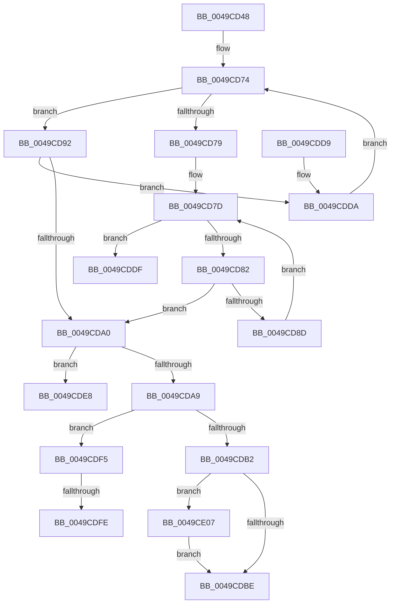

# EmpUpdateRuleState

- RVA: `0x0049CD48`–`0x0049CE11` (길이 `201` bytes)
- VA: `0x000000014049CD48`
- 실행 섹션: `.text`
- PDB 이름 있음: `예`; PDB Function 태그: `예`
- unwind 정보 RVA: `0x00092B0C`
- 디코드: `58`개 명령, `201/201` bytes 표시
- 미해석 바이트: `0` (있으면 어셈블리에 `.byte`로 보존)

> 이 문서는 커널 이미지의 기계어와 PDB 기호를 분석해 생성했습니다. 4번과 5번은 함수 원형과 자료형을 바이너리 사용 방식에서 추정한 C 해석이며 원본 소스 복구 결과는 아닙니다.

## 1. Dependencies

- 직접 호출 지점: **1**; 고유 호출 대상: **1**
- 직접 호출자로 확인된 함수: **3**
- RIP 상대 이미지 참조: **0**

### Outgoing calls
- `0x0049CE0A` → [EmpRuleStateChangeNotify](../58/EmpRuleStateChangeNotify_function_00580AC4.md) (function, `0x00580AC4`)

### Direct callers
- [EmpRuleUpdateWorkerThread](../58/EmpRuleUpdateWorkerThread_function_00580B20.md) at `0x00580BF2`
- [sub_006F7FE4](../6F/Unknown_function_006F7FE4.md) at `0x006F8006`
- [EmClientQueryRuleState](../../pagelk/B7/EmClientQueryRuleState_function_00B77D70.md) at `0x00B77E14`

### Static image references
- 디코드된 RIP-relative 메모리 참조가 없습니다.

## 2. Other-region calls and transfers

- 다른 실행 섹션으로 향하는 call: **0**
- call이 아닌 외부 분기/꼬리 이동: **4**
  - `0x0049CDE3` → [sub_006F7FE4](../6F/Unknown_function_006F7FE4.md) (`tail-transfer`)
  - `0x0049CDF0` → [sub_006F7FE4 + 0x2A](../6F/Unknown_function_006F7FE4.md) (`tail-transfer`)
  - `0x0049CDF8` → [sub_006F7FE4 + 0x34](../6F/Unknown_function_006F7FE4.md) (`tail-transfer`)
  - `0x0049CE02` → [sub_006F7FE4 + 0x34](../6F/Unknown_function_006F7FE4.md) (`tail-transfer`)

## 3. Assembly (complete function range)

```asm
0049CD48  48 8B C4                        mov rax, rsp
0049CD4B  48 89 58 08                     mov qword ptr [rax + 8], rbx
0049CD4F  48 89 68 10                     mov qword ptr [rax + 0x10], rbp
0049CD53  48 89 70 18                     mov qword ptr [rax + 0x18], rsi
0049CD57  48 89 78 20                     mov qword ptr [rax + 0x20], rdi
0049CD5B  41 56                           push r14
0049CD5D  48 83 EC 20                     sub rsp, 0x20
0049CD61  8B 69 10                        mov ebp, dword ptr [rcx + 0x10]
0049CD64  4C 8B F2                        mov r14, rdx
0049CD67  44 8B 49 30                     mov r9d, dword ptr [rcx + 0x30]
0049CD6B  48 8B D9                        mov rbx, rcx
0049CD6E  40 B7 01                        mov dil, 1
0049CD71  45 33 C0                        xor r8d, r8d
0049CD74  45 3B C1                        cmp r8d, r9d
0049CD77  72 19                           jb 0x14049cd92
0049CD79  48 8B 4B 40                     mov rcx, qword ptr [rbx + 0x40]
0049CD7D  48 85 C9                        test rcx, rcx
0049CD80  74 5D                           je 0x14049cddf
0049CD82  48 8B 41 F8                     mov rax, qword ptr [rcx - 8]
0049CD86  48 83 78 10 00                  cmp qword ptr [rax + 0x10], 0
0049CD8B  74 13                           je 0x14049cda0
0049CD8D  48 8B 09                        mov rcx, qword ptr [rcx]
0049CD90  EB EB                           jmp 0x14049cd7d
0049CD92  48 8B 43 38                     mov rax, qword ptr [rbx + 0x38]
0049CD96  4A 8B 0C C0                     mov rcx, qword ptr [rax + r8*8]
0049CD9A  83 79 10 00                     cmp dword ptr [rcx + 0x10], 0
0049CD9E  7F 3A                           jg 0x14049cdda
0049CDA0  40 32 FF                        xor dil, dil
0049CDA3  40 38 7B 14                     cmp byte ptr [rbx + 0x14], dil
0049CDA7  75 3F                           jne 0x14049cde8
0049CDA9  40 88 7B 14                     mov byte ptr [rbx + 0x14], dil
0049CDAD  40 84 FF                        test dil, dil
0049CDB0  75 43                           jne 0x14049cdf5
0049CDB2  C7 43 10 01 00 00 00            mov dword ptr [rbx + 0x10], 1
0049CDB9  39 6B 10                        cmp dword ptr [rbx + 0x10], ebp
0049CDBC  75 49                           jne 0x14049ce07
0049CDBE  48 8B 5C 24 30                  mov rbx, qword ptr [rsp + 0x30]
0049CDC3  48 8B 6C 24 38                  mov rbp, qword ptr [rsp + 0x38]
0049CDC8  48 8B 74 24 40                  mov rsi, qword ptr [rsp + 0x40]
0049CDCD  48 8B 7C 24 48                  mov rdi, qword ptr [rsp + 0x48]
0049CDD2  48 83 C4 20                     add rsp, 0x20
0049CDD6  41 5E                           pop r14
0049CDD8  C3                              ret
0049CDD9  CC                              int3
0049CDDA  41 FF C0                        inc r8d
0049CDDD  EB 95                           jmp 0x14049cd74
0049CDDF  48 8B 4B 48                     mov rcx, qword ptr [rbx + 0x48]
0049CDE3  E9 FC B1 25 00                  jmp 0x1406f7fe4
0049CDE8  48 8B 73 20                     mov rsi, qword ptr [rbx + 0x20]
0049CDEC  40 88 7B 14                     mov byte ptr [rbx + 0x14], dil
0049CDF0  E9 19 B2 25 00                  jmp 0x1406f800e
0049CDF5  83 FD 01                        cmp ebp, 1
0049CDF8  0F 85 1A B2 25 00               jne 0x1406f8018
0049CDFE  83 63 10 00                     and dword ptr [rbx + 0x10], 0
0049CE02  E9 11 B2 25 00                  jmp 0x1406f8018
0049CE07  48 8B CB                        mov rcx, rbx
0049CE0A  E8 B5 3C 0E 00                  call 0x140580ac4
0049CE0F  EB AD                           jmp 0x14049cdbe
```

## 4. C-style interpretation (structured pseudocode)

```c
__int64 __fastcall EmpUpdateRuleState(__int64 a1, __int64 a2, int a3)
{
    __int64 result;
    __int64 v_rdi;
    __int64 v_rsp;
    unsigned __int64 v_stack_p10;
    unsigned __int64 v_stack_p18;
    unsigned __int64 v_stack_p20;
    unsigned __int64 v_stack_p8;

    *(unsigned __int64 *)(v_rsp + 8) = v_rbx;
    *(unsigned __int64 *)(v_rsp + 16) = v_rbp;
    *(unsigned __int64 *)(v_rsp + 24) = v_rsi;
    *(unsigned __int64 *)(v_rsp + 32) = v_rdi;
    v_rsp = (v_rsp) - (32);
    a3 = 0;
loc_0049CD74:
    if (0 < ((unsigned int)((unsigned int)(*(unsigned int *)(a1 + 48))))) goto loc_0049CD92;
loc_0049CD7D:
    if (*(unsigned __int64 *)(a1 + 64) == 0) goto loc_0049CDDF;
    if ((*(unsigned __int64 *)(*(unsigned __int64 *)(*(unsigned __int64 *)(a1 + 64) - 8) + 16)) == 0) goto loc_0049CDA0;
    goto loc_0049CD7D;
loc_0049CD92:
    if ((*(unsigned int *)(*(unsigned __int64 *)(*(unsigned __int64 *)(a1 + 56) + a3 * 8) + 16)) > 0) goto loc_0049CDDA;
loc_0049CDA0:
    v_rdi = 0;
    if ((*(unsigned __int8 *)(a1 + 20)) != 0) goto loc_0049CDE8;
    *(unsigned __int8 *)(a1 + 20) = 0;
    if (0 != 0) goto loc_0049CDF5;
    *(unsigned int *)(a1 + 16) = 1;
    if ((*(unsigned int *)(a1 + 16)) != ((unsigned int)((unsigned int)(*(unsigned int *)(a1 + 16))))) goto loc_0049CE07;
loc_0049CDBE:
    v_rsp = (v_rsp) + (32);
    return *(unsigned __int64 *)(a1 + 56);
loc_0049CDDA:
    a3 = (unsigned int)((a3) + 1);
    goto loc_0049CD74;
loc_0049CDDF:
loc_0049CDE8:
    *(unsigned __int8 *)(v_stack_p8 + 20) = (unsigned __int8)(v_stack_p20);
loc_0049CDF5:
loc_0049CE07:
    result = EmpRuleStateChangeNotify(v_stack_p8, a2, a3, (unsigned int)(*(unsigned int *)(a1 + 48)));
    goto loc_0049CDBE;
}
```

## 5. (Beta) C Style

```c
int64_t EmpUpdateRuleState(void *Arg1, int64_t Arg2, int32_t Arg3)
{
    uint8_t *arg1 = (uint8_t *)Arg1;

    int64_t result;
    int64_t local_rdi;
    int64_t local_rsp;
    uint64_t v_stack_p10;
    uint64_t v_stack_p18;
    uint64_t v_stack_p20;
    uint64_t v_stack_p8;

    *(uint64_t *)(local_rsp + 0x8) = local_rbx;
    *(uint64_t *)(local_rsp + 0x10) = local_rbp;
    *(uint64_t *)(local_rsp + 0x18) = local_rsi;
    *(uint64_t *)(local_rsp + 0x20) = local_rdi;
    local_rsp = (local_rsp) - (32);
    Arg3 = 0;
loc_0049CD74:
    if (0 < ((uint32_t)((uint32_t)(*(uint32_t *)(arg1 + 0x30))))) goto loc_0049CD92;
loc_0049CD7D:
    if (*(uint64_t *)(arg1 + 0x40) == 0) goto loc_0049CDDF;
    if ((*(uint64_t *)(*(uint64_t *)(*(uint64_t *)(arg1 + 0x40) - 0x8) + 0x10)) == 0) goto loc_0049CDA0;
    goto loc_0049CD7D;
loc_0049CD92:
    if ((*(uint32_t *)(*(uint64_t *)(*(uint64_t *)(arg1 + 0x38) + Arg3 * 8) + 0x10)) > 0) goto loc_0049CDDA;
loc_0049CDA0:
    local_rdi = 0;
    if ((*(uint8_t *)(arg1 + 0x14)) != 0) goto loc_0049CDE8;
    *(uint8_t *)(arg1 + 0x14) = 0;
    if (0 != 0) goto loc_0049CDF5;
    *(uint32_t *)(arg1 + 0x10) = 1;
    if ((*(uint32_t *)(arg1 + 0x10)) != ((uint32_t)((uint32_t)(*(uint32_t *)(arg1 + 0x10))))) goto loc_0049CE07;
loc_0049CDBE:
    local_rsp = (local_rsp) + (32);
    return *(uint64_t *)(arg1 + 0x38);
loc_0049CDDA:
    Arg3 = (uint32_t)((Arg3) + 1);
    goto loc_0049CD74;
loc_0049CDDF:
loc_0049CDE8:
    *(uint8_t *)(v_stack_p8 + 0x14) = (uint8_t)(v_stack_p20);
loc_0049CDF5:
loc_0049CE07:
    result = EmpRuleStateChangeNotify(v_stack_p8, Arg2, Arg3, (uint32_t)(*(uint32_t *)(arg1 + 0x30)));
    goto loc_0049CDBE;
}
```

### 관측된 메모리 오프셋

구조체 형식이 확인되지 않은 접근은 인자 기준의 오프셋으로만 기록했습니다.

| 기준 인자 | 오프셋 표현 | 폭 (bit) | 접근 |
|---|---:|---:|---|
| `Arg1` | `+ 0x10` | `32` | `R` |
| `Arg1` | `+ 0x10` | `32` | `R/W` |
| `Arg1` | `+ 0x10` | `32` | `W` |
| `Arg1` | `+ 0x14` | `8` | `R` |
| `Arg1` | `+ 0x14` | `8` | `W` |
| `Arg1` | `+ 0x20` | `64` | `R` |
| `Arg1` | `+ 0x30` | `32` | `R` |
| `Arg1` | `+ 0x38` | `64` | `R` |
| `Arg1` | `+ 0x40` | `64` | `R` |
| `Arg1` | `+ 0x48` | `64` | `R` |

## 6. Execution-region graph

[열기: 2D/3D 그래프와 함수 탐색 컨트롤 패널](../../../control-panel.html?section=text&rva=0x0049CD48&view=graph)

- 2D 그래프는 위에서 아래로 흐르고, 3D 그래프는 빈 공간을 드래그해 회전합니다. Shift+드래그는 이동, 휠은 확대·축소, 함수 노드 선택은 대상 보고서 이동입니다.

### Static fallback


