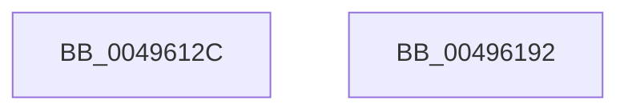

# EtwTraceProcessTerminate

- RVA: `0x0049612C`–`0x00496193` (길이 `103` bytes)
- VA: `0x000000014049612C`
- 실행 섹션: `.text`
- PDB 이름 있음: `예`; PDB Function 태그: `아니요`
- unwind 정보 RVA: `0x000B3A94`
- 디코드: `22`개 명령, `103/103` bytes 표시
- 미해석 바이트: `0` (있으면 어셈블리에 `.byte`로 보존)

> 이 문서는 커널 이미지의 기계어와 PDB 기호를 분석해 생성했습니다. 4번과 5번은 함수 원형과 자료형을 바이너리 사용 방식에서 추정한 C 해석이며 원본 소스 복구 결과는 아닙니다.

## 1. Dependencies

- 직접 호출 지점: **2**; 고유 호출 대상: **2**
- 직접 호출자로 확인된 함수: **1**
- RIP 상대 이미지 참조: **1**

### Outgoing calls
- `0x0049617B` → [EtwTraceKernelEvent](../23/EtwTraceKernelEvent_function_00235350.md) (function, `0x00235350`)
- `0x00496188` → [_security_check_cookie](../6A/_security_check_cookie_function_006AC640.md) (function, `0x006AC640`)

### Direct callers
- [PspTerminateProcess](../../page/90/PspTerminateProcess_function_00903FFC.md) at `0x00904064`

### Static image references
- `0x00496130` → RVA `0x00E0A740` (`.data`; read)

## 2. Other-region calls and transfers

- 다른 실행 섹션으로 향하는 call: **0**
- 별도 외부 분기/꼬리 이동을 확인하지 못했습니다.

## 3. Assembly (complete function range)

```asm
0049612C  48 83 EC 58                     sub rsp, 0x58
00496130  48 8B 05 09 46 97 00            mov rax, qword ptr [rip + 0x974609]
00496137  48 33 C4                        xor rax, rsp
0049613A  48 89 44 24 48                  mov qword ptr [rsp + 0x48], rax
0049613F  8B 81 D0 01 00 00               mov eax, dword ptr [rcx + 0x1d0]
00496145  BA 01 00 00 00                  mov edx, 1
0049614A  83 64 24 44 00                  and dword ptr [rsp + 0x44], 0
0049614F  48 8D 4C 24 38                  lea rcx, [rsp + 0x38]
00496154  89 44 24 30                     mov dword ptr [rsp + 0x30], eax
00496158  41 B9 0B 03 00 00               mov r9d, 0x30b
0049615E  48 8D 44 24 30                  lea rax, [rsp + 0x30]
00496163  C7 44 24 40 04 00 00 00         mov dword ptr [rsp + 0x40], 4
0049616B  44 8B C2                        mov r8d, edx
0049616E  48 89 44 24 38                  mov qword ptr [rsp + 0x38], rax
00496173  C7 44 24 20 02 19 60 00         mov dword ptr [rsp + 0x20], 0x601902
0049617B  E8 D0 F1 D9 FF                  call 0x140235350
00496180  48 8B 4C 24 48                  mov rcx, qword ptr [rsp + 0x48]
00496185  48 33 CC                        xor rcx, rsp
00496188  E8 B3 64 21 00                  call 0x1406ac640
0049618D  48 83 C4 58                     add rsp, 0x58
00496191  C3                              ret
00496192  CC                              int3
```

## 4. C-style interpretation (structured pseudocode)

```c
__int64 __fastcall EtwTraceProcessTerminate(__int64 a1)
{
    __int64 result;
    __int64 v_rsp;
    unsigned __int64 v_stack_m10;
    unsigned int v_stack_m14;
    unsigned int v_stack_m18;
    unsigned __int64 v_stack_m20;
    unsigned int v_stack_m28;
    unsigned int v_stack_m38;

    v_rsp = (v_rsp) - (88);
    result = (*(unsigned __int64 *)(v_rip + 9913865)) ^ (v_rsp);
    v_stack_m10 = result;
    v_stack_m28 = (unsigned int)((unsigned int)(*(unsigned int *)(a1 + 464)));
    v_stack_m18 = 4;
    v_stack_m20 = v_stack_m28;
    v_stack_m38 = 0x601902ULL;
    result = EtwTraceKernelEvent(v_stack_m20, 1, 1, 779);
    a1 = (v_stack_m10) ^ (v_rsp);
    result = _security_check_cookie(a1, 1, 1, 779);
    v_rsp = (v_rsp) + (88);
    return result;
}
```

## 5. (Beta) C Style

```c
int64_t EtwTraceProcessTerminate(void *Arg1)
{
    uint8_t *arg1 = (uint8_t *)Arg1;

    int64_t result;
    int64_t local_rsp;
    uint64_t v_stack_m10;
    uint32_t v_stack_m14;
    uint32_t v_stack_m18;
    uint64_t v_stack_m20;
    uint32_t v_stack_m28;
    uint32_t v_stack_m38;

    local_rsp = (local_rsp) - (88);
    result = (*(uint64_t *)(v_rip + 0x974609)) ^ (local_rsp);
    v_stack_m10 = result;
    v_stack_m28 = (uint32_t)((uint32_t)(*(uint32_t *)(arg1 + 0x1D0)));
    v_stack_m18 = 4;
    v_stack_m20 = v_stack_m28;
    v_stack_m38 = 0x601902ULL;
    result = EtwTraceKernelEvent(v_stack_m20, 1, 1, 779);
    Arg1 = (v_stack_m10) ^ (local_rsp);
    result = _security_check_cookie(Arg1, 1, 1, 779);
    local_rsp = (local_rsp) + (88);
    return result;
}
```

### 관측된 메모리 오프셋

구조체 형식이 확인되지 않은 접근은 인자 기준의 오프셋으로만 기록했습니다.

| 기준 인자 | 오프셋 표현 | 폭 (bit) | 접근 |
|---|---:|---:|---|
| `Arg1` | `+ 0x1D0` | `32` | `R` |

## 6. Execution-region graph

[열기: 2D/3D 그래프와 함수 탐색 컨트롤 패널](../../../control-panel.html?section=text&rva=0x0049612C&view=graph)

- 2D 그래프는 위에서 아래로 흐르고, 3D 그래프는 빈 공간을 드래그해 회전합니다. Shift+드래그는 이동, 휠은 확대·축소, 함수 노드 선택은 대상 보고서 이동입니다.

### Static fallback


