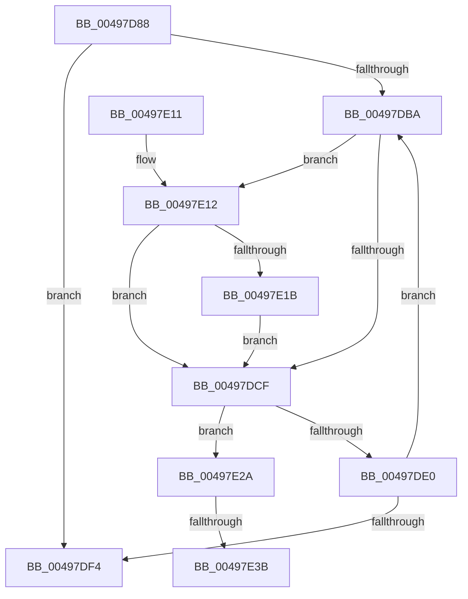

# EtwpCancelPendingApcs

- RVA: `0x00497D88`–`0x00497E4D` (길이 `197` bytes)
- VA: `0x0000000140497D88`
- 실행 섹션: `.text`
- PDB 이름 있음: `예`; PDB Function 태그: `예`
- unwind 정보 RVA: `0x000B3FAC`
- 디코드: `60`개 명령, `197/197` bytes 표시
- 미해석 바이트: `0` (있으면 어셈블리에 `.byte`로 보존)

> 이 문서는 커널 이미지의 기계어와 PDB 기호를 분석해 생성했습니다. 4번과 5번은 함수 원형과 자료형을 바이너리 사용 방식에서 추정한 C 해석이며 원본 소스 복구 결과는 아닙니다.

## 1. Dependencies

- 직접 호출 지점: **7**; 고유 호출 대상: **7**
- 직접 호출자로 확인된 함수: **1**
- RIP 상대 이미지 참조: **0**

### Outgoing calls
- `0x00497DAD` → [ExpInterlockedFlushSList](../6B/ExpInterlockedFlushSList_function_006BA5F0.md) (function, `0x006BA5F0`)
- `0x00497DC1` → [KeAcquireSpinLockRaiseToDpc](../20/KeAcquireSpinLockRaiseToDpc_function_00208470.md) (function, `0x00208470`)
- `0x00497DD6` → [KeReleaseSpinLock](../39/KeReleaseSpinLock_function_00392BA0.md) (function, `0x00392BA0`)
- `0x00497DEA` → [ExpInterlockedPushEntrySList](../6B/ExpInterlockedPushEntrySList_function_006BA5B0.md) (function, `0x006BA5B0`)
- `0x00497E23` → [ObfReferenceObjectWithTag](../21/ObfReferenceObjectWithTag_function_00210710.md) (function, `0x00210710`)
- `0x00497E2E` → [KeRemoveQueueApc](../3C/KeRemoveQueueApc_function_003C4820.md) (function, `0x003C4820`)
- `0x00497E42` → [EtwpFinalizePendingApc](../44/EtwpFinalizePendingApc_function_004486A4.md) (function, `0x004486A4`)

### Direct callers
- [EtwpFreeLoggerContext](../../page/9C/EtwpFreeLoggerContext_function_009C1688.md) at `0x009C16C0`
- [EtwpFreeLoggerContext](../../page/9C/EtwpFreeLoggerContext_function_009C1688.md) at `0x009C196A`

### Static image references
- 디코드된 RIP-relative 메모리 참조가 없습니다.

## 2. Other-region calls and transfers

- 다른 실행 섹션으로 향하는 call: **0**
- call이 아닌 외부 분기/꼬리 이동: **2**
  - `0x00497E35` → [sub_006F784A](../6F/Unknown_function_006F784A.md) (`tail-transfer`)
  - `0x00497E48` → [sub_006F784A](../6F/Unknown_function_006F784A.md) (`tail-transfer`)

## 3. Assembly (complete function range)

```asm
00497D88  48 89 5C 24 08                  mov qword ptr [rsp + 8], rbx
00497D8D  48 89 6C 24 10                  mov qword ptr [rsp + 0x10], rbp
00497D92  48 89 74 24 18                  mov qword ptr [rsp + 0x18], rsi
00497D97  57                              push rdi
00497D98  41 54                           push r12
00497D9A  41 55                           push r13
00497D9C  41 56                           push r14
00497D9E  41 57                           push r15
00497DA0  48 83 EC 20                     sub rsp, 0x20
00497DA4  48 8B E9                        mov rbp, rcx
00497DA7  33 FF                           xor edi, edi
00497DA9  48 83 C1 10                     add rcx, 0x10
00497DAD  E8 3E 28 22 00                  call 0x1406ba5f0
00497DB2  48 8B D8                        mov rbx, rax
00497DB5  48 85 C0                        test rax, rax
00497DB8  74 3A                           je 0x140497df4
00497DBA  48 8D 4D 08                     lea rcx, [rbp + 8]
00497DBE  4C 8B EB                        mov r13, rbx
00497DC1  E8 AA 06 D7 FF                  call 0x140208470
00497DC6  80 7B F2 00                     cmp byte ptr [rbx - 0xe], 0
00497DCA  44 8A E0                        mov r12b, al
00497DCD  75 43                           jne 0x140497e12
00497DCF  41 8A D4                        mov dl, r12b
00497DD2  48 8D 4D 08                     lea rcx, [rbp + 8]
00497DD6  E8 C5 AD EF FF                  call 0x140392ba0
00497DDB  48 85 FF                        test rdi, rdi
00497DDE  75 4A                           jne 0x140497e2a
00497DE0  48 8B 1B                        mov rbx, qword ptr [rbx]
00497DE3  48 8D 4D 10                     lea rcx, [rbp + 0x10]
00497DE7  49 8B D5                        mov rdx, r13
00497DEA  E8 C1 27 22 00                  call 0x1406ba5b0
00497DEF  48 85 DB                        test rbx, rbx
00497DF2  75 C6                           jne 0x140497dba
00497DF4  48 8B 5C 24 50                  mov rbx, qword ptr [rsp + 0x50]
00497DF9  48 8B 6C 24 58                  mov rbp, qword ptr [rsp + 0x58]
00497DFE  48 8B 74 24 60                  mov rsi, qword ptr [rsp + 0x60]
00497E03  48 83 C4 20                     add rsp, 0x20
00497E07  41 5F                           pop r15
00497E09  41 5E                           pop r14
00497E0B  41 5D                           pop r13
00497E0D  41 5C                           pop r12
00497E0F  5F                              pop rdi
00497E10  C3                              ret
00497E11  CC                              int3
00497E12  48 8B 4B A8                     mov rcx, qword ptr [rbx - 0x58]
00497E16  48 85 C9                        test rcx, rcx
00497E19  74 B4                           je 0x140497dcf
00497E1B  BA 44 66 6C 74                  mov edx, 0x746c6644
00497E20  48 8B F9                        mov rdi, rcx
00497E23  E8 E8 88 D7 FF                  call 0x140210710
00497E28  EB A5                           jmp 0x140497dcf
00497E2A  48 8D 4B A0                     lea rcx, [rbx - 0x60]
00497E2E  E8 ED C9 F2 FF                  call 0x1403c4820
00497E33  84 C0                           test al, al
00497E35  0F 84 0F FA 25 00               je 0x1406f784a
00497E3B  48 8D 53 A0                     lea rdx, [rbx - 0x60]
00497E3F  48 8B CD                        mov rcx, rbp
00497E42  E8 5D 08 FB FF                  call 0x1404486a4
00497E47  90                              nop
00497E48  E9 FD F9 25 00                  jmp 0x1406f784a
```

## 4. C-style interpretation (structured pseudocode)

```c
__int64 __fastcall EtwpCancelPendingApcs(__int64 a1)
{
    __int64 result;
    __int64 v_rdi;
    __int64 v_rsp;
    unsigned __int64 v_stack_p10;
    unsigned __int64 v_stack_p18;
    unsigned __int64 v_stack_p8;

    v_stack_p8 = v_rbx;
    v_stack_p10 = v_rbp;
    v_stack_p18 = v_rsi;
    v_rsp = (v_rsp) - (32);
    v_rdi = 0;
    a1 = (a1) + (16);
    result = ExpInterlockedFlushSList(a1, a2, a3, a4);
    if (result == 0) goto loc_00497DF4;
loc_00497DBA:
    result = KeAcquireSpinLockRaiseToDpc(a1 + 8, a2, a3, a4);
    if ((*(unsigned __int8 *)(result - 14)) != 0) goto loc_00497E12;
loc_00497DCF:
    result = KeReleaseSpinLock(a1 + 8, (unsigned __int8)((unsigned __int8)(result)), a3, a4);
    if (0 != 0) goto loc_00497E2A;
    result = ExpInterlockedPushEntrySList(a1 + 16, result, a3, a4);
    if (*(unsigned __int64 *)(result) != 0) goto loc_00497DBA;
loc_00497DF4:
    v_rsp = (v_rsp) + (32);
    return result;
loc_00497E12:
    if (*(unsigned __int64 *)(v_stack_p8 - 88) == 0) goto loc_00497DCF;
    result = ObfReferenceObjectWithTag(*(unsigned __int64 *)(v_stack_p8 - 88), (unsigned int)(0x746C6644ULL), a3, a4);
    goto loc_00497DCF;
loc_00497E2A:
    result = KeRemoveQueueApc(v_stack_p8 - 96, (unsigned int)(0x746C6644ULL), a3, a4);
    result = EtwpFinalizePendingApc(v_stack_p10, v_stack_p8 - 96, a3, a4);
}
```

## 5. (Beta) C Style

```c
int64_t EtwpCancelPendingApcs(void *Arg1)
{
    uint8_t *arg1 = (uint8_t *)Arg1;

    int64_t result;
    int64_t local_rdi;
    int64_t local_rsp;
    uint64_t v_stack_p10;
    uint64_t v_stack_p18;
    uint64_t v_stack_p8;

    v_stack_p8 = local_rbx;
    v_stack_p10 = local_rbp;
    v_stack_p18 = local_rsi;
    local_rsp = (local_rsp) - (32);
    local_rdi = 0;
    Arg1 = (Arg1) + (16);
    result = ExpInterlockedFlushSList(Arg1, a2, a3, a4);
    if (result == 0) goto loc_00497DF4;
loc_00497DBA:
    result = KeAcquireSpinLockRaiseToDpc(Arg1 + 8, a2, a3, a4);
    if ((*(uint8_t *)(result - 0xE)) != 0) goto loc_00497E12;
loc_00497DCF:
    result = KeReleaseSpinLock(Arg1 + 8, (uint8_t)((uint8_t)(result)), a3, a4);
    if (0 != 0) goto loc_00497E2A;
    result = ExpInterlockedPushEntrySList(Arg1 + 16, result, a3, a4);
    if (*(uint64_t *)(result) != 0) goto loc_00497DBA;
loc_00497DF4:
    local_rsp = (local_rsp) + (32);
    return result;
loc_00497E12:
    if (*(uint64_t *)(v_stack_p8 - 0x58) == 0) goto loc_00497DCF;
    result = ObfReferenceObjectWithTag(*(uint64_t *)(v_stack_p8 - 0x58), (uint32_t)(0x746C6644ULL), a3, a4);
    goto loc_00497DCF;
loc_00497E2A:
    result = KeRemoveQueueApc(v_stack_p8 - 96, (uint32_t)(0x746C6644ULL), a3, a4);
    result = EtwpFinalizePendingApc(v_stack_p10, v_stack_p8 - 96, a3, a4);
}
```

### 관측된 메모리 오프셋

구조체 형식이 확인되지 않은 접근은 인자 기준의 오프셋으로만 기록했습니다.

| 기준 인자 | 오프셋 표현 | 폭 (bit) | 접근 |
|---|---:|---:|---|
| `Arg1` | `+ 0x8` | `64` | `R` |
| `Arg1` | `+ 0x10` | `64` | `R` |

## 6. Execution-region graph

[열기: 2D/3D 그래프와 함수 탐색 컨트롤 패널](../../../control-panel.html?section=text&rva=0x00497D88&view=graph)

- 2D 그래프는 위에서 아래로 흐르고, 3D 그래프는 빈 공간을 드래그해 회전합니다. Shift+드래그는 이동, 휠은 확대·축소, 함수 노드 선택은 대상 보고서 이동입니다.

### Static fallback


