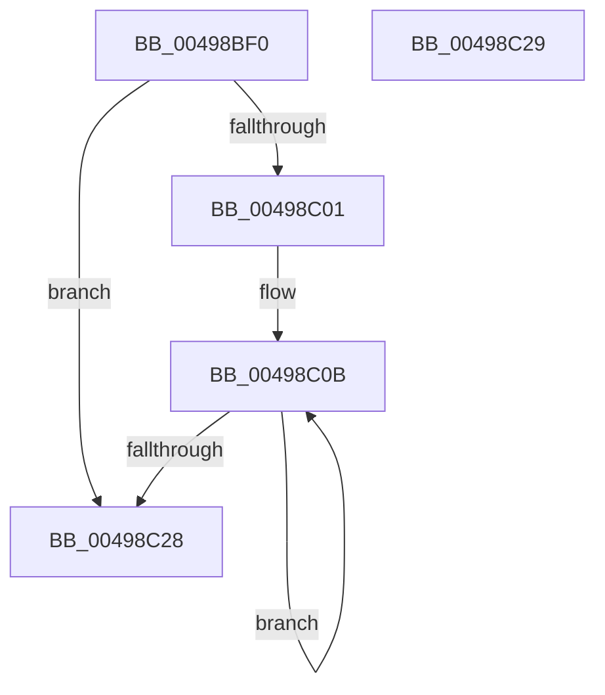

# EtwpCopyMetaProviderGuids

- RVA: `0x00498BF0`–`0x00498C2A` (길이 `58` bytes)
- VA: `0x0000000140498BF0`
- 실행 섹션: `.text`
- PDB 이름 있음: `예`; PDB Function 태그: `아니요`
- unwind 정보 RVA: `0x000DB714`
- 디코드: `18`개 명령, `58/58` bytes 표시
- 미해석 바이트: `0` (있으면 어셈블리에 `.byte`로 보존)

> 이 문서는 커널 이미지의 기계어와 PDB 기호를 분석해 생성했습니다. 4번과 5번은 함수 원형과 자료형을 바이너리 사용 방식에서 추정한 C 해석이며 원본 소스 복구 결과는 아닙니다.

## 1. Dependencies

- 직접 호출 지점: **0**; 고유 호출 대상: **0**
- 직접 호출자로 확인된 함수: **1**
- RIP 상대 이미지 참조: **1**

### Outgoing calls
- 직접 디코드된 call 명령이 없습니다.

### Direct callers
- [EtwpGetTraceGuidList](../../page/A5/EtwpGetTraceGuidList_function_00A5FEC4.md) at `0x00A5FF61`

### Static image references
- `0x00498C01` → RVA `0x0000B8D0` (`.rdata`; read)

## 2. Other-region calls and transfers

- 다른 실행 섹션으로 향하는 call: **0**
- 별도 외부 분기/꼬리 이동을 확인하지 못했습니다.

## 3. Assembly (complete function range)

```asm
00498BF0  B8 11 00 00 00                  mov eax, 0x11
00498BF5  4C 8B C1                        mov r8, rcx
00498BF8  3B D0                           cmp edx, eax
00498BFA  0F 46 C2                        cmovbe eax, edx
00498BFD  85 C0                           test eax, eax
00498BFF  74 27                           je 0x140498c28
00498C01  48 8D 15 C8 2C B7 FF            lea rdx, [rip - 0x48d338]
00498C08  44 8B C8                        mov r9d, eax
00498C0B  48 8B 02                        mov rax, qword ptr [rdx]
00498C0E  48 8D 52 08                     lea rdx, [rdx + 8]
00498C12  48 8B 48 10                     mov rcx, qword ptr [rax + 0x10]
00498C16  0F 10 01                        movups xmm0, xmmword ptr [rcx]
00498C19  F3 41 0F 7F 00                  movdqu xmmword ptr [r8], xmm0
00498C1E  4D 8D 40 10                     lea r8, [r8 + 0x10]
00498C22  49 83 E9 01                     sub r9, 1
00498C26  75 E3                           jne 0x140498c0b
00498C28  C3                              ret
00498C29  CC                              int3
```

## 4. C-style interpretation (structured pseudocode)

```c
__int64 __fastcall EtwpCopyMetaProviderGuids(__int64 a1, int a2)
{
    __int64 result;

    result = 17;
    if (a2 <= 17) { result = a2; }
    if ((unsigned int)(result) == 0) goto loc_00498C28;
loc_00498C0B:
    *(unsigned __int64 *)(a1) = v_xmm0;
    a4 = ((unsigned int)((unsigned int)(result))) - (1);
    if (condition_is_not_equal) goto loc_00498C0B;
loc_00498C28:
    return *(unsigned __int64 *)(v_rip - 4772664);
}
```

## 5. (Beta) C Style

```c
int64_t EtwpCopyMetaProviderGuids(void *Arg1, int32_t Arg2)
{
    uint8_t *arg1 = (uint8_t *)Arg1;

    int64_t result;

    result = 17;
    if (Arg2 <= 17) { result = Arg2; }
    if ((uint32_t)(result) == 0) goto loc_00498C28;
loc_00498C0B:
    *(uint64_t *)(arg1) = v_xmm0;
    a4 = ((uint32_t)((uint32_t)(result))) - (1);
    if (condition_is_not_equal) goto loc_00498C0B;
loc_00498C28:
    return *(uint64_t *)(v_rip - 0x48D338);
}
```

### 관측된 메모리 오프셋

구조체 형식이 확인되지 않은 접근은 인자 기준의 오프셋으로만 기록했습니다.

| 기준 인자 | 오프셋 표현 | 폭 (bit) | 접근 |
|---|---:|---:|---|
| `Arg1` | `+ 0x0` | `128` | `W` |
| `Arg1` | `+ 0x10` | `64` | `R` |

## 6. Execution-region graph

[열기: 2D/3D 그래프와 함수 탐색 컨트롤 패널](../../../control-panel.html?section=text&rva=0x00498BF0&view=graph)

- 2D 그래프는 위에서 아래로 흐르고, 3D 그래프는 빈 공간을 드래그해 회전합니다. Shift+드래그는 이동, 휠은 확대·축소, 함수 노드 선택은 대상 보고서 이동입니다.

### Static fallback


