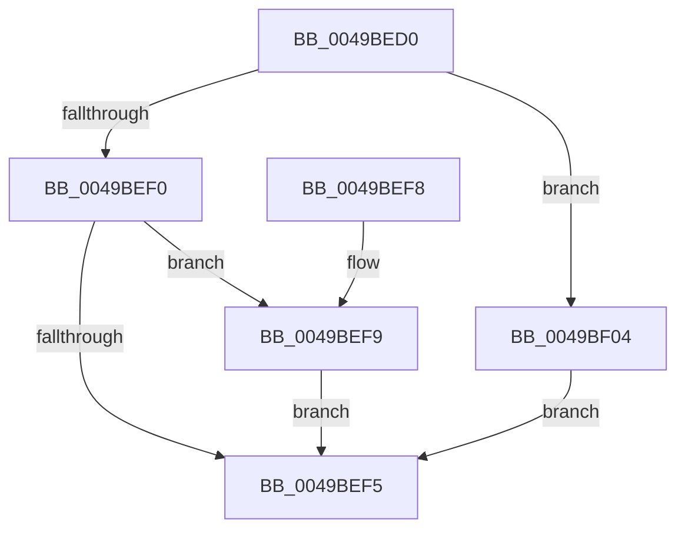

# EtwpQueryProcessEnabledSecurityMitigations

- RVA: `0x0049BED0`–`0x0049BF10` (길이 `64` bytes)
- VA: `0x000000014049BED0`
- 실행 섹션: `.text`
- PDB 이름 있음: `예`; PDB Function 태그: `아니요`
- unwind 정보 RVA: `0x000DB714`
- 디코드: `23`개 명령, `64/64` bytes 표시
- 미해석 바이트: `0` (있으면 어셈블리에 `.byte`로 보존)

> 이 문서는 커널 이미지의 기계어와 PDB 기호를 분석해 생성했습니다. 4번과 5번은 함수 원형과 자료형을 바이너리 사용 방식에서 추정한 C 해석이며 원본 소스 복구 결과는 아닙니다.

## 1. Dependencies

- 직접 호출 지점: **0**; 고유 호출 대상: **0**
- 직접 호출자로 확인된 함수: **1**
- RIP 상대 이미지 참조: **0**

### Outgoing calls
- 직접 디코드된 call 명령이 없습니다.

### Direct callers
- [EtwpPsProvTraceProcess](../../page/8A/EtwpPsProvTraceProcess_function_008A3954.md) at `0x008A3CBB`

### Static image references
- 디코드된 RIP-relative 메모리 참조가 없습니다.

## 2. Other-region calls and transfers

- 다른 실행 섹션으로 향하는 call: **0**
- 별도 외부 분기/꼬리 이동을 확인하지 못했습니다.

## 3. Assembly (complete function range)

```asm
0049BED0  8B 81 54 07 00 00               mov eax, dword ptr [rcx + 0x754]
0049BED6  33 D2                           xor edx, edx
0049BED8  44 8B C0                        mov r8d, eax
0049BEDB  8B C8                           mov ecx, eax
0049BEDD  41 81 E0 00 40 00 00            and r8d, 0x4000
0049BEE4  81 E1 00 80 00 00               and ecx, 0x8000
0049BEEA  0F BA E0 14                     bt eax, 0x14
0049BEEE  72 14                           jb 0x14049bf04
0049BEF0  45 85 C0                        test r8d, r8d
0049BEF3  75 04                           jne 0x14049bef9
0049BEF5  8B C2                           mov eax, edx
0049BEF7  C3                              ret
0049BEF8  CC                              int3
0049BEF9  F7 D9                           neg ecx
0049BEFB  1B D2                           sbb edx, edx
0049BEFD  83 E2 03                        and edx, 3
0049BF00  FF C2                           inc edx
0049BF02  EB F1                           jmp 0x14049bef5
0049BF04  F7 D9                           neg ecx
0049BF06  1B D2                           sbb edx, edx
0049BF08  83 E2 06                        and edx, 6
0049BF0B  83 C2 02                        add edx, 2
0049BF0E  EB E5                           jmp 0x14049bef5
```

## 4. C-style interpretation (structured pseudocode)

```c
__int64 __fastcall EtwpQueryProcessEnabledSecurityMitigations(__int64 a1, int a2)
{
    a2 = 0;
    a3 = (unsigned int)(((unsigned int)((unsigned int)((unsigned int)(*(unsigned int *)(a1 + 1876))))) & (0x4000ULL));
    a1 = (unsigned int)(((unsigned int)((unsigned int)((unsigned int)(*(unsigned int *)(a1 + 1876))))) & (0x8000ULL));
    if (condition_is_below) goto loc_0049BF04;
    if ((unsigned int)(a3) != 0) goto loc_0049BEF9;
loc_0049BEF5:
    return 0;
loc_0049BEF9:
    a1 = (unsigned int)(-(a1));
    a2 = (unsigned int)((a2) & (3));
    a2 = (unsigned int)((a2) + 1);
    goto loc_0049BEF5;
loc_0049BF04:
    a1 = (unsigned int)(-(a1));
    a2 = (unsigned int)((a2) & (6));
    a2 = (unsigned int)((a2) + (2));
    goto loc_0049BEF5;
}
```

## 5. (Beta) C Style

```c
int64_t EtwpQueryProcessEnabledSecurityMitigations(void *Arg1, int32_t Arg2)
{
    uint8_t *arg1 = (uint8_t *)Arg1;

    Arg2 = 0;
    a3 = (uint32_t)(((uint32_t)((uint32_t)((uint32_t)(*(uint32_t *)(arg1 + 0x754))))) & (0x4000ULL));
    Arg1 = (uint32_t)(((uint32_t)((uint32_t)((uint32_t)(*(uint32_t *)(arg1 + 0x754))))) & (0x8000ULL));
    if (condition_is_below) goto loc_0049BF04;
    if ((uint32_t)(a3) != 0) goto loc_0049BEF9;
loc_0049BEF5:
    return 0;
loc_0049BEF9:
    Arg1 = (uint32_t)(-(Arg1));
    Arg2 = (uint32_t)((Arg2) & (3));
    Arg2 = (uint32_t)((Arg2) + 1);
    goto loc_0049BEF5;
loc_0049BF04:
    Arg1 = (uint32_t)(-(Arg1));
    Arg2 = (uint32_t)((Arg2) & (6));
    Arg2 = (uint32_t)((Arg2) + (2));
    goto loc_0049BEF5;
}
```

### 관측된 메모리 오프셋

구조체 형식이 확인되지 않은 접근은 인자 기준의 오프셋으로만 기록했습니다.

| 기준 인자 | 오프셋 표현 | 폭 (bit) | 접근 |
|---|---:|---:|---|
| `Arg1` | `+ 0x754` | `32` | `R` |

## 6. Execution-region graph

[열기: 2D/3D 그래프와 함수 탐색 컨트롤 패널](../../../control-panel.html?section=text&rva=0x0049BED0&view=graph)

- 2D 그래프는 위에서 아래로 흐르고, 3D 그래프는 빈 공간을 드래그해 회전합니다. Shift+드래그는 이동, 휠은 확대·축소, 함수 노드 선택은 대상 보고서 이동입니다.

### Static fallback


