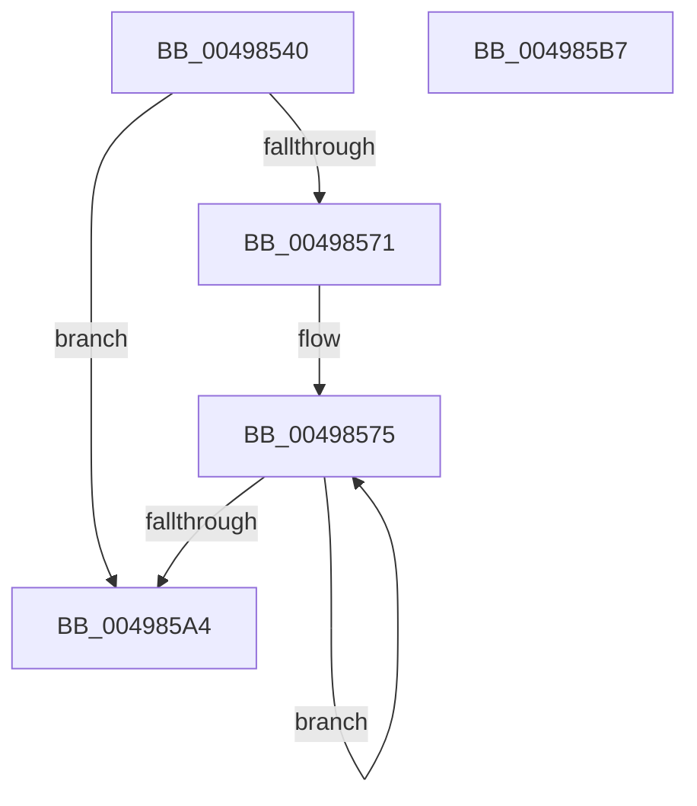

# EtwpTraceKernelEventWithFilter

- RVA: `0x00498540`–`0x004985B8` (길이 `120` bytes)
- VA: `0x0000000140498540`
- 실행 섹션: `.text`
- PDB 이름 있음: `예`; PDB Function 태그: `아니요`
- unwind 정보 RVA: `0x000B4164`
- 디코드: `34`개 명령, `120/120` bytes 표시
- 미해석 바이트: `0` (있으면 어셈블리에 `.byte`로 보존)

> 이 문서는 커널 이미지의 기계어와 PDB 기호를 분석해 생성했습니다. 4번과 5번은 함수 원형과 자료형을 바이너리 사용 방식에서 추정한 C 해석이며 원본 소스 복구 결과는 아닙니다.

## 1. Dependencies

- 직접 호출 지점: **1**; 고유 호출 대상: **1**
- 직접 호출자로 확인된 함수: **4**
- RIP 상대 이미지 참조: **1**

### Outgoing calls
- `0x00498599` → [EtwpLogKernelEvent](../25/EtwpLogKernelEvent_function_0025CC00.md) (function, `0x0025CC00`)

### Direct callers
- [EtwTraceObjectOperation](../3F/EtwTraceObjectOperation_function_003FFFD4.md) at `0x00400119`
- [EtwTraceObject](../../page/7B/EtwTraceObject_function_007B81A4.md) at `0x007B82CC`
- [EtwpTraceHandle](../../page/86/EtwpTraceHandle_function_0086AA44.md) at `0x0086ABE7`
- [EtwTraceDuplicateHandle](../../page/A5/EtwTraceDuplicateHandle_function_00A56C5C.md) at `0x00A56DB7`

### Static image references
- `0x00498552` → RVA `0x00FC6AA8` (`ALMOSTRO`; read)

## 2. Other-region calls and transfers

- 다른 실행 섹션으로 향하는 call: **0**
- 별도 외부 분기/꼬리 이동을 확인하지 못했습니다.

## 3. Assembly (complete function range)

```asm
00498540  48 89 5C 24 08                  mov qword ptr [rsp + 8], rbx
00498545  48 89 6C 24 10                  mov qword ptr [rsp + 0x10], rbp
0049854A  56                              push rsi
0049854B  57                              push rdi
0049854C  41 56                           push r14
0049854E  48 83 EC 30                     sub rsp, 0x30
00498552  48 8B 05 4F E5 B2 00            mov rax, qword ptr [rip + 0xb2e54f]
00498559  41 0F B7 F1                     movzx esi, r9w
0049855D  8B EA                           mov ebp, edx
0049855F  4C 8B F1                        mov r14, rcx
00498562  8B 98 A8 11 00 00               mov ebx, dword ptr [rax + 0x11a8]
00498568  41 23 D8                        and ebx, r8d
0049856B  44 0F BC C3                     bsf r8d, ebx
0049856F  74 33                           je 0x1404985a4
00498571  8B 7C 24 70                     mov edi, dword ptr [rsp + 0x70]
00498575  48 8B 15 2C E5 B2 00            mov rdx, qword ptr [rip + 0xb2e52c]
0049857C  8D 43 FF                        lea eax, [rbx - 1]
0049857F  89 7C 24 28                     mov dword ptr [rsp + 0x28], edi
00498583  44 8B CD                        mov r9d, ebp
00498586  49 8B CE                        mov rcx, r14
00498589  66 89 74 24 20                  mov word ptr [rsp + 0x20], si
0049858E  23 D8                           and ebx, eax
00498590  46 0F B6 84 42 98 11 00 00      movzx r8d, byte ptr [rdx + r8*2 + 0x1198]
00498599  E8 62 46 DC FF                  call 0x14025cc00
0049859E  44 0F BC C3                     bsf r8d, ebx
004985A2  75 D1                           jne 0x140498575
004985A4  48 8B 5C 24 50                  mov rbx, qword ptr [rsp + 0x50]
004985A9  48 8B 6C 24 58                  mov rbp, qword ptr [rsp + 0x58]
004985AE  48 83 C4 30                     add rsp, 0x30
004985B2  41 5E                           pop r14
004985B4  5F                              pop rdi
004985B5  5E                              pop rsi
004985B6  C3                              ret
004985B7  CC                              int3
```

## 4. C-style interpretation (structured pseudocode)

```c
__int64 __fastcall EtwpTraceKernelEventWithFilter(__int64 a1, int a2, int a3, unsigned __int16 a4, unsigned int a5)
{
    __int64 result;
    __int64 v_rbx;
    __int64 v_rsp;
    unsigned int v_stack_m20;
    unsigned __int16 v_stack_m28;
    unsigned __int64 v_stack_p10;
    unsigned __int64 v_stack_p8;

    v_stack_p8 = v_rbx;
    v_stack_p10 = v_rbp;
    v_rsp = (v_rsp) - (48);
    v_rbx = (unsigned int)(((unsigned int)(*(unsigned int *)(*(unsigned __int64 *)(v_rip + 11724111) + 4520))) & (a3));
    if (condition_is_equal) goto loc_004985A4;
loc_00498575:
    v_stack_m20 = (unsigned int)((unsigned int)(a5));
    v_stack_m28 = a4;
    v_rbx = (unsigned int)((v_rbx) & ((unsigned int)(v_rbx - 1)));
    result = EtwpLogKernelEvent(a1, *(unsigned __int64 *)(v_rip + 11724076), *(unsigned __int8 *)(*(unsigned __int64 *)(v_rip + 11724076) + a3 * 2 + 4504), (unsigned int)((unsigned int)((unsigned int)(a2))));
    if (condition_is_not_equal) goto loc_00498575;
loc_004985A4:
    v_rsp = (v_rsp) + (48);
    return result;
}
```

## 5. (Beta) C Style

```c
int64_t EtwpTraceKernelEventWithFilter(int64_t Arg1, int32_t Arg2, int32_t Arg3, uint16_t Arg4, uint32_t Arg5)
{
    int64_t result;
    int64_t local_rbx;
    int64_t local_rsp;
    uint32_t v_stack_m20;
    uint16_t v_stack_m28;
    uint64_t v_stack_p10;
    uint64_t v_stack_p8;

    v_stack_p8 = local_rbx;
    v_stack_p10 = local_rbp;
    local_rsp = (local_rsp) - (48);
    local_rbx = (uint32_t)(((uint32_t)(*(uint32_t *)(*(uint64_t *)(v_rip + 0xB2E54F) + 0x11A8))) & (Arg3));
    if (condition_is_equal) goto loc_004985A4;
loc_00498575:
    v_stack_m20 = (uint32_t)((uint32_t)(Arg5));
    v_stack_m28 = Arg4;
    local_rbx = (uint32_t)((local_rbx) & ((uint32_t)(local_rbx - 1)));
    result = EtwpLogKernelEvent(Arg1, *(uint64_t *)(v_rip + 0xB2E52C), *(uint8_t *)(*(uint64_t *)(v_rip + 0xB2E52C) + Arg3 * 2 + 0x1198), (uint32_t)((uint32_t)((uint32_t)(Arg2))));
    if (condition_is_not_equal) goto loc_00498575;
loc_004985A4:
    local_rsp = (local_rsp) + (48);
    return result;
}
```

## 6. Execution-region graph

[열기: 2D/3D 그래프와 함수 탐색 컨트롤 패널](../../../control-panel.html?section=text&rva=0x00498540&view=graph)

- 2D 그래프는 위에서 아래로 흐르고, 3D 그래프는 빈 공간을 드래그해 회전합니다. Shift+드래그는 이동, 휠은 확대·축소, 함수 노드 선택은 대상 보고서 이동입니다.

### Static fallback


