# EtwpUpdateSelectedGroupMasks

- RVA: `0x0049B114`–`0x0049B5A7` (길이 `1,171` bytes)
- VA: `0x000000014049B114`
- 실행 섹션: `.text`
- PDB 이름 있음: `예`; PDB Function 태그: `예`
- unwind 정보 RVA: `0x000B4874`
- 디코드: `280`개 명령, `1,171/1,171` bytes 표시
- 미해석 바이트: `0` (있으면 어셈블리에 `.byte`로 보존)

> 이 문서는 커널 이미지의 기계어와 PDB 기호를 분석해 생성했습니다. 4번과 5번은 함수 원형과 자료형을 바이너리 사용 방식에서 추정한 C 해석이며 원본 소스 복구 결과는 아닙니다.

## 1. Dependencies

- 직접 호출 지점: **17**; 고유 호출 대상: **14**
- 직접 호출자로 확인된 함수: **2**
- RIP 상대 이미지 참조: **8**

### Outgoing calls
- `0x0049B1CE` → [KeAbPreAcquire](../21/KeAbPreAcquire_function_00210230.md) (function, `0x00210230`)
- `0x0049B1E7` → [ExfAcquirePushLockExclusiveEx](../20/ExfAcquirePushLockExclusiveEx_function_0020FC90.md) (function, `0x0020FC90`)
- `0x0049B2FB` → [EtwpLogGroupMask](../../page/9E/EtwpLogGroupMask_function_009E44E0.md) (function, `0x009E44E0`)
- `0x0049B345` → [EtwpUpdateGlobalGroupMasks](../../page/A4/EtwpUpdateGlobalGroupMasks_function_00A4F55C.md) (function, `0x00A4F55C`)
- `0x0049B360` → [EtwpLogGroupMask](../../page/9E/EtwpLogGroupMask_function_009E44E0.md) (function, `0x009E44E0`)
- `0x0049B38A` → [EtwpLogAlwaysPresentRundown](../../page/9E/EtwpLogAlwaysPresentRundown_function_009E4474.md) (function, `0x009E4474`)
- `0x0049B3AD` → [KeAbPostRelease](../2E/KeAbPostRelease_function_002E1600.md) (function, `0x002E1600`)
- `0x0049B3C2` → [EtwEventEnabled](../39/EtwEventEnabled_function_00392450.md) (function, `0x00392450`)
- `0x0049B3D8` → [_security_check_cookie](../6A/_security_check_cookie_function_006AC640.md) (function, `0x006AC640`)
- `0x0049B427` → [EtwpKernelTraceRundown](../../page/9E/EtwpKernelTraceRundown_function_009E4080.md) (function, `0x009E4080`)
- `0x0049B454` → [SeSinglePrivilegeCheck](../../page/87/SeSinglePrivilegeCheck_function_00871E20.md) (function, `0x00871E20`)
- `0x0049B46F` → [EtwEventEnabled](../39/EtwEventEnabled_function_00392450.md) (function, `0x00392450`)
- `0x0049B4A1` → [EtwpEventWriteTemplateAdmin](../../page/AA/EtwpEventWriteTemplateAdmin_function_00AA5880.md) (function, `0x00AA5880`)
- `0x0049B4E0` → [EtwpCCSwapStart](../../page/AD/EtwpCCSwapStart_function_00AD88F8.md) (function, `0x00AD88F8`)
- `0x0049B4FB` → [ExfTryToWakePushLock](../26/ExfTryToWakePushLock_function_00265DD0.md) (function, `0x00265DD0`)
- `0x0049B540` → [EtwpEventWriteTemplateInvalidGroupMask](../../page/7B/EtwpEventWriteTemplateInvalidGroupMask_function_007B6008.md) (function, `0x007B6008`)
- `0x0049B59D` → [EtwpKernelTraceRundown](../../page/9E/EtwpKernelTraceRundown_function_009E4080.md) (function, `0x009E4080`)

### Direct callers
- [sub_006EF0FC](../6E/Unknown_function_006EF0FC.md) at `0x006EF25A`
- [EtwpUpdateGroupMasks](../../page/A6/EtwpUpdateGroupMasks_function_00A67530.md) at `0x00A675C1`

### Static image references
- `0x0049B130` → RVA `0x00E0A740` (`.data`; read)
- `0x0049B188` → RVA `0x00FC6AA8` (`ALMOSTRO`; read)
- `0x0049B30C` → RVA `0x00EFF284` (`.data`; read)
- `0x0049B3B4` → RVA `0x00EFF840` (`.data`; read)
- `0x0049B3BB` → RVA `0x0001AB68` (`.rdata`; read)
- `0x0049B447` → RVA `0x00FD9B48` (`PAGEDATA`; read)
- `0x0049B468` → RVA `0x000234E0` (`.rdata`; read)
- `0x0049B514` → RVA `0x00FC6EF8` (`ALMOSTRO`; read)

## 2. Other-region calls and transfers

- 다른 실행 섹션으로 향하는 call: **10**
  - `0x0049B2FB` → [EtwpLogGroupMask](../../page/9E/EtwpLogGroupMask_function_009E44E0.md) (`.text` → `PAGE`)
  - `0x0049B345` → [EtwpUpdateGlobalGroupMasks](../../page/A4/EtwpUpdateGlobalGroupMasks_function_00A4F55C.md) (`.text` → `PAGE`)
  - `0x0049B360` → [EtwpLogGroupMask](../../page/9E/EtwpLogGroupMask_function_009E44E0.md) (`.text` → `PAGE`)
  - `0x0049B38A` → [EtwpLogAlwaysPresentRundown](../../page/9E/EtwpLogAlwaysPresentRundown_function_009E4474.md) (`.text` → `PAGE`)
  - `0x0049B427` → [EtwpKernelTraceRundown](../../page/9E/EtwpKernelTraceRundown_function_009E4080.md) (`.text` → `PAGE`)
  - `0x0049B454` → [SeSinglePrivilegeCheck](../../page/87/SeSinglePrivilegeCheck_function_00871E20.md) (`.text` → `PAGE`)
  - `0x0049B4A1` → [EtwpEventWriteTemplateAdmin](../../page/AA/EtwpEventWriteTemplateAdmin_function_00AA5880.md) (`.text` → `PAGE`)
  - `0x0049B4E0` → [EtwpCCSwapStart](../../page/AD/EtwpCCSwapStart_function_00AD88F8.md) (`.text` → `PAGE`)
  - `0x0049B540` → [EtwpEventWriteTemplateInvalidGroupMask](../../page/7B/EtwpEventWriteTemplateInvalidGroupMask_function_007B6008.md) (`.text` → `PAGE`)
  - `0x0049B59D` → [EtwpKernelTraceRundown](../../page/9E/EtwpKernelTraceRundown_function_009E4080.md) (`.text` → `PAGE`)
- call이 아닌 외부 분기/꼬리 이동: **3**
  - `0x0049B557` → [sub_006F7B6E](../6F/Unknown_function_006F7B6E.md) (`tail-transfer`)
  - `0x0049B562` → [sub_006F7B6E](../6F/Unknown_function_006F7B6E.md) (`tail-transfer`)
  - `0x0049B572` → [sub_006F7B6E](../6F/Unknown_function_006F7B6E.md) (`tail-transfer`)

## 3. Assembly (complete function range)

```asm
0049B114  48 89 5C 24 20                  mov qword ptr [rsp + 0x20], rbx
0049B119  55                              push rbp
0049B11A  56                              push rsi
0049B11B  57                              push rdi
0049B11C  41 54                           push r12
0049B11E  41 55                           push r13
0049B120  41 56                           push r14
0049B122  41 57                           push r15
0049B124  48 8D 6C 24 D9                  lea rbp, [rsp - 0x27]
0049B129  48 81 EC B0 00 00 00            sub rsp, 0xb0
0049B130  48 8B 05 09 F6 96 00            mov rax, qword ptr [rip + 0x96f609]
0049B137  48 33 C4                        xor rax, rsp
0049B13A  48 89 45 17                     mov qword ptr [rbp + 0x17], rax
0049B13E  44 8B 21                        mov r12d, dword ptr [rcx]
0049B141  0F 57 C0                        xorps xmm0, xmm0
0049B144  4C 8B A9 50 05 00 00            mov r13, qword ptr [rcx + 0x550]
0049B14B  0F 57 C9                        xorps xmm1, xmm1
0049B14E  49 8B F8                        mov rdi, r8
0049B151  4C 8B F2                        mov r14, rdx
0049B154  48 8B D9                        mov rbx, rcx
0049B157  0F 11 45 D7                     movups xmmword ptr [rbp - 0x29], xmm0
0049B15B  0F 11 45 E7                     movups xmmword ptr [rbp - 0x19], xmm0
0049B15F  0F 11 4D F7                     movups xmmword ptr [rbp - 9], xmm1
0049B163  0F 11 4D 07                     movups xmmword ptr [rbp + 7], xmm1
0049B167  0F 11 45 B7                     movups xmmword ptr [rbp - 0x49], xmm0
0049B16B  0F 11 45 C7                     movups xmmword ptr [rbp - 0x39], xmm0
0049B16F  4D 85 C0                        test r8, r8
0049B172  74 14                           je 0x14049b188
0049B174  41 8B 40 04                     mov eax, dword ptr [r8 + 4]
0049B178  A8 01                           test al, 1
0049B17A  0F 85 85 03 00 00               jne 0x14049b505
0049B180  A8 10                           test al, 0x10
0049B182  0F 85 7D 03 00 00               jne 0x14049b505
0049B188  48 8B 05 19 B9 B2 00            mov rax, qword ptr [rip + 0xb2b919]
0049B18F  BE 61 00 00 C0                  mov esi, 0xc0000061
0049B194  B9 08 00 00 00                  mov ecx, 8
0049B199  48 39 83 50 05 00 00            cmp qword ptr [rbx + 0x550], rax
0049B1A0  74 0A                           je 0x14049b1ac
0049B1A2  33 D2                           xor edx, edx
0049B1A4  3B D1                           cmp edx, ecx
0049B1A6  0F 82 68 03 00 00               jb 0x14049b514
0049B1AC  48 85 FF                        test rdi, rdi
0049B1AF  74 0E                           je 0x14049b1bf
0049B1B1  41 F7 40 04 02 04 00 00         test dword ptr [r8 + 4], 0x402
0049B1B9  0F 85 72 02 00 00               jne 0x14049b431
0049B1BF  48 8D B3 B0 02 00 00            lea rsi, [rbx + 0x2b0]
0049B1C6  45 33 C0                        xor r8d, r8d
0049B1C9  48 8B CE                        mov rcx, rsi
0049B1CC  33 D2                           xor edx, edx
0049B1CE  E8 5D 50 D7 FF                  call 0x140210230
0049B1D3  F0 48 0F BA 2E 00               lock bts qword ptr [rsi], 0
0049B1D9  4C 8B F8                        mov r15, rax
0049B1DC  73 0E                           jae 0x14049b1ec
0049B1DE  4C 8B C6                        mov r8, rsi
0049B1E1  48 8B D0                        mov rdx, rax
0049B1E4  48 8B CE                        mov rcx, rsi
0049B1E7  E8 A4 4A D7 FF                  call 0x14020fc90
0049B1EC  4D 85 FF                        test r15, r15
0049B1EF  74 05                           je 0x14049b1f6
0049B1F1  41 C6 47 0A 01                  mov byte ptr [r15 + 0xa], 1
0049B1F6  44 0F B6 BB 32 03 00 00         movzx r15d, byte ptr [rbx + 0x332]
0049B1FE  4D 85 F6                        test r14, r14
0049B201  74 41                           je 0x14049b244
0049B203  41 8B 46 04                     mov eax, dword ptr [r14 + 4]
0049B207  A8 04                           test al, 4
0049B209  0F 84 EA 01 00 00               je 0x14049b3f9
0049B20F  48 8B 93 50 05 00 00            mov rdx, qword ptr [rbx + 0x550]
0049B216  49 8B CF                        mov rcx, r15
0049B219  48 C1 E1 05                     shl rcx, 5
0049B21D  48 81 C2 CC 11 00 00            add rdx, 0x11cc
0049B224  48 03 D1                        add rdx, rcx
0049B227  74 0B                           je 0x14049b234
0049B229  8B 42 04                        mov eax, dword ptr [rdx + 4]
0049B22C  A8 04                           test al, 4
0049B22E  0F 85 16 03 00 00               jne 0x14049b54a
0049B234  48 85 FF                        test rdi, rdi
0049B237  74 0B                           je 0x14049b244
0049B239  8B 47 04                        mov eax, dword ptr [rdi + 4]
0049B23C  A8 04                           test al, 4
0049B23E  0F 85 67 02 00 00               jne 0x14049b4ab
0049B244  48 8B 8B 50 05 00 00            mov rcx, qword ptr [rbx + 0x550]
0049B24B  4C 8D 4D D7                     lea r9, [rbp - 0x29]
0049B24F  49 8B C7                        mov rax, r15
0049B252  4C 8D 55 F7                     lea r10, [rbp - 9]
0049B256  48 C1 E0 05                     shl rax, 5
0049B25A  4C 8D 5D B7                     lea r11, [rbp - 0x49]
0049B25E  48 2B F8                        sub rdi, rax
0049B261  4C 2B F0                        sub r14, rax
0049B264  4C 2B C8                        sub r9, rax
0049B267  4C 8D 81 CC 11 00 00            lea r8, [rcx + 0x11cc]
0049B26E  4C 2B D0                        sub r10, rax
0049B271  4C 03 C0                        add r8, rax
0049B274  48 2B F9                        sub rdi, rcx
0049B277  4C 2B F1                        sub r14, rcx
0049B27A  4C 2B C9                        sub r9, rcx
0049B27D  4C 2B D1                        sub r10, rcx
0049B280  4C 2B D8                        sub r11, rax
0049B283  BE 08 00 00 00                  mov esi, 8
0049B288  4C 2B D9                        sub r11, rcx
0049B28B  42 8B 8C 07 34 EE FF FF         mov ecx, dword ptr [rdi + r8 - 0x11cc]
0049B293  8B C1                           mov eax, ecx
0049B295  43 8B 94 06 34 EE FF FF         mov edx, dword ptr [r14 + r8 - 0x11cc]
0049B29D  F7 D0                           not eax
0049B29F  23 D0                           and edx, eax
0049B2A1  41 23 10                        and edx, dword ptr [r8]
0049B2A4  43 89 94 01 34 EE FF FF         mov dword ptr [r9 + r8 - 0x11cc], edx
0049B2AC  F7 D2                           not edx
0049B2AE  41 8B 00                        mov eax, dword ptr [r8]
0049B2B1  F7 D0                           not eax
0049B2B3  23 C1                           and eax, ecx
0049B2B5  43 89 84 02 34 EE FF FF         mov dword ptr [r10 + r8 - 0x11cc], eax
0049B2BD  41 0B 00                        or eax, dword ptr [r8]
0049B2C0  4D 8D 40 04                     lea r8, [r8 + 4]
0049B2C4  23 C2                           and eax, edx
0049B2C6  43 89 84 03 30 EE FF FF         mov dword ptr [r11 + r8 - 0x11d0], eax
0049B2CE  48 83 EE 01                     sub rsi, 1
0049B2D2  75 B7                           jne 0x14049b28b
0049B2D4  4C 8B 83 50 05 00 00            mov r8, qword ptr [rbx + 0x550]
0049B2DB  49 8B CF                        mov rcx, r15
0049B2DE  48 C1 E1 05                     shl rcx, 5
0049B2E2  49 81 C0 CC 11 00 00            add r8, 0x11cc
0049B2E9  4C 03 C1                        add r8, rcx
0049B2EC  41 B9 20 00 00 00               mov r9d, 0x20
0049B2F2  49 8B CD                        mov rcx, r13
0049B2F5  41 8B D4                        mov edx, r12d
0049B2F8  49 8B F7                        mov rsi, r15
0049B2FB  E8 E0 91 54 00                  call 0x1409e44e0
0049B300  8B 7B 0C                        mov edi, dword ptr [rbx + 0xc]
0049B303  45 33 F6                        xor r14d, r14d
0049B306  81 E7 00 04 00 00               and edi, 0x400
0049B30C  44 38 35 71 3F A6 00            cmp byte ptr [rip + 0xa63f71], r14b
0049B313  0F 85 EF 00 00 00               jne 0x14049b408
0049B319  48 8B 83 50 05 00 00            mov rax, qword ptr [rbx + 0x550]
0049B320  45 8B C7                        mov r8d, r15d
0049B323  0F 10 45 B7                     movups xmm0, xmmword ptr [rbp - 0x49]
0049B327  48 C1 E6 05                     shl rsi, 5
0049B32B  41 8B D4                        mov edx, r12d
0049B32E  0F 10 4D C7                     movups xmm1, xmmword ptr [rbp - 0x39]
0049B332  49 8B CD                        mov rcx, r13
0049B335  0F 11 84 06 CC 11 00 00         movups xmmword ptr [rsi + rax + 0x11cc], xmm0
0049B33D  0F 11 8C 06 DC 11 00 00         movups xmmword ptr [rsi + rax + 0x11dc], xmm1
0049B345  E8 12 42 5B 00                  call 0x140a4f55c
0049B34A  8B F0                           mov esi, eax
0049B34C  85 C0                           test eax, eax
0049B34E  78 34                           js 0x14049b384
0049B350  41 B9 05 00 00 00               mov r9d, 5
0049B356  4C 8D 45 B7                     lea r8, [rbp - 0x49]
0049B35A  41 8B D4                        mov edx, r12d
0049B35D  49 8B CD                        mov rcx, r13
0049B360  E8 7B 91 54 00                  call 0x1409e44e0
0049B365  44 38 35 18 3F A6 00            cmp byte ptr [rip + 0xa63f18], r14b
0049B36C  74 16                           je 0x14049b384
0049B36E  85 FF                           test edi, edi
0049B370  0F 84 10 02 00 00               je 0x14049b586
0049B376  8B 83 30 03 00 00               mov eax, dword ptr [rbx + 0x330]
0049B37C  A8 02                           test al, 2
0049B37E  0F 85 02 02 00 00               jne 0x14049b586
0049B384  41 8B D4                        mov edx, r12d
0049B387  49 8B CD                        mov rcx, r13
0049B38A  E8 E5 90 54 00                  call 0x1409e4474
0049B38F  48 83 C8 FF                     or rax, 0xffffffffffffffff
0049B393  F0 48 0F C1 83 B0 02 00 00      lock xadd qword ptr [rbx + 0x2b0], rax
0049B39C  24 06                           and al, 6
0049B39E  3C 02                           cmp al, 2
0049B3A0  0F 84 4E 01 00 00               je 0x14049b4f4
0049B3A6  48 8D 8B B0 02 00 00            lea rcx, [rbx + 0x2b0]
0049B3AD  E8 4E 62 E4 FF                  call 0x1402e1600
0049B3B2  EB 1B                           jmp 0x14049b3cf
0049B3B4  48 8B 0D 85 44 A6 00            mov rcx, qword ptr [rip + 0xa64485]
0049B3BB  48 8D 15 A6 F7 B7 FF            lea rdx, [rip - 0x48085a]
0049B3C2  E8 89 70 EF FF                  call 0x140392450
0049B3C7  84 C0                           test al, al
0049B3C9  0F 85 67 01 00 00               jne 0x14049b536
0049B3CF  8B C6                           mov eax, esi
0049B3D1  48 8B 4D 17                     mov rcx, qword ptr [rbp + 0x17]
0049B3D5  48 33 CC                        xor rcx, rsp
0049B3D8  E8 63 12 21 00                  call 0x1406ac640
0049B3DD  48 8B 9C 24 08 01 00 00         mov rbx, qword ptr [rsp + 0x108]
0049B3E5  48 81 C4 B0 00 00 00            add rsp, 0xb0
0049B3EC  41 5F                           pop r15
0049B3EE  41 5E                           pop r14
0049B3F0  41 5D                           pop r13
0049B3F2  41 5C                           pop r12
0049B3F4  5F                              pop rdi
0049B3F5  5E                              pop rsi
0049B3F6  5D                              pop rbp
0049B3F7  C3                              ret
0049B3F8  CC                              int3
0049B3F9  0F BA E0 08                     bt eax, 8
0049B3FD  0F 83 41 FE FF FF               jae 0x14049b244
0049B403  E9 07 FE FF FF                  jmp 0x14049b20f
0049B408  85 FF                           test edi, edi
0049B40A  0F 85 09 FF FF FF               jne 0x14049b319
0049B410  44 89 74 24 28                  mov dword ptr [rsp + 0x28], r14d
0049B415  48 8D 4D D7                     lea rcx, [rbp - 0x29]
0049B419  45 33 C9                        xor r9d, r9d
0049B41C  4C 89 74 24 20                  mov qword ptr [rsp + 0x20], r14
0049B421  45 8B C4                        mov r8d, r12d
0049B424  49 8B D5                        mov rdx, r13
0049B427  E8 54 8C 54 00                  call 0x1409e4080
0049B42C  E9 E8 FE FF FF                  jmp 0x14049b319
0049B431  83 BB 30 03 00 00 00            cmp dword ptr [rbx + 0x330], 0
0049B438  0F 8C 81 FD FF FF               jl 0x14049b1bf
0049B43E  65 48 8B 04 25 88 01 00 00      mov rax, qword ptr gs:[0x188]
0049B447  48 8B 0D FA E6 B3 00            mov rcx, qword ptr [rip + 0xb3e6fa]
0049B44E  8A 90 32 02 00 00               mov dl, byte ptr [rax + 0x232]
0049B454  E8 C7 69 3D 00                  call 0x140871e20
0049B459  84 C0                           test al, al
0049B45B  0F 85 5E FD FF FF               jne 0x14049b1bf
0049B461  48 8B 0D D8 43 A6 00            mov rcx, qword ptr [rip + 0xa643d8]
0049B468  48 8D 15 71 80 B8 FF            lea rdx, [rip - 0x477f8f]
0049B46F  E8 DC 6F EF FF                  call 0x140392450
0049B474  84 C0                           test al, al
0049B476  0F 84 53 FF FF FF               je 0x14049b3cf
0049B47C  8B 4B 0C                        mov ecx, dword ptr [rbx + 0xc]
0049B47F  4C 8D 83 98 00 00 00            lea r8, [rbx + 0x98]
0049B486  89 4C 24 30                     mov dword ptr [rsp + 0x30], ecx
0049B48A  4C 8D 8B 88 00 00 00            lea r9, [rbx + 0x88]
0049B491  89 74 24 28                     mov dword ptr [rsp + 0x28], esi
0049B495  48 8D 15 44 80 B8 FF            lea rdx, [rip - 0x477fbc]
0049B49C  4C 89 44 24 20                  mov qword ptr [rsp + 0x20], r8
0049B4A1  E8 DA A3 60 00                  call 0x140aa5880
0049B4A6  E9 24 FF FF FF                  jmp 0x14049b3cf
0049B4AB  0F BA E0 08                     bt eax, 8
0049B4AF  0F 83 8F FD FF FF               jae 0x14049b244
0049B4B5  48 8B 93 50 05 00 00            mov rdx, qword ptr [rbx + 0x550]
0049B4BC  49 8B CF                        mov rcx, r15
0049B4BF  48 C1 E1 05                     shl rcx, 5
0049B4C3  48 81 C2 CC 11 00 00            add rdx, 0x11cc
0049B4CA  48 03 D1                        add rdx, rcx
0049B4CD  74 0B                           je 0x14049b4da
0049B4CF  8B 42 04                        mov eax, dword ptr [rdx + 4]
0049B4D2  A8 04                           test al, 4
0049B4D4  0F 85 9D 00 00 00               jne 0x14049b577
0049B4DA  8B 8B C8 00 00 00               mov ecx, dword ptr [rbx + 0xc8]
0049B4E0  E8 13 D4 63 00                  call 0x140ad88f8
0049B4E5  8B F0                           mov esi, eax
0049B4E7  85 C0                           test eax, eax
0049B4E9  0F 88 A0 FE FF FF               js 0x14049b38f
0049B4EF  E9 50 FD FF FF                  jmp 0x14049b244
0049B4F4  48 8D 8B B0 02 00 00            lea rcx, [rbx + 0x2b0]
0049B4FB  E8 D0 A8 DC FF                  call 0x140265dd0
0049B500  E9 A1 FE FF FF                  jmp 0x14049b3a6
0049B505  B8 00 02 00 00                  mov eax, 0x200
0049B50A  41 09 00                        or dword ptr [r8], eax
0049B50D  09 02                           or dword ptr [rdx], eax
0049B50F  E9 74 FC FF FF                  jmp 0x14049b188
0049B514  48 8D 05 DD B9 B2 00            lea rax, [rip + 0xb2b9dd]
0049B51B  8B 04 90                        mov eax, dword ptr [rax + rdx*4]
0049B51E  F7 D0                           not eax
0049B520  41 85 04 90                     test dword ptr [r8 + rdx*4], eax
0049B524  0F 85 8A FE FF FF               jne 0x14049b3b4
0049B52A  FF C2                           inc edx
0049B52C  B9 08 00 00 00                  mov ecx, 8
0049B531  E9 6E FC FF FF                  jmp 0x14049b1a4
0049B536  4C 8D 83 88 00 00 00            lea r8, [rbx + 0x88]
0049B53D  4C 8B CF                        mov r9, rdi
0049B540  E8 C3 AA 31 00                  call 0x1407b6008
0049B545  E9 85 FE FF FF                  jmp 0x14049b3cf
0049B54A  0F BA E0 08                     bt eax, 8
0049B54E  0F 83 E0 FC FF FF               jae 0x14049b234
0049B554  48 85 FF                        test rdi, rdi
0049B557  0F 84 11 C6 25 00               je 0x1406f7b6e
0049B55D  8B 47 04                        mov eax, dword ptr [rdi + 4]
0049B560  A8 04                           test al, 4
0049B562  0F 84 06 C6 25 00               je 0x1406f7b6e
0049B568  0F BA E0 08                     bt eax, 8
0049B56C  0F 82 C7 FC FF FF               jb 0x14049b239
0049B572  E9 F7 C5 25 00                  jmp 0x1406f7b6e
0049B577  0F BA E0 08                     bt eax, 8
0049B57B  0F 82 C3 FC FF FF               jb 0x14049b244
0049B581  E9 54 FF FF FF                  jmp 0x14049b4da
0049B586  44 89 74 24 28                  mov dword ptr [rsp + 0x28], r14d
0049B58B  48 8D 4D F7                     lea rcx, [rbp - 9]
0049B58F  41 B1 01                        mov r9b, 1
0049B592  4C 89 74 24 20                  mov qword ptr [rsp + 0x20], r14
0049B597  45 8B C4                        mov r8d, r12d
0049B59A  49 8B D5                        mov rdx, r13
0049B59D  E8 DE 8A 54 00                  call 0x1409e4080
0049B5A2  E9 DD FD FF FF                  jmp 0x14049b384
```

## 4. C-style interpretation (structured pseudocode)

```c
__int64 __fastcall EtwpUpdateSelectedGroupMasks(__int64 a1, __int64 a2, __int64 a3)
{
    __int64 result;
    __int64 v_r10;
    __int64 v_r11;
    __int64 v_r14;
    __int64 v_rdi;
    __int64 v_rsi;
    __int64 v_rsp;
    unsigned __int64 v_stack_m48;
    unsigned __int64 v_stack_m58;
    unsigned __int64 v_stack_m5F;
    unsigned __int64 v_stack_m68;
    unsigned __int64 v_stack_m78;
    unsigned __int64 v_stack_m88;
    unsigned __int64 v_stack_m98;
    unsigned __int64 v_stack_mA8;
    unsigned __int64 v_stack_p20;
    unsigned int v_stack_p28;
    unsigned int v_stack_p30;

    v_stack_p20 = v_rbx;
    v_rsp = (v_rsp) - (176);
    result = (*(unsigned __int64 *)(v_rip + 9893385)) ^ (v_rsp);
    v_stack_m48 = result;
    v_stack_m88 = v_xmm0;
    v_stack_m78 = v_xmm0;
    v_stack_m68 = v_xmm1;
    v_stack_m58 = v_xmm1;
    v_stack_mA8 = v_xmm0;
    v_stack_m98 = v_xmm0;
    if (a3 == 0) goto loc_0049B188;
    if ((((unsigned __int8)((unsigned int)(*(unsigned int *)(a3 + 4)))) & (1)) != 0) goto loc_0049B505;
    if ((((unsigned __int8)((unsigned int)(*(unsigned int *)(a3 + 4)))) & (16)) != 0) goto loc_0049B505;
loc_0049B188:
    if ((*(unsigned __int64 *)(a1 + 1360)) == (*(unsigned __int64 *)(v_rip + 11712793))) goto loc_0049B1AC;
    a2 = 0;
loc_0049B1A4:
    if (0 < 8) goto loc_0049B514;
loc_0049B1AC:
    if (a3 == 0) goto loc_0049B1BF;
    if (((*(unsigned int *)(a3 + 4)) & (0x402ULL)) != 0) goto loc_0049B431;
loc_0049B1BF:
    a3 = 0;
    a2 = 0;
    result = KeAbPreAcquire(a1 + 688, a2, a3, a4);
    if (!(condition_is_above_or_equal)) {
        a3 = a1 + 688;
        a2 = result;
        a1 = a1 + 688;
        result = ExfAcquirePushLockExclusiveEx(a1, a2, a3, a4);
    }
    if (result != 0) {
        *(unsigned __int8 *)(result + 10) = 1;
    }
    if (a2 == 0) goto loc_0049B244;
    if ((((unsigned __int8)((unsigned int)(*(unsigned int *)(a2 + 4)))) & (4)) == 0) goto loc_0049B3F9;
loc_0049B20F:
    a1 = (*(unsigned __int8 *)(a1 + 818)) << (5);
    a2 = (*(unsigned __int64 *)(a1 + 1360)) + (0x11CCULL);
    a2 = (a2) + (a1);
    if (condition_is_equal) goto loc_0049B234;
    if ((((unsigned __int8)((unsigned int)(*(unsigned int *)(a2 + 4)))) & (4)) != 0) goto loc_0049B54A;
loc_0049B234:
    if (a3 == 0) goto loc_0049B244;
loc_0049B239:
    if ((((unsigned __int8)((unsigned int)(*(unsigned int *)(a3 + 4)))) & (4)) != 0) goto loc_0049B4AB;
loc_0049B244:
    result = (*(unsigned __int8 *)(a1 + 818)) << (5);
    v_rdi = (a3) - (result);
    v_r14 = (a2) - (result);
    a4 = (v_stack_m88) - (result);
    v_r10 = (v_stack_m68) - (result);
    a3 = (*(unsigned __int64 *)(a1 + 1360) + 4556) + (result);
    v_rdi = (v_rdi) - (*(unsigned __int64 *)(a1 + 1360));
    v_r14 = (v_r14) - (*(unsigned __int64 *)(a1 + 1360));
    a4 = (a4) - (*(unsigned __int64 *)(a1 + 1360));
    v_r10 = (v_r10) - (*(unsigned __int64 *)(a1 + 1360));
    v_r11 = (v_stack_mA8) - (result);
    v_r11 = (v_r11) - (*(unsigned __int64 *)(a1 + 1360));
loc_0049B28B:
    result = (unsigned int)(~((unsigned int)((unsigned int)((unsigned int)(*(unsigned int *)(v_rdi + a3 * 1 - 4556))))));
    a2 = (unsigned int)(((unsigned int)(*(unsigned int *)(v_r14 + a3 * 1 - 4556))) & ((unsigned int)(result)));
    a2 = (unsigned int)((a2) & (*(unsigned int *)(a3)));
    *(unsigned int *)(a4 + a3 * 1 - 4556) = (unsigned int)(a2);
    a2 = (unsigned int)(~(a2));
    result = (unsigned int)(~((unsigned int)(*(unsigned int *)(a3))));
    result = (unsigned int)((result) & ((unsigned int)((unsigned int)(*(unsigned int *)(v_rdi + a3 * 1 - 4556)))));
    *(unsigned int *)(v_r10 + a3 * 1 - 4556) = (unsigned int)(result);
    result = (unsigned int)((result) | (*(unsigned int *)(a3)));
    result = (unsigned int)((result) & ((unsigned int)(a2)));
    *(unsigned int *)(v_r11 + a3 + 4 * 1 - 4560) = (unsigned int)(result);
    v_rsi = (8) - (1);
    if (condition_is_not_equal) goto loc_0049B28B;
    a1 = (*(unsigned __int8 *)(a1 + 818)) << (5);
    a3 = (*(unsigned __int64 *)(a1 + 1360)) + (0x11CCULL);
    a3 = (a3) + (a1);
    result = EtwpLogGroupMask(*(unsigned __int64 *)(a1 + 1360), (unsigned int)((unsigned int)((unsigned int)(*(unsigned int *)(a1)))), a3, 32);
    v_r14 = 0;
    v_rdi = (unsigned int)(((unsigned int)(*(unsigned int *)(a1 + 12))) & (0x400ULL));
    if ((*(unsigned __int8 *)(v_rip + 10895217)) != 0) goto loc_0049B408;
loc_0049B319:
    v_rsi = (*(unsigned __int8 *)(a1 + 818)) << (5);
    *(unsigned __int64 *)(v_rsi + *(unsigned __int64 *)(a1 + 1360) * 1 + 4556) = v_xmm0;
    *(unsigned __int64 *)(v_rsi + *(unsigned __int64 *)(a1 + 1360) * 1 + 4572) = v_xmm1;
    result = EtwpUpdateGlobalGroupMasks(*(unsigned __int64 *)(a1 + 1360), (unsigned int)((unsigned int)((unsigned int)(*(unsigned int *)(a1)))), (unsigned int)((unsigned int)(*(unsigned __int8 *)(a1 + 818))), 32);
    if (sign_flag) goto loc_0049B384;
    result = EtwpLogGroupMask(*(unsigned __int64 *)(a1 + 1360), (unsigned int)((unsigned int)((unsigned int)(*(unsigned int *)(a1)))), v_stack_mA8, 5);
    if ((*(unsigned __int8 *)(v_rip + 10895128)) == 0) goto loc_0049B384;
    if ((unsigned int)(v_rdi) == 0) goto loc_0049B586;
    if ((((unsigned __int8)((unsigned int)(*(unsigned int *)(a1 + 816)))) & (2)) != 0) goto loc_0049B586;
loc_0049B384:
    result = EtwpLogAlwaysPresentRundown(*(unsigned __int64 *)(a1 + 1360), (unsigned int)((unsigned int)((unsigned int)(*(unsigned int *)(a1)))), v_stack_mA8, 5);
loc_0049B38F:
    result = (result) | (-1);
    result = (unsigned __int8)((result) & (6));
    if (((unsigned __int8)(result)) == 2) goto loc_0049B4F4;
loc_0049B3A6:
    result = KeAbPostRelease(a1 + 688, (unsigned int)((unsigned int)((unsigned int)(*(unsigned int *)(a1)))), v_stack_mA8, 5);
    goto loc_0049B3CF;
loc_0049B3B4:
    result = EtwEventEnabled(*(unsigned __int64 *)(v_rip + 10896517), v_rip - 4720730, v_stack_mA8, 5);
    if ((unsigned __int8)(result) != 0) goto loc_0049B536;
loc_0049B3CF:
    a1 = (v_stack_m48) ^ (v_rsp);
    result = _security_check_cookie(a1, v_rip - 4720730, v_stack_mA8, 5);
    v_rsp = (v_rsp) + (176);
    return result;
loc_0049B3F9:
    if (condition_is_above_or_equal) goto loc_0049B244;
    goto loc_0049B20F;
loc_0049B408:
    if ((unsigned int)(v_rdi) != 0) goto loc_0049B319;
    v_stack_p28 = 0;
    a4 = 0;
    v_stack_p20 = 0;
    result = EtwpKernelTraceRundown(v_stack_m88, *(unsigned __int64 *)(a1 + 1360), (unsigned int)((unsigned int)((unsigned int)(*(unsigned int *)(a1)))), a4);
    goto loc_0049B319;
loc_0049B431:
    if ((*(unsigned int *)(v_stack_p20 + 816)) < 0) goto loc_0049B1BF;
    result = SeSinglePrivilegeCheck(*(unsigned __int64 *)(v_rip + 11790074), *(unsigned __int8 *)(*(unsigned __int64 *)(gs_base + (0 + 392)) + 562), (unsigned int)((unsigned int)((unsigned int)(*(unsigned int *)(a1)))), a4);
    if ((unsigned __int8)(result) != 0) goto loc_0049B1BF;
    result = EtwEventEnabled(*(unsigned __int64 *)(v_rip + 10896344), v_rip - 4685711, (unsigned int)((unsigned int)((unsigned int)(*(unsigned int *)(a1)))), a4);
    if ((unsigned __int8)(result) == 0) goto loc_0049B3CF;
    v_stack_p30 = (unsigned int)((unsigned int)(*(unsigned int *)(v_stack_p20 + 12)));
    v_stack_p28 = (unsigned int)((unsigned int)((unsigned int)(result)));
    v_stack_p20 = v_stack_p20 + 152;
    result = EtwpEventWriteTemplateAdmin((unsigned int)(*(unsigned int *)(v_stack_p20 + 12)), v_rip - 4685756, v_stack_p20 + 152, v_stack_p20 + 136);
    goto loc_0049B3CF;
loc_0049B4AB:
    if (condition_is_above_or_equal) goto loc_0049B244;
    a1 = (*(unsigned __int8 *)(a1 + 818)) << (5);
    a2 = (*(unsigned __int64 *)(v_stack_p20 + 1360)) + (0x11CCULL);
    a2 = (a2) + (a1);
    if (condition_is_equal) goto loc_0049B4DA;
    if ((((unsigned __int8)((unsigned int)(*(unsigned int *)(a2 + 4)))) & (4)) != 0) goto loc_0049B577;
loc_0049B4DA:
    result = EtwpCCSwapStart((unsigned int)(*(unsigned int *)(v_stack_p20 + 200)), a2, v_stack_p20 + 152, v_stack_p20 + 136);
    if (sign_flag) goto loc_0049B38F;
    goto loc_0049B244;
loc_0049B4F4:
    result = ExfTryToWakePushLock(v_stack_p20 + 688, a2, v_stack_p20 + 152, v_stack_p20 + 136);
    goto loc_0049B3A6;
loc_0049B505:
    goto loc_0049B188;
loc_0049B514:
    result = (unsigned int)(~((unsigned int)(*(unsigned int *)(v_rip + 11712989 + a2 * 4))));
    if (((*(unsigned int *)(v_stack_p20 + 152 + a2 * 4)) & ((unsigned int)(result))) != 0) goto loc_0049B3B4;
    a2 = (unsigned int)((a2) + 1);
    goto loc_0049B1A4;
loc_0049B536:
    result = EtwpEventWriteTemplateInvalidGroupMask(8, a2, v_stack_p20 + 136, v_rdi);
    goto loc_0049B3CF;
loc_0049B54A:
    if (condition_is_above_or_equal) goto loc_0049B234;
    if (condition_is_below) goto loc_0049B239;
loc_0049B577:
    if (condition_is_below) goto loc_0049B244;
    goto loc_0049B4DA;
loc_0049B586:
    v_stack_p28 = 0;
    v_stack_p20 = 0;
    result = EtwpKernelTraceRundown(v_stack_m68, *(unsigned __int64 *)(a1 + 1360), (unsigned int)((unsigned int)((unsigned int)(*(unsigned int *)(a1)))), 1);
    goto loc_0049B384;
}
```

## 5. (Beta) C Style

```c
int64_t EtwpUpdateSelectedGroupMasks(void *Arg1, void *Arg2, int64_t Arg3)
{
    uint8_t *arg1 = (uint8_t *)Arg1;
    uint8_t *arg2 = (uint8_t *)Arg2;

    int64_t result;
    int64_t local_r10;
    int64_t local_r11;
    int64_t local_r14;
    int64_t local_rdi;
    int64_t local_rsi;
    int64_t local_rsp;
    uint64_t v_stack_m48;
    uint64_t v_stack_m58;
    uint64_t v_stack_m5F;
    uint64_t v_stack_m68;
    uint64_t v_stack_m78;
    uint64_t v_stack_m88;
    uint64_t v_stack_m98;
    uint64_t v_stack_mA8;
    uint64_t v_stack_p20;
    uint32_t v_stack_p28;
    uint32_t v_stack_p30;

    v_stack_p20 = local_rbx;
    local_rsp = (local_rsp) - (176);
    result = (*(uint64_t *)(v_rip + 0x96F609)) ^ (local_rsp);
    v_stack_m48 = result;
    v_stack_m88 = v_xmm0;
    v_stack_m78 = v_xmm0;
    v_stack_m68 = v_xmm1;
    v_stack_m58 = v_xmm1;
    v_stack_mA8 = v_xmm0;
    v_stack_m98 = v_xmm0;
    if (Arg3 == 0) goto loc_0049B188;
    if ((((uint8_t)((uint32_t)(*(uint32_t *)(Arg3 + 0x4)))) & (1)) != 0) goto loc_0049B505;
    if ((((uint8_t)((uint32_t)(*(uint32_t *)(Arg3 + 0x4)))) & (16)) != 0) goto loc_0049B505;
loc_0049B188:
    if ((*(uint64_t *)(arg1 + 0x550)) == (*(uint64_t *)(v_rip + 0xB2B919))) goto loc_0049B1AC;
    Arg2 = 0;
loc_0049B1A4:
    if (0 < 8) goto loc_0049B514;
loc_0049B1AC:
    if (Arg3 == 0) goto loc_0049B1BF;
    if (((*(uint32_t *)(Arg3 + 0x4)) & (0x402ULL)) != 0) goto loc_0049B431;
loc_0049B1BF:
    Arg3 = 0;
    Arg2 = 0;
    result = KeAbPreAcquire(Arg1 + 688, Arg2, Arg3, a4);
    if (!(condition_is_above_or_equal)) {
        Arg3 = Arg1 + 688;
        Arg2 = result;
        Arg1 = Arg1 + 688;
        result = ExfAcquirePushLockExclusiveEx(Arg1, Arg2, Arg3, a4);
    }
    if (result != 0) {
        *(uint8_t *)(result + 0xA) = 1;
    }
    if (Arg2 == NULL) goto loc_0049B244;
    if ((((uint8_t)((uint32_t)(*(uint32_t *)(arg2 + 0x4)))) & (4)) == 0) goto loc_0049B3F9;
loc_0049B20F:
    Arg1 = (*(uint8_t *)(arg1 + 0x332)) << (5);
    Arg2 = (*(uint64_t *)(arg1 + 0x550)) + (0x11CCULL);
    Arg2 = (Arg2) + (Arg1);
    if (condition_is_equal) goto loc_0049B234;
    if ((((uint8_t)((uint32_t)(*(uint32_t *)(arg2 + 0x4)))) & (4)) != 0) goto loc_0049B54A;
loc_0049B234:
    if (Arg3 == 0) goto loc_0049B244;
loc_0049B239:
    if ((((uint8_t)((uint32_t)(*(uint32_t *)(Arg3 + 0x4)))) & (4)) != 0) goto loc_0049B4AB;
loc_0049B244:
    result = (*(uint8_t *)(arg1 + 0x332)) << (5);
    local_rdi = (Arg3) - (result);
    local_r14 = (Arg2) - (result);
    a4 = (v_stack_m88) - (result);
    local_r10 = (v_stack_m68) - (result);
    Arg3 = (*(uint64_t *)(arg1 + 0x550) + 4556) + (result);
    local_rdi = (local_rdi) - (*(uint64_t *)(arg1 + 0x550));
    local_r14 = (local_r14) - (*(uint64_t *)(arg1 + 0x550));
    a4 = (a4) - (*(uint64_t *)(arg1 + 0x550));
    local_r10 = (local_r10) - (*(uint64_t *)(arg1 + 0x550));
    local_r11 = (v_stack_mA8) - (result);
    local_r11 = (local_r11) - (*(uint64_t *)(arg1 + 0x550));
loc_0049B28B:
    result = (uint32_t)(~((uint32_t)((uint32_t)((uint32_t)(*(uint32_t *)(local_rdi + Arg3 * 1 - 0x11CC))))));
    Arg2 = (uint32_t)(((uint32_t)(*(uint32_t *)(local_r14 + Arg3 * 1 - 0x11CC))) & ((uint32_t)(result)));
    Arg2 = (uint32_t)((Arg2) & (*(uint32_t *)(Arg3)));
    *(uint32_t *)(a4 + Arg3 * 1 - 0x11CC) = (uint32_t)(Arg2);
    Arg2 = (uint32_t)(~(Arg2));
    result = (uint32_t)(~((uint32_t)(*(uint32_t *)(Arg3))));
    result = (uint32_t)((result) & ((uint32_t)((uint32_t)(*(uint32_t *)(local_rdi + Arg3 * 1 - 0x11CC)))));
    *(uint32_t *)(local_r10 + Arg3 * 1 - 0x11CC) = (uint32_t)(result);
    result = (uint32_t)((result) | (*(uint32_t *)(Arg3)));
    result = (uint32_t)((result) & ((uint32_t)(Arg2)));
    *(uint32_t *)(local_r11 + Arg3 + 0x4 * 1 - 0x11D0) = (uint32_t)(result);
    local_rsi = (8) - (1);
    if (condition_is_not_equal) goto loc_0049B28B;
    Arg1 = (*(uint8_t *)(arg1 + 0x332)) << (5);
    Arg3 = (*(uint64_t *)(arg1 + 0x550)) + (0x11CCULL);
    Arg3 = (Arg3) + (Arg1);
    result = EtwpLogGroupMask(*(uint64_t *)(arg1 + 0x550), (uint32_t)((uint32_t)((uint32_t)(*(uint32_t *)(arg1)))), Arg3, 32);
    local_r14 = 0;
    local_rdi = (uint32_t)(((uint32_t)(*(uint32_t *)(arg1 + 0xC))) & (0x400ULL));
    if ((*(uint8_t *)(v_rip + 0xA63F71)) != 0) goto loc_0049B408;
loc_0049B319:
    local_rsi = (*(uint8_t *)(arg1 + 0x332)) << (5);
    *(uint64_t *)(local_rsi + *(uint64_t *)(arg1 + 0x550) * 1 + 0x11CC) = v_xmm0;
    *(uint64_t *)(local_rsi + *(uint64_t *)(arg1 + 0x550) * 1 + 0x11DC) = v_xmm1;
    result = EtwpUpdateGlobalGroupMasks(*(uint64_t *)(arg1 + 0x550), (uint32_t)((uint32_t)((uint32_t)(*(uint32_t *)(arg1)))), (uint32_t)((uint32_t)(*(uint8_t *)(arg1 + 0x332))), 32);
    if (sign_flag) goto loc_0049B384;
    result = EtwpLogGroupMask(*(uint64_t *)(arg1 + 0x550), (uint32_t)((uint32_t)((uint32_t)(*(uint32_t *)(arg1)))), v_stack_mA8, 5);
    if ((*(uint8_t *)(v_rip + 0xA63F18)) == 0) goto loc_0049B384;
    if ((uint32_t)(local_rdi) == 0) goto loc_0049B586;
    if ((((uint8_t)((uint32_t)(*(uint32_t *)(arg1 + 0x330)))) & (2)) != 0) goto loc_0049B586;
loc_0049B384:
    result = EtwpLogAlwaysPresentRundown(*(uint64_t *)(arg1 + 0x550), (uint32_t)((uint32_t)((uint32_t)(*(uint32_t *)(arg1)))), v_stack_mA8, 5);
loc_0049B38F:
    result = (result) | (-1);
    result = (uint8_t)((result) & (6));
    if (((uint8_t)(result)) == 2) goto loc_0049B4F4;
loc_0049B3A6:
    result = KeAbPostRelease(Arg1 + 688, (uint32_t)((uint32_t)((uint32_t)(*(uint32_t *)(arg1)))), v_stack_mA8, 5);
    goto loc_0049B3CF;
loc_0049B3B4:
    result = EtwEventEnabled(*(uint64_t *)(v_rip + 0xA64485), v_rip - 4720730, v_stack_mA8, 5);
    if ((uint8_t)(result) != 0) goto loc_0049B536;
loc_0049B3CF:
    Arg1 = (v_stack_m48) ^ (local_rsp);
    result = _security_check_cookie(Arg1, v_rip - 4720730, v_stack_mA8, 5);
    local_rsp = (local_rsp) + (176);
    return result;
loc_0049B3F9:
    if (condition_is_above_or_equal) goto loc_0049B244;
    goto loc_0049B20F;
loc_0049B408:
    if ((uint32_t)(local_rdi) != 0) goto loc_0049B319;
    v_stack_p28 = 0;
    a4 = 0;
    v_stack_p20 = 0;
    result = EtwpKernelTraceRundown(v_stack_m88, *(uint64_t *)(arg1 + 0x550), (uint32_t)((uint32_t)((uint32_t)(*(uint32_t *)(arg1)))), a4);
    goto loc_0049B319;
loc_0049B431:
    if ((*(uint32_t *)(v_stack_p20 + 0x330)) < 0) goto loc_0049B1BF;
    result = SeSinglePrivilegeCheck(*(uint64_t *)(v_rip + 0xB3E6FA), *(uint8_t *)(*(uint64_t *)(gs_base + (0 + 0x188)) + 0x232), (uint32_t)((uint32_t)((uint32_t)(*(uint32_t *)(arg1)))), a4);
    if ((uint8_t)(result) != 0) goto loc_0049B1BF;
    result = EtwEventEnabled(*(uint64_t *)(v_rip + 0xA643D8), v_rip - 4685711, (uint32_t)((uint32_t)((uint32_t)(*(uint32_t *)(arg1)))), a4);
    if ((uint8_t)(result) == 0) goto loc_0049B3CF;
    v_stack_p30 = (uint32_t)((uint32_t)(*(uint32_t *)(v_stack_p20 + 0xC)));
    v_stack_p28 = (uint32_t)((uint32_t)((uint32_t)(result)));
    v_stack_p20 = v_stack_p20 + 152;
    result = EtwpEventWriteTemplateAdmin((uint32_t)(*(uint32_t *)(v_stack_p20 + 0xC)), v_rip - 4685756, v_stack_p20 + 152, v_stack_p20 + 136);
    goto loc_0049B3CF;
loc_0049B4AB:
    if (condition_is_above_or_equal) goto loc_0049B244;
    Arg1 = (*(uint8_t *)(arg1 + 0x332)) << (5);
    Arg2 = (*(uint64_t *)(v_stack_p20 + 0x550)) + (0x11CCULL);
    Arg2 = (Arg2) + (Arg1);
    if (condition_is_equal) goto loc_0049B4DA;
    if ((((uint8_t)((uint32_t)(*(uint32_t *)(arg2 + 0x4)))) & (4)) != 0) goto loc_0049B577;
loc_0049B4DA:
    result = EtwpCCSwapStart((uint32_t)(*(uint32_t *)(v_stack_p20 + 0xC8)), Arg2, v_stack_p20 + 152, v_stack_p20 + 136);
    if (sign_flag) goto loc_0049B38F;
    goto loc_0049B244;
loc_0049B4F4:
    result = ExfTryToWakePushLock(v_stack_p20 + 688, Arg2, v_stack_p20 + 152, v_stack_p20 + 136);
    goto loc_0049B3A6;
loc_0049B505:
    goto loc_0049B188;
loc_0049B514:
    result = (uint32_t)(~((uint32_t)(*(uint32_t *)(v_rip + 0xB2B9DD + arg2 * 4))));
    if (((*(uint32_t *)(v_stack_p20 + 0x98 + arg2 * 4)) & ((uint32_t)(result))) != 0) goto loc_0049B3B4;
    Arg2 = (uint32_t)((Arg2) + 1);
    goto loc_0049B1A4;
loc_0049B536:
    result = EtwpEventWriteTemplateInvalidGroupMask(8, Arg2, v_stack_p20 + 136, local_rdi);
    goto loc_0049B3CF;
loc_0049B54A:
    if (condition_is_above_or_equal) goto loc_0049B234;
    if (condition_is_below) goto loc_0049B239;
loc_0049B577:
    if (condition_is_below) goto loc_0049B244;
    goto loc_0049B4DA;
loc_0049B586:
    v_stack_p28 = 0;
    v_stack_p20 = 0;
    result = EtwpKernelTraceRundown(v_stack_m68, *(uint64_t *)(arg1 + 0x550), (uint32_t)((uint32_t)((uint32_t)(*(uint32_t *)(arg1)))), 1);
    goto loc_0049B384;
}
```

### 관측된 메모리 오프셋

구조체 형식이 확인되지 않은 접근은 인자 기준의 오프셋으로만 기록했습니다.

| 기준 인자 | 오프셋 표현 | 폭 (bit) | 접근 |
|---|---:|---:|---|
| `Arg1` | `+ 0x0` | `32` | `R` |
| `Arg1` | `+ 0x0` | `64` | `R/W` |
| `Arg1` | `+ 0xC` | `32` | `R` |
| `Arg1` | `+ 0x88` | `64` | `R` |
| `Arg1` | `+ 0x98` | `64` | `R` |
| `Arg1` | `+ 0xC8` | `32` | `R` |
| `Arg1` | `+ 0x2B0` | `64` | `R` |
| `Arg1` | `+ 0x2B0` | `64` | `R/W` |
| `Arg1` | `+ 0x330` | `32` | `R` |
| `Arg1` | `+ 0x332` | `8` | `R` |
| `Arg1` | `+ 0x550` | `64` | `R` |
| `Arg2` | `+ 0x0` | `32` | `R/W` |

## 6. Execution-region graph

[열기: 2D/3D 그래프와 함수 탐색 컨트롤 패널](../../../control-panel.html?section=text&rva=0x0049B114&view=graph)

- 2D 그래프는 위에서 아래로 흐르고, 3D 그래프는 빈 공간을 드래그해 회전합니다. Shift+드래그는 이동, 휠은 확대·축소, 함수 노드 선택은 대상 보고서 이동입니다.

### Static fallback

```mermaid
flowchart TD
  bb_0049B114[BB_0049B114]
  bb_0049B174[BB_0049B174]
  bb_0049B180[BB_0049B180]
  bb_0049B188[BB_0049B188]
  bb_0049B1A2[BB_0049B1A2]
  bb_0049B1A4[BB_0049B1A4]
  bb_0049B1AC[BB_0049B1AC]
  bb_0049B1B1[BB_0049B1B1]
  bb_0049B1BF[BB_0049B1BF]
  bb_0049B1DE[BB_0049B1DE]
  bb_0049B1EC[BB_0049B1EC]
  bb_0049B1F1[BB_0049B1F1]
  bb_0049B1F6[BB_0049B1F6]
  bb_0049B203[BB_0049B203]
  bb_0049B20F[BB_0049B20F]
  bb_0049B229[BB_0049B229]
  bb_0049B234[BB_0049B234]
  bb_0049B239[BB_0049B239]
  bb_0049B244[BB_0049B244]
  bb_0049B28B[BB_0049B28B]
  bb_0049B2D4[BB_0049B2D4]
  bb_0049B319[BB_0049B319]
  bb_0049B350[BB_0049B350]
  bb_0049B36E[BB_0049B36E]
  bb_0049B376[BB_0049B376]
  bb_0049B384[BB_0049B384]
  bb_0049B38F[BB_0049B38F]
  bb_0049B3A6[BB_0049B3A6]
  bb_0049B3B4[BB_0049B3B4]
  bb_0049B3CF[BB_0049B3CF]
  bb_0049B3F8[BB_0049B3F8]
  bb_0049B3F9[BB_0049B3F9]
  bb_0049B403[BB_0049B403]
  bb_0049B408[BB_0049B408]
  bb_0049B410[BB_0049B410]
  bb_0049B431[BB_0049B431]
  bb_0049B43E[BB_0049B43E]
  bb_0049B461[BB_0049B461]
  bb_0049B47C[BB_0049B47C]
  bb_0049B4AB[BB_0049B4AB]
  bb_0049B4B5[BB_0049B4B5]
  bb_0049B4CF[BB_0049B4CF]
  bb_0049B4DA[BB_0049B4DA]
  bb_0049B4EF[BB_0049B4EF]
  bb_0049B4F4[BB_0049B4F4]
  bb_0049B505[BB_0049B505]
  bb_0049B514[BB_0049B514]
  bb_0049B52A[BB_0049B52A]
  bb_0049B536[BB_0049B536]
  bb_0049B54A[BB_0049B54A]
  bb_0049B554[BB_0049B554]
  bb_0049B55D[BB_0049B55D]
  bb_0049B568[BB_0049B568]
  bb_0049B572[BB_0049B572]
  bb_0049B577[BB_0049B577]
  bb_0049B581[BB_0049B581]
  bb_0049B586[BB_0049B586]
  bb_0049B114 -->|branch| bb_0049B188
  bb_0049B114 -->|fallthrough| bb_0049B174
  bb_0049B174 -->|branch| bb_0049B505
  bb_0049B174 -->|fallthrough| bb_0049B180
  bb_0049B180 -->|branch| bb_0049B505
  bb_0049B180 -->|fallthrough| bb_0049B188
  bb_0049B188 -->|branch| bb_0049B1AC
  bb_0049B188 -->|fallthrough| bb_0049B1A2
  bb_0049B1A2 -->|flow| bb_0049B1A4
  bb_0049B1A4 -->|branch| bb_0049B514
  bb_0049B1A4 -->|fallthrough| bb_0049B1AC
  bb_0049B1AC -->|branch| bb_0049B1BF
  bb_0049B1AC -->|fallthrough| bb_0049B1B1
  bb_0049B1B1 -->|branch| bb_0049B431
  bb_0049B1B1 -->|fallthrough| bb_0049B1BF
  bb_0049B1BF -->|branch| bb_0049B1EC
  bb_0049B1BF -->|fallthrough| bb_0049B1DE
  bb_0049B1DE -->|flow| bb_0049B1EC
  bb_0049B1EC -->|branch| bb_0049B1F6
  bb_0049B1EC -->|fallthrough| bb_0049B1F1
  bb_0049B1F1 -->|flow| bb_0049B1F6
  bb_0049B1F6 -->|branch| bb_0049B244
  bb_0049B1F6 -->|fallthrough| bb_0049B203
  bb_0049B203 -->|branch| bb_0049B3F9
  bb_0049B203 -->|fallthrough| bb_0049B20F
  bb_0049B20F -->|branch| bb_0049B234
  bb_0049B20F -->|fallthrough| bb_0049B229
  bb_0049B229 -->|branch| bb_0049B54A
  bb_0049B229 -->|fallthrough| bb_0049B234
  bb_0049B234 -->|branch| bb_0049B244
  bb_0049B234 -->|fallthrough| bb_0049B239
  bb_0049B239 -->|branch| bb_0049B4AB
  bb_0049B239 -->|fallthrough| bb_0049B244
  bb_0049B244 -->|flow| bb_0049B28B
  bb_0049B28B -->|branch| bb_0049B28B
  bb_0049B28B -->|fallthrough| bb_0049B2D4
  bb_0049B2D4 -->|branch| bb_0049B408
  bb_0049B2D4 -->|fallthrough| bb_0049B319
  bb_0049B319 -->|branch| bb_0049B384
  bb_0049B319 -->|fallthrough| bb_0049B350
  bb_0049B350 -->|branch| bb_0049B384
  bb_0049B350 -->|fallthrough| bb_0049B36E
  bb_0049B36E -->|branch| bb_0049B586
  bb_0049B36E -->|fallthrough| bb_0049B376
  bb_0049B376 -->|branch| bb_0049B586
  bb_0049B376 -->|fallthrough| bb_0049B384
  bb_0049B384 -->|flow| bb_0049B38F
  bb_0049B38F -->|branch| bb_0049B4F4
  bb_0049B38F -->|fallthrough| bb_0049B3A6
  bb_0049B3A6 -->|branch| bb_0049B3CF
  bb_0049B3B4 -->|branch| bb_0049B536
  bb_0049B3B4 -->|fallthrough| bb_0049B3CF
  bb_0049B3F8 -->|flow| bb_0049B3F9
  bb_0049B3F9 -->|branch| bb_0049B244
  bb_0049B3F9 -->|fallthrough| bb_0049B403
  bb_0049B403 -->|branch| bb_0049B20F
  bb_0049B408 -->|branch| bb_0049B319
  bb_0049B408 -->|fallthrough| bb_0049B410
  bb_0049B410 -->|branch| bb_0049B319
  bb_0049B431 -->|branch| bb_0049B1BF
  bb_0049B431 -->|fallthrough| bb_0049B43E
  bb_0049B43E -->|branch| bb_0049B1BF
  bb_0049B43E -->|fallthrough| bb_0049B461
  bb_0049B461 -->|branch| bb_0049B3CF
  bb_0049B461 -->|fallthrough| bb_0049B47C
  bb_0049B47C -->|branch| bb_0049B3CF
  bb_0049B4AB -->|branch| bb_0049B244
  bb_0049B4AB -->|fallthrough| bb_0049B4B5
  bb_0049B4B5 -->|branch| bb_0049B4DA
  bb_0049B4B5 -->|fallthrough| bb_0049B4CF
  bb_0049B4CF -->|branch| bb_0049B577
  bb_0049B4CF -->|fallthrough| bb_0049B4DA
  bb_0049B4DA -->|branch| bb_0049B38F
  bb_0049B4DA -->|fallthrough| bb_0049B4EF
  bb_0049B4EF -->|branch| bb_0049B244
  bb_0049B4F4 -->|branch| bb_0049B3A6
  bb_0049B505 -->|branch| bb_0049B188
  bb_0049B514 -->|branch| bb_0049B3B4
  bb_0049B514 -->|fallthrough| bb_0049B52A
  bb_0049B52A -->|branch| bb_0049B1A4
  bb_0049B536 -->|branch| bb_0049B3CF
  bb_0049B54A -->|branch| bb_0049B234
  bb_0049B54A -->|fallthrough| bb_0049B554
  bb_0049B554 -->|fallthrough| bb_0049B55D
  bb_0049B55D -->|fallthrough| bb_0049B568
  bb_0049B568 -->|branch| bb_0049B239
  bb_0049B568 -->|fallthrough| bb_0049B572
  bb_0049B577 -->|branch| bb_0049B244
  bb_0049B577 -->|fallthrough| bb_0049B581
  bb_0049B581 -->|branch| bb_0049B4DA
  bb_0049B586 -->|branch| bb_0049B384
```


