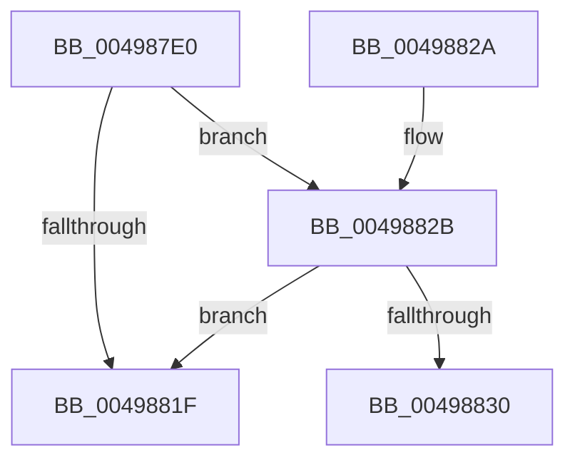

# ExAllocatePoolWithQuotaTag

- RVA: `0x004987E0`–`0x00498849` (길이 `105` bytes)
- VA: `0x00000001404987E0`
- 실행 섹션: `.text`
- PDB 이름 있음: `예`; PDB Function 태그: `아니요`
- unwind 정보 RVA: `0x000B41E4`
- 디코드: `31`개 명령, `105/105` bytes 표시
- 미해석 바이트: `0` (있으면 어셈블리에 `.byte`로 보존)

> 이 문서는 커널 이미지의 기계어와 PDB 기호를 분석해 생성했습니다. 4번과 5번은 함수 원형과 자료형을 바이너리 사용 방식에서 추정한 C 해석이며 원본 소스 복구 결과는 아닙니다.

## 1. Dependencies

- 직접 호출 지점: **3**; 고유 호출 대상: **3**
- 직접 호출자로 확인된 함수: **4**
- RIP 상대 이미지 참조: **0**

### Outgoing calls
- `0x004987F7` → [ExpPoolTypeToPoolFlags](../../poolcode/B8/ExpPoolTypeToPoolFlags_function_00B841C0.md) (function, `0x00B841C0`)
- `0x00498815` → [ExAllocatePool2](../../poolcode/B8/ExAllocatePool2_function_00B820F0.md) (function, `0x00B820F0`)
- `0x00498843` → [KeBugCheckEx](../4F/KeBugCheckEx_function_004FD660.md) (function, `0x004FD660`)

### Direct callers
- [FsRtlAllocatePoolWithQuota](../58/FsRtlAllocatePoolWithQuota_function_00581C00.md) at `0x00581C0C`
- [FsRtlAllocatePoolWithQuotaTag](../58/FsRtlAllocatePoolWithQuotaTag_function_00581C30.md) at `0x00581C36`
- [VerifierExAllocatePoolWithQuotaTag](../../pagevrfy/BA/VerifierExAllocatePoolWithQuotaTag_function_00BA1510.md) at `0x00BA1584`
- [VerifierPortExAllocatePoolWithQuotaTag](../../pagevrfy/BA/VerifierPortExAllocatePoolWithQuotaTag_function_00BABE80.md) at `0x00BABF3F`

### Static image references
- 디코드된 RIP-relative 메모리 참조가 없습니다.

## 2. Other-region calls and transfers

- 다른 실행 섹션으로 향하는 call: **2**
  - `0x004987F7` → [ExpPoolTypeToPoolFlags](../../poolcode/B8/ExpPoolTypeToPoolFlags_function_00B841C0.md) (`.text` → `POOLCODE`)
  - `0x00498815` → [ExAllocatePool2](../../poolcode/B8/ExAllocatePool2_function_00B820F0.md) (`.text` → `POOLCODE`)
- 별도 외부 분기/꼬리 이동을 확인하지 못했습니다.

## 3. Assembly (complete function range)

```asm
004987E0  48 89 5C 24 08                  mov qword ptr [rsp + 8], rbx
004987E5  57                              push rdi
004987E6  48 83 EC 30                     sub rsp, 0x30
004987EA  48 8B FA                        mov rdi, rdx
004987ED  45 8B D0                        mov r10d, r8d
004987F0  BA 01 00 00 00                  mov edx, 1
004987F5  8B D9                           mov ebx, ecx
004987F7  E8 C4 B9 6E 00                  call 0x140b841c0
004987FC  41 81 E2 FF FF FF 7F            and r10d, 0x7fffffff
00498803  B9 42 61 64 30                  mov ecx, 0x30646142
00498808  48 8B D7                        mov rdx, rdi
0049880B  44 0F 44 D1                     cmove r10d, ecx
0049880F  48 8B C8                        mov rcx, rax
00498812  45 8B C2                        mov r8d, r10d
00498815  E8 D6 98 6E 00                  call 0x140b820f0
0049881A  48 85 C0                        test rax, rax
0049881D  74 0C                           je 0x14049882b
0049881F  48 8B 5C 24 40                  mov rbx, qword ptr [rsp + 0x40]
00498824  48 83 C4 30                     add rsp, 0x30
00498828  5F                              pop rdi
00498829  C3                              ret
0049882A  CC                              int3
0049882B  F6 C3 02                        test bl, 2
0049882E  74 EF                           je 0x14049881f
00498830  48 83 64 24 20 00               and qword ptr [rsp + 0x20], 0
00498836  45 33 C9                        xor r9d, r9d
00498839  45 33 C0                        xor r8d, r8d
0049883C  48 8B D7                        mov rdx, rdi
0049883F  41 8D 49 41                     lea ecx, [r9 + 0x41]
00498843  E8 18 4E 06 00                  call 0x1404fd660
00498848  CC                              int3
```

## 4. C-style interpretation (structured pseudocode)

```c
__int64 __fastcall ExAllocatePoolWithQuotaTag(int a1, __int64 a2, int a3, int a4)
{
    __int64 result;
    __int64 v_r10;
    __int64 v_rsp;
    unsigned __int64 v_stack_p20;
    unsigned __int64 v_stack_p8;

    v_stack_p8 = v_rbx;
    v_rsp = (v_rsp) - (48);
    result = ExpPoolTypeToPoolFlags(a1, 1, a3, a4);
    v_r10 = (unsigned int)(((unsigned int)(a3)) & (0x7FFFFFFFULL));
    if (condition_is_equal) { v_r10 = (unsigned int)((unsigned int)(0x30646142ULL)); }
    result = ExAllocatePool2(result, a2, (unsigned int)((unsigned int)(v_r10)), a4);
    if (result == 0) goto loc_0049882B;
loc_0049881F:
    v_rsp = (v_rsp) + (48);
    return result;
loc_0049882B:
    if ((((unsigned __int8)(v_stack_p8)) & (2)) == 0) goto loc_0049881F;
    a4 = 0;
    a3 = 0;
    result = KeBugCheckEx(a4 + 65, a2, a3, a4);
    return result;
}
```

## 5. (Beta) C Style

```c
int64_t ExAllocatePoolWithQuotaTag(int32_t Arg1, int64_t Arg2, int32_t Arg3, int32_t Arg4)
{
    int64_t result;
    int64_t local_r10;
    int64_t local_rsp;
    uint64_t v_stack_p20;
    uint64_t v_stack_p8;

    v_stack_p8 = local_rbx;
    local_rsp = (local_rsp) - (48);
    result = ExpPoolTypeToPoolFlags(Arg1, 1, Arg3, Arg4);
    local_r10 = (uint32_t)(((uint32_t)(Arg3)) & (0x7FFFFFFFULL));
    if (condition_is_equal) { local_r10 = (uint32_t)((uint32_t)(0x30646142ULL)); }
    result = ExAllocatePool2(result, Arg2, (uint32_t)((uint32_t)(local_r10)), Arg4);
    if (result == 0) goto loc_0049882B;
loc_0049881F:
    local_rsp = (local_rsp) + (48);
    return result;
loc_0049882B:
    if ((((uint8_t)(v_stack_p8)) & (2)) == 0) goto loc_0049881F;
    Arg4 = 0;
    Arg3 = 0;
    result = KeBugCheckEx(Arg4 + 65, Arg2, Arg3, Arg4);
    return result;
}
```

## 6. Execution-region graph

[열기: 2D/3D 그래프와 함수 탐색 컨트롤 패널](../../../control-panel.html?section=text&rva=0x004987E0&view=graph)

- 2D 그래프는 위에서 아래로 흐르고, 3D 그래프는 빈 공간을 드래그해 회전합니다. Shift+드래그는 이동, 휠은 확대·축소, 함수 노드 선택은 대상 보고서 이동입니다.

### Static fallback


