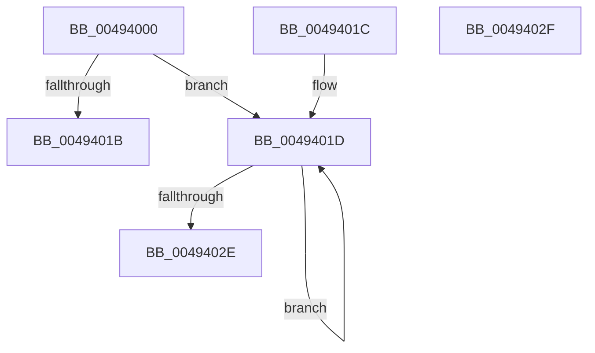

# ExBlockPushLock

- RVA: `0x00494000`–`0x00494030` (길이 `48` bytes)
- VA: `0x0000000140494000`
- 실행 섹션: `.text`
- PDB 이름 있음: `예`; PDB Function 태그: `아니요`
- unwind 정보 RVA: `0x000DB714`
- 디코드: `16`개 명령, `48/48` bytes 표시
- 미해석 바이트: `0` (있으면 어셈블리에 `.byte`로 보존)

> 이 문서는 커널 이미지의 기계어와 PDB 기호를 분석해 생성했습니다. 4번과 5번은 함수 원형과 자료형을 바이너리 사용 방식에서 추정한 C 해석이며 원본 소스 복구 결과는 아닙니다.

## 1. Dependencies

- 직접 호출 지점: **0**; 고유 호출 대상: **0**
- 직접 호출자로 확인된 함수: **0**
- RIP 상대 이미지 참조: **0**

### Outgoing calls
- 직접 디코드된 call 명령이 없습니다.

### Direct callers
- 이 함수 시작 RVA로 연결되는 직접 call은 확인되지 않았습니다. 간접 호출은 완전히 역산할 수 없습니다.

### Static image references
- 디코드된 RIP-relative 메모리 참조가 없습니다.

## 2. Other-region calls and transfers

- 다른 실행 섹션으로 향하는 call: **0**
- 별도 외부 분기/꼬리 이동을 확인하지 못했습니다.

## 3. Assembly (complete function range)

```asm
00494000  4C 8B C1                        mov r8, rcx
00494003  C7 42 34 02 00 00 00            mov dword ptr [rdx + 0x34], 2
0049400A  0F 0D 09                        prefetchw byte ptr [rcx]
0049400D  48 8B 01                        mov rax, qword ptr [rcx]
00494010  48 89 42 18                     mov qword ptr [rdx + 0x18], rax
00494014  F0 48 0F B1 11                  lock cmpxchg qword ptr [rcx], rdx
00494019  75 02                           jne 0x14049401d
0049401B  C3                              ret
0049401C  CC                              int3
0049401D  48 8B C8                        mov rcx, rax
00494020  48 89 42 18                     mov qword ptr [rdx + 0x18], rax
00494024  F0 49 0F B1 10                  lock cmpxchg qword ptr [r8], rdx
00494029  48 3B C1                        cmp rax, rcx
0049402C  75 EF                           jne 0x14049401d
0049402E  C3                              ret
0049402F  CC                              int3
```

## 4. C-style interpretation (structured pseudocode)

```c
__int64 __fastcall ExBlockPushLock(__int64 a1, __int64 a2)
{
    *(unsigned int *)(a2 + 52) = 2;
    *(unsigned __int64 *)(a2 + 24) = *(unsigned __int64 *)(a1);
    if (condition_is_not_equal) goto loc_0049401D;
    return *(unsigned __int64 *)(a1);
loc_0049401D:
    *(unsigned __int64 *)(a2 + 24) = *(unsigned __int64 *)(a1);
    if ((*(unsigned __int64 *)(a1)) != (*(unsigned __int64 *)(a1))) goto loc_0049401D;
    return *(unsigned __int64 *)(a1);
}
```

## 5. (Beta) C Style

```c
int64_t ExBlockPushLock(void *Arg1, void *Arg2)
{
    uint8_t *arg1 = (uint8_t *)Arg1;
    uint8_t *arg2 = (uint8_t *)Arg2;

    *(uint32_t *)(arg2 + 0x34) = 2;
    *(uint64_t *)(arg2 + 0x18) = *(uint64_t *)(arg1);
    if (condition_is_not_equal) goto loc_0049401D;
    return *(uint64_t *)(arg1);
loc_0049401D:
    *(uint64_t *)(arg2 + 0x18) = *(uint64_t *)(arg1);
    if ((*(uint64_t *)(arg1)) != (*(uint64_t *)(arg1))) goto loc_0049401D;
    return *(uint64_t *)(arg1);
}
```

### 관측된 메모리 오프셋

구조체 형식이 확인되지 않은 접근은 인자 기준의 오프셋으로만 기록했습니다.

| 기준 인자 | 오프셋 표현 | 폭 (bit) | 접근 |
|---|---:|---:|---|
| `Arg1` | `+ 0x0` | `8` | `R` |
| `Arg1` | `+ 0x0` | `64` | `R` |
| `Arg2` | `+ 0x18` | `64` | `W` |
| `Arg2` | `+ 0x34` | `32` | `W` |

## 6. Execution-region graph

[열기: 2D/3D 그래프와 함수 탐색 컨트롤 패널](../../../control-panel.html?section=text&rva=0x00494000&view=graph)

- 2D 그래프는 위에서 아래로 흐르고, 3D 그래프는 빈 공간을 드래그해 회전합니다. Shift+드래그는 이동, 휠은 확대·축소, 함수 노드 선택은 대상 보고서 이동입니다.

### Static fallback


