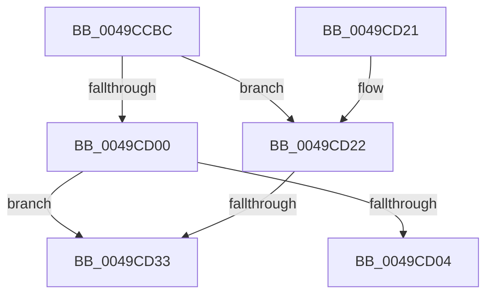

# ExFreeSvmAsid

- RVA: `0x0049CCBC`–`0x0049CD41` (길이 `133` bytes)
- VA: `0x000000014049CCBC`
- 실행 섹션: `.text`
- PDB 이름 있음: `예`; PDB Function 태그: `예`
- unwind 정보 RVA: `0x000B4D08`
- 디코드: `38`개 명령, `133/133` bytes 표시
- 미해석 바이트: `0` (있으면 어셈블리에 `.byte`로 보존)

> 이 문서는 커널 이미지의 기계어와 PDB 기호를 분석해 생성했습니다. 4번과 5번은 함수 원형과 자료형을 바이너리 사용 방식에서 추정한 C 해석이며 원본 소스 복구 결과는 아닙니다.

## 1. Dependencies

- 직접 호출 지점: **0**; 고유 호출 대상: **0**
- 직접 호출자로 확인된 함수: **1**
- RIP 상대 이미지 참조: **0**

### Outgoing calls
- 직접 디코드된 call 명령이 없습니다.

### Direct callers
- [MmCleanProcessAddressSpace](../../page/A1/MmCleanProcessAddressSpace_function_00A17EC0.md) at `0x00A1804A`

### Static image references
- 디코드된 RIP-relative 메모리 참조가 없습니다.

## 2. Other-region calls and transfers

- 다른 실행 섹션으로 향하는 call: **0**
- call이 아닌 외부 분기/꼬리 이동: **2**
  - `0x0049CD2D` → [sub_006F7EE2](../6F/Unknown_function_006F7EE2.md) (`tail-transfer`)
  - `0x0049CD3C` → [sub_006F7EE2](../6F/Unknown_function_006F7EE2.md) (`tail-transfer`)

## 3. Assembly (complete function range)

```asm
0049CCBC  48 89 5C 24 10                  mov qword ptr [rsp + 0x10], rbx
0049CCC1  48 89 6C 24 18                  mov qword ptr [rsp + 0x18], rbp
0049CCC6  48 89 74 24 20                  mov qword ptr [rsp + 0x20], rsi
0049CCCB  57                              push rdi
0049CCCC  41 54                           push r12
0049CCCE  41 55                           push r13
0049CCD0  41 56                           push r14
0049CCD2  41 57                           push r15
0049CCD4  48 83 EC 20                     sub rsp, 0x20
0049CCD8  65 48 8B 04 25 88 01 00 00      mov rax, qword ptr gs:[0x188]
0049CCE1  33 ED                           xor ebp, ebp
0049CCE3  45 33 E4                        xor r12d, r12d
0049CCE6  48 8B 98 B8 00 00 00            mov rbx, qword ptr [rax + 0xb8]
0049CCED  83 C8 FF                        or eax, 0xffffffff
0049CCF0  8B BB 00 06 00 00               mov edi, dword ptr [rbx + 0x600]
0049CCF6  8B B3 E4 07 00 00               mov esi, dword ptr [rbx + 0x7e4]
0049CCFC  85 FF                           test edi, edi
0049CCFE  75 22                           jne 0x14049cd22
0049CD00  85 F6                           test esi, esi
0049CD02  75 2F                           jne 0x14049cd33
0049CD04  48 8B 5C 24 58                  mov rbx, qword ptr [rsp + 0x58]
0049CD09  48 8B 6C 24 60                  mov rbp, qword ptr [rsp + 0x60]
0049CD0E  48 8B 74 24 68                  mov rsi, qword ptr [rsp + 0x68]
0049CD13  48 83 C4 20                     add rsp, 0x20
0049CD17  41 5F                           pop r15
0049CD19  41 5E                           pop r14
0049CD1B  41 5D                           pop r13
0049CD1D  41 5C                           pop r12
0049CD1F  5F                              pop rdi
0049CD20  C3                              ret
0049CD21  CC                              int3
0049CD22  48 8B AB 08 06 00 00            mov rbp, qword ptr [rbx + 0x608]
0049CD29  03 F8                           add edi, eax
0049CD2B  85 F6                           test esi, esi
0049CD2D  0F 84 AF B1 25 00               je 0x1406f7ee2
0049CD33  4C 8B A3 E8 07 00 00            mov r12, qword ptr [rbx + 0x7e8]
0049CD3A  03 F0                           add esi, eax
0049CD3C  E9 A1 B1 25 00                  jmp 0x1406f7ee2
```

## 4. C-style interpretation (structured pseudocode)

```c
__int64 __fastcall ExFreeSvmAsid(void)
{
    __int64 result;
    __int64 v_r12;
    __int64 v_rbp;
    __int64 v_rdi;
    __int64 v_rsi;
    __int64 v_rsp;
    unsigned __int64 v_stack_p10;
    unsigned __int64 v_stack_p18;
    unsigned __int64 v_stack_p20;

    v_stack_p10 = v_rbx;
    v_stack_p18 = v_rbp;
    v_stack_p20 = v_rsi;
    v_rsp = (v_rsp) - (32);
    v_rbp = 0;
    v_r12 = 0;
    result = (unsigned int)((*(unsigned __int64 *)(gs_base + (0 + 392))) | (0xFFFFFFFFULL));
    if ((unsigned int)((unsigned int)(*(unsigned int *)(*(unsigned __int64 *)(*(unsigned __int64 *)(gs_base + (0 + 392)) + 184) + 1536))) != 0) goto loc_0049CD22;
    if ((unsigned int)((unsigned int)(*(unsigned int *)(*(unsigned __int64 *)(*(unsigned __int64 *)(gs_base + (0 + 392)) + 184) + 2020))) != 0) goto loc_0049CD33;
    v_rsp = (v_rsp) + (32);
    return result;
loc_0049CD22:
    v_rdi = (unsigned int)(((unsigned int)(*(unsigned int *)(*(unsigned __int64 *)(*(unsigned __int64 *)(gs_base + (0 + 392)) + 184) + 1536))) + ((unsigned int)(result)));
loc_0049CD33:
    v_rsi = (unsigned int)((v_stack_p20) + ((unsigned int)(result)));
}
```

## 5. (Beta) C Style

```c
void ExFreeSvmAsid(void)
{
    int64_t result;
    int64_t local_r12;
    int64_t local_rbp;
    int64_t local_rdi;
    int64_t local_rsi;
    int64_t local_rsp;
    uint64_t v_stack_p10;
    uint64_t v_stack_p18;
    uint64_t v_stack_p20;

    v_stack_p10 = local_rbx;
    v_stack_p18 = local_rbp;
    v_stack_p20 = local_rsi;
    local_rsp = (local_rsp) - (32);
    local_rbp = 0;
    local_r12 = 0;
    result = (uint32_t)((*(uint64_t *)(gs_base + (0 + 0x188))) | (0xFFFFFFFFULL));
    if ((uint32_t)((uint32_t)(*(uint32_t *)(*(uint64_t *)(*(uint64_t *)(gs_base + (0 + 0x188)) + 0xB8) + 0x600))) != 0) goto loc_0049CD22;
    if ((uint32_t)((uint32_t)(*(uint32_t *)(*(uint64_t *)(*(uint64_t *)(gs_base + (0 + 0x188)) + 0xB8) + 0x7E4))) != 0) goto loc_0049CD33;
    local_rsp = (local_rsp) + (32);
    return result;
loc_0049CD22:
    local_rdi = (uint32_t)(((uint32_t)(*(uint32_t *)(*(uint64_t *)(*(uint64_t *)(gs_base + (0 + 0x188)) + 0xB8) + 0x600))) + ((uint32_t)(result)));
loc_0049CD33:
    local_rsi = (uint32_t)((v_stack_p20) + ((uint32_t)(result)));
}
```

## 6. Execution-region graph

[열기: 2D/3D 그래프와 함수 탐색 컨트롤 패널](../../../control-panel.html?section=text&rva=0x0049CCBC&view=graph)

- 2D 그래프는 위에서 아래로 흐르고, 3D 그래프는 빈 공간을 드래그해 회전합니다. Shift+드래그는 이동, 휠은 확대·축소, 함수 노드 선택은 대상 보고서 이동입니다.

### Static fallback


