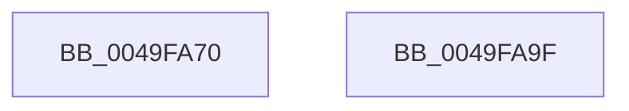

# ExGetCurrentProcessorCounts

- RVA: `0x0049FA70`–`0x0049FAA0` (길이 `48` bytes)
- VA: `0x000000014049FA70`
- 실행 섹션: `.text`
- PDB 이름 있음: `예`; PDB Function 태그: `아니요`
- unwind 정보 RVA: `0x000DB714`
- 디코드: `11`개 명령, `48/48` bytes 표시
- 미해석 바이트: `0` (있으면 어셈블리에 `.byte`로 보존)

> 이 문서는 커널 이미지의 기계어와 PDB 기호를 분석해 생성했습니다. 4번과 5번은 함수 원형과 자료형을 바이너리 사용 방식에서 추정한 C 해석이며 원본 소스 복구 결과는 아닙니다.

## 1. Dependencies

- 직접 호출 지점: **0**; 고유 호출 대상: **0**
- 직접 호출자로 확인된 함수: **0**
- RIP 상대 이미지 참조: **0**

### Outgoing calls
- 직접 디코드된 call 명령이 없습니다.

### Direct callers
- 이 함수 시작 RVA로 연결되는 직접 call은 확인되지 않았습니다. 간접 호출은 완전히 역산할 수 없습니다.

### Static image references
- 디코드된 RIP-relative 메모리 참조가 없습니다.

## 2. Other-region calls and transfers

- 다른 실행 섹션으로 향하는 call: **0**
- 별도 외부 분기/꼬리 이동을 확인하지 못했습니다.

## 3. Assembly (complete function range)

```asm
0049FA70  65 4C 8B 14 25 20 00 00 00      mov r10, qword ptr gs:[0x20]
0049FA79  49 8B 42 18                     mov rax, qword ptr [r10 + 0x18]
0049FA7D  44 8B 88 8C 02 00 00            mov r9d, dword ptr [rax + 0x28c]
0049FA84  44 89 09                        mov dword ptr [rcx], r9d
0049FA87  41 8B 82 48 86 00 00            mov eax, dword ptr [r10 + 0x8648]
0049FA8E  41 03 82 44 86 00 00            add eax, dword ptr [r10 + 0x8644]
0049FA95  89 02                           mov dword ptr [rdx], eax
0049FA97  41 8B 42 24                     mov eax, dword ptr [r10 + 0x24]
0049FA9B  41 89 00                        mov dword ptr [r8], eax
0049FA9E  C3                              ret
0049FA9F  CC                              int3
```

## 4. C-style interpretation (structured pseudocode)

```c
__int64 __fastcall ExGetCurrentProcessorCounts(__int64 a1, __int64 a2, __int64 a3)
{
    __int64 result;

    *(unsigned int *)(a1) = (unsigned int)((unsigned int)(*(unsigned int *)(*(unsigned __int64 *)(*(unsigned __int64 *)(gs_base + (0 + 32)) + 24) + 652)));
    result = (unsigned int)(((unsigned int)(*(unsigned int *)(*(unsigned __int64 *)(gs_base + (0 + 32)) + 34376))) + (*(unsigned int *)(*(unsigned __int64 *)(gs_base + (0 + 32)) + 34372)));
    *(unsigned int *)(a2) = (unsigned int)(result);
    *(unsigned int *)(a3) = (unsigned int)((unsigned int)(*(unsigned int *)(*(unsigned __int64 *)(gs_base + (0 + 32)) + 36)));
    return (unsigned int)(*(unsigned int *)(*(unsigned __int64 *)(gs_base + (0 + 32)) + 36));
}
```

## 5. (Beta) C Style

```c
int64_t ExGetCurrentProcessorCounts(void *Arg1, void *Arg2, void *Arg3)
{
    uint8_t *arg1 = (uint8_t *)Arg1;
    uint8_t *arg2 = (uint8_t *)Arg2;
    uint8_t *arg3 = (uint8_t *)Arg3;

    int64_t result;

    *(uint32_t *)(arg1) = (uint32_t)((uint32_t)(*(uint32_t *)(*(uint64_t *)(*(uint64_t *)(gs_base + (0 + 0x20)) + 0x18) + 0x28C)));
    result = (uint32_t)(((uint32_t)(*(uint32_t *)(*(uint64_t *)(gs_base + (0 + 0x20)) + 0x8648))) + (*(uint32_t *)(*(uint64_t *)(gs_base + (0 + 0x20)) + 0x8644)));
    *(uint32_t *)(arg2) = (uint32_t)(result);
    *(uint32_t *)(arg3) = (uint32_t)((uint32_t)(*(uint32_t *)(*(uint64_t *)(gs_base + (0 + 0x20)) + 0x24)));
    return (uint32_t)(*(uint32_t *)(*(uint64_t *)(gs_base + (0 + 0x20)) + 0x24));
}
```

### 관측된 메모리 오프셋

구조체 형식이 확인되지 않은 접근은 인자 기준의 오프셋으로만 기록했습니다.

| 기준 인자 | 오프셋 표현 | 폭 (bit) | 접근 |
|---|---:|---:|---|
| `Arg1` | `+ 0x0` | `32` | `W` |
| `Arg2` | `+ 0x0` | `32` | `W` |
| `Arg3` | `+ 0x0` | `32` | `W` |

## 6. Execution-region graph

[열기: 2D/3D 그래프와 함수 탐색 컨트롤 패널](../../../control-panel.html?section=text&rva=0x0049FA70&view=graph)

- 2D 그래프는 위에서 아래로 흐르고, 3D 그래프는 빈 공간을 드래그해 회전합니다. Shift+드래그는 이동, 휠은 확대·축소, 함수 노드 선택은 대상 보고서 이동입니다.

### Static fallback


