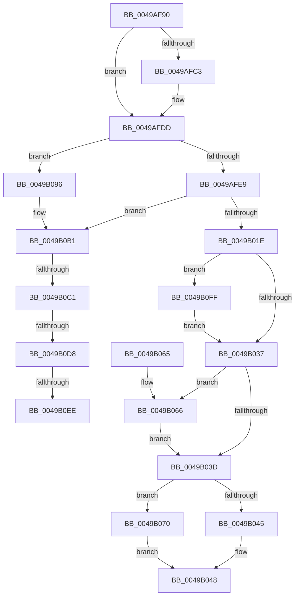

# ExInitializeFastResource2

- RVA: `0x0049AF90`–`0x0049B10C` (길이 `380` bytes)
- VA: `0x000000014049AF90`
- 실행 섹션: `.text`
- PDB 이름 있음: `예`; PDB Function 태그: `예`
- unwind 정보 RVA: `0x000B4844`
- 디코드: `107`개 명령, `380/380` bytes 표시
- 미해석 바이트: `0` (있으면 어셈블리에 `.byte`로 보존)

> 이 문서는 커널 이미지의 기계어와 PDB 기호를 분석해 생성했습니다. 4번과 5번은 함수 원형과 자료형을 바이너리 사용 방식에서 추정한 C 해석이며 원본 소스 복구 결과는 아닙니다.

## 1. Dependencies

- 직접 호출 지점: **6**; 고유 호출 대상: **5**
- 직접 호출자로 확인된 함수: **3**
- RIP 상대 이미지 참조: **2**

### Outgoing calls
- `0x0049AFD7` → [KeBugCheckEx](../4F/KeBugCheckEx_function_004FD660.md) (function, `0x004FD660`)
- `0x0049AFEF` → [memset](../6C/memset_function_006C6C40.md) (function, `0x006C6C40`)
- `0x0049B0AB` → [KeBugCheckEx](../4F/KeBugCheckEx_function_004FD660.md) (function, `0x004FD660`)
- `0x0049B0C7` → [RtlStdLogStackTrace](RtlStdLogStackTrace_function_00495BF8.md) (function, `0x00495BF8`)
- `0x0049B0DE` → [RtlpStdGetRecordedStackTraceIndex](RtlpStdGetRecordedStackTraceIndex_function_00495C84.md) (function, `0x00495C84`)
- `0x0049B0F4` → [RtlStdReleaseStackTrace](RtlStdReleaseStackTrace_function_00495D58.md) (function, `0x00495D58`)

### Direct callers
- [ExInitializeFastResourceAcquired](ExInitializeFastResourceAcquired_function_0049ADE0.md) at `0x0049AE0C`
- [ExInitializeFastResource](ExInitializeFastResource_function_0049AF70.md) at `0x0049AF78`
- [DifExInitializeFastResourceWrapper](../62/DifExInitializeFastResourceWrapper_function_006209D0.md) at `0x00620AAB`

### Static image references
- `0x0049B00E` → RVA `0x00FC42C0` (`.data`; read)
- `0x0049B0B1` → RVA `0x00F05C48` (`.data`; read)

## 2. Other-region calls and transfers

- 다른 실행 섹션으로 향하는 call: **0**
- call이 아닌 외부 분기/꼬리 이동: **4**
  - `0x0049B0BB` → [sub_006F7B60 + 0x6](../6F/Unknown_function_006F7B60.md) (`tail-transfer`)
  - `0x0049B0D2` → [sub_006F7B60](../6F/Unknown_function_006F7B60.md) (`tail-transfer`)
  - `0x0049B0E8` → [sub_006F7B60 + 0x3](../6F/Unknown_function_006F7B60.md) (`tail-transfer`)
  - `0x0049B0FA` → [sub_006F7B60 + 0x3](../6F/Unknown_function_006F7B60.md) (`tail-transfer`)

## 3. Assembly (complete function range)

```asm
0049AF90  4C 8B DC                        mov r11, rsp
0049AF93  49 89 5B 08                     mov qword ptr [r11 + 8], rbx
0049AF97  49 89 6B 10                     mov qword ptr [r11 + 0x10], rbp
0049AF9B  49 89 73 18                     mov qword ptr [r11 + 0x18], rsi
0049AF9F  57                              push rdi
0049AFA0  41 54                           push r12
0049AFA2  41 55                           push r13
0049AFA4  41 56                           push r14
0049AFA6  41 57                           push r15
0049AFA8  48 83 EC 30                     sub rsp, 0x30
0049AFAC  45 8B E8                        mov r13d, r8d
0049AFAF  8B EA                           mov ebp, edx
0049AFB1  48 8B F9                        mov rdi, rcx
0049AFB4  44 0F 20 C0                     mov rax, cr8
0049AFB8  41 BC 01 00 00 00               mov r12d, 1
0049AFBE  41 3A C4                        cmp al, r12b
0049AFC1  76 1A                           jbe 0x14049afdd
0049AFC3  33 DB                           xor ebx, ebx
0049AFC5  44 0F B6 C0                     movzx r8d, al
0049AFC9  45 8B CC                        mov r9d, r12d
0049AFCC  49 89 5B C8                     mov qword ptr [r11 - 0x38], rbx
0049AFD0  33 D2                           xor edx, edx
0049AFD2  B9 C6 01 00 00                  mov ecx, 0x1c6
0049AFD7  E8 84 26 06 00                  call 0x1404fd660
0049AFDC  CC                              int3
0049AFDD  F7 C5 F6 FF FF FF               test ebp, 0xfffffff6
0049AFE3  0F 85 AD 00 00 00               jne 0x14049b096
0049AFE9  33 D2                           xor edx, edx
0049AFEB  44 8D 42 68                     lea r8d, [rdx + 0x68]
0049AFEF  E8 4C BC 22 00                  call 0x1406c6c40
0049AFF4  33 DB                           xor ebx, ebx
0049AFF6  48 89 5F 48                     mov qword ptr [rdi + 0x48], rbx
0049AFFA  8A 47 65                        mov al, byte ptr [rdi + 0x65]
0049AFFD  24 FA                           and al, 0xfa
0049AFFF  48 89 5F 50                     mov qword ptr [rdi + 0x50], rbx
0049B003  0C 02                           or al, 2
0049B005  89 5F 60                        mov dword ptr [rdi + 0x60], ebx
0049B008  88 47 65                        mov byte ptr [rdi + 0x65], al
0049B00B  88 5F 64                        mov byte ptr [rdi + 0x64], bl
0049B00E  F7 05 A8 92 B2 00 00 20 00 00   test dword ptr [rip + 0xb292a8], 0x2000
0049B018  0F 85 93 00 00 00               jne 0x14049b0b1
0049B01E  48 89 5F 28                     mov qword ptr [rdi + 0x28], rbx
0049B022  0F B7 47 1A                     movzx eax, word ptr [rdi + 0x1a]
0049B026  66 41 0B C4                     or ax, r12w
0049B02A  66 89 47 1A                     mov word ptr [rdi + 0x1a], ax
0049B02E  41 84 EC                        test r12b, bpl
0049B031  0F 85 C8 00 00 00               jne 0x14049b0ff
0049B037  40 F6 C5 08                     test bpl, 8
0049B03B  75 29                           jne 0x14049b066
0049B03D  83 C8 FF                        or eax, 0xffffffff
0049B040  44 3B E8                        cmp r13d, eax
0049B043  75 2B                           jne 0x14049b070
0049B045  89 47 1C                        mov dword ptr [rdi + 0x1c], eax
0049B048  48 8B 5C 24 60                  mov rbx, qword ptr [rsp + 0x60]
0049B04D  48 8B 6C 24 68                  mov rbp, qword ptr [rsp + 0x68]
0049B052  48 8B 74 24 70                  mov rsi, qword ptr [rsp + 0x70]
0049B057  48 83 C4 30                     add rsp, 0x30
0049B05B  41 5F                           pop r15
0049B05D  41 5E                           pop r14
0049B05F  41 5D                           pop r13
0049B061  41 5C                           pop r12
0049B063  5F                              pop rdi
0049B064  C3                              ret
0049B065  CC                              int3
0049B066  66 83 C8 08                     or ax, 8
0049B06A  66 89 47 1A                     mov word ptr [rdi + 0x1a], ax
0049B06E  EB CD                           jmp 0x14049b03d
0049B070  41 8D 8D 9F 0F 00 00            lea ecx, [r13 + 0xf9f]
0049B077  48 B8 77 BE 9F 1A 2F DD 24 06   movabs rax, 0x624dd2f1a9fbe77
0049B081  48 F7 E1                        mul rcx
0049B084  48 2B CA                        sub rcx, rdx
0049B087  48 D1 E9                        shr rcx, 1
0049B08A  48 03 CA                        add rcx, rdx
0049B08D  48 C1 E9 0B                     shr rcx, 0xb
0049B091  89 4F 1C                        mov dword ptr [rdi + 0x1c], ecx
0049B094  EB B2                           jmp 0x14049b048
0049B096  33 DB                           xor ebx, ebx
0049B098  4C 8B CD                        mov r9, rbp
0049B09B  4C 8B C7                        mov r8, rdi
0049B09E  48 89 5C 24 20                  mov qword ptr [rsp + 0x20], rbx
0049B0A3  B9 C6 01 00 00                  mov ecx, 0x1c6
0049B0A8  8D 53 10                        lea edx, [rbx + 0x10]
0049B0AB  E8 B0 25 06 00                  call 0x1404fd660
0049B0B0  CC                              int3
0049B0B1  48 8B 35 90 AB A6 00            mov rsi, qword ptr [rip + 0xa6ab90]
0049B0B8  48 85 F6                        test rsi, rsi
0049B0BB  0F 84 A5 CA 25 00               je 0x1406f7b66
0049B0C1  41 8B D4                        mov edx, r12d
0049B0C4  48 8B CE                        mov rcx, rsi
0049B0C7  E8 2C AB FF FF                  call 0x140495bf8
0049B0CC  4C 8B F8                        mov r15, rax
0049B0CF  48 85 C0                        test rax, rax
0049B0D2  0F 84 88 CA 25 00               je 0x1406f7b60
0049B0D8  48 8B D0                        mov rdx, rax
0049B0DB  48 8B CE                        mov rcx, rsi
0049B0DE  E8 A1 AB FF FF                  call 0x140495c84
0049B0E3  44 8B F0                        mov r14d, eax
0049B0E6  85 C0                           test eax, eax
0049B0E8  0F 85 75 CA 25 00               jne 0x1406f7b63
0049B0EE  49 8B D7                        mov rdx, r15
0049B0F1  48 8B CE                        mov rcx, rsi
0049B0F4  E8 5F AC FF FF                  call 0x140495d58
0049B0F9  90                              nop
0049B0FA  E9 64 CA 25 00                  jmp 0x1406f7b63
0049B0FF  66 83 C8 40                     or ax, 0x40
0049B103  66 89 47 1A                     mov word ptr [rdi + 0x1a], ax
0049B107  E9 2B FF FF FF                  jmp 0x14049b037
```

## 4. C-style interpretation (structured pseudocode)

```c
__int64 __fastcall ExInitializeFastResource2(__int64 a1, int a2, int a3)
{
    __int64 result;
    __int64 v_rbx;
    __int64 v_rsp;
    unsigned __int64 v_stack_p10;
    unsigned __int64 v_stack_p18;
    unsigned __int64 v_stack_p20;
    unsigned __int64 v_stack_p8;

    *(unsigned __int64 *)(v_rsp + 8) = v_rbx;
    *(unsigned __int64 *)(v_rsp + 16) = v_rbp;
    *(unsigned __int64 *)(v_rsp + 24) = v_rsi;
    v_rsp = (v_rsp) - (48);
    result = v_cr8;
    if (((unsigned __int8)(v_cr8)) >= = 1) {
        v_rbx = 0;
        a3 = (unsigned __int8)(v_cr8);
        a4 = 1;
        *(unsigned __int64 *)(v_rsp - 56) = 0;
        a2 = 0;
        a1 = 454;
        result = KeBugCheckEx(a1, a2, a3, a4);
    }
    if ((((unsigned int)((unsigned int)(a2))) & (0xFFFFFFF6ULL)) != 0) goto loc_0049B096;
    a2 = 0;
    result = memset(a1, a2, a2 + 104, a4);
    v_rbx = 0;
    *(unsigned __int64 *)(a1 + 72) = 0;
    result = (unsigned __int8)((*(unsigned __int8 *)(a1 + 101)) & (250));
    *(unsigned __int64 *)(a1 + 80) = 0;
    result = (unsigned __int8)((result) | (2));
    *(unsigned int *)(a1 + 96) = 0;
    *(unsigned __int8 *)(a1 + 101) = (unsigned __int8)(result);
    *(unsigned __int8 *)(a1 + 100) = 0;
    if (((*(unsigned int *)(v_rip + 11702952)) & (0x2000ULL)) != 0) goto loc_0049B0B1;
    *(unsigned __int64 *)(a1 + 40) = 0;
    result = (unsigned __int16)((*(unsigned __int16 *)(a1 + 26)) | (1));
    *(unsigned __int16 *)(a1 + 26) = (unsigned __int16)(result);
    if (((1) & ((unsigned __int8)((unsigned int)(a2)))) != 0) goto loc_0049B0FF;
loc_0049B037:
    if ((((unsigned __int8)((unsigned int)(a2))) & (8)) != 0) goto loc_0049B066;
loc_0049B03D:
    result = (unsigned int)((result) | (0xFFFFFFFFULL));
    if (((unsigned int)((unsigned int)(a3))) != ((unsigned int)(result))) goto loc_0049B070;
    *(unsigned int *)(a1 + 28) = (unsigned int)(result);
loc_0049B048:
    v_rsp = (v_rsp) + (48);
    return result;
loc_0049B066:
    result = (unsigned __int16)((result) | (8));
    *(unsigned __int16 *)(a1 + 26) = (unsigned __int16)(result);
    goto loc_0049B03D;
loc_0049B070:
    a1 = ((unsigned int)(a3) + 3999) - (0);
    a1 = (a1) >> (1);
    a1 = (a1) + (0);
    a1 = (a1) >> (11);
    *(unsigned int *)(a1 + 28) = (unsigned int)(a1);
    goto loc_0049B048;
loc_0049B096:
    v_rbx = 0;
    v_stack_p20 = 0;
    result = KeBugCheckEx(454, v_rbx + 16, a1, v_stack_p10);
loc_0049B0B1:
    result = RtlStdLogStackTrace(*(unsigned __int64 *)(v_rip + 10922896), 1, a1, v_stack_p10);
    result = RtlpStdGetRecordedStackTraceIndex(*(unsigned __int64 *)(v_rip + 10922896), result, a1, v_stack_p10);
    result = RtlStdReleaseStackTrace(*(unsigned __int64 *)(v_rip + 10922896), result, a1, v_stack_p10);
loc_0049B0FF:
    result = (unsigned __int16)((result) | (64));
    *(unsigned __int16 *)(a1 + 26) = (unsigned __int16)(result);
    goto loc_0049B037;
}
```

## 5. (Beta) C Style

```c
int64_t ExInitializeFastResource2(void *FastResource2, int32_t Arg2, int32_t Arg3)
{
    uint8_t *fastResource2 = (uint8_t *)FastResource2;

    int64_t result;
    int64_t local_rbx;
    int64_t local_rsp;
    uint64_t v_stack_p10;
    uint64_t v_stack_p18;
    uint64_t v_stack_p20;
    uint64_t v_stack_p8;

    *(uint64_t *)(local_rsp + 0x8) = local_rbx;
    *(uint64_t *)(local_rsp + 0x10) = local_rbp;
    *(uint64_t *)(local_rsp + 0x18) = local_rsi;
    local_rsp = (local_rsp) - (48);
    result = v_cr8;
    if (((uint8_t)(v_cr8)) >= = 1) {
        local_rbx = 0;
        Arg3 = (uint8_t)(v_cr8);
        a4 = 1;
        *(uint64_t *)(local_rsp - 0x38) = 0;
        Arg2 = 0;
        FastResource2 = 454;
        result = KeBugCheckEx(FastResource2, Arg2, Arg3, a4);
    }
    if ((((uint32_t)((uint32_t)(Arg2))) & (0xFFFFFFF6ULL)) != 0) goto loc_0049B096;
    Arg2 = 0;
    result = memset(FastResource2, Arg2, Arg2 + 104, a4);
    local_rbx = 0;
    *(uint64_t *)(fastResource2 + 0x48) = 0;
    result = (uint8_t)((*(uint8_t *)(fastResource2 + 0x65)) & (250));
    *(uint64_t *)(fastResource2 + 0x50) = 0;
    result = (uint8_t)((result) | (2));
    *(uint32_t *)(fastResource2 + 0x60) = 0;
    *(uint8_t *)(fastResource2 + 0x65) = (uint8_t)(result);
    *(uint8_t *)(fastResource2 + 0x64) = 0;
    if (((*(uint32_t *)(v_rip + 0xB292A8)) & (0x2000ULL)) != 0) goto loc_0049B0B1;
    *(uint64_t *)(fastResource2 + 0x28) = 0;
    result = (uint16_t)((*(uint16_t *)(fastResource2 + 0x1A)) | (1));
    *(uint16_t *)(fastResource2 + 0x1A) = (uint16_t)(result);
    if (((1) & ((uint8_t)((uint32_t)(Arg2)))) != 0) goto loc_0049B0FF;
loc_0049B037:
    if ((((uint8_t)((uint32_t)(Arg2))) & (8)) != 0) goto loc_0049B066;
loc_0049B03D:
    result = (uint32_t)((result) | (0xFFFFFFFFULL));
    if (((uint32_t)((uint32_t)(Arg3))) != ((uint32_t)(result))) goto loc_0049B070;
    *(uint32_t *)(fastResource2 + 0x1C) = (uint32_t)(result);
loc_0049B048:
    local_rsp = (local_rsp) + (48);
    return result;
loc_0049B066:
    result = (uint16_t)((result) | (8));
    *(uint16_t *)(fastResource2 + 0x1A) = (uint16_t)(result);
    goto loc_0049B03D;
loc_0049B070:
    FastResource2 = ((uint32_t)(Arg3) + 3999) - (0);
    FastResource2 = (FastResource2) >> (1);
    FastResource2 = (FastResource2) + (0);
    FastResource2 = (FastResource2) >> (11);
    *(uint32_t *)(fastResource2 + 0x1C) = (uint32_t)(FastResource2);
    goto loc_0049B048;
loc_0049B096:
    local_rbx = 0;
    v_stack_p20 = 0;
    result = KeBugCheckEx(454, local_rbx + 16, FastResource2, v_stack_p10);
loc_0049B0B1:
    result = RtlStdLogStackTrace(*(uint64_t *)(v_rip + 0xA6AB90), 1, FastResource2, v_stack_p10);
    result = RtlpStdGetRecordedStackTraceIndex(*(uint64_t *)(v_rip + 0xA6AB90), result, FastResource2, v_stack_p10);
    result = RtlStdReleaseStackTrace(*(uint64_t *)(v_rip + 0xA6AB90), result, FastResource2, v_stack_p10);
loc_0049B0FF:
    result = (uint16_t)((result) | (64));
    *(uint16_t *)(fastResource2 + 0x1A) = (uint16_t)(result);
    goto loc_0049B037;
}
```

### 관측된 메모리 오프셋

구조체 형식이 확인되지 않은 접근은 인자 기준의 오프셋으로만 기록했습니다.

| 기준 인자 | 오프셋 표현 | 폭 (bit) | 접근 |
|---|---:|---:|---|
| `FastResource2` | `+ 0x1A` | `16` | `R` |
| `FastResource2` | `+ 0x1A` | `16` | `W` |
| `FastResource2` | `+ 0x1C` | `32` | `W` |
| `FastResource2` | `+ 0x28` | `64` | `W` |
| `FastResource2` | `+ 0x48` | `64` | `W` |
| `FastResource2` | `+ 0x50` | `64` | `W` |
| `FastResource2` | `+ 0x60` | `32` | `W` |
| `FastResource2` | `+ 0x64` | `8` | `W` |
| `FastResource2` | `+ 0x65` | `8` | `R` |
| `FastResource2` | `+ 0x65` | `8` | `W` |

## 6. Execution-region graph

[열기: 2D/3D 그래프와 함수 탐색 컨트롤 패널](../../../control-panel.html?section=text&rva=0x0049AF90&view=graph)

- 2D 그래프는 위에서 아래로 흐르고, 3D 그래프는 빈 공간을 드래그해 회전합니다. Shift+드래그는 이동, 휠은 확대·축소, 함수 노드 선택은 대상 보고서 이동입니다.

### Static fallback


