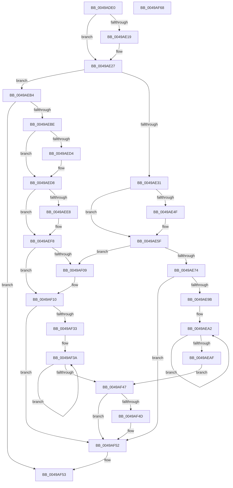

# ExInitializeFastResourceAcquired

- RVA: `0x0049ADE0`–`0x0049AF69` (길이 `393` bytes)
- VA: `0x000000014049ADE0`
- 실행 섹션: `.text`
- PDB 이름 있음: `예`; PDB Function 태그: `아니요`
- unwind 정보 RVA: `0x0005C954`
- 디코드: `107`개 명령, `393/393` bytes 표시
- 미해석 바이트: `0` (있으면 어셈블리에 `.byte`로 보존)

> 이 문서는 커널 이미지의 기계어와 PDB 기호를 분석해 생성했습니다. 4번과 5번은 함수 원형과 자료형을 바이너리 사용 방식에서 추정한 C 해석이며 원본 소스 복구 결과는 아닙니다.

## 1. Dependencies

- 직접 호출 지점: **3**; 고유 호출 대상: **3**
- 직접 호출자로 확인된 함수: **1**
- RIP 상대 이미지 참조: **0**

### Outgoing calls
- `0x0049AE0C` → [ExInitializeFastResource2](ExInitializeFastResource2_function_0049AF90.md) (function, `0x0049AF90`)
- `0x0049AE1F` → [KeAbPreAcquire](../21/KeAbPreAcquire_function_00210230.md) (function, `0x00210230`)
- `0x0049AF4D` → [KiRemoveSystemWorkPriorityKick](../26/KiRemoveSystemWorkPriorityKick_function_002631D0.md) (function, `0x002631D0`)

### Direct callers
- [DifExInitializeFastResourceAcquiredWrapper](../62/DifExInitializeFastResourceAcquiredWrapper_function_00620850.md) at `0x00620934`

### Static image references
- 디코드된 RIP-relative 메모리 참조가 없습니다.

## 2. Other-region calls and transfers

- 다른 실행 섹션으로 향하는 call: **0**
- 별도 외부 분기/꼬리 이동을 확인하지 못했습니다.

## 3. Assembly (complete function range)

```asm
0049ADE0  48 89 5C 24 08                  mov qword ptr [rsp + 8], rbx
0049ADE5  48 89 6C 24 10                  mov qword ptr [rsp + 0x10], rbp
0049ADEA  48 89 74 24 18                  mov qword ptr [rsp + 0x18], rsi
0049ADEF  57                              push rdi
0049ADF0  48 83 EC 20                     sub rsp, 0x20
0049ADF4  65 48 8B 34 25 88 01 00 00      mov rsi, qword ptr gs:[0x188]
0049ADFD  49 8B D8                        mov rbx, r8
0049AE00  8B EA                           mov ebp, edx
0049AE02  41 83 C8 FF                     or r8d, 0xffffffff
0049AE06  83 E2 F9                        and edx, 0xfffffff9
0049AE09  48 8B F9                        mov rdi, rcx
0049AE0C  E8 7F 01 00 00                  call 0x14049af90
0049AE11  33 D2                           xor edx, edx
0049AE13  40 F6 C5 06                     test bpl, 6
0049AE17  74 0E                           je 0x14049ae27
0049AE19  45 33 C0                        xor r8d, r8d
0049AE1C  48 8B CF                        mov rcx, rdi
0049AE1F  E8 0C 54 D7 FF                  call 0x140210230
0049AE24  48 8B D0                        mov rdx, rax
0049AE27  40 F6 C5 02                     test bpl, 2
0049AE2B  0F 84 83 00 00 00               je 0x14049aeb4
0049AE31  48 8B 07                        mov rax, qword ptr [rdi]
0049AE34  48 8D 4F 40                     lea rcx, [rdi + 0x40]
0049AE38  48 83 C8 01                     or rax, 1
0049AE3C  48 89 07                        mov qword ptr [rdi], rax
0049AE3F  48 89 71 10                     mov qword ptr [rcx + 0x10], rsi
0049AE43  C7 41 20 01 00 00 00            mov dword ptr [rcx + 0x20], 1
0049AE4A  48 85 D2                        test rdx, rdx
0049AE4D  74 10                           je 0x14049ae5f
0049AE4F  8A 42 08                        mov al, byte ptr [rdx + 8]
0049AE52  24 3F                           and al, 0x3f
0049AE54  C6 42 0A 01                     mov byte ptr [rdx + 0xa], 1
0049AE58  02 C0                           add al, al
0049AE5A  0C 01                           or al, 1
0049AE5C  88 41 24                        mov byte ptr [rcx + 0x24], al
0049AE5F  FA                              cli
0049AE60  48 8D 86 B8 06 00 00            lea rax, [rsi + 0x6b8]
0049AE67  48 8B 10                        mov rdx, qword ptr [rax]
0049AE6A  48 39 42 08                     cmp qword ptr [rdx + 8], rax
0049AE6E  0F 85 95 00 00 00               jne 0x14049af09
0049AE74  48 89 11                        mov qword ptr [rcx], rdx
0049AE77  48 89 41 08                     mov qword ptr [rcx + 8], rax
0049AE7B  48 89 4A 08                     mov qword ptr [rdx + 8], rcx
0049AE7F  48 89 08                        mov qword ptr [rax], rcx
0049AE82  65 48 8B 0C 25 20 00 00 00      mov rcx, qword ptr gs:[0x20]
0049AE8B  4C 8B 81 B8 8E 00 00            mov r8, qword ptr [rcx + 0x8eb8]
0049AE92  4D 85 C0                        test r8, r8
0049AE95  0F 84 B7 00 00 00               je 0x14049af52
0049AE9B  41 0F 0D 08                     prefetchw byte ptr [r8]
0049AE9F  41 8B 00                        mov eax, dword ptr [r8]
0049AEA2  8B D0                           mov edx, eax
0049AEA4  0F BA F2 15                     btr edx, 0x15
0049AEA8  F0 41 0F B1 10                  lock cmpxchg dword ptr [r8], edx
0049AEAD  75 F3                           jne 0x14049aea2
0049AEAF  E9 93 00 00 00                  jmp 0x14049af47
0049AEB4  40 F6 C5 04                     test bpl, 4
0049AEB8  0F 84 95 00 00 00               je 0x14049af53
0049AEBE  48 8B 07                        mov rax, qword ptr [rdi]
0049AEC1  83 E0 03                        and eax, 3
0049AEC4  48 83 C8 04                     or rax, 4
0049AEC8  48 89 07                        mov qword ptr [rdi], rax
0049AECB  48 8D 47 40                     lea rax, [rdi + 0x40]
0049AECF  48 3B D8                        cmp rbx, rax
0049AED2  74 04                           je 0x14049aed8
0049AED4  48 89 7B 18                     mov qword ptr [rbx + 0x18], rdi
0049AED8  48 89 73 10                     mov qword ptr [rbx + 0x10], rsi
0049AEDC  C7 43 20 01 00 00 00            mov dword ptr [rbx + 0x20], 1
0049AEE3  48 85 D2                        test rdx, rdx
0049AEE6  74 10                           je 0x14049aef8
0049AEE8  8A 42 08                        mov al, byte ptr [rdx + 8]
0049AEEB  24 3F                           and al, 0x3f
0049AEED  C6 42 0A 01                     mov byte ptr [rdx + 0xa], 1
0049AEF1  02 C0                           add al, al
0049AEF3  0C 01                           or al, 1
0049AEF5  88 43 24                        mov byte ptr [rbx + 0x24], al
0049AEF8  FA                              cli
0049AEF9  48 8D 86 B8 06 00 00            lea rax, [rsi + 0x6b8]
0049AF00  48 8B 10                        mov rdx, qword ptr [rax]
0049AF03  48 39 42 08                     cmp qword ptr [rdx + 8], rax
0049AF07  74 07                           je 0x14049af10
0049AF09  B9 03 00 00 00                  mov ecx, 3
0049AF0E  CD 29                           int 0x29
0049AF10  48 89 13                        mov qword ptr [rbx], rdx
0049AF13  48 89 43 08                     mov qword ptr [rbx + 8], rax
0049AF17  48 89 5A 08                     mov qword ptr [rdx + 8], rbx
0049AF1B  48 89 18                        mov qword ptr [rax], rbx
0049AF1E  65 48 8B 0C 25 20 00 00 00      mov rcx, qword ptr gs:[0x20]
0049AF27  4C 8B 81 B8 8E 00 00            mov r8, qword ptr [rcx + 0x8eb8]
0049AF2E  4D 85 C0                        test r8, r8
0049AF31  74 1F                           je 0x14049af52
0049AF33  41 0F 0D 08                     prefetchw byte ptr [r8]
0049AF37  41 8B 00                        mov eax, dword ptr [r8]
0049AF3A  8B D0                           mov edx, eax
0049AF3C  0F BA F2 15                     btr edx, 0x15
0049AF40  F0 41 0F B1 10                  lock cmpxchg dword ptr [r8], edx
0049AF45  75 F3                           jne 0x14049af3a
0049AF47  0F BA E0 15                     bt eax, 0x15
0049AF4B  73 05                           jae 0x14049af52
0049AF4D  E8 7E 82 DC FF                  call 0x1402631d0
0049AF52  FB                              sti
0049AF53  48 8B 5C 24 30                  mov rbx, qword ptr [rsp + 0x30]
0049AF58  48 8B 6C 24 38                  mov rbp, qword ptr [rsp + 0x38]
0049AF5D  48 8B 74 24 40                  mov rsi, qword ptr [rsp + 0x40]
0049AF62  48 83 C4 20                     add rsp, 0x20
0049AF66  5F                              pop rdi
0049AF67  C3                              ret
0049AF68  CC                              int3
```

## 4. C-style interpretation (structured pseudocode)

```c
__int64 __fastcall ExInitializeFastResourceAcquired(__int64 a1, int a2, __int64 a3)
{
    __int64 result;
    __int64 v_rsp;
    unsigned __int64 v_stack_p10;
    unsigned __int64 v_stack_p18;
    unsigned __int64 v_stack_p8;

    v_stack_p8 = v_rbx;
    v_stack_p10 = v_rbp;
    v_stack_p18 = v_rsi;
    v_rsp = (v_rsp) - (32);
    a3 = (unsigned int)((a3) | (0xFFFFFFFFULL));
    a2 = (unsigned int)((a2) & (0xFFFFFFF9ULL));
    result = ExInitializeFastResource2(a1, a2, a3, a4);
    a2 = 0;
    if ((((unsigned __int8)((unsigned int)(a2))) & (6)) != 0) {
        a3 = 0;
        a1 = a1;
        result = KeAbPreAcquire(a1, a2, a3, a4);
        a2 = result;
    }
    if ((((unsigned __int8)((unsigned int)(a2))) & (2)) == 0) goto loc_0049AEB4;
    result = (*(unsigned __int64 *)(a1)) | (1);
    *(unsigned __int64 *)(a1) = result;
    *(unsigned __int64 *)(a1 + 64 + 16) = *(unsigned __int64 *)(gs_base + (0 + 392));
    *(unsigned int *)(a1 + 64 + 32) = 1;
    if (a2 != 0) {
        result = *(unsigned __int8 *)(a2 + 8);
        result = (unsigned __int8)((result) & (63));
        *(unsigned __int8 *)(a2 + 10) = 1;
        result = (unsigned __int8)((result) + ((unsigned __int8)(result)));
        result = (unsigned __int8)((result) | (1));
        *(unsigned __int8 *)(a1 + 64 + 36) = (unsigned __int8)(result);
    }
    if ((*(unsigned __int64 *)(*(unsigned __int64 *)(*(unsigned __int64 *)(gs_base + (0 + 392)) + 1720) + 8)) != (*(unsigned __int64 *)(gs_base + (0 + 392)) + 1720)) goto loc_0049AF09;
    *(unsigned __int64 *)(a1 + 64) = *(unsigned __int64 *)(*(unsigned __int64 *)(gs_base + (0 + 392)) + 1720);
    *(unsigned __int64 *)(a1 + 64 + 8) = *(unsigned __int64 *)(gs_base + (0 + 392)) + 1720;
    *(unsigned __int64 *)(*(unsigned __int64 *)(*(unsigned __int64 *)(gs_base + (0 + 392)) + 1720) + 8) = a1 + 64;
    *(unsigned __int64 *)(*(unsigned __int64 *)(gs_base + (0 + 392)) + 1720) = a1 + 64;
    if (*(unsigned __int64 *)(*(unsigned __int64 *)(gs_base + (0 + 32)) + 36536) == 0) goto loc_0049AF52;
loc_0049AEA2:
    if (*(unsigned __int64 *)(*(unsigned __int64 *)(gs_base + (0 + 32)) + 36536) != 0) goto loc_0049AEA2;
    goto loc_0049AF47;
loc_0049AEB4:
    if ((((unsigned __int8)((unsigned int)(a2))) & (4)) == 0) goto loc_0049AF53;
    result = (unsigned int)((*(unsigned __int64 *)(a1)) & (3));
    result = (result) | (4);
    *(unsigned __int64 *)(a1) = result;
    if (0 != (a1 + 64)) {
        *(unsigned __int64 *)(a3 + 24) = a1;
    }
    *(unsigned __int64 *)(a3 + 16) = *(unsigned __int64 *)(gs_base + (0 + 392));
    *(unsigned int *)(a3 + 32) = 1;
    result = a1 + 64;
    if ((unsigned int)((unsigned int)((unsigned int)(*(unsigned int *)(*(unsigned __int64 *)(*(unsigned __int64 *)(gs_base + (0 + 32)) + 36536))))) != 0) {
        result = *(unsigned __int8 *)((unsigned int)((unsigned int)((unsigned int)(*(unsigned int *)(*(unsigned __int64 *)(*(unsigned __int64 *)(gs_base + (0 + 32)) + 36536))))) + 8);
        result = (unsigned __int8)((result) & (63));
        *(unsigned __int8 *)((unsigned int)((unsigned int)((unsigned int)(*(unsigned int *)(*(unsigned __int64 *)(*(unsigned __int64 *)(gs_base + (0 + 32)) + 36536))))) + 10) = 1;
        result = (unsigned __int8)((result) + ((unsigned __int8)(result)));
        result = (unsigned __int8)((result) | (1));
        *(unsigned __int8 *)(a3 + 36) = (unsigned __int8)(result);
    }
    if ((*(unsigned __int64 *)(*(unsigned __int64 *)(*(unsigned __int64 *)(gs_base + (0 + 392)) + 1720) + 8)) != (*(unsigned __int64 *)(gs_base + (0 + 392)) + 1720)) {
        a1 = 3;
    }
    *(unsigned __int64 *)(a3) = *(unsigned __int64 *)(*(unsigned __int64 *)(gs_base + (0 + 392)) + 1720);
    *(unsigned __int64 *)(a3 + 8) = *(unsigned __int64 *)(gs_base + (0 + 392)) + 1720;
    *(unsigned __int64 *)(*(unsigned __int64 *)(*(unsigned __int64 *)(gs_base + (0 + 392)) + 1720) + 8) = 0;
    *(unsigned __int64 *)(*(unsigned __int64 *)(gs_base + (0 + 392)) + 1720) = 0;
    if (*(unsigned __int64 *)(*(unsigned __int64 *)(gs_base + (0 + 32)) + 36536) == 0) goto loc_0049AF52;
loc_0049AF3A:
    if (*(unsigned __int64 *)(*(unsigned __int64 *)(gs_base + (0 + 32)) + 36536) != 0) goto loc_0049AF3A;
loc_0049AF47:
    result = (unsigned int)(*(unsigned int *)(*(unsigned __int64 *)(*(unsigned __int64 *)(gs_base + (0 + 32)) + 36536)));
    if (!(condition_is_above_or_equal)) {
        result = KiRemoveSystemWorkPriorityKick(*(unsigned __int64 *)(gs_base + (0 + 32)), (unsigned int)((unsigned int)((unsigned int)(*(unsigned int *)(*(unsigned __int64 *)(*(unsigned __int64 *)(gs_base + (0 + 32)) + 36536))))), *(unsigned __int64 *)(*(unsigned __int64 *)(gs_base + (0 + 32)) + 36536), a4);
    }
loc_0049AF53:
    v_rsp = (v_rsp) + (32);
    return result;
}
```

## 5. (Beta) C Style

```c
int64_t ExInitializeFastResourceAcquired(void *FastResourceAcquired, int32_t Arg2, int64_t Arg3)
{
    uint8_t *fastResourceAcquired = (uint8_t *)FastResourceAcquired;

    int64_t result;
    int64_t local_rsp;
    uint64_t v_stack_p10;
    uint64_t v_stack_p18;
    uint64_t v_stack_p8;

    v_stack_p8 = local_rbx;
    v_stack_p10 = local_rbp;
    v_stack_p18 = local_rsi;
    local_rsp = (local_rsp) - (32);
    Arg3 = (uint32_t)((Arg3) | (0xFFFFFFFFULL));
    Arg2 = (uint32_t)((Arg2) & (0xFFFFFFF9ULL));
    result = ExInitializeFastResource2(FastResourceAcquired, Arg2, Arg3, a4);
    Arg2 = 0;
    if ((((uint8_t)((uint32_t)(Arg2))) & (6)) != 0) {
        Arg3 = 0;
        FastResourceAcquired = FastResourceAcquired;
        result = KeAbPreAcquire(FastResourceAcquired, Arg2, Arg3, a4);
        Arg2 = result;
    }
    if ((((uint8_t)((uint32_t)(Arg2))) & (2)) == 0) goto loc_0049AEB4;
    result = (*(uint64_t *)(fastResourceAcquired)) | (1);
    *(uint64_t *)(fastResourceAcquired) = result;
    *(uint64_t *)(fastResourceAcquired + 0x40 + 0x10) = *(uint64_t *)(gs_base + (0 + 0x188));
    *(uint32_t *)(fastResourceAcquired + 0x40 + 0x20) = 1;
    if (Arg2 != 0) {
        result = *(uint8_t *)(Arg2 + 0x8);
        result = (uint8_t)((result) & (63));
        *(uint8_t *)(Arg2 + 0xA) = 1;
        result = (uint8_t)((result) + ((uint8_t)(result)));
        result = (uint8_t)((result) | (1));
        *(uint8_t *)(fastResourceAcquired + 0x40 + 0x24) = (uint8_t)(result);
    }
    if ((*(uint64_t *)(*(uint64_t *)(*(uint64_t *)(gs_base + (0 + 0x188)) + 0x6B8) + 0x8)) != (*(uint64_t *)(gs_base + (0 + 0x188)) + 1720)) goto loc_0049AF09;
    *(uint64_t *)(fastResourceAcquired + 0x40) = *(uint64_t *)(*(uint64_t *)(gs_base + (0 + 0x188)) + 0x6B8);
    *(uint64_t *)(fastResourceAcquired + 0x40 + 0x8) = *(uint64_t *)(gs_base + (0 + 0x188)) + 1720;
    *(void **)(*(uint64_t *)(*(uint64_t *)(gs_base + (0 + 0x188)) + 0x6B8) + 0x8) = FastResourceAcquired + 64;
    *(void **)(*(uint64_t *)(gs_base + (0 + 0x188)) + 0x6B8) = FastResourceAcquired + 64;
    if (*(uint64_t *)(*(uint64_t *)(gs_base + (0 + 0x20)) + 0x8EB8) == 0) goto loc_0049AF52;
loc_0049AEA2:
    if (*(uint64_t *)(*(uint64_t *)(gs_base + (0 + 0x20)) + 0x8EB8) != 0) goto loc_0049AEA2;
    goto loc_0049AF47;
loc_0049AEB4:
    if ((((uint8_t)((uint32_t)(Arg2))) & (4)) == 0) goto loc_0049AF53;
    result = (uint32_t)((*(uint64_t *)(fastResourceAcquired)) & (3));
    result = (result) | (4);
    *(uint64_t *)(fastResourceAcquired) = result;
    if (0 != (FastResourceAcquired + 64)) {
        *(void **)(Arg3 + 0x18) = FastResourceAcquired;
    }
    *(uint64_t *)(Arg3 + 0x10) = *(uint64_t *)(gs_base + (0 + 0x188));
    *(uint32_t *)(Arg3 + 0x20) = 1;
    result = FastResourceAcquired + 64;
    if ((uint32_t)((uint32_t)((uint32_t)(*(uint32_t *)(*(uint64_t *)(*(uint64_t *)(gs_base + (0 + 0x20)) + 0x8EB8))))) != 0) {
        result = *(uint8_t *)((uint32_t)((uint32_t)((uint32_t)(*(uint32_t *)(*(uint64_t *)(*(uint64_t *)(gs_base + (0 + 0x20)) + 0x8EB8))))) + 0x8);
        result = (uint8_t)((result) & (63));
        *(uint8_t *)((uint32_t)((uint32_t)((uint32_t)(*(uint32_t *)(*(uint64_t *)(*(uint64_t *)(gs_base + (0 + 0x20)) + 0x8EB8))))) + 0xA) = 1;
        result = (uint8_t)((result) + ((uint8_t)(result)));
        result = (uint8_t)((result) | (1));
        *(uint8_t *)(Arg3 + 0x24) = (uint8_t)(result);
    }
    if ((*(uint64_t *)(*(uint64_t *)(*(uint64_t *)(gs_base + (0 + 0x188)) + 0x6B8) + 0x8)) != (*(uint64_t *)(gs_base + (0 + 0x188)) + 1720)) {
        FastResourceAcquired = 3;
    }
    *(uint64_t *)(Arg3) = *(uint64_t *)(*(uint64_t *)(gs_base + (0 + 0x188)) + 0x6B8);
    *(uint64_t *)(Arg3 + 0x8) = *(uint64_t *)(gs_base + (0 + 0x188)) + 1720;
    *(uint64_t *)(*(uint64_t *)(*(uint64_t *)(gs_base + (0 + 0x188)) + 0x6B8) + 0x8) = 0;
    *(uint64_t *)(*(uint64_t *)(gs_base + (0 + 0x188)) + 0x6B8) = 0;
    if (*(uint64_t *)(*(uint64_t *)(gs_base + (0 + 0x20)) + 0x8EB8) == 0) goto loc_0049AF52;
loc_0049AF3A:
    if (*(uint64_t *)(*(uint64_t *)(gs_base + (0 + 0x20)) + 0x8EB8) != 0) goto loc_0049AF3A;
loc_0049AF47:
    result = (uint32_t)(*(uint32_t *)(*(uint64_t *)(*(uint64_t *)(gs_base + (0 + 0x20)) + 0x8EB8)));
    if (!(condition_is_above_or_equal)) {
        result = KiRemoveSystemWorkPriorityKick(*(uint64_t *)(gs_base + (0 + 0x20)), (uint32_t)((uint32_t)((uint32_t)(*(uint32_t *)(*(uint64_t *)(*(uint64_t *)(gs_base + (0 + 0x20)) + 0x8EB8))))), *(uint64_t *)(*(uint64_t *)(gs_base + (0 + 0x20)) + 0x8EB8), a4);
    }
loc_0049AF53:
    local_rsp = (local_rsp) + (32);
    return result;
}
```

### 관측된 메모리 오프셋

구조체 형식이 확인되지 않은 접근은 인자 기준의 오프셋으로만 기록했습니다.

| 기준 인자 | 오프셋 표현 | 폭 (bit) | 접근 |
|---|---:|---:|---|
| `FastResourceAcquired` | `+ 0x0` | `64` | `R` |
| `FastResourceAcquired` | `+ 0x0` | `64` | `W` |
| `FastResourceAcquired` | `+ 0x8` | `64` | `W` |
| `FastResourceAcquired` | `+ 0x10` | `64` | `W` |
| `FastResourceAcquired` | `+ 0x20` | `32` | `W` |
| `FastResourceAcquired` | `+ 0x24` | `8` | `W` |
| `FastResourceAcquired` | `+ 0x40` | `64` | `R` |

## 6. Execution-region graph

[열기: 2D/3D 그래프와 함수 탐색 컨트롤 패널](../../../control-panel.html?section=text&rva=0x0049ADE0&view=graph)

- 2D 그래프는 위에서 아래로 흐르고, 3D 그래프는 빈 공간을 드래그해 회전합니다. Shift+드래그는 이동, 휠은 확대·축소, 함수 노드 선택은 대상 보고서 이동입니다.

### Static fallback


