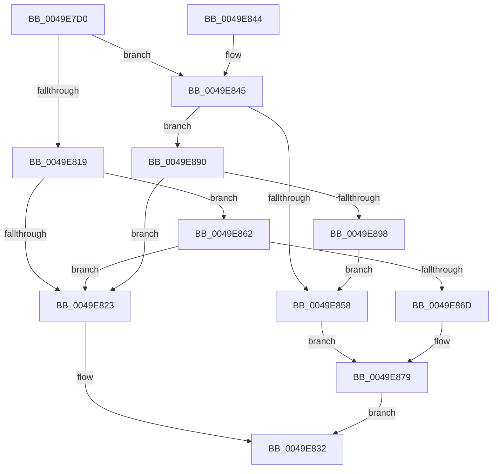

# ExSetTimerResolution

- RVA: `0x0049E7D0`–`0x0049E89A` (길이 `202` bytes)
- VA: `0x000000014049E7D0`
- 실행 섹션: `.text`
- PDB 이름 있음: `예`; PDB Function 태그: `아니요`
- unwind 정보 RVA: `0x000B51F4`
- 디코드: `56`개 명령, `202/202` bytes 표시
- 미해석 바이트: `0` (있으면 어셈블리에 `.byte`로 보존)

> 이 문서는 커널 이미지의 기계어와 PDB 기호를 분석해 생성했습니다. 4번과 5번은 함수 원형과 자료형을 바이너리 사용 방식에서 추정한 C 해석이며 원본 소스 복구 결과는 아닙니다.

## 1. Dependencies

- 직접 호출 지점: **4**; 고유 호출 대상: **4**
- 직접 호출자로 확인된 함수: **2**
- RIP 상대 이미지 참조: **8**

### Outgoing calls
- `0x0049E7F4` → [PoTraceSystemTimerResolutionKernel](../2F/PoTraceSystemTimerResolutionKernel_function_002FD154.md) (function, `0x002FD154`)
- `0x0049E800` → [KeAcquireSpinLockRaiseToDpc](../20/KeAcquireSpinLockRaiseToDpc_function_00208470.md) (function, `0x00208470`)
- `0x0049E82D` → [KeReleaseSpinLock](../39/KeReleaseSpinLock_function_00392BA0.md) (function, `0x00392BA0`)
- `0x0049E887` → [ExpUpdateTimerResolution](../39/ExpUpdateTimerResolution_function_003914A0.md) (function, `0x003914A0`)

### Direct callers
- [PspReadDfssConfigurationValues](../5E/PspReadDfssConfigurationValues_function_005E2508.md) at `0x005E265A`
- [PspReadDfssConfigurationValues](../5E/PspReadDfssConfigurationValues_function_005E2508.md) at `0x005E2667`
- [DifExSetTimerResolutionWrapper](../62/DifExSetTimerResolutionWrapper_function_006230E0.md) at `0x006231B7`

### Static image references
- `0x0049E7F9` → RVA `0x00EFEE50` (`.data`; read)
- `0x0049E805` → RVA `0x00FC6BEC` (`ALMOSTRO`; read)
- `0x0049E819` → RVA `0x00EFEE64` (`.data`; read)
- `0x0049E84D` → RVA `0x00EFEE64` (`.data`; write)
- `0x0049E858` → RVA `0x00FC6BEC` (`ALMOSTRO`; write)
- `0x0049E86D` → RVA `0x00FC6AA0` (`ALMOSTRO`; read)
- `0x0049E87E` → RVA `0x00EFEE60` (`.data`; write)
- `0x0049E890` → RVA `0x00EFEE60` (`.data`; read)

## 2. Other-region calls and transfers

- 다른 실행 섹션으로 향하는 call: **0**
- 별도 외부 분기/꼬리 이동을 확인하지 못했습니다.

## 3. Assembly (complete function range)

```asm
0049E7D0  48 89 5C 24 08                  mov qword ptr [rsp + 8], rbx
0049E7D5  48 89 74 24 18                  mov qword ptr [rsp + 0x18], rsi
0049E7DA  57                              push rdi
0049E7DB  48 83 EC 20                     sub rsp, 0x20
0049E7DF  8A C2                           mov al, dl
0049E7E1  8B D9                           mov ebx, ecx
0049E7E3  F6 D8                           neg al
0049E7E5  40 8A F2                        mov sil, dl
0049E7E8  BA 45 53 54 52                  mov edx, 0x52545345
0049E7ED  1B C9                           sbb ecx, ecx
0049E7EF  45 33 C0                        xor r8d, r8d
0049E7F2  23 CB                           and ecx, ebx
0049E7F4  E8 5B E9 E5 FF                  call 0x1402fd154
0049E7F9  48 8D 0D 50 06 A6 00            lea rcx, [rip + 0xa60650]
0049E800  E8 6B 9C D6 FF                  call 0x140208470
0049E805  8B 3D E1 83 B2 00               mov edi, dword ptr [rip + 0xb283e1]
0049E80B  33 D2                           xor edx, edx
0049E80D  88 44 24 38                     mov byte ptr [rsp + 0x38], al
0049E811  44 8A C0                        mov r8b, al
0049E814  40 84 F6                        test sil, sil
0049E817  75 2C                           jne 0x14049e845
0049E819  8B 0D 45 06 A6 00               mov ecx, dword ptr [rip + 0xa60645]
0049E81F  85 C9                           test ecx, ecx
0049E821  75 3F                           jne 0x14049e862
0049E823  41 8A D0                        mov dl, r8b
0049E826  48 8D 0D 23 06 A6 00            lea rcx, [rip + 0xa60623]
0049E82D  E8 6E 43 EF FF                  call 0x140392ba0
0049E832  48 8B 5C 24 30                  mov rbx, qword ptr [rsp + 0x30]
0049E837  8B C7                           mov eax, edi
0049E839  48 8B 74 24 40                  mov rsi, qword ptr [rsp + 0x40]
0049E83E  48 83 C4 20                     add rsp, 0x20
0049E842  5F                              pop rdi
0049E843  C3                              ret
0049E844  CC                              int3
0049E845  8B 05 19 06 A6 00               mov eax, dword ptr [rip + 0xa60619]
0049E84B  FF C0                           inc eax
0049E84D  89 05 11 06 A6 00               mov dword ptr [rip + 0xa60611], eax
0049E853  83 F8 01                        cmp eax, 1
0049E856  75 38                           jne 0x14049e890
0049E858  89 1D 8E 83 B2 00               mov dword ptr [rip + 0xb2838e], ebx
0049E85E  8B D3                           mov edx, ebx
0049E860  EB 17                           jmp 0x14049e879
0049E862  83 C1 FF                        add ecx, -1
0049E865  89 0D F9 05 A6 00               mov dword ptr [rip + 0xa605f9], ecx
0049E86B  75 B6                           jne 0x14049e823
0049E86D  8B 05 2D 82 B2 00               mov eax, dword ptr [rip + 0xb2822d]
0049E873  89 05 73 83 B2 00               mov dword ptr [rip + 0xb28373], eax
0049E879  4C 8D 44 24 38                  lea r8, [rsp + 0x38]
0049E87E  89 15 DC 05 A6 00               mov dword ptr [rip + 0xa605dc], edx
0049E884  40 8A CE                        mov cl, sil
0049E887  E8 14 2C EF FF                  call 0x1403914a0
0049E88C  8B F8                           mov edi, eax
0049E88E  EB A2                           jmp 0x14049e832
0049E890  3B 1D CA 05 A6 00               cmp ebx, dword ptr [rip + 0xa605ca]
0049E896  73 8B                           jae 0x14049e823
0049E898  EB BE                           jmp 0x14049e858
```

## 4. C-style interpretation (structured pseudocode)

```c
__int64 __fastcall ExSetTimerResolution(int a1, unsigned __int8 a2, int a3)
{
    __int64 result;
    __int64 v_rsp;
    unsigned __int8 v_stack_p10;
    unsigned __int64 v_stack_p18;
    unsigned __int64 v_stack_p38;
    unsigned __int64 v_stack_p8;

    v_stack_p8 = v_rbx;
    v_stack_p18 = v_rsi;
    v_rsp = (v_rsp) - (32);
    result = (unsigned __int8)(-(a2));
    a3 = 0;
    a1 = (unsigned int)((a1) & ((unsigned int)((unsigned int)(a1))));
    result = PoTraceSystemTimerResolutionKernel(a1, (unsigned int)(0x52545345ULL), a3, a4);
    result = KeAcquireSpinLockRaiseToDpc(v_rip + 10880592, (unsigned int)(0x52545345ULL), a3, a4);
    a2 = 0;
    v_stack_p10 = (unsigned __int8)(result);
    if (0 != 0) goto loc_0049E845;
    if ((unsigned int)((unsigned int)(*(unsigned int *)(v_rip + 10880581))) != 0) goto loc_0049E862;
loc_0049E823:
    result = KeReleaseSpinLock(v_rip + 10880547, (unsigned __int8)((unsigned __int8)(result)), (unsigned __int8)(result), a4);
loc_0049E832:
    v_rsp = (v_rsp) + (32);
    return (unsigned int)((unsigned int)((unsigned int)(*(unsigned int *)(v_rip + 11699169))));
loc_0049E845:
    result = (unsigned int)(((unsigned int)(*(unsigned int *)(v_rip + 10880537))) + 1);
    *(unsigned int *)(v_rip + 10880529) = (unsigned int)(result);
    if (((unsigned int)(result)) != 1) goto loc_0049E890;
loc_0049E858:
    *(unsigned int *)(v_rip + 11699086) = (unsigned int)(v_stack_p8);
    goto loc_0049E879;
loc_0049E862:
    a1 = (unsigned int)((v_rip + 10880547) + (-1));
    *(unsigned int *)(v_rip + 10880505) = a1;
    if (condition_is_not_equal) goto loc_0049E823;
    *(unsigned int *)(v_rip + 11699059) = (unsigned int)((unsigned int)(*(unsigned int *)(v_rip + 11698733)));
loc_0049E879:
    *(unsigned int *)(v_rip + 10880476) = (unsigned int)((unsigned int)((unsigned int)(v_stack_p8)));
    result = ExpUpdateTimerResolution((unsigned __int8)(v_stack_p18), (unsigned int)((unsigned int)(v_stack_p8)), v_stack_p38, a4);
    goto loc_0049E832;
loc_0049E890:
    if (((unsigned int)(v_stack_p8)) >= (*(unsigned int *)(v_rip + 10880458))) goto loc_0049E823;
    goto loc_0049E858;
}
```

## 5. (Beta) C Style

```c
int64_t ExSetTimerResolution(int32_t Arg1, uint8_t Arg2, int32_t Arg3)
{
    int64_t result;
    int64_t local_rsp;
    uint8_t v_stack_p10;
    uint64_t v_stack_p18;
    uint64_t v_stack_p38;
    uint64_t v_stack_p8;

    v_stack_p8 = local_rbx;
    v_stack_p18 = local_rsi;
    local_rsp = (local_rsp) - (32);
    result = (uint8_t)(-(Arg2));
    Arg3 = 0;
    Arg1 = (uint32_t)((Arg1) & ((uint32_t)((uint32_t)(Arg1))));
    result = PoTraceSystemTimerResolutionKernel(Arg1, (uint32_t)(0x52545345ULL), Arg3, a4);
    result = KeAcquireSpinLockRaiseToDpc(v_rip + 10880592, (uint32_t)(0x52545345ULL), Arg3, a4);
    Arg2 = 0;
    v_stack_p10 = (uint8_t)(result);
    if (0 != 0) goto loc_0049E845;
    if ((uint32_t)((uint32_t)(*(uint32_t *)(v_rip + 0xA60645))) != 0) goto loc_0049E862;
loc_0049E823:
    result = KeReleaseSpinLock(v_rip + 10880547, (uint8_t)((uint8_t)(result)), (uint8_t)(result), a4);
loc_0049E832:
    local_rsp = (local_rsp) + (32);
    return (uint32_t)((uint32_t)((uint32_t)(*(uint32_t *)(v_rip + 0xB283E1))));
loc_0049E845:
    result = (uint32_t)(((uint32_t)(*(uint32_t *)(v_rip + 0xA60619))) + 1);
    *(uint32_t *)(v_rip + 0xA60611) = (uint32_t)(result);
    if (((uint32_t)(result)) != 1) goto loc_0049E890;
loc_0049E858:
    *(uint32_t *)(v_rip + 0xB2838E) = (uint32_t)(v_stack_p8);
    goto loc_0049E879;
loc_0049E862:
    Arg1 = (uint32_t)((v_rip + 10880547) + (-1));
    *(uint32_t *)(v_rip + 0xA605F9) = Arg1;
    if (condition_is_not_equal) goto loc_0049E823;
    *(uint32_t *)(v_rip + 0xB28373) = (uint32_t)((uint32_t)(*(uint32_t *)(v_rip + 0xB2822D)));
loc_0049E879:
    *(uint32_t *)(v_rip + 0xA605DC) = (uint32_t)((uint32_t)((uint32_t)(v_stack_p8)));
    result = ExpUpdateTimerResolution((uint8_t)(v_stack_p18), (uint32_t)((uint32_t)(v_stack_p8)), v_stack_p38, a4);
    goto loc_0049E832;
loc_0049E890:
    if (((uint32_t)(v_stack_p8)) >= (*(uint32_t *)(v_rip + 0xA605CA))) goto loc_0049E823;
    goto loc_0049E858;
}
```

## 6. Execution-region graph

[열기: 2D/3D 그래프와 함수 탐색 컨트롤 패널](../../../control-panel.html?section=text&rva=0x0049E7D0&view=graph)

- 2D 그래프는 위에서 아래로 흐르고, 3D 그래프는 빈 공간을 드래그해 회전합니다. Shift+드래그는 이동, 휠은 확대·축소, 함수 노드 선택은 대상 보고서 이동입니다.

### Static fallback


