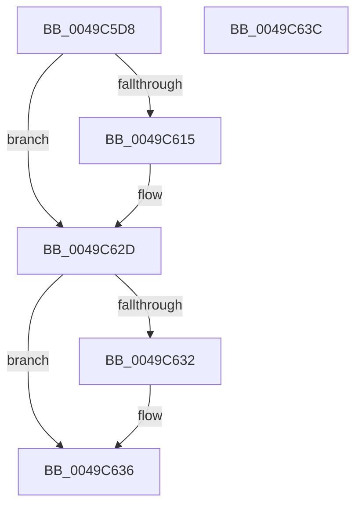

# ExpAcquirePoolListLockShared

- RVA: `0x0049C5D8`–`0x0049C63D` (길이 `101` bytes)
- VA: `0x000000014049C5D8`
- 실행 섹션: `.text`
- PDB 이름 있음: `예`; PDB Function 태그: `아니요`
- unwind 정보 RVA: `0x0005CF00`
- 디코드: `26`개 명령, `101/101` bytes 표시
- 미해석 바이트: `0` (있으면 어셈블리에 `.byte`로 보존)

> 이 문서는 커널 이미지의 기계어와 PDB 기호를 분석해 생성했습니다. 4번과 5번은 함수 원형과 자료형을 바이너리 사용 방식에서 추정한 C 해석이며 원본 소스 복구 결과는 아닙니다.

## 1. Dependencies

- 직접 호출 지점: **2**; 고유 호출 대상: **2**
- 직접 호출자로 확인된 함수: **1**
- RIP 상대 이미지 참조: **1**

### Outgoing calls
- `0x0049C5FB` → [KeAbPreAcquire](../21/KeAbPreAcquire_function_00210230.md) (function, `0x00210230`)
- `0x0049C628` → [ExfAcquirePushLockSharedEx](../21/ExfAcquirePushLockSharedEx_function_0021044C.md) (function, `0x0021044C`)

### Direct callers
- [ExpPrivatePoolGetNext](../../page/A5/ExpPrivatePoolGetNext_function_00A5FD60.md) at `0x00A5FD9A`

### Static image references
- `0x0049C5E7` → RVA `0x00E6BEE0` (`.data`; read)

## 2. Other-region calls and transfers

- 다른 실행 섹션으로 향하는 call: **0**
- 별도 외부 분기/꼬리 이동을 확인하지 못했습니다.

## 3. Assembly (complete function range)

```asm
0049C5D8  40 53                           push rbx
0049C5DA  48 83 EC 20                     sub rsp, 0x20
0049C5DE  65 48 8B 04 25 88 01 00 00      mov rax, qword ptr gs:[0x188]
0049C5E7  48 8D 0D F2 F8 9C 00            lea rcx, [rip + 0x9cf8f2]
0049C5EE  45 33 C0                        xor r8d, r8d
0049C5F1  33 D2                           xor edx, edx
0049C5F3  66 FF 88 E4 01 00 00            dec word ptr [rax + 0x1e4]
0049C5FA  90                              nop
0049C5FB  E8 30 3C D7 FF                  call 0x140210230
0049C600  48 8B D8                        mov rbx, rax
0049C603  BA 11 00 00 00                  mov edx, 0x11
0049C608  33 C0                           xor eax, eax
0049C60A  F0 48 0F B1 15 CD F8 9C 00      lock cmpxchg qword ptr [rip + 0x9cf8cd], rdx
0049C613  74 18                           je 0x14049c62d
0049C615  4C 8D 0D C4 F8 9C 00            lea r9, [rip + 0x9cf8c4]
0049C61C  4C 8B C3                        mov r8, rbx
0049C61F  33 D2                           xor edx, edx
0049C621  48 8D 0D B8 F8 9C 00            lea rcx, [rip + 0x9cf8b8]
0049C628  E8 1F 3E D7 FF                  call 0x14021044c
0049C62D  48 85 DB                        test rbx, rbx
0049C630  74 04                           je 0x14049c636
0049C632  C6 43 0A 01                     mov byte ptr [rbx + 0xa], 1
0049C636  48 83 C4 20                     add rsp, 0x20
0049C63A  5B                              pop rbx
0049C63B  C3                              ret
0049C63C  CC                              int3
```

## 4. C-style interpretation (structured pseudocode)

```c
__int64 __fastcall ExpAcquirePoolListLockShared(__int64 a1, int a2, int a3)
{
    __int64 result;
    __int64 v_rsp;

    v_rsp = (v_rsp) - (32);
    a3 = 0;
    a2 = 0;
    result = KeAbPreAcquire(v_rip + 10287346, a2, a3, a4);
    result = 0;
    if (!(condition_is_equal)) {
        a4 = v_rip + 10287300;
        a3 = 0;
        a2 = 0;
        a1 = v_rip + 10287288;
        result = ExfAcquirePushLockSharedEx(a1, a2, a3, a4);
    }
    if (result != 0) {
        *(unsigned __int8 *)(result + 10) = 1;
    }
    v_rsp = (v_rsp) + (32);
    return result;
}
```

## 5. (Beta) C Style

```c
int64_t ExpAcquirePoolListLockShared(int64_t Arg1, int32_t Arg2, int32_t Arg3)
{
    int64_t result;
    int64_t local_rsp;

    local_rsp = (local_rsp) - (32);
    Arg3 = 0;
    Arg2 = 0;
    result = KeAbPreAcquire(v_rip + 10287346, Arg2, Arg3, a4);
    result = 0;
    if (!(condition_is_equal)) {
        a4 = v_rip + 10287300;
        Arg3 = 0;
        Arg2 = 0;
        Arg1 = v_rip + 10287288;
        result = ExfAcquirePushLockSharedEx(Arg1, Arg2, Arg3, a4);
    }
    if (result != 0) {
        *(uint8_t *)(result + 0xA) = 1;
    }
    local_rsp = (local_rsp) + (32);
    return result;
}
```

## 6. Execution-region graph

[열기: 2D/3D 그래프와 함수 탐색 컨트롤 패널](../../../control-panel.html?section=text&rva=0x0049C5D8&view=graph)

- 2D 그래프는 위에서 아래로 흐르고, 3D 그래프는 빈 공간을 드래그해 회전합니다. Shift+드래그는 이동, 휠은 확대·축소, 함수 노드 선택은 대상 보고서 이동입니다.

### Static fallback


