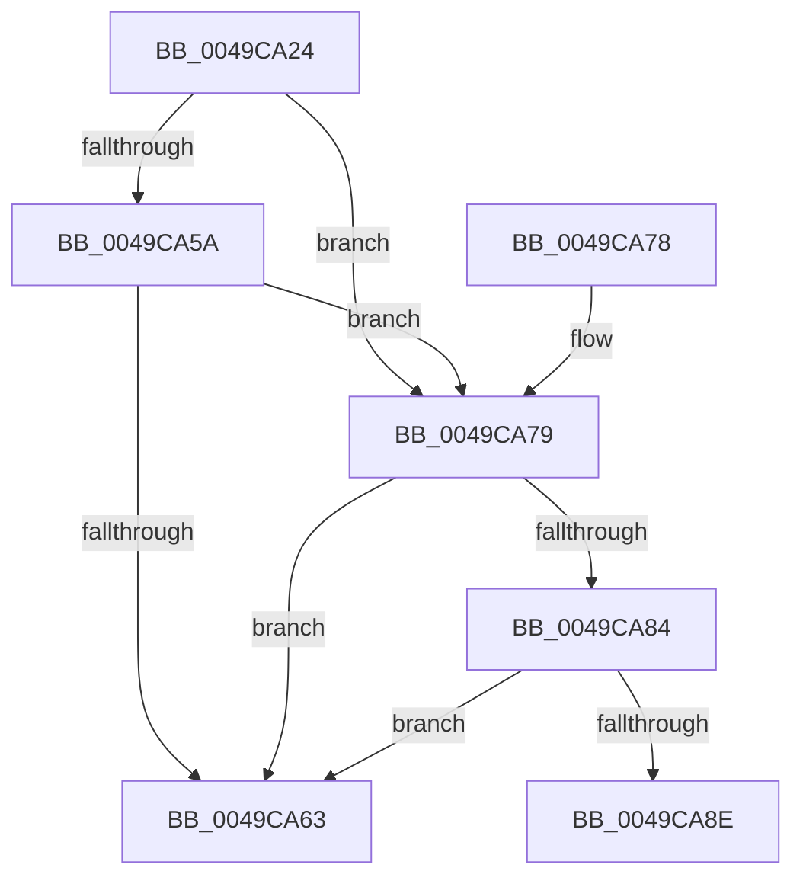

# ExpCheckForResource

- RVA: `0x0049CA24`–`0x0049CAAD` (길이 `137` bytes)
- VA: `0x000000014049CA24`
- 실행 섹션: `.text`
- PDB 이름 있음: `예`; PDB Function 태그: `예`
- unwind 정보 RVA: `0x000B4CB8`
- 디코드: `36`개 명령, `137/137` bytes 표시
- 미해석 바이트: `0` (있으면 어셈블리에 `.byte`로 보존)

> 이 문서는 커널 이미지의 기계어와 PDB 기호를 분석해 생성했습니다. 4번과 5번은 함수 원형과 자료형을 바이너리 사용 방식에서 추정한 C 해석이며 원본 소스 복구 결과는 아닙니다.

## 1. Dependencies

- 직접 호출 지점: **2**; 고유 호출 대상: **2**
- 직접 호출자로 확인된 함수: **4**
- RIP 상대 이미지 참조: **5**

### Outgoing calls
- `0x0049CA5A` → [VfCheckForResource](../../pagevrfy/BB/VfCheckForResource_function_00BB71C8.md) (function, `0x00BB71C8`)
- `0x0049CA99` → [ExAcquireSpinLockShared](../24/ExAcquireSpinLockShared_function_0024DCE0.md) (function, `0x0024DCE0`)

### Direct callers
- [ExpFreePoolChecks](../35/ExpFreePoolChecks_function_0035F4F0.md) at `0x0035F583`
- [sub_00360968](../36/Unknown_function_00360968.md) at `0x00360D8C`
- [FREE_CHECK_ERESOURCE](FREE_CHECK_ERESOURCE_function_0049CA00.md) at `0x0049CA0E`
- [sub_00B8371E](../../poolcode/B8/Unknown_function_00B8371E.md) at `0x00B83B44`

### Static image references
- `0x0049CA36` → RVA `0x00F04A20` (`.data`; read)
- `0x0049CA79` → RVA `0x00FC6A80` (`ALMOSTRO`; read)
- `0x0049CA84` → RVA `0x00E0EB9C` (`.data`; read)
- `0x0049CA8E` → RVA `0x00FCF0C0` (`CACHEALI`; read)
- `0x0049CA9E` → RVA `0x00EFAC20` (`.data`; read)

## 2. Other-region calls and transfers

- 다른 실행 섹션으로 향하는 call: **1**
  - `0x0049CA5A` → [VfCheckForResource](../../pagevrfy/BB/VfCheckForResource_function_00BB71C8.md) (`.text` → `PAGEVRFY`)
- call이 아닌 외부 분기/꼬리 이동: **1**
  - `0x0049CAA8` → [sub_006F7E72](../6F/Unknown_function_006F7E72.md) (`tail-transfer`)

## 3. Assembly (complete function range)

```asm
0049CA24  48 89 5C 24 08                  mov qword ptr [rsp + 8], rbx
0049CA29  48 89 6C 24 10                  mov qword ptr [rsp + 0x10], rbp
0049CA2E  56                              push rsi
0049CA2F  57                              push rdi
0049CA30  41 56                           push r14
0049CA32  48 83 EC 30                     sub rsp, 0x30
0049CA36  F7 05 E0 7F A6 00 00 08 00 00   test dword ptr [rip + 0xa67fe0], 0x800
0049CA40  48 8B F2                        mov rsi, rdx
0049CA43  48 C7 44 24 60 00 00 00 00      mov qword ptr [rsp + 0x60], 0
0049CA4C  48 8B F9                        mov rdi, rcx
0049CA4F  48 C7 44 24 68 00 00 00 00      mov qword ptr [rsp + 0x68], 0
0049CA58  74 1F                           je 0x14049ca79
0049CA5A  E8 69 A7 71 00                  call 0x140bb71c8
0049CA5F  85 C0                           test eax, eax
0049CA61  74 16                           je 0x14049ca79
0049CA63  33 C0                           xor eax, eax
0049CA65  48 8B 5C 24 50                  mov rbx, qword ptr [rsp + 0x50]
0049CA6A  48 8B 6C 24 58                  mov rbp, qword ptr [rsp + 0x58]
0049CA6F  48 83 C4 30                     add rsp, 0x30
0049CA73  41 5E                           pop r14
0049CA75  5F                              pop rdi
0049CA76  5E                              pop rsi
0049CA77  C3                              ret
0049CA78  CC                              int3
0049CA79  8B 05 01 A0 B2 00               mov eax, dword ptr [rip + 0xb2a001]
0049CA7F  83 F8 01                        cmp eax, 1
0049CA82  77 DF                           ja 0x14049ca63
0049CA84  8B 05 12 21 97 00               mov eax, dword ptr [rip + 0x972112]
0049CA8A  A8 01                           test al, 1
0049CA8C  74 D5                           je 0x14049ca63
0049CA8E  48 8D 0D 2B 26 B3 00            lea rcx, [rip + 0xb3262b]
0049CA95  4C 8D 34 37                     lea r14, [rdi + rsi]
0049CA99  E8 42 12 DB FF                  call 0x14024dce0
0049CA9E  48 8B 1D 7B E1 A5 00            mov rbx, qword ptr [rip + 0xa5e17b]
0049CAA5  40 8A E8                        mov bpl, al
0049CAA8  E9 C5 B3 25 00                  jmp 0x1406f7e72
```

## 4. C-style interpretation (structured pseudocode)

```c
__int64 __fastcall ExpCheckForResource(__int64 a1, __int64 a2)
{
    __int64 result;
    __int64 v_rsp;
    unsigned __int64 v_stack_p10;
    unsigned __int64 v_stack_p18;
    unsigned __int64 v_stack_p20;
    unsigned __int64 v_stack_p8;

    v_stack_p8 = v_rbx;
    v_stack_p10 = v_rbp;
    v_rsp = (v_rsp) - (48);
    v_stack_p18 = 0;
    v_stack_p20 = 0;
    if (((*(unsigned int *)(v_rip + 10911712)) & (0x800ULL)) == 0) goto loc_0049CA79;
    result = VfCheckForResource(a1, a2, a3, a4);
    if ((unsigned int)(result) == 0) goto loc_0049CA79;
loc_0049CA63:
    result = 0;
    v_rsp = (v_rsp) + (48);
    return result;
loc_0049CA79:
    if (((unsigned int)((unsigned int)(*(unsigned int *)(v_rip + 11706369)))) > 1) goto loc_0049CA63;
    if ((((unsigned __int8)((unsigned int)(*(unsigned int *)(v_rip + 9904402)))) & (1)) == 0) goto loc_0049CA63;
    result = ExAcquireSpinLockShared(v_rip + 11740715, a2, a3, a4);
}
```

## 5. (Beta) C Style

```c
int64_t ExpCheckForResource(void *Arg1, int64_t Arg2)
{
    uint8_t *arg1 = (uint8_t *)Arg1;

    int64_t result;
    int64_t local_rsp;
    uint64_t v_stack_p10;
    uint64_t v_stack_p18;
    uint64_t v_stack_p20;
    uint64_t v_stack_p8;

    v_stack_p8 = local_rbx;
    v_stack_p10 = local_rbp;
    local_rsp = (local_rsp) - (48);
    v_stack_p18 = 0;
    v_stack_p20 = 0;
    if (((*(uint32_t *)(v_rip + 0xA67FE0)) & (0x800ULL)) == 0) goto loc_0049CA79;
    result = VfCheckForResource(Arg1, Arg2, a3, a4);
    if ((uint32_t)(result) == 0) goto loc_0049CA79;
loc_0049CA63:
    result = 0;
    local_rsp = (local_rsp) + (48);
    return result;
loc_0049CA79:
    if (((uint32_t)((uint32_t)(*(uint32_t *)(v_rip + 0xB2A001)))) > 1) goto loc_0049CA63;
    if ((((uint8_t)((uint32_t)(*(uint32_t *)(v_rip + 0x972112)))) & (1)) == 0) goto loc_0049CA63;
    result = ExAcquireSpinLockShared(v_rip + 11740715, Arg2, a3, a4);
}
```

### 관측된 메모리 오프셋

구조체 형식이 확인되지 않은 접근은 인자 기준의 오프셋으로만 기록했습니다.

| 기준 인자 | 오프셋 표현 | 폭 (bit) | 접근 |
|---|---:|---:|---|
| `Arg1` | `+ 0x0 + rsi*1` | `64` | `R` |

## 6. Execution-region graph

[열기: 2D/3D 그래프와 함수 탐색 컨트롤 패널](../../../control-panel.html?section=text&rva=0x0049CA24&view=graph)

- 2D 그래프는 위에서 아래로 흐르고, 3D 그래프는 빈 공간을 드래그해 회전합니다. Shift+드래그는 이동, 휠은 확대·축소, 함수 노드 선택은 대상 보고서 이동입니다.

### Static fallback


