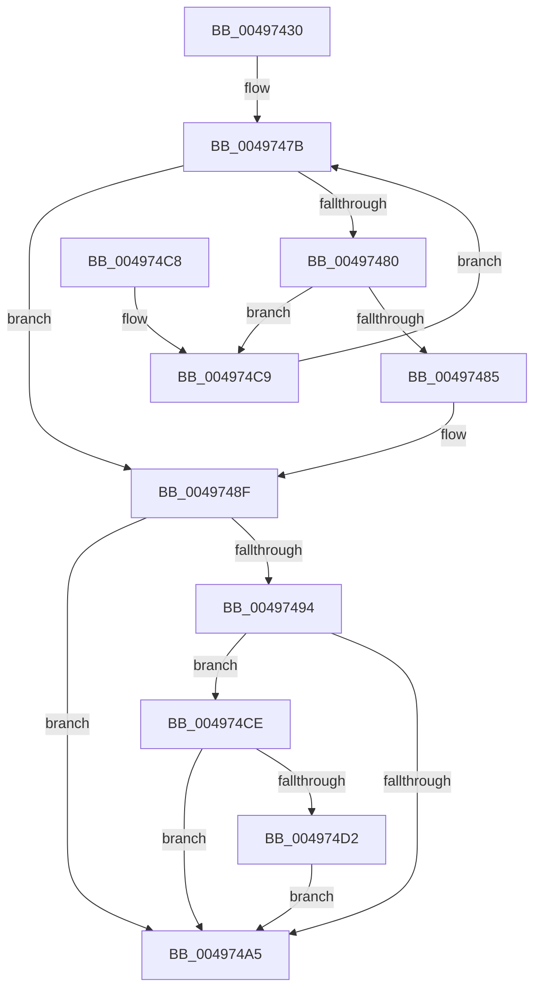

# ExpEnumerateCallback

- RVA: `0x00497430`–`0x004974E5` (길이 `181` bytes)
- VA: `0x0000000140497430`
- 실행 섹션: `.text`
- PDB 이름 있음: `예`; PDB Function 태그: `아니요`
- unwind 정보 RVA: `0x000A2790`
- 디코드: `56`개 명령, `181/181` bytes 표시
- 미해석 바이트: `0` (있으면 어셈블리에 `.byte`로 보존)

> 이 문서는 커널 이미지의 기계어와 PDB 기호를 분석해 생성했습니다. 4번과 5번은 함수 원형과 자료형을 바이너리 사용 방식에서 추정한 C 해석이며 원본 소스 복구 결과는 아닙니다.

## 1. Dependencies

- 직접 호출 지점: **3**; 고유 호출 대상: **3**
- 직접 호출자로 확인된 함수: **0**
- RIP 상대 이미지 참조: **1**

### Outgoing calls
- `0x00497451` → [KeAcquireSpinLockRaiseToDpc](../20/KeAcquireSpinLockRaiseToDpc_function_00208470.md) (function, `0x00208470`)
- `0x004974AB` → [KeReleaseSpinLock](../39/KeReleaseSpinLock_function_00392BA0.md) (function, `0x00392BA0`)
- `0x004974DE` → [KeSetEvent](../33/KeSetEvent_function_0033F310.md) (function, `0x0033F310`)

### Direct callers
- 이 함수 시작 RVA로 연결되는 직접 call은 확인되지 않았습니다. 간접 호출은 완전히 역산할 수 없습니다.

### Static image references
- `0x004974D5` → RVA `0x00EFACE0` (`.data`; read)

## 2. Other-region calls and transfers

- 다른 실행 섹션으로 향하는 call: **0**
- 별도 외부 분기/꼬리 이동을 확인하지 못했습니다.

## 3. Assembly (complete function range)

```asm
00497430  48 89 5C 24 08                  mov qword ptr [rsp + 8], rbx
00497435  48 89 6C 24 10                  mov qword ptr [rsp + 0x10], rbp
0049743A  48 89 74 24 18                  mov qword ptr [rsp + 0x18], rsi
0049743F  57                              push rdi
00497440  48 83 EC 20                     sub rsp, 0x20
00497444  48 8D 71 08                     lea rsi, [rcx + 8]
00497448  48 8B D9                        mov rbx, rcx
0049744B  48 8B CE                        mov rcx, rsi
0049744E  48 8B FA                        mov rdi, rdx
00497451  E8 1A 10 D7 FF                  call 0x140208470
00497456  4C 8B 07                        mov r8, qword ptr [rdi]
00497459  4C 8D 53 10                     lea r10, [rbx + 0x10]
0049745D  49 8B C8                        mov rcx, r8
00497460  40 8A E8                        mov bpl, al
00497463  48 F7 D9                        neg rcx
00497466  49 8B CA                        mov rcx, r10
00497469  4D 1B C9                        sbb r9, r9
0049746C  33 DB                           xor ebx, ebx
0049746E  4D 23 C8                        and r9, r8
00497471  4D 85 C0                        test r8, r8
00497474  49 0F 45 C8                     cmovne rcx, r8
00497478  48 8B 01                        mov rax, qword ptr [rcx]
0049747B  49 3B C2                        cmp rax, r10
0049747E  74 0F                           je 0x14049748f
00497480  38 58 2C                        cmp byte ptr [rax + 0x2c], bl
00497483  75 44                           jne 0x1404974c9
00497485  FF 40 28                        inc dword ptr [rax + 0x28]
00497488  48 8B 58 18                     mov rbx, qword ptr [rax + 0x18]
0049748C  48 89 07                        mov qword ptr [rdi], rax
0049748F  4D 85 C9                        test r9, r9
00497492  74 11                           je 0x1404974a5
00497494  41 8B 41 28                     mov eax, dword ptr [r9 + 0x28]
00497498  FF C8                           dec eax
0049749A  41 80 79 2C 00                  cmp byte ptr [r9 + 0x2c], 0
0049749F  41 89 41 28                     mov dword ptr [r9 + 0x28], eax
004974A3  75 29                           jne 0x1404974ce
004974A5  40 8A D5                        mov dl, bpl
004974A8  48 8B CE                        mov rcx, rsi
004974AB  E8 F0 B6 EF FF                  call 0x140392ba0
004974B0  48 8B 6C 24 38                  mov rbp, qword ptr [rsp + 0x38]
004974B5  48 8B C3                        mov rax, rbx
004974B8  48 8B 5C 24 30                  mov rbx, qword ptr [rsp + 0x30]
004974BD  48 8B 74 24 40                  mov rsi, qword ptr [rsp + 0x40]
004974C2  48 83 C4 20                     add rsp, 0x20
004974C6  5F                              pop rdi
004974C7  C3                              ret
004974C8  CC                              int3
004974C9  48 8B 00                        mov rax, qword ptr [rax]
004974CC  EB AD                           jmp 0x14049747b
004974CE  85 C0                           test eax, eax
004974D0  75 D3                           jne 0x1404974a5
004974D2  45 33 C0                        xor r8d, r8d
004974D5  48 8D 0D 04 38 A6 00            lea rcx, [rip + 0xa63804]
004974DC  33 D2                           xor edx, edx
004974DE  E8 2D 7E EA FF                  call 0x14033f310
004974E3  EB C0                           jmp 0x1404974a5
```

## 4. C-style interpretation (structured pseudocode)

```c
__int64 __fastcall ExpEnumerateCallback(__int64 a1, __int64 a2, __int64 a3, __int64 a4)
{
    __int64 result;
    __int64 v_rbx;
    __int64 v_rsp;
    unsigned __int64 v_stack_p10;
    unsigned __int64 v_stack_p18;
    unsigned __int64 v_stack_p8;

    v_stack_p8 = v_rbx;
    v_stack_p10 = v_rbp;
    v_stack_p18 = v_rsi;
    v_rsp = (v_rsp) - (32);
    result = KeAcquireSpinLockRaiseToDpc(a1 + 8, a2, a3, a4);
    a1 = -(*(unsigned __int64 *)(a2));
    v_rbx = 0;
    a4 = (a4) & (*(unsigned __int64 *)(a2));
    a1 = a1 + 16;
    if (*(unsigned __int64 *)(a2) != 0) { a1 = *(unsigned __int64 *)(a2); }
loc_0049747B:
    if ((*(unsigned __int64 *)(a1)) == (a1 + 16)) goto loc_0049748F;
    if ((*(unsigned __int8 *)(*(unsigned __int64 *)(a1) + 44)) != 0) goto loc_004974C9;
    *(unsigned __int64 *)(a2) = *(unsigned __int64 *)(a1);
loc_0049748F:
    if (a4 == 0) goto loc_004974A5;
    result = (unsigned int)(((unsigned int)(*(unsigned int *)(a4 + 40))) - 1);
    *(unsigned int *)(a4 + 40) = (unsigned int)(result);
    if ((*(unsigned __int8 *)(a4 + 44)) != 0) goto loc_004974CE;
loc_004974A5:
    result = KeReleaseSpinLock(a1 + 8, (unsigned __int8)((unsigned __int8)(result)), *(unsigned __int64 *)(a2), a4);
    v_rsp = (v_rsp) + (32);
    return *(unsigned __int64 *)(*(unsigned __int64 *)(a1) + 24);
loc_004974C9:
    goto loc_0049747B;
loc_004974CE:
    if ((unsigned int)(*(unsigned __int64 *)(*(unsigned __int64 *)(*(unsigned __int64 *)(a1) + 24))) != 0) goto loc_004974A5;
    a3 = 0;
    a2 = 0;
    result = KeSetEvent(v_rip + 10893316, a2, a3, a4);
    goto loc_004974A5;
}
```

## 5. (Beta) C Style

```c
int64_t ExpEnumerateCallback(void *Arg1, void *Arg2, int64_t Arg3, int64_t Arg4)
{
    uint8_t *arg1 = (uint8_t *)Arg1;
    uint8_t *arg2 = (uint8_t *)Arg2;

    int64_t result;
    int64_t local_rbx;
    int64_t local_rsp;
    uint64_t v_stack_p10;
    uint64_t v_stack_p18;
    uint64_t v_stack_p8;

    v_stack_p8 = local_rbx;
    v_stack_p10 = local_rbp;
    v_stack_p18 = local_rsi;
    local_rsp = (local_rsp) - (32);
    result = KeAcquireSpinLockRaiseToDpc(Arg1 + 8, Arg2, Arg3, Arg4);
    Arg1 = -(*(uint64_t *)(arg2));
    local_rbx = 0;
    Arg4 = (Arg4) & (*(uint64_t *)(arg2));
    Arg1 = Arg1 + 16;
    if (*(uint64_t *)(arg2) != 0) { Arg1 = *(uint64_t *)(arg2); }
loc_0049747B:
    if ((*(uint64_t *)(arg1)) == (Arg1 + 16)) goto loc_0049748F;
    if ((*(uint8_t *)(*(uint64_t *)(arg1) + 0x2C)) != 0) goto loc_004974C9;
    *(uint64_t *)(arg2) = *(uint64_t *)(arg1);
loc_0049748F:
    if (Arg4 == 0) goto loc_004974A5;
    result = (uint32_t)(((uint32_t)(*(uint32_t *)(Arg4 + 0x28))) - 1);
    *(uint32_t *)(Arg4 + 0x28) = (uint32_t)(result);
    if ((*(uint8_t *)(Arg4 + 0x2C)) != 0) goto loc_004974CE;
loc_004974A5:
    result = KeReleaseSpinLock(Arg1 + 8, (uint8_t)((uint8_t)(result)), *(uint64_t *)(arg2), Arg4);
    local_rsp = (local_rsp) + (32);
    return *(uint64_t *)(*(uint64_t *)(arg1) + 0x18);
loc_004974C9:
    goto loc_0049747B;
loc_004974CE:
    if ((uint32_t)(*(uint64_t *)(*(uint64_t *)(*(uint64_t *)(arg1) + 0x18))) != 0) goto loc_004974A5;
    Arg3 = 0;
    Arg2 = 0;
    result = KeSetEvent(v_rip + 10893316, Arg2, Arg3, Arg4);
    goto loc_004974A5;
}
```

### 관측된 메모리 오프셋

구조체 형식이 확인되지 않은 접근은 인자 기준의 오프셋으로만 기록했습니다.

| 기준 인자 | 오프셋 표현 | 폭 (bit) | 접근 |
|---|---:|---:|---|
| `Arg1` | `+ 0x8` | `64` | `R` |
| `Arg1` | `+ 0x10` | `64` | `R` |
| `Arg2` | `+ 0x0` | `64` | `R` |
| `Arg2` | `+ 0x0` | `64` | `W` |

## 6. Execution-region graph

[열기: 2D/3D 그래프와 함수 탐색 컨트롤 패널](../../../control-panel.html?section=text&rva=0x00497430&view=graph)

- 2D 그래프는 위에서 아래로 흐르고, 3D 그래프는 빈 공간을 드래그해 회전합니다. Shift+드래그는 이동, 휠은 확대·축소, 함수 노드 선택은 대상 보고서 이동입니다.

### Static fallback


