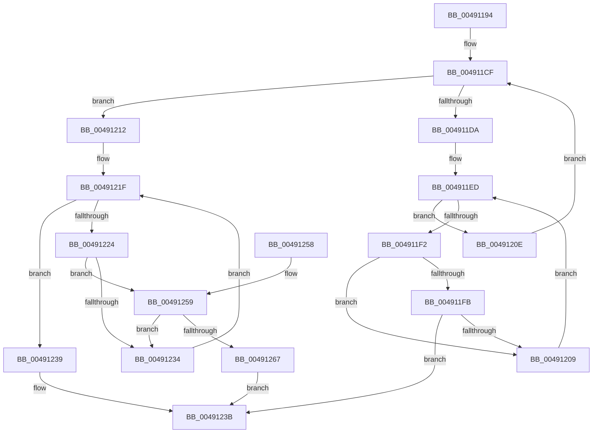

# ExpHpEnumerateHeaps

- RVA: `0x00491194`–`0x00491269` (길이 `213` bytes)
- VA: `0x0000000140491194`
- 실행 섹션: `.text`
- PDB 이름 있음: `예`; PDB Function 태그: `아니요`
- unwind 정보 RVA: `0x000B2CA0`
- 디코드: `68`개 명령, `213/213` bytes 표시
- 미해석 바이트: `0` (있으면 어셈블리에 `.byte`로 보존)

> 이 문서는 커널 이미지의 기계어와 PDB 기호를 분석해 생성했습니다. 4번과 5번은 함수 원형과 자료형을 바이너리 사용 방식에서 추정한 C 해석이며 원본 소스 복구 결과는 아닙니다.

## 1. Dependencies

- 직접 호출 지점: **2**; 고유 호출 대상: **1**
- 직접 호출자로 확인된 함수: **2**
- RIP 상대 이미지 참조: **4**

### Outgoing calls
- `0x00491200` → [guard_dispatch_icall](../6B/guard_dispatch_icall_function_006BAAD0.md) (function, `0x006BAAD0`)
- `0x0049125E` → [guard_dispatch_icall](../6B/guard_dispatch_icall_function_006BAAD0.md) (function, `0x006BAAD0`)

### Direct callers
- [ExpHpCompactionRoutine](ExpHpCompactionRoutine_function_00491150.md) at `0x00491160`
- [ExpHeapInitPhase1](../65/ExpHeapInitPhase1_function_0065C890.md) at `0x0065C8A2`
- [ExpHeapInitPhase1](../65/ExpHeapInitPhase1_function_0065C890.md) at `0x0065C8B6`

### Static image references
- `0x004911B0` → RVA `0x0001A7E0` (`.rdata`; read)
- `0x004911CF` → RVA `0x00E6BF10` (`.data`; read)
- `0x004911E3` → RVA `0x00E6BF40` (`.data`; read)
- `0x00491224` → RVA `0x00EEEF40` (`.data`; read)

## 2. Other-region calls and transfers

- 다른 실행 섹션으로 향하는 call: **0**
- 별도 외부 분기/꼬리 이동을 확인하지 못했습니다.

## 3. Assembly (complete function range)

```asm
00491194  48 8B C4                        mov rax, rsp
00491197  48 89 58 08                     mov qword ptr [rax + 8], rbx
0049119B  48 89 68 10                     mov qword ptr [rax + 0x10], rbp
0049119F  48 89 70 18                     mov qword ptr [rax + 0x18], rsi
004911A3  57                              push rdi
004911A4  41 54                           push r12
004911A6  41 55                           push r13
004911A8  41 56                           push r14
004911AA  41 57                           push r15
004911AC  48 83 EC 30                     sub rsp, 0x30
004911B0  66 0F 6F 05 28 96 B8 FF         movdqa xmm0, xmmword ptr [rip - 0x4769d8]
004911B8  4C 8B E2                        mov r12, rdx
004911BB  F3 0F 7F 40 C8                  movdqu xmmword ptr [rax - 0x38], xmm0
004911C0  48 63 C1                        movsxd rax, ecx
004911C3  33 FF                           xor edi, edi
004911C5  48 63 6C C4 20                  movsxd rbp, dword ptr [rsp + rax*8 + 0x20]
004911CA  48 63 74 C4 24                  movsxd rsi, dword ptr [rsp + rax*8 + 0x24]
004911CF  3B 3D 3B AD 9D 00               cmp edi, dword ptr [rip + 0x9dad3b]
004911D5  48 8B DD                        mov rbx, rbp
004911D8  73 38                           jae 0x140491212
004911DA  8B C7                           mov eax, edi
004911DC  4C 69 F0 C0 20 00 00            imul r14, rax, 0x20c0
004911E3  48 8D 05 56 AD 9D 00            lea rax, [rip + 0x9dad56]
004911EA  4C 03 F0                        add r14, rax
004911ED  48 3B DE                        cmp rbx, rsi
004911F0  7F 1C                           jg 0x14049120e
004911F2  49 8B 0C DE                     mov rcx, qword ptr [r14 + rbx*8]
004911F6  48 85 C9                        test rcx, rcx
004911F9  74 0E                           je 0x140491209
004911FB  33 D2                           xor edx, edx
004911FD  49 8B C4                        mov rax, r12
00491200  E8 CB 98 22 00                  call 0x1406baad0
00491205  85 C0                           test eax, eax
00491207  78 32                           js 0x14049123b
00491209  48 FF C3                        inc rbx
0049120C  EB DF                           jmp 0x1404911ed
0049120E  FF C7                           inc edi
00491210  EB BD                           jmp 0x1404911cf
00491212  B8 03 00 00 00                  mov eax, 3
00491217  3B F0                           cmp esi, eax
00491219  0F 4D F0                        cmovge esi, eax
0049121C  48 63 FE                        movsxd rdi, esi
0049121F  48 3B DF                        cmp rbx, rdi
00491222  7F 15                           jg 0x140491239
00491224  48 8D 0D 15 DD A5 00            lea rcx, [rip + 0xa5dd15]
0049122B  48 8B 0C D9                     mov rcx, qword ptr [rcx + rbx*8]
0049122F  48 85 C9                        test rcx, rcx
00491232  75 25                           jne 0x140491259
00491234  48 FF C3                        inc rbx
00491237  EB E6                           jmp 0x14049121f
00491239  33 C0                           xor eax, eax
0049123B  48 8B 5C 24 60                  mov rbx, qword ptr [rsp + 0x60]
00491240  48 8B 6C 24 68                  mov rbp, qword ptr [rsp + 0x68]
00491245  48 8B 74 24 70                  mov rsi, qword ptr [rsp + 0x70]
0049124A  48 83 C4 30                     add rsp, 0x30
0049124E  41 5F                           pop r15
00491250  41 5E                           pop r14
00491252  41 5D                           pop r13
00491254  41 5C                           pop r12
00491256  5F                              pop rdi
00491257  C3                              ret
00491258  CC                              int3
00491259  33 D2                           xor edx, edx
0049125B  49 8B C4                        mov rax, r12
0049125E  E8 6D 98 22 00                  call 0x1406baad0
00491263  85 C0                           test eax, eax
00491265  79 CD                           jns 0x140491234
00491267  EB D2                           jmp 0x14049123b
```

## 4. C-style interpretation (structured pseudocode)

```c
__int64 __fastcall ExpHpEnumerateHeaps(int a1, __int64 a2)
{
    __int64 result;
    __int64 v_r14;
    __int64 v_rbx;
    __int64 v_rdi;
    __int64 v_rsi;
    __int64 v_rsp;
    unsigned __int64 v_stack_p10;
    unsigned __int64 v_stack_p18;
    unsigned __int64 v_stack_p8;

    *(unsigned __int64 *)(v_rsp + 8) = v_rbx;
    *(unsigned __int64 *)(v_rsp + 16) = v_rbp;
    *(unsigned __int64 *)(v_rsp + 24) = v_rsi;
    v_rsp = (v_rsp) - (48);
    *(unsigned __int64 *)(v_rsp - 56) = v_xmm0;
    v_rdi = 0;
loc_004911CF:
    if (0 >= (*(unsigned int *)(v_rip + 10333499))) goto loc_00491212;
    v_r14 = (v_r14) * (0);
    v_r14 = (v_r14) + (v_rip + 10333526);
loc_004911ED:
    if (((int)(*(unsigned int *)(v_rsp + (int)(a1) * 8 + 32))) > ((int)(*(unsigned int *)(v_rsp + (int)(a1) * 8 + 36)))) goto loc_0049120E;
    if (*(unsigned __int64 *)(v_r14 + (int)(*(unsigned int *)(v_rsp + (int)(a1) * 8 + 32)) * 8) == 0) goto loc_00491209;
    a2 = 0;
    result = guard_dispatch_icall(*(unsigned __int64 *)(v_r14 + (int)(*(unsigned int *)(v_rsp + (int)(a1) * 8 + 32)) * 8), a2, a3, a4);
    if (sign_flag) goto loc_0049123B;
loc_00491209:
    v_rbx = ((int)(*(unsigned int *)(v_rsp + (int)(a1) * 8 + 32))) + 1;
    goto loc_004911ED;
loc_0049120E:
    v_rdi = (unsigned int)((v_rdi) + 1);
    goto loc_004911CF;
loc_00491212:
    v_rsi = (int)(*(unsigned int *)(v_rsp + (int)(a1) * 8 + 36));
    if (((unsigned int)((int)(*(unsigned int *)(v_rsp + (int)(a1) * 8 + 36)))) >= 3) { v_rsi = 3; }
loc_0049121F:
    if (v_rbx > ((int)((unsigned int)(v_rsi)))) goto loc_00491239;
    if (*(unsigned __int64 *)(v_rip + 10870037 + v_rbx * 8) != 0) goto loc_00491259;
loc_00491234:
    v_rbx = (v_rbx) + 1;
    goto loc_0049121F;
loc_00491239:
    result = 0;
loc_0049123B:
    v_rsp = (v_rsp) + (48);
    return result;
loc_00491259:
    a2 = 0;
    result = guard_dispatch_icall(*(unsigned __int64 *)(v_rip + 10870037 + v_rbx * 8), a2, a3, a4);
    if (!sign_flag) goto loc_00491234;
    goto loc_0049123B;
}
```

## 5. (Beta) C Style

```c
int64_t ExpHpEnumerateHeaps(int32_t Arg1, int64_t Arg2)
{
    int64_t result;
    int64_t local_r14;
    int64_t local_rbx;
    int64_t local_rdi;
    int64_t local_rsi;
    int64_t local_rsp;
    uint64_t v_stack_p10;
    uint64_t v_stack_p18;
    uint64_t v_stack_p8;

    *(uint64_t *)(local_rsp + 0x8) = local_rbx;
    *(uint64_t *)(local_rsp + 0x10) = local_rbp;
    *(uint64_t *)(local_rsp + 0x18) = local_rsi;
    local_rsp = (local_rsp) - (48);
    *(uint64_t *)(local_rsp - 0x38) = v_xmm0;
    local_rdi = 0;
loc_004911CF:
    if (0 >= (*(uint32_t *)(v_rip + 0x9DAD3B))) goto loc_00491212;
    local_r14 = (local_r14) * (0);
    local_r14 = (local_r14) + (v_rip + 10333526);
loc_004911ED:
    if (((int32_t)(*(uint32_t *)(local_rsp + (int32_t)(Arg1) * 8 + 0x20))) > ((int32_t)(*(uint32_t *)(local_rsp + (int32_t)(Arg1) * 8 + 0x24)))) goto loc_0049120E;
    if (*(uint64_t *)(local_r14 + (int32_t)(*(uint32_t *)(local_rsp + (int32_t)(Arg1) * 8 + 0x20)) * 8) == 0) goto loc_00491209;
    Arg2 = 0;
    result = guard_dispatch_icall(*(uint64_t *)(local_r14 + (int32_t)(*(uint32_t *)(local_rsp + (int32_t)(Arg1) * 8 + 0x20)) * 8), Arg2, a3, a4);
    if (sign_flag) goto loc_0049123B;
loc_00491209:
    local_rbx = ((int32_t)(*(uint32_t *)(local_rsp + (int32_t)(Arg1) * 8 + 0x20))) + 1;
    goto loc_004911ED;
loc_0049120E:
    local_rdi = (uint32_t)((local_rdi) + 1);
    goto loc_004911CF;
loc_00491212:
    local_rsi = (int32_t)(*(uint32_t *)(local_rsp + (int32_t)(Arg1) * 8 + 0x24));
    if (((uint32_t)((int32_t)(*(uint32_t *)(local_rsp + (int32_t)(Arg1) * 8 + 0x24)))) >= 3) { local_rsi = 3; }
loc_0049121F:
    if (local_rbx > ((int32_t)((uint32_t)(local_rsi)))) goto loc_00491239;
    if (*(uint64_t *)(v_rip + 0xA5DD15 + local_rbx * 8) != 0) goto loc_00491259;
loc_00491234:
    local_rbx = (local_rbx) + 1;
    goto loc_0049121F;
loc_00491239:
    result = 0;
loc_0049123B:
    local_rsp = (local_rsp) + (48);
    return result;
loc_00491259:
    Arg2 = 0;
    result = guard_dispatch_icall(*(uint64_t *)(v_rip + 0xA5DD15 + local_rbx * 8), Arg2, a3, a4);
    if (!sign_flag) goto loc_00491234;
    goto loc_0049123B;
}
```

## 6. Execution-region graph

[열기: 2D/3D 그래프와 함수 탐색 컨트롤 패널](../../../control-panel.html?section=text&rva=0x00491194&view=graph)

- 2D 그래프는 위에서 아래로 흐르고, 3D 그래프는 빈 공간을 드래그해 회전합니다. Shift+드래그는 이동, 휠은 확대·축소, 함수 노드 선택은 대상 보고서 이동입니다.

### Static fallback


