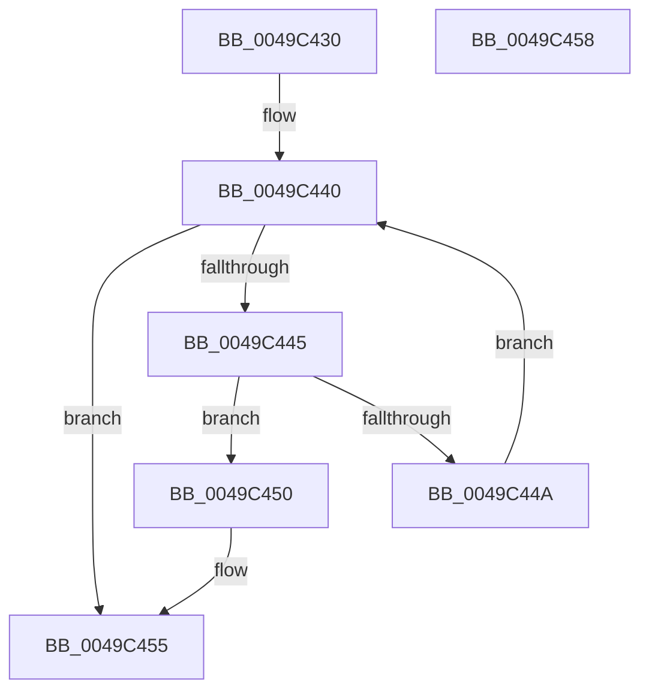

# ExpHpIsSpecialPoolHeap

- RVA: `0x0049C430`–`0x0049C459` (길이 `41` bytes)
- VA: `0x000000014049C430`
- 실행 섹션: `.text`
- PDB 이름 있음: `예`; PDB Function 태그: `아니요`
- unwind 정보 RVA: `0x000DB714`
- 디코드: `13`개 명령, `41/41` bytes 표시
- 미해석 바이트: `0` (있으면 어셈블리에 `.byte`로 보존)

> 이 문서는 커널 이미지의 기계어와 PDB 기호를 분석해 생성했습니다. 4번과 5번은 함수 원형과 자료형을 바이너리 사용 방식에서 추정한 C 해석이며 원본 소스 복구 결과는 아닙니다.

## 1. Dependencies

- 직접 호출 지점: **0**; 고유 호출 대상: **0**
- 직접 호출자로 확인된 함수: **1**
- RIP 상대 이미지 참조: **2**

### Outgoing calls
- 직접 디코드된 call 명령이 없습니다.

### Direct callers
- [ExIsSpecialPoolAddress](ExIsSpecialPoolAddress_function_0049C410.md) at `0x0049C41C`

### Static image references
- `0x0049C432` → RVA `0x00EEEF40` (`.data`; read)
- `0x0049C439` → RVA `0x00EEEF60` (`.data`; read)

## 2. Other-region calls and transfers

- 다른 실행 섹션으로 향하는 call: **0**
- 별도 외부 분기/꼬리 이동을 확인하지 못했습니다.

## 3. Assembly (complete function range)

```asm
0049C430  33 D2                           xor edx, edx
0049C432  48 8D 05 07 2B A5 00            lea rax, [rip + 0xa52b07]
0049C439  4C 8D 05 20 2B A5 00            lea r8, [rip + 0xa52b20]
0049C440  49 3B C0                        cmp rax, r8
0049C443  7D 10                           jge 0x14049c455
0049C445  48 3B 08                        cmp rcx, qword ptr [rax]
0049C448  74 06                           je 0x14049c450
0049C44A  48 83 C0 08                     add rax, 8
0049C44E  EB F0                           jmp 0x14049c440
0049C450  BA 01 00 00 00                  mov edx, 1
0049C455  8B C2                           mov eax, edx
0049C457  C3                              ret
0049C458  CC                              int3
```

## 4. C-style interpretation (structured pseudocode)

```c
__int64 __fastcall ExpHpIsSpecialPoolHeap(__int64 a1, int a2)
{
    __int64 result;

    a2 = 0;
loc_0049C440:
    if ((v_rip + 10824455) >= (v_rip + 10824480)) goto loc_0049C455;
    if (a1 == (*(unsigned __int64 *)(v_rip + 10824455))) goto loc_0049C450;
    result = (v_rip + 10824455) + (8);
    goto loc_0049C440;
loc_0049C450:
loc_0049C455:
    return 1;
}
```

## 5. (Beta) C Style

```c
int64_t ExpHpIsSpecialPoolHeap(int64_t Arg1, int32_t Arg2)
{
    int64_t result;

    Arg2 = 0;
loc_0049C440:
    if ((v_rip + 10824455) >= (v_rip + 10824480)) goto loc_0049C455;
    if (Arg1 == (*(uint64_t *)(v_rip + 0xA52B07))) goto loc_0049C450;
    result = (v_rip + 10824455) + (8);
    goto loc_0049C440;
loc_0049C450:
loc_0049C455:
    return 1;
}
```

## 6. Execution-region graph

[열기: 2D/3D 그래프와 함수 탐색 컨트롤 패널](../../../control-panel.html?section=text&rva=0x0049C430&view=graph)

- 2D 그래프는 위에서 아래로 흐르고, 3D 그래프는 빈 공간을 드래그해 회전합니다. Shift+드래그는 이동, 휠은 확대·축소, 함수 노드 선택은 대상 보고서 이동입니다.

### Static fallback


