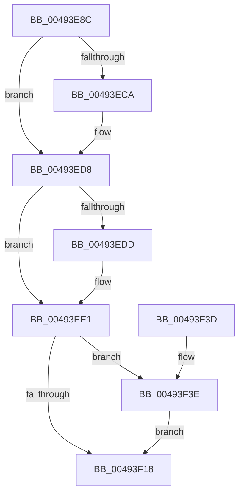

# ExpSaPageGroupFreeMemory

- RVA: `0x00493E8C`–`0x00493F48` (길이 `188` bytes)
- VA: `0x0000000140493E8C`
- 실행 섹션: `.text`
- PDB 이름 있음: `예`; PDB Function 태그: `아니요`
- unwind 정보 RVA: `0x000841B4`
- 디코드: `53`개 명령, `188/188` bytes 표시
- 미해석 바이트: `0` (있으면 어셈블리에 `.byte`로 보존)

> 이 문서는 커널 이미지의 기계어와 PDB 기호를 분석해 생성했습니다. 4번과 5번은 함수 원형과 자료형을 바이너리 사용 방식에서 추정한 C 해석이며 원본 소스 복구 결과는 아닙니다.

## 1. Dependencies

- 직접 호출 지점: **5**; 고유 호출 대상: **5**
- 직접 호출자로 확인된 함수: **1**
- RIP 상대 이미지 참조: **0**

### Outgoing calls
- `0x00493EBA` → [KeAbPreAcquire](../21/KeAbPreAcquire_function_00210230.md) (function, `0x00210230`)
- `0x00493ED3` → [ExfAcquirePushLockExclusiveEx](../20/ExfAcquirePushLockExclusiveEx_function_0020FC90.md) (function, `0x0020FC90`)
- `0x00493EF4` → [RtlClearBitsEx](../29/RtlClearBitsEx_function_00297740.md) (function, `0x00297740`)
- `0x00493F1B` → [KeAbPostRelease](../2E/KeAbPostRelease_function_002E1600.md) (function, `0x002E1600`)
- `0x00493F41` → [ExfTryToWakePushLock](../26/ExfTryToWakePushLock_function_00265DD0.md) (function, `0x00265DD0`)

### Direct callers
- [ExpSaAllocatorFree](../2E/ExpSaAllocatorFree_function_002E2E00.md) at `0x002E2E78`

### Static image references
- 디코드된 RIP-relative 메모리 참조가 없습니다.

## 2. Other-region calls and transfers

- 다른 실행 섹션으로 향하는 call: **0**
- 별도 외부 분기/꼬리 이동을 확인하지 못했습니다.

## 3. Assembly (complete function range)

```asm
00493E8C  48 8B C4                        mov rax, rsp
00493E8F  48 89 58 08                     mov qword ptr [rax + 8], rbx
00493E93  48 89 68 10                     mov qword ptr [rax + 0x10], rbp
00493E97  48 89 70 18                     mov qword ptr [rax + 0x18], rsi
00493E9B  48 89 78 20                     mov qword ptr [rax + 0x20], rdi
00493E9F  41 56                           push r14
00493EA1  48 83 EC 20                     sub rsp, 0x20
00493EA5  48 8D 79 18                     lea rdi, [rcx + 0x18]
00493EA9  45 8B F0                        mov r14d, r8d
00493EAC  48 8B DA                        mov rbx, rdx
00493EAF  48 8B E9                        mov rbp, rcx
00493EB2  48 8B CF                        mov rcx, rdi
00493EB5  45 33 C0                        xor r8d, r8d
00493EB8  33 D2                           xor edx, edx
00493EBA  E8 71 C3 D7 FF                  call 0x140210230
00493EBF  F0 48 0F BA 2F 00               lock bts qword ptr [rdi], 0
00493EC5  48 8B F0                        mov rsi, rax
00493EC8  73 0E                           jae 0x140493ed8
00493ECA  4C 8B C7                        mov r8, rdi
00493ECD  48 8B D0                        mov rdx, rax
00493ED0  48 8B CF                        mov rcx, rdi
00493ED3  E8 B8 BD D7 FF                  call 0x14020fc90
00493ED8  48 85 F6                        test rsi, rsi
00493EDB  74 04                           je 0x140493ee1
00493EDD  C6 46 0A 01                     mov byte ptr [rsi + 0xa], 1
00493EE1  48 C1 EB 04                     shr rbx, 4
00493EE5  48 8D 4D 30                     lea rcx, [rbp + 0x30]
00493EE9  81 E3 FF 01 00 00               and ebx, 0x1ff
00493EEF  4D 8B C6                        mov r8, r14
00493EF2  8B D3                           mov edx, ebx
00493EF4  E8 47 38 E0 FF                  call 0x140297740
00493EF9  44 01 75 24                     add dword ptr [rbp + 0x24], r14d
00493EFD  81 7D 24 00 02 00 00            cmp dword ptr [rbp + 0x24], 0x200
00493F04  0F 94 C3                        sete bl
00493F07  48 83 CA FF                     or rdx, 0xffffffffffffffff
00493F0B  F0 48 0F C1 17                  lock xadd qword ptr [rdi], rdx
00493F10  80 E2 06                        and dl, 6
00493F13  80 FA 02                        cmp dl, 2
00493F16  74 26                           je 0x140493f3e
00493F18  48 8B CF                        mov rcx, rdi
00493F1B  E8 E0 D6 E4 FF                  call 0x1402e1600
00493F20  48 8B 6C 24 38                  mov rbp, qword ptr [rsp + 0x38]
00493F25  8A C3                           mov al, bl
00493F27  48 8B 5C 24 30                  mov rbx, qword ptr [rsp + 0x30]
00493F2C  48 8B 74 24 40                  mov rsi, qword ptr [rsp + 0x40]
00493F31  48 8B 7C 24 48                  mov rdi, qword ptr [rsp + 0x48]
00493F36  48 83 C4 20                     add rsp, 0x20
00493F3A  41 5E                           pop r14
00493F3C  C3                              ret
00493F3D  CC                              int3
00493F3E  48 8B CF                        mov rcx, rdi
00493F41  E8 8A 1E DD FF                  call 0x140265dd0
00493F46  EB D0                           jmp 0x140493f18
```

## 4. C-style interpretation (structured pseudocode)

```c
__int64 __fastcall ExpSaPageGroupFreeMemory(__int64 a1, __int64 a2, int a3)
{
    __int64 result;
    __int64 v_rbx;
    __int64 v_rsp;
    unsigned __int64 v_stack_p10;
    unsigned __int64 v_stack_p18;
    unsigned __int64 v_stack_p20;
    unsigned __int64 v_stack_p8;

    *(unsigned __int64 *)(v_rsp + 8) = v_rbx;
    *(unsigned __int64 *)(v_rsp + 16) = v_rbp;
    *(unsigned __int64 *)(v_rsp + 24) = v_rsi;
    *(unsigned __int64 *)(v_rsp + 32) = v_rdi;
    v_rsp = (v_rsp) - (32);
    a3 = 0;
    a2 = 0;
    result = KeAbPreAcquire(a1 + 24, a2, a3, a4);
    if (!(condition_is_above_or_equal)) {
        a3 = a1 + 24;
        a2 = result;
        a1 = a1 + 24;
        result = ExfAcquirePushLockExclusiveEx(a1, a2, a3, a4);
    }
    if (result != 0) {
        *(unsigned __int8 *)(result + 10) = 1;
    }
    v_rbx = (a2) >> (4);
    v_rbx = (unsigned int)((v_rbx) & (511));
    result = RtlClearBitsEx(a1 + 48, (unsigned int)((unsigned int)(v_rbx)), (unsigned int)(a3), a4);
    v_rbx = ((*(unsigned int *)(a1 + 36)) == 512) ? 1 : 0;
    a2 = ((unsigned int)((unsigned int)(v_rbx))) | (-1);
    a2 = (unsigned __int8)((a2) & (6));
    if (((unsigned __int8)(a2)) == 2) goto loc_00493F3E;
loc_00493F18:
    result = KeAbPostRelease(a1 + 24, a2, (unsigned int)(a3), a4);
    v_rsp = (v_rsp) + (32);
    return (unsigned __int8)(v_rbx);
loc_00493F3E:
    result = ExfTryToWakePushLock(v_stack_p20, a2, (unsigned int)(a3), a4);
    goto loc_00493F18;
}
```

## 5. (Beta) C Style

```c
int64_t ExpSaPageGroupFreeMemory(void *Arg1, int64_t Arg2, int32_t Arg3)
{
    uint8_t *arg1 = (uint8_t *)Arg1;

    int64_t result;
    int64_t local_rbx;
    int64_t local_rsp;
    uint64_t v_stack_p10;
    uint64_t v_stack_p18;
    uint64_t v_stack_p20;
    uint64_t v_stack_p8;

    *(uint64_t *)(local_rsp + 0x8) = local_rbx;
    *(uint64_t *)(local_rsp + 0x10) = local_rbp;
    *(uint64_t *)(local_rsp + 0x18) = local_rsi;
    *(uint64_t *)(local_rsp + 0x20) = local_rdi;
    local_rsp = (local_rsp) - (32);
    Arg3 = 0;
    Arg2 = 0;
    result = KeAbPreAcquire(Arg1 + 24, Arg2, Arg3, a4);
    if (!(condition_is_above_or_equal)) {
        Arg3 = Arg1 + 24;
        Arg2 = result;
        Arg1 = Arg1 + 24;
        result = ExfAcquirePushLockExclusiveEx(Arg1, Arg2, Arg3, a4);
    }
    if (result != 0) {
        *(uint8_t *)(result + 0xA) = 1;
    }
    local_rbx = (Arg2) >> (4);
    local_rbx = (uint32_t)((local_rbx) & (511));
    result = RtlClearBitsEx(Arg1 + 48, (uint32_t)((uint32_t)(local_rbx)), (uint32_t)(Arg3), a4);
    local_rbx = ((*(uint32_t *)(arg1 + 0x24)) == 512) ? 1 : 0;
    Arg2 = ((uint32_t)((uint32_t)(local_rbx))) | (-1);
    Arg2 = (uint8_t)((Arg2) & (6));
    if (((uint8_t)(Arg2)) == 2) goto loc_00493F3E;
loc_00493F18:
    result = KeAbPostRelease(Arg1 + 24, Arg2, (uint32_t)(Arg3), a4);
    local_rsp = (local_rsp) + (32);
    return (uint8_t)(local_rbx);
loc_00493F3E:
    result = ExfTryToWakePushLock(v_stack_p20, Arg2, (uint32_t)(Arg3), a4);
    goto loc_00493F18;
}
```

### 관측된 메모리 오프셋

구조체 형식이 확인되지 않은 접근은 인자 기준의 오프셋으로만 기록했습니다.

| 기준 인자 | 오프셋 표현 | 폭 (bit) | 접근 |
|---|---:|---:|---|
| `Arg1` | `+ 0x0` | `64` | `R/W` |
| `Arg1` | `+ 0x18` | `64` | `R` |
| `Arg1` | `+ 0x24` | `32` | `R` |
| `Arg1` | `+ 0x24` | `32` | `R/W` |
| `Arg1` | `+ 0x30` | `64` | `R` |

## 6. Execution-region graph

[열기: 2D/3D 그래프와 함수 탐색 컨트롤 패널](../../../control-panel.html?section=text&rva=0x00493E8C&view=graph)

- 2D 그래프는 위에서 아래로 흐르고, 3D 그래프는 빈 공간을 드래그해 회전합니다. Shift+드래그는 이동, 휠은 확대·축소, 함수 노드 선택은 대상 보고서 이동입니다.

### Static fallback


