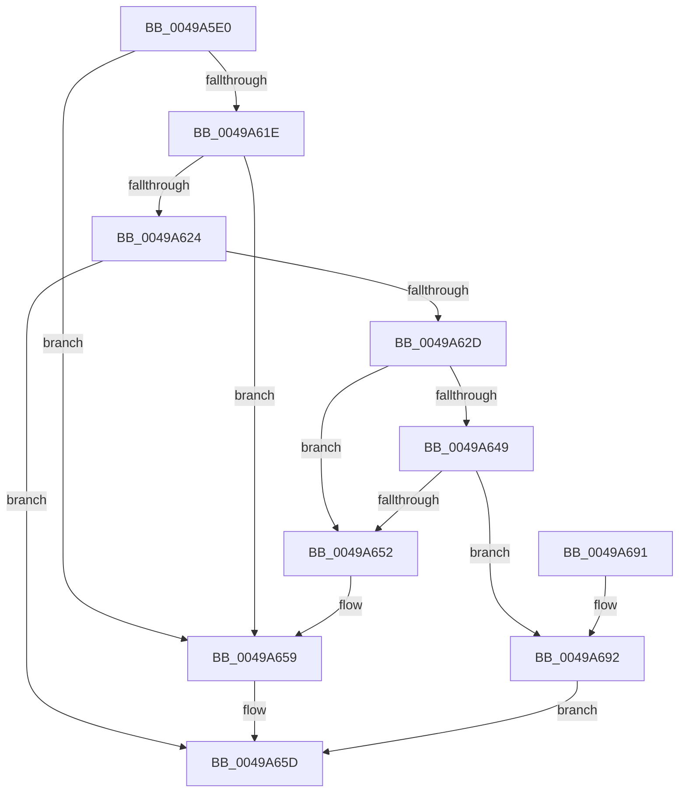

# ExpTimerApcRoutine

- RVA: `0x0049A5E0`–`0x0049A6AE` (길이 `206` bytes)
- VA: `0x000000014049A5E0`
- 실행 섹션: `.text`
- PDB 이름 있음: `예`; PDB Function 태그: `아니요`
- unwind 정보 RVA: `0x000AA9C0`
- 디코드: `51`개 명령, `206/206` bytes 표시
- 미해석 바이트: `0` (있으면 어셈블리에 `.byte`로 보존)

> 이 문서는 커널 이미지의 기계어와 PDB 기호를 분석해 생성했습니다. 4번과 5번은 함수 원형과 자료형을 바이너리 사용 방식에서 추정한 C 해석이며 원본 소스 복구 결과는 아닙니다.

## 1. Dependencies

- 직접 호출 지점: **5**; 고유 호출 대상: **5**
- 직접 호출자로 확인된 함수: **0**
- RIP 상대 이미지 참조: **0**

### Outgoing calls
- `0x0049A60D` → [KeAcquireSpinLockRaiseToDpc](../20/KeAcquireSpinLockRaiseToDpc_function_00208470.md) (function, `0x00208470`)
- `0x0049A634` → [KeAcquireSpinLockAtDpcLevel](../20/KeAcquireSpinLockAtDpcLevel_function_00208430.md) (function, `0x00208430`)
- `0x0049A664` → [KeReleaseSpinLock](../39/KeReleaseSpinLock_function_00392BA0.md) (function, `0x00392BA0`)
- `0x0049A671` → [ObfDereferenceObjectWithTag](../2F/ObfDereferenceObjectWithTag_function_002F78E0.md) (function, `0x002F78E0`)
- `0x0049A6A0` → [KxReleaseSpinLock](../20/KxReleaseSpinLock_function_00206670.md) (function, `0x00206670`)

### Direct callers
- 이 함수 시작 RVA로 연결되는 직접 call은 확인되지 않았습니다. 간접 호출은 완전히 역산할 수 없습니다.

### Static image references
- 디코드된 RIP-relative 메모리 참조가 없습니다.

## 2. Other-region calls and transfers

- 다른 실행 섹션으로 향하는 call: **0**
- 별도 외부 분기/꼬리 이동을 확인하지 못했습니다.

## 3. Assembly (complete function range)

```asm
0049A5E0  48 8B C4                        mov rax, rsp
0049A5E3  48 89 58 08                     mov qword ptr [rax + 8], rbx
0049A5E7  48 89 68 10                     mov qword ptr [rax + 0x10], rbp
0049A5EB  48 89 70 18                     mov qword ptr [rax + 0x18], rsi
0049A5EF  48 89 78 20                     mov qword ptr [rax + 0x20], rdi
0049A5F3  41 56                           push r14
0049A5F5  48 83 EC 20                     sub rsp, 0x20
0049A5F9  65 48 8B 3C 25 88 01 00 00      mov rdi, qword ptr gs:[0x188]
0049A602  48 8D 59 B8                     lea rbx, [rcx - 0x48]
0049A606  48 8D 4B 40                     lea rcx, [rbx + 0x40]
0049A60A  48 8B F2                        mov rsi, rdx
0049A60D  E8 5E DE D6 FF                  call 0x140208470
0049A612  F6 83 30 01 00 00 01            test byte ptr [rbx + 0x130], 1
0049A619  44 8A F0                        mov r14b, al
0049A61C  74 3B                           je 0x14049a659
0049A61E  48 3B 7B 50                     cmp rdi, qword ptr [rbx + 0x50]
0049A622  75 35                           jne 0x14049a659
0049A624  83 BB F0 00 00 00 00            cmp dword ptr [rbx + 0xf0], 0
0049A62B  75 30                           jne 0x14049a65d
0049A62D  48 8D 8F F0 04 00 00            lea rcx, [rdi + 0x4f0]
0049A634  E8 F7 DD D6 FF                  call 0x140208430
0049A639  48 8D 83 E0 00 00 00            lea rax, [rbx + 0xe0]
0049A640  4C 8B 00                        mov r8, qword ptr [rax]
0049A643  49 39 40 08                     cmp qword ptr [r8 + 8], rax
0049A647  75 09                           jne 0x14049a652
0049A649  48 8B 50 08                     mov rdx, qword ptr [rax + 8]
0049A64D  48 39 02                        cmp qword ptr [rdx], rax
0049A650  74 40                           je 0x14049a692
0049A652  B9 03 00 00 00                  mov ecx, 3
0049A657  CD 29                           int 0x29
0049A659  48 83 26 00                     and qword ptr [rsi], 0
0049A65D  41 8A D6                        mov dl, r14b
0049A660  48 8D 4B 40                     lea rcx, [rbx + 0x40]
0049A664  E8 37 85 EF FF                  call 0x140392ba0
0049A669  BA 44 66 6C 74                  mov edx, 0x746c6644
0049A66E  48 8B CB                        mov rcx, rbx
0049A671  E8 6A D2 E5 FF                  call 0x1402f78e0
0049A676  48 8B 5C 24 30                  mov rbx, qword ptr [rsp + 0x30]
0049A67B  48 8B 6C 24 38                  mov rbp, qword ptr [rsp + 0x38]
0049A680  48 8B 74 24 40                  mov rsi, qword ptr [rsp + 0x40]
0049A685  48 8B 7C 24 48                  mov rdi, qword ptr [rsp + 0x48]
0049A68A  48 83 C4 20                     add rsp, 0x20
0049A68E  41 5E                           pop r14
0049A690  C3                              ret
0049A691  CC                              int3
0049A692  4C 89 02                        mov qword ptr [rdx], r8
0049A695  48 8D 8F F0 04 00 00            lea rcx, [rdi + 0x4f0]
0049A69C  49 89 50 08                     mov qword ptr [r8 + 8], rdx
0049A6A0  E8 CB BF D6 FF                  call 0x140206670
0049A6A5  80 A3 30 01 00 00 FE            and byte ptr [rbx + 0x130], 0xfe
0049A6AC  EB AF                           jmp 0x14049a65d
```

## 4. C-style interpretation (structured pseudocode)

```c
__int64 __fastcall ExpTimerApcRoutine(__int64 a1, __int64 a2)
{
    __int64 result;
    __int64 v_rsp;
    unsigned __int64 v_stack_p10;
    unsigned __int64 v_stack_p18;
    unsigned __int64 v_stack_p20;
    unsigned __int64 v_stack_p8;

    *(unsigned __int64 *)(v_rsp + 8) = v_rbx;
    *(unsigned __int64 *)(v_rsp + 16) = v_rbp;
    *(unsigned __int64 *)(v_rsp + 24) = v_rsi;
    *(unsigned __int64 *)(v_rsp + 32) = v_rdi;
    v_rsp = (v_rsp) - (32);
    result = KeAcquireSpinLockRaiseToDpc(a1 - 72 + 64, a2, a3, a4);
    if (((*(unsigned __int8 *)(a1 - 72 + 304)) & (1)) == 0) goto loc_0049A659;
    if ((*(unsigned __int64 *)(gs_base + (0 + 392))) != (*(unsigned __int64 *)(a1 - 72 + 80))) goto loc_0049A659;
    if ((*(unsigned int *)(a1 - 72 + 240)) != 0) goto loc_0049A65D;
    result = KeAcquireSpinLockAtDpcLevel(*(unsigned __int64 *)(gs_base + (0 + 392)) + 1264, a2, a3, a4);
    if ((*(unsigned __int64 *)(*(unsigned __int64 *)(a1 - 72 + 224) + 8)) != (a1 - 72 + 224)) goto loc_0049A652;
    if ((*(unsigned __int64 *)(*(unsigned __int64 *)(a1 - 72 + 224 + 8))) == (a1 - 72 + 224)) goto loc_0049A692;
loc_0049A652:
loc_0049A659:
loc_0049A65D:
    result = KeReleaseSpinLock(a1 - 72 + 64, (unsigned __int8)((unsigned __int8)(result)), *(unsigned __int64 *)(a1 - 72 + 224), a4);
    result = ObfDereferenceObjectWithTag(a1 - 72, (unsigned int)(0x746C6644ULL), *(unsigned __int64 *)(a1 - 72 + 224), a4);
    v_rsp = (v_rsp) + (32);
    return result;
loc_0049A692:
    *(unsigned __int64 *)((unsigned int)(0x746C6644ULL)) = *(unsigned __int64 *)(a1 - 72 + 224);
    *(unsigned __int64 *)(*(unsigned __int64 *)(a1 - 72 + 224) + 8) = (unsigned int)(0x746C6644ULL);
    result = KxReleaseSpinLock(v_stack_p20 + 1264, (unsigned int)(0x746C6644ULL), *(unsigned __int64 *)(a1 - 72 + 224), a4);
    goto loc_0049A65D;
}
```

## 5. (Beta) C Style

```c
int64_t ExpTimerApcRoutine(void *Arg1, void *Arg2)
{
    uint8_t *arg1 = (uint8_t *)Arg1;
    uint8_t *arg2 = (uint8_t *)Arg2;

    int64_t result;
    int64_t local_rsp;
    uint64_t v_stack_p10;
    uint64_t v_stack_p18;
    uint64_t v_stack_p20;
    uint64_t v_stack_p8;

    *(uint64_t *)(local_rsp + 0x8) = local_rbx;
    *(uint64_t *)(local_rsp + 0x10) = local_rbp;
    *(uint64_t *)(local_rsp + 0x18) = local_rsi;
    *(uint64_t *)(local_rsp + 0x20) = local_rdi;
    local_rsp = (local_rsp) - (32);
    result = KeAcquireSpinLockRaiseToDpc(Arg1 - 72 + 64, Arg2, a3, a4);
    if (((*(uint8_t *)(arg1 - 0x48 + 0x130)) & (1)) == 0) goto loc_0049A659;
    if ((*(uint64_t *)(gs_base + (0 + 0x188))) != (*(uint64_t *)(arg1 - 0x48 + 0x50))) goto loc_0049A659;
    if ((*(uint32_t *)(arg1 - 0x48 + 0xF0)) != 0) goto loc_0049A65D;
    result = KeAcquireSpinLockAtDpcLevel(*(uint64_t *)(gs_base + (0 + 0x188)) + 1264, Arg2, a3, a4);
    if ((*(uint64_t *)(*(uint64_t *)(arg1 - 0x48 + 0xE0) + 0x8)) != (Arg1 - 72 + 224)) goto loc_0049A652;
    if ((*(uint64_t *)(*(uint64_t *)(arg1 - 0x48 + 0xE0 + 0x8))) == (Arg1 - 72 + 224)) goto loc_0049A692;
loc_0049A652:
loc_0049A659:
loc_0049A65D:
    result = KeReleaseSpinLock(Arg1 - 72 + 64, (uint8_t)((uint8_t)(result)), *(uint64_t *)(arg1 - 0x48 + 0xE0), a4);
    result = ObfDereferenceObjectWithTag(Arg1 - 72, (uint32_t)(0x746C6644ULL), *(uint64_t *)(arg1 - 0x48 + 0xE0), a4);
    local_rsp = (local_rsp) + (32);
    return result;
loc_0049A692:
    *(uint64_t *)((uint32_t)(0x746C6644ULL)) = *(uint64_t *)(arg1 - 0x48 + 0xE0);
    *(uint64_t *)(*(uint64_t *)(arg1 - 0x48 + 0xE0) + 0x8) = (uint32_t)(0x746C6644ULL);
    result = KxReleaseSpinLock(v_stack_p20 + 1264, (uint32_t)(0x746C6644ULL), *(uint64_t *)(arg1 - 0x48 + 0xE0), a4);
    goto loc_0049A65D;
}
```

### 관측된 메모리 오프셋

구조체 형식이 확인되지 않은 접근은 인자 기준의 오프셋으로만 기록했습니다.

| 기준 인자 | 오프셋 표현 | 폭 (bit) | 접근 |
|---|---:|---:|---|
| `Arg1` | `- 0x48` | `64` | `R` |
| `Arg1` | `+ 0x0` | `64` | `R` |
| `Arg1` | `+ 0x8` | `64` | `R` |
| `Arg1` | `+ 0x40` | `64` | `R` |
| `Arg1` | `+ 0x50` | `64` | `R` |
| `Arg1` | `+ 0xE0` | `64` | `R` |
| `Arg1` | `+ 0xF0` | `32` | `R` |
| `Arg1` | `+ 0x130` | `8` | `R` |
| `Arg1` | `+ 0x130` | `8` | `R/W` |
| `Arg2` | `+ 0x0` | `64` | `R/W` |

## 6. Execution-region graph

[열기: 2D/3D 그래프와 함수 탐색 컨트롤 패널](../../../control-panel.html?section=text&rva=0x0049A5E0&view=graph)

- 2D 그래프는 위에서 아래로 흐르고, 3D 그래프는 빈 공간을 드래그해 회전합니다. Shift+드래그는 이동, 휠은 확대·축소, 함수 노드 선택은 대상 보고서 이동입니다.

### Static fallback


