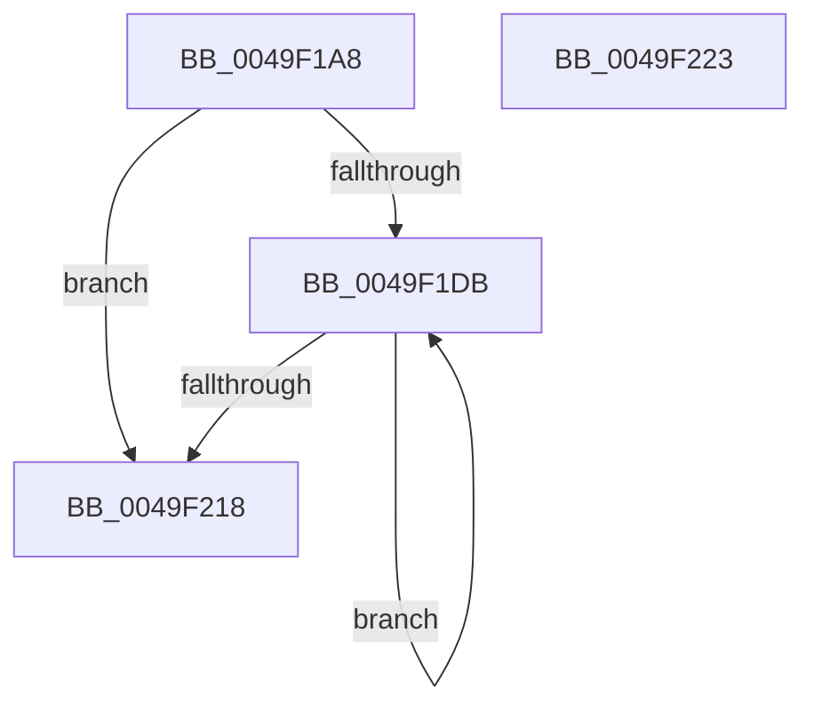

# ExpWorkerFactoryDeferredThreadCreation

- RVA: `0x0049F1A8`–`0x0049F224` (길이 `124` bytes)
- VA: `0x000000014049F1A8`
- 실행 섹션: `.text`
- PDB 이름 있음: `예`; PDB Function 태그: `아니요`
- unwind 정보 RVA: `0x00065960`
- 디코드: `33`개 명령, `124/124` bytes 표시
- 미해석 바이트: `0` (있으면 어셈블리에 `.byte`로 보존)

> 이 문서는 커널 이미지의 기계어와 PDB 기호를 분석해 생성했습니다. 4번과 5번은 함수 원형과 자료형을 바이너리 사용 방식에서 추정한 C 해석이며 원본 소스 복구 결과는 아닙니다.

## 1. Dependencies

- 직접 호출 지점: **4**; 고유 호출 대상: **4**
- 직접 호출자로 확인된 함수: **1**
- RIP 상대 이미지 참조: **2**

### Outgoing calls
- `0x0049F1CE` → [ExpInterlockedFlushSList](../6B/ExpInterlockedFlushSList_function_006BA5F0.md) (function, `0x006BA5F0`)
- `0x0049F1EA` → [KeAcquireInStackQueuedSpinLock](../27/KeAcquireInStackQueuedSpinLock_function_002757A0.md) (function, `0x002757A0`)
- `0x0049F201` → [ExpWorkerFactoryCheckCreate](../34/ExpWorkerFactoryCheckCreate_function_00344460.md) (function, `0x00344460`)
- `0x0049F20E` → [ObfDereferenceObjectWithTag](../2F/ObfDereferenceObjectWithTag_function_002F78E0.md) (function, `0x002F78E0`)

### Direct callers
- [ExpWorkerFactoryManagerThread](../65/ExpWorkerFactoryManagerThread_function_0065CCC0.md) at `0x0065CD20`

### Static image references
- `0x0049F1B4` → RVA `0x00E29160` (`.data`; read)
- `0x0049F1C8` → RVA `0x00EFA180` (`.data`; write)

## 2. Other-region calls and transfers

- 다른 실행 섹션으로 향하는 call: **0**
- 별도 외부 분기/꼬리 이동을 확인하지 못했습니다.

## 3. Assembly (complete function range)

```asm
0049F1A8  48 89 5C 24 08                  mov qword ptr [rsp + 8], rbx
0049F1AD  57                              push rdi
0049F1AE  48 83 EC 40                     sub rsp, 0x40
0049F1B2  33 C0                           xor eax, eax
0049F1B4  48 8D 0D A5 9F 98 00            lea rcx, [rip + 0x989fa5]
0049F1BB  0F 57 C0                        xorps xmm0, xmm0
0049F1BE  48 89 44 24 30                  mov qword ptr [rsp + 0x30], rax
0049F1C3  0F 11 44 24 20                  movups xmmword ptr [rsp + 0x20], xmm0
0049F1C8  89 05 B2 AF A5 00               mov dword ptr [rip + 0xa5afb2], eax
0049F1CE  E8 1D B4 21 00                  call 0x1406ba5f0
0049F1D3  48 8B F8                        mov rdi, rax
0049F1D6  48 85 C0                        test rax, rax
0049F1D9  74 3D                           je 0x14049f218
0049F1DB  48 8B DF                        mov rbx, rdi
0049F1DE  48 8D 54 24 20                  lea rdx, [rsp + 0x20]
0049F1E3  48 8B 3F                        mov rdi, qword ptr [rdi]
0049F1E6  48 8B 4B 10                     mov rcx, qword ptr [rbx + 0x10]
0049F1EA  E8 B1 65 DD FF                  call 0x1402757a0
0049F1EF  83 A3 98 01 00 00 F7            and dword ptr [rbx + 0x198], 0xfffffff7
0049F1F6  48 8D 54 24 20                  lea rdx, [rsp + 0x20]
0049F1FB  41 B0 01                        mov r8b, 1
0049F1FE  48 8B CB                        mov rcx, rbx
0049F201  E8 5A 52 EA FF                  call 0x140344460
0049F206  BA 44 66 6C 74                  mov edx, 0x746c6644
0049F20B  48 8B CB                        mov rcx, rbx
0049F20E  E8 CD 86 E5 FF                  call 0x1402f78e0
0049F213  48 85 FF                        test rdi, rdi
0049F216  75 C3                           jne 0x14049f1db
0049F218  48 8B 5C 24 50                  mov rbx, qword ptr [rsp + 0x50]
0049F21D  48 83 C4 40                     add rsp, 0x40
0049F221  5F                              pop rdi
0049F222  C3                              ret
0049F223  CC                              int3
```

## 4. C-style interpretation (structured pseudocode)

```c
__int64 __fastcall ExpWorkerFactoryDeferredThreadCreation(void)
{
    __int64 result;
    __int64 v_rsp;
    unsigned __int64 v_stack_m18;
    unsigned __int64 v_stack_m28;
    unsigned __int64 v_stack_p8;

    v_stack_p8 = v_rbx;
    v_rsp = (v_rsp) - (64);
    result = 0;
    v_stack_m18 = 0;
    v_stack_m28 = v_xmm0;
    *(unsigned int *)(v_rip + 10858418) = 0;
    result = ExpInterlockedFlushSList(v_rip + 10002341, a2, a3, a4);
    if (result == 0) goto loc_0049F218;
loc_0049F1DB:
    result = KeAcquireInStackQueuedSpinLock(*(unsigned __int64 *)(result + 16), v_stack_m28, a3, a4);
    result = ExpWorkerFactoryCheckCreate(result, v_stack_m28, 1, a4);
    result = ObfDereferenceObjectWithTag(result, (unsigned int)(0x746C6644ULL), 1, a4);
    if (*(unsigned __int64 *)(result) != 0) goto loc_0049F1DB;
loc_0049F218:
    v_rsp = (v_rsp) + (64);
    return result;
}
```

## 5. (Beta) C Style

```c
void ExpWorkerFactoryDeferredThreadCreation(void)
{
    int64_t result;
    int64_t local_rsp;
    uint64_t v_stack_m18;
    uint64_t v_stack_m28;
    uint64_t v_stack_p8;

    v_stack_p8 = local_rbx;
    local_rsp = (local_rsp) - (64);
    result = 0;
    v_stack_m18 = 0;
    v_stack_m28 = v_xmm0;
    *(uint32_t *)(v_rip + 0xA5AFB2) = 0;
    result = ExpInterlockedFlushSList(v_rip + 10002341, a2, a3, a4);
    if (result == 0) goto loc_0049F218;
loc_0049F1DB:
    result = KeAcquireInStackQueuedSpinLock(*(uint64_t *)(result + 0x10), v_stack_m28, a3, a4);
    result = ExpWorkerFactoryCheckCreate(result, v_stack_m28, 1, a4);
    result = ObfDereferenceObjectWithTag(result, (uint32_t)(0x746C6644ULL), 1, a4);
    if (*(uint64_t *)(result) != 0) goto loc_0049F1DB;
loc_0049F218:
    local_rsp = (local_rsp) + (64);
    return result;
}
```

## 6. Execution-region graph

[열기: 2D/3D 그래프와 함수 탐색 컨트롤 패널](../../../control-panel.html?section=text&rva=0x0049F1A8&view=graph)

- 2D 그래프는 위에서 아래로 흐르고, 3D 그래프는 빈 공간을 드래그해 회전합니다. Shift+드래그는 이동, 휠은 확대·축소, 함수 노드 선택은 대상 보고서 이동입니다.

### Static fallback


