# ExtEnvSetVpptTarget

- RVA: `0x0049D8FC`–`0x0049DC23` (길이 `807` bytes)
- VA: `0x000000014049D8FC`
- 실행 섹션: `.text`
- PDB 이름 있음: `예`; PDB Function 태그: `아니요`
- unwind 정보 RVA: `0x000B4FE0`
- 디코드: `203`개 명령, `807/807` bytes 표시
- 미해석 바이트: `0` (있으면 어셈블리에 `.byte`로 보존)

> 이 문서는 커널 이미지의 기계어와 PDB 기호를 분석해 생성했습니다. 4번과 5번은 함수 원형과 자료형을 바이너리 사용 방식에서 추정한 C 해석이며 원본 소스 복구 결과는 아닙니다.

## 1. Dependencies

- 직접 호출 지점: **13**; 고유 호출 대상: **8**
- 직접 호출자로 확인된 함수: **1**
- RIP 상대 이미지 참조: **7**

### Outgoing calls
- `0x0049D93C` → [memset](../6C/memset_function_006C6C40.md) (function, `0x006C6C40`)
- `0x0049D9EE` → [HalpInterruptFindLinesForGsiRange](../2D/HalpInterruptFindLinesForGsiRange_function_002D204C.md) (function, `0x002D204C`)
- `0x0049DA11` → [HalpAcquireHighLevelLock](../2D/HalpAcquireHighLevelLock_function_002D2390.md) (function, `0x002D2390`)
- `0x0049DA63` → [HalpReleaseHighLevelLock](../2D/HalpReleaseHighLevelLock_function_002D1C58.md) (function, `0x002D1C58`)
- `0x0049DA9E` → [HalpInterruptFindLinesForGsiRange](../2D/HalpInterruptFindLinesForGsiRange_function_002D204C.md) (function, `0x002D204C`)
- `0x0049DAB6` → [HalpInterruptLookupController](../2D/HalpInterruptLookupController_function_002D20D4.md) (function, `0x002D20D4`)
- `0x0049DB08` → [KeBugCheckEx](../4F/KeBugCheckEx_function_004FD660.md) (function, `0x004FD660`)
- `0x0049DB2E` → [HalpInterruptSetDestination](../2D/HalpInterruptSetDestination_function_002D3100.md) (function, `0x002D3100`)
- `0x0049DB42` → [_security_check_cookie](../6A/_security_check_cookie_function_006AC640.md) (function, `0x006AC640`)
- `0x0049DBBC` → [KeBugCheckEx](../4F/KeBugCheckEx_function_004FD660.md) (function, `0x004FD660`)
- `0x0049DBDB` → [KeBugCheckEx](../4F/KeBugCheckEx_function_004FD660.md) (function, `0x004FD660`)
- `0x0049DBFE` → [KeBugCheckEx](../4F/KeBugCheckEx_function_004FD660.md) (function, `0x004FD660`)
- `0x0049DC1D` → [KeBugCheckEx](../4F/KeBugCheckEx_function_004FD660.md) (function, `0x004FD660`)

### Direct callers
- [HalpVpptUpdatePhysicalTimer](../2D/HalpVpptUpdatePhysicalTimer_function_002D23D8.md) at `0x002D2478`

### Static image references
- `0x0049D91B` → RVA `0x00E0A740` (`.data`; read)
- `0x0049D941` → RVA `0x00F231B0` (`.data`; read)
- `0x0049D948` → RVA `0x00FC4108` (`.data`; read)
- `0x0049D97C` → RVA `0x00FC40F0` (`.data`; read)
- `0x0049DA0A` → RVA `0x00F906F0` (`.data`; read)
- `0x0049DA16` → RVA `0x00F906E0` (`.data`; read)
- `0x0049DA6D` → RVA `0x00E101F0` (`.data`; read)

## 2. Other-region calls and transfers

- 다른 실행 섹션으로 향하는 call: **0**
- 별도 외부 분기/꼬리 이동을 확인하지 못했습니다.

## 3. Assembly (complete function range)

```asm
0049D8FC  48 8B C4                        mov rax, rsp
0049D8FF  48 89 58 08                     mov qword ptr [rax + 8], rbx
0049D903  48 89 70 10                     mov qword ptr [rax + 0x10], rsi
0049D907  48 89 78 18                     mov qword ptr [rax + 0x18], rdi
0049D90B  4C 89 70 20                     mov qword ptr [rax + 0x20], r14
0049D90F  55                              push rbp
0049D910  48 8D 68 A1                     lea rbp, [rax - 0x5f]
0049D914  48 81 EC C0 00 00 00            sub rsp, 0xc0
0049D91B  48 8B 05 1E CE 96 00            mov rax, qword ptr [rip + 0x96ce1e]
0049D922  48 33 C4                        xor rax, rsp
0049D925  48 89 45 47                     mov qword ptr [rbp + 0x47], rax
0049D929  8B DA                           mov ebx, edx
0049D92B  48 8D 4D E7                     lea rcx, [rbp - 0x19]
0049D92F  33 D2                           xor edx, edx
0049D931  0F 57 C0                        xorps xmm0, xmm0
0049D934  0F 11 45 CF                     movups xmmword ptr [rbp - 0x31], xmm0
0049D938  44 8D 42 58                     lea r8d, [rdx + 0x58]
0049D93C  E8 FF 92 22 00                  call 0x1406c6c40
0049D941  48 8B 05 68 58 A8 00            mov rax, qword ptr [rip + 0xa85868]
0049D948  48 8B 3D B9 67 B2 00            mov rdi, qword ptr [rip + 0xb267b9]
0049D94F  8B 0C 98                        mov ecx, dword ptr [rax + rbx*4]
0049D952  33 C0                           xor eax, eax
0049D954  89 45 D9                        mov dword ptr [rbp - 0x27], eax
0049D957  66 89 45 DD                     mov word ptr [rbp - 0x23], ax
0049D95B  8B C1                           mov eax, ecx
0049D95D  C1 E8 06                        shr eax, 6
0049D960  83 E1 3F                        and ecx, 0x3f
0049D963  66 89 45 D7                     mov word ptr [rbp - 0x29], ax
0049D967  B8 01 00 00 00                  mov eax, 1
0049D96C  48 D3 E0                        shl rax, cl
0049D96F  48 89 45 CF                     mov qword ptr [rbp - 0x31], rax
0049D973  48 85 FF                        test rdi, rdi
0049D976  0F 85 FF 01 00 00               jne 0x14049db7b
0049D97C  48 8B 3D 6D 67 B2 00            mov rdi, qword ptr [rip + 0xb2676d]
0049D983  83 BF E4 00 00 00 0C            cmp dword ptr [rdi + 0xe4], 0xc
0049D98A  0F 85 74 02 00 00               jne 0x14049dc04
0049D990  8B 45 0F                        mov eax, dword ptr [rbp + 0xf]
0049D993  25 00 00 00 C0                  and eax, 0xc0000000
0049D998  C7 45 EB D1 00 00 00            mov dword ptr [rbp - 0x15], 0xd1
0049D99F  0F 10 45 CF                     movups xmm0, xmmword ptr [rbp - 0x31]
0049D9A3  0F BA E8 1E                     bts eax, 0x1e
0049D9A7  C6 45 EF 0D                     mov byte ptr [rbp - 0x11], 0xd
0049D9AB  89 45 0F                        mov dword ptr [rbp + 0xf], eax
0049D9AE  8B 47 5C                        mov eax, dword ptr [rdi + 0x5c]
0049D9B1  89 45 F3                        mov dword ptr [rbp - 0xd], eax
0049D9B4  8B 47 60                        mov eax, dword ptr [rdi + 0x60]
0049D9B7  89 45 F7                        mov dword ptr [rbp - 9], eax
0049D9BA  8B 87 E0 00 00 00               mov eax, dword ptr [rdi + 0xe0]
0049D9C0  F3 0F 7F 45 FF                  movdqu xmmword ptr [rbp - 1], xmm0
0049D9C5  0F BA E0 09                     bt eax, 9
0049D9C9  72 1D                           jb 0x14049d9e8
0049D9CB  0F BA E0 08                     bt eax, 8
0049D9CF  0F 83 0C 02 00 00               jae 0x14049dbe1
0049D9D5  8B 5F 54                        mov ebx, dword ptr [rdi + 0x54]
0049D9D8  83 FB 08                        cmp ebx, 8
0049D9DB  0F 83 84 01 00 00               jae 0x14049db65
0049D9E1  BE 00 B0 00 00                  mov esi, 0xb000
0049D9E6  EB 1F                           jmp 0x14049da07
0049D9E8  8B 4F 58                        mov ecx, dword ptr [rdi + 0x58]
0049D9EB  8D 51 01                        lea edx, [rcx + 1]
0049D9EE  E8 59 46 E3 FF                  call 0x1402d204c
0049D9F3  48 85 C0                        test rax, rax
0049D9F6  0F 84 A3 01 00 00               je 0x14049db9f
0049D9FC  8B 58 14                        mov ebx, dword ptr [rax + 0x14]
0049D9FF  2B 58 1C                        sub ebx, dword ptr [rax + 0x1c]
0049DA02  8B 70 10                        mov esi, dword ptr [rax + 0x10]
0049DA05  03 D9                           add ebx, ecx
0049DA07  45 32 F6                        xor r14b, r14b
0049DA0A  48 8D 0D DF 2C AF 00            lea rcx, [rip + 0xaf2cdf]
0049DA11  E8 7A 49 E3 FF                  call 0x1402d2390
0049DA16  4C 8B 05 C3 2C AF 00            mov r8, qword ptr [rip + 0xaf2cc3]
0049DA1D  44 8A C8                        mov r9b, al
0049DA20  48 8D 05 B9 2C AF 00            lea rax, [rip + 0xaf2cb9]
0049DA27  4C 3B C0                        cmp r8, rax
0049DA2A  74 2D                           je 0x14049da59
0049DA2C  49 8B D0                        mov rdx, r8
0049DA2F  4D 8B 00                        mov r8, qword ptr [r8]
0049DA32  39 72 10                        cmp dword ptr [rdx + 0x10], esi
0049DA35  75 E9                           jne 0x14049da20
0049DA37  39 5A 14                        cmp dword ptr [rdx + 0x14], ebx
0049DA3A  75 E4                           jne 0x14049da20
0049DA3C  48 8B 42 18                     mov rax, qword ptr [rdx + 0x18]
0049DA40  41 B6 01                        mov r14b, 1
0049DA43  48 89 45 C7                     mov qword ptr [rbp - 0x39], rax
0049DA47  8B 42 24                        mov eax, dword ptr [rdx + 0x24]
0049DA4A  8B 5D CB                        mov ebx, dword ptr [rbp - 0x35]
0049DA4D  8B 75 C7                        mov esi, dword ptr [rbp - 0x39]
0049DA50  89 45 F3                        mov dword ptr [rbp - 0xd], eax
0049DA53  8B 42 20                        mov eax, dword ptr [rdx + 0x20]
0049DA56  89 45 F7                        mov dword ptr [rbp - 9], eax
0049DA59  41 8A D1                        mov dl, r9b
0049DA5C  48 8D 0D 8D 2C AF 00            lea rcx, [rip + 0xaf2c8d]
0049DA63  E8 F0 41 E3 FF                  call 0x1402d1c58
0049DA68  45 84 F6                        test r14b, r14b
0049DA6B  75 47                           jne 0x14049dab4
0049DA6D  48 8B 05 7C 27 97 00            mov rax, qword ptr [rip + 0x97277c]
0049DA74  83 B8 F0 00 00 00 02            cmp dword ptr [rax + 0xf0], 2
0049DA7B  75 37                           jne 0x14049dab4
0049DA7D  8D 86 00 50 FF FF               lea eax, [rsi - 0xb000]
0049DA83  83 F8 01                        cmp eax, 1
0049DA86  77 2C                           ja 0x14049dab4
0049DA88  44 8B F3                        mov r14d, ebx
0049DA8B  81 FE 01 B0 00 00               cmp esi, 0xb001
0049DA91  0F 84 DB 00 00 00               je 0x14049db72
0049DA97  41 8D 56 01                     lea edx, [r14 + 1]
0049DA9B  41 8B CE                        mov ecx, r14d
0049DA9E  E8 A9 45 E3 FF                  call 0x1402d204c
0049DAA3  48 85 C0                        test rax, rax
0049DAA6  74 0C                           je 0x14049dab4
0049DAA8  8B 58 14                        mov ebx, dword ptr [rax + 0x14]
0049DAAB  2B 58 1C                        sub ebx, dword ptr [rax + 0x1c]
0049DAAE  8B 70 10                        mov esi, dword ptr [rax + 0x10]
0049DAB1  41 03 DE                        add ebx, r14d
0049DAB4  8B CE                           mov ecx, esi
0049DAB6  E8 19 46 E3 FF                  call 0x1402d20d4
0049DABB  48 85 C0                        test rax, rax
0049DABE  74 2B                           je 0x14049daeb
0049DAC0  48 8D 90 08 01 00 00            lea rdx, [rax + 0x108]
0049DAC7  48 8B 02                        mov rax, qword ptr [rdx]
0049DACA  48 3B C2                        cmp rax, rdx
0049DACD  74 1C                           je 0x14049daeb
0049DACF  48 8B C8                        mov rcx, rax
0049DAD2  48 8B 00                        mov rax, qword ptr [rax]
0049DAD5  44 8B 41 14                     mov r8d, dword ptr [rcx + 0x14]
0049DAD9  44 3B C3                        cmp r8d, ebx
0049DADC  7F EC                           jg 0x14049daca
0049DADE  39 59 18                        cmp dword ptr [rcx + 0x18], ebx
0049DAE1  7E E7                           jle 0x14049daca
0049DAE3  41 2B D8                        sub ebx, r8d
0049DAE6  48 85 C9                        test rcx, rcx
0049DAE9  75 23                           jne 0x14049db0e
0049DAEB  49 C7 C1 0D 00 00 C0            mov r9, 0xffffffffc000000d
0049DAF2  48 C7 44 24 20 03 00 00 00      mov qword ptr [rsp + 0x20], 3
0049DAFB  4C 8B C7                        mov r8, rdi
0049DAFE  BA 14 01 00 00                  mov edx, 0x114
0049DB03  B9 5C 00 00 00                  mov ecx, 0x5c
0049DB08  E8 53 FB 05 00                  call 0x1404fd660
0049DB0D  CC                              int3
0049DB0E  8B 41 1C                        mov eax, dword ptr [rcx + 0x1c]
0049DB11  83 F8 FF                        cmp eax, -1
0049DB14  74 D5                           je 0x14049daeb
0049DB16  83 65 E7 00                     and dword ptr [rbp - 0x19], 0
0049DB1A  4C 8D 45 C7                     lea r8, [rbp - 0x39]
0049DB1E  03 C3                           add eax, ebx
0049DB20  48 8D 55 CF                     lea rdx, [rbp - 0x31]
0049DB24  48 8D 4D E7                     lea rcx, [rbp - 0x19]
0049DB28  89 45 C7                        mov dword ptr [rbp - 0x39], eax
0049DB2B  89 45 1F                        mov dword ptr [rbp + 0x1f], eax
0049DB2E  E8 CD 55 E3 FF                  call 0x1402d3100
0049DB33  85 C0                           test eax, eax
0049DB35  0F 88 87 00 00 00               js 0x14049dbc2
0049DB3B  48 8B 4D 47                     mov rcx, qword ptr [rbp + 0x47]
0049DB3F  48 33 CC                        xor rcx, rsp
0049DB42  E8 F9 EA 20 00                  call 0x1406ac640
0049DB47  4C 8D 9C 24 C0 00 00 00         lea r11, [rsp + 0xc0]
0049DB4F  49 8B 5B 10                     mov rbx, qword ptr [r11 + 0x10]
0049DB53  49 8B 73 18                     mov rsi, qword ptr [r11 + 0x18]
0049DB57  49 8B 7B 20                     mov rdi, qword ptr [r11 + 0x20]
0049DB5B  4D 8B 73 28                     mov r14, qword ptr [r11 + 0x28]
0049DB5F  49 8B E3                        mov rsp, r11
0049DB62  5D                              pop rbp
0049DB63  C3                              ret
0049DB64  CC                              int3
0049DB65  BE 01 B0 00 00                  mov esi, 0xb001
0049DB6A  83 C3 F8                        add ebx, -8
0049DB6D  E9 95 FE FF FF                  jmp 0x14049da07
0049DB72  41 83 C6 08                     add r14d, 8
0049DB76  E9 1C FF FF FF                  jmp 0x14049da97
0049DB7B  83 BF E4 00 00 00 0C            cmp dword ptr [rdi + 0xe4], 0xc
0049DB82  0F 85 F4 FD FF FF               jne 0x14049d97c
0049DB88  8B 45 0F                        mov eax, dword ptr [rbp + 0xf]
0049DB8B  25 04 00 00 C0                  and eax, 0xc0000004
0049DB90  C7 45 EB D3 00 00 00            mov dword ptr [rbp - 0x15], 0xd3
0049DB97  83 C8 04                        or eax, 4
0049DB9A  E9 00 FE FF FF                  jmp 0x14049d99f
0049DB9F  49 C7 C1 25 02 00 C0            mov r9, 0xffffffffc0000225
0049DBA6  48 C7 44 24 20 01 00 00 00      mov qword ptr [rsp + 0x20], 1
0049DBAF  4C 8B C7                        mov r8, rdi
0049DBB2  BA 14 01 00 00                  mov edx, 0x114
0049DBB7  B9 5C 00 00 00                  mov ecx, 0x5c
0049DBBC  E8 9F FA 05 00                  call 0x1404fd660
0049DBC1  CC                              int3
0049DBC2  4C 63 C8                        movsxd r9, eax
0049DBC5  4C 8B C7                        mov r8, rdi
0049DBC8  BA 14 01 00 00                  mov edx, 0x114
0049DBCD  48 C7 44 24 20 04 00 00 00      mov qword ptr [rsp + 0x20], 4
0049DBD6  B9 5C 00 00 00                  mov ecx, 0x5c
0049DBDB  E8 80 FA 05 00                  call 0x1404fd660
0049DBE0  CC                              int3
0049DBE1  49 C7 C1 BB 00 00 C0            mov r9, 0xffffffffc00000bb
0049DBE8  48 C7 44 24 20 02 00 00 00      mov qword ptr [rsp + 0x20], 2
0049DBF1  4C 8B C7                        mov r8, rdi
0049DBF4  BA 14 01 00 00                  mov edx, 0x114
0049DBF9  B9 5C 00 00 00                  mov ecx, 0x5c
0049DBFE  E8 5D FA 05 00                  call 0x1404fd660
0049DC03  CC                              int3
0049DC04  48 83 64 24 20 00               and qword ptr [rsp + 0x20], 0
0049DC0A  45 33 C0                        xor r8d, r8d
0049DC0D  49 C7 C1 BB 00 00 C0            mov r9, 0xffffffffc00000bb
0049DC14  BA 14 01 00 00                  mov edx, 0x114
0049DC19  41 8D 48 5C                     lea ecx, [r8 + 0x5c]
0049DC1D  E8 3E FA 05 00                  call 0x1404fd660
0049DC22  CC                              int3
```

## 4. C-style interpretation (structured pseudocode)

```c
__int64 __fastcall ExtEnvSetVpptTarget(__int64 a1, int a2)
{
    __int64 result;
    __int64 v_r14;
    __int64 v_rbx;
    __int64 v_rsi;
    __int64 v_rsp;
    unsigned __int64 v_stack_m8;
    unsigned __int64 v_stack_mA0;
    unsigned __int64 v_stack_mA8;

    *(unsigned __int64 *)(v_rsp + 8) = v_rbx;
    *(unsigned __int64 *)(v_rsp + 16) = v_rsi;
    *(unsigned __int64 *)(v_rsp + 24) = v_rdi;
    *(unsigned __int64 *)(v_rsp + 32) = v_r14;
    v_rsp = (v_rsp) - (192);
    result = (*(unsigned __int64 *)(v_rip + 9883166)) ^ (v_rsp);
    *(unsigned __int64 *)(v_rsp - 95 + 71) = result;
    a2 = 0;
    *(unsigned __int64 *)(v_rsp - 95 - 49) = v_xmm0;
    result = memset(v_rsp - 95 - 25, a2, a2 + 88, a4);
    result = 0;
    *(unsigned int *)(v_rsp - 95 - 39) = 0;
    *(unsigned __int16 *)(v_rsp - 95 - 35) = 0;
    result = (unsigned int)(((unsigned int)((unsigned int)((unsigned int)(*(unsigned int *)(*(unsigned __int64 *)(v_rip + 11032680) + (unsigned int)(a2) * 4))))) >> (6));
    a1 = (unsigned int)(((unsigned int)(*(unsigned int *)(*(unsigned __int64 *)(v_rip + 11032680) + (unsigned int)(a2) * 4))) & (63));
    *(unsigned __int16 *)(v_rsp - 95 - 41) = (unsigned __int16)(result);
    result = (1) << ((unsigned __int8)(a1));
    *(unsigned __int64 *)(v_rsp - 95 - 49) = result;
    if (*(unsigned __int64 *)(v_rip + 11691961) != 0) goto loc_0049DB7B;
loc_0049D97C:
    if ((*(unsigned int *)(*(unsigned __int64 *)(v_rip + 11691885) + 228)) != 12) goto loc_0049DC04;
    result = (unsigned int)(((unsigned int)(*(unsigned int *)(v_rsp - 95 + 15))) & (0xC0000000ULL));
    *(unsigned int *)(v_rsp - 95 - 21) = 209;
loc_0049D99F:
    *(unsigned __int8 *)(v_rsp - 95 - 17) = 13;
    *(unsigned int *)(v_rsp - 95 + 15) = (unsigned int)(result);
    *(unsigned int *)(v_rsp - 95 - 13) = (unsigned int)((unsigned int)(*(unsigned int *)(*(unsigned __int64 *)(v_rip + 11691885) + 92)));
    *(unsigned int *)(v_rsp - 95 - 9) = (unsigned int)((unsigned int)(*(unsigned int *)(*(unsigned __int64 *)(v_rip + 11691885) + 96)));
    *(unsigned __int64 *)(v_rsp - 95 - 1) = v_xmm0;
    if (condition_is_below) goto loc_0049D9E8;
    if (condition_is_above_or_equal) goto loc_0049DBE1;
    if (((unsigned int)((unsigned int)(*(unsigned int *)(*(unsigned __int64 *)(v_rip + 11691885) + 84)))) >= 8) goto loc_0049DB65;
    goto loc_0049DA07;
loc_0049D9E8:
    result = HalpInterruptFindLinesForGsiRange((unsigned int)(*(unsigned int *)(*(unsigned __int64 *)(v_rip + 11691885) + 88)), (unsigned int)(*(unsigned int *)(*(unsigned __int64 *)(v_rip + 11691885) + 88)) + 1, a2 + 88, a4);
    if (result == 0) goto loc_0049DB9F;
    v_rbx = (unsigned int)(((unsigned int)(*(unsigned int *)(result + 20))) - (*(unsigned int *)(result + 28)));
    v_rbx = (unsigned int)((v_rbx) + ((unsigned int)((unsigned int)(*(unsigned int *)(*(unsigned __int64 *)(v_rip + 11691885) + 88)))));
loc_0049DA07:
    v_r14 = 0;
    result = HalpAcquireHighLevelLock(v_rip + 11480287, (unsigned int)(*(unsigned int *)(*(unsigned __int64 *)(v_rip + 11691885) + 88)) + 1, a2 + 88, a4);
loc_0049DA20:
    if ((*(unsigned __int64 *)(v_rip + 11480259)) == (v_rip + 11480249)) goto loc_0049DA59;
    if ((*(unsigned int *)(*(unsigned __int64 *)(v_rip + 11480259) + 16)) != ((unsigned int)((unsigned int)(*(unsigned int *)(result + 16))))) goto loc_0049DA20;
    if ((*(unsigned int *)(*(unsigned __int64 *)(v_rip + 11480259) + 20)) != ((unsigned int)(v_rbx))) goto loc_0049DA20;
    *(unsigned __int64 *)(v_rsp - 95 - 57) = *(unsigned __int64 *)(*(unsigned __int64 *)(v_rip + 11480259) + 24);
    *(unsigned int *)(v_rsp - 95 - 13) = (unsigned int)((unsigned int)(*(unsigned int *)(*(unsigned __int64 *)(v_rip + 11480259) + 36)));
    *(unsigned int *)(v_rsp - 95 - 9) = (unsigned int)((unsigned int)(*(unsigned int *)(*(unsigned __int64 *)(v_rip + 11480259) + 32)));
loc_0049DA59:
    result = HalpReleaseHighLevelLock(v_rip + 11480205, (unsigned __int8)((unsigned __int8)(result)), *(unsigned __int64 *)(*(unsigned __int64 *)(v_rip + 11480259)), (unsigned __int8)(result));
    if (1 != 0) goto loc_0049DAB4;
    if ((*(unsigned int *)(*(unsigned __int64 *)(v_rip + 9906044) + 240)) != 2) goto loc_0049DAB4;
    if (((unsigned int)((unsigned int)(*(unsigned int *)(v_rsp - 95 - 57)) - 45056)) > 1) goto loc_0049DAB4;
    if (((unsigned int)((unsigned int)(*(unsigned int *)(v_rsp - 95 - 57)))) == 0xB001ULL) goto loc_0049DB72;
loc_0049DA97:
    result = HalpInterruptFindLinesForGsiRange((unsigned int)((unsigned int)((unsigned int)((unsigned int)((unsigned int)(*(unsigned int *)(v_rsp - 95 - 53)))))), (unsigned int)((unsigned int)((unsigned int)(*(unsigned int *)(v_rsp - 95 - 53)))) + 1, *(unsigned __int64 *)(*(unsigned __int64 *)(v_rip + 11480259)), (unsigned __int8)(result));
    v_rbx = (unsigned int)(*(unsigned int *)(v_rsp - 95 - 53));
    v_rsi = (unsigned int)(*(unsigned int *)(v_rsp - 95 - 57));
    if (result != 0) {
        v_rbx = *(unsigned int *)(result + 20);
        v_rbx = (unsigned int)((v_rbx) - (*(unsigned int *)(result + 28)));
        v_rsi = *(unsigned int *)(result + 16);
        v_rbx = (unsigned int)((v_rbx) + ((unsigned int)((unsigned int)((unsigned int)((unsigned int)(*(unsigned int *)(v_rsp - 95 - 53)))))));
    }
    result = HalpInterruptLookupController((unsigned int)((unsigned int)(v_rsi)), (unsigned int)((unsigned int)((unsigned int)(*(unsigned int *)(v_rsp - 95 - 53)))) + 1, *(unsigned __int64 *)(*(unsigned __int64 *)(v_rip + 11480259)), (unsigned __int8)(result));
    if (result == 0) goto loc_0049DAEB;
loc_0049DACA:
    if ((*(unsigned __int64 *)(result + 264)) == (result + 264)) goto loc_0049DAEB;
    if (((unsigned int)((unsigned int)(*(unsigned int *)(*(unsigned __int64 *)(result + 264) + 20)))) > ((unsigned int)(v_rbx))) goto loc_0049DACA;
    if ((*(unsigned int *)(*(unsigned __int64 *)(result + 264) + 24)) <= ((unsigned int)(v_rbx))) goto loc_0049DACA;
    v_rbx = (unsigned int)((v_rbx) - ((unsigned int)((unsigned int)(*(unsigned int *)(*(unsigned __int64 *)(result + 264) + 20)))));
    result = *(unsigned __int64 *)(*(unsigned __int64 *)(result + 264));
    if (*(unsigned __int64 *)(result + 264) == 0) {
        a4 = 0xFFFFFFFFC000000DULL;
        v_stack_mA8 = 3;
        a3 = *(unsigned __int64 *)(v_rip + 11691885);
        a2 = 276;
        a1 = 92;
        result = KeBugCheckEx(a1, a2, a3, a4);
    }
    if (((unsigned int)((unsigned int)(*(unsigned int *)(a1 + 28)))) == -1) goto loc_0049DAEB;
    result = (unsigned int)(((unsigned int)(*(unsigned int *)(a1 + 28))) + ((unsigned int)(v_rbx)));
    *(unsigned int *)(v_rsp - 95 - 57) = (unsigned int)(result);
    *(unsigned int *)(v_rsp - 95 + 31) = (unsigned int)(result);
    result = HalpInterruptSetDestination(v_rsp - 95 - 25, v_rsp - 95 - 49, v_rsp - 95 - 57, a4);
    if (sign_flag) goto loc_0049DBC2;
    a1 = (*(unsigned __int64 *)(v_rsp - 95 + 71)) ^ (v_rsp);
    result = _security_check_cookie(a1, v_rsp - 95 - 49, v_rsp - 95 - 57, a4);
    return result;
loc_0049DB65:
    v_rbx = (unsigned int)((*(unsigned __int64 *)(v_stack_m8 + 16)) + (-8));
    goto loc_0049DA07;
loc_0049DB72:
    v_r14 = (unsigned int)((*(unsigned __int64 *)(v_stack_m8 + 40)) + (8));
    goto loc_0049DA97;
loc_0049DB7B:
    if ((*(unsigned int *)(*(unsigned __int64 *)(v_stack_m8 + 32) + 228)) != 12) goto loc_0049D97C;
    result = (unsigned int)(((unsigned int)(*(unsigned int *)(v_rsp - 95 + 15))) & (0xC0000004ULL));
    *(unsigned int *)(v_rsp - 95 - 21) = 211;
    result = (unsigned int)((result) | (4));
    goto loc_0049D99F;
loc_0049DB9F:
    v_stack_mA0 = 1;
    result = KeBugCheckEx(92, 276, *(unsigned __int64 *)(v_stack_m8 + 32), 0xFFFFFFFFC0000225ULL);
loc_0049DBC2:
    v_stack_mA0 = 4;
    result = KeBugCheckEx(92, 276, *(unsigned __int64 *)(v_stack_m8 + 32), (int)((unsigned int)(result)));
loc_0049DBE1:
    v_stack_mA0 = 2;
    result = KeBugCheckEx(92, 276, *(unsigned __int64 *)(v_stack_m8 + 32), 0xFFFFFFFFC00000BBULL);
loc_0049DC04:
    a3 = 0;
    result = KeBugCheckEx(a3 + 92, 276, a3, 0xFFFFFFFFC00000BBULL);
    return result;
}
```

## 5. (Beta) C Style

```c
int64_t ExtEnvSetVpptTarget(int64_t Arg1, int32_t Arg2)
{
    int64_t result;
    int64_t local_r14;
    int64_t local_rbx;
    int64_t local_rsi;
    int64_t local_rsp;
    uint64_t v_stack_m8;
    uint64_t v_stack_mA0;
    uint64_t v_stack_mA8;

    *(uint64_t *)(local_rsp + 0x8) = local_rbx;
    *(uint64_t *)(local_rsp + 0x10) = local_rsi;
    *(uint64_t *)(local_rsp + 0x18) = local_rdi;
    *(uint64_t *)(local_rsp + 0x20) = local_r14;
    local_rsp = (local_rsp) - (192);
    result = (*(uint64_t *)(v_rip + 0x96CE1E)) ^ (local_rsp);
    *(uint64_t *)(local_rsp - 0x5F + 0x47) = result;
    Arg2 = 0;
    *(uint64_t *)(local_rsp - 0x5F - 0x31) = v_xmm0;
    result = memset(local_rsp - 95 - 25, Arg2, Arg2 + 88, a4);
    result = 0;
    *(uint32_t *)(local_rsp - 0x5F - 0x27) = 0;
    *(uint16_t *)(local_rsp - 0x5F - 0x23) = 0;
    result = (uint32_t)(((uint32_t)((uint32_t)((uint32_t)(*(uint32_t *)(*(uint64_t *)(v_rip + 0xA85868) + (uint32_t)(Arg2) * 4))))) >> (6));
    Arg1 = (uint32_t)(((uint32_t)(*(uint32_t *)(*(uint64_t *)(v_rip + 0xA85868) + (uint32_t)(Arg2) * 4))) & (63));
    *(uint16_t *)(local_rsp - 0x5F - 0x29) = (uint16_t)(result);
    result = (1) << ((uint8_t)(Arg1));
    *(uint64_t *)(local_rsp - 0x5F - 0x31) = result;
    if (*(uint64_t *)(v_rip + 0xB267B9) != 0) goto loc_0049DB7B;
loc_0049D97C:
    if ((*(uint32_t *)(*(uint64_t *)(v_rip + 0xB2676D) + 0xE4)) != 12) goto loc_0049DC04;
    result = (uint32_t)(((uint32_t)(*(uint32_t *)(local_rsp - 0x5F + 0xF))) & (0xC0000000ULL));
    *(uint32_t *)(local_rsp - 0x5F - 0x15) = 209;
loc_0049D99F:
    *(uint8_t *)(local_rsp - 0x5F - 0x11) = 13;
    *(uint32_t *)(local_rsp - 0x5F + 0xF) = (uint32_t)(result);
    *(uint32_t *)(local_rsp - 0x5F - 0xD) = (uint32_t)((uint32_t)(*(uint32_t *)(*(uint64_t *)(v_rip + 0xB2676D) + 0x5C)));
    *(uint32_t *)(local_rsp - 0x5F - 0x9) = (uint32_t)((uint32_t)(*(uint32_t *)(*(uint64_t *)(v_rip + 0xB2676D) + 0x60)));
    *(uint64_t *)(local_rsp - 0x5F - 0x1) = v_xmm0;
    if (condition_is_below) goto loc_0049D9E8;
    if (condition_is_above_or_equal) goto loc_0049DBE1;
    if (((uint32_t)((uint32_t)(*(uint32_t *)(*(uint64_t *)(v_rip + 0xB2676D) + 0x54)))) >= 8) goto loc_0049DB65;
    goto loc_0049DA07;
loc_0049D9E8:
    result = HalpInterruptFindLinesForGsiRange((uint32_t)(*(uint32_t *)(*(uint64_t *)(v_rip + 0xB2676D) + 0x58)), (uint32_t)(*(uint32_t *)(*(uint64_t *)(v_rip + 0xB2676D) + 0x58)) + 1, Arg2 + 88, a4);
    if (result == 0) goto loc_0049DB9F;
    local_rbx = (uint32_t)(((uint32_t)(*(uint32_t *)(result + 0x14))) - (*(uint32_t *)(result + 0x1C)));
    local_rbx = (uint32_t)((local_rbx) + ((uint32_t)((uint32_t)(*(uint32_t *)(*(uint64_t *)(v_rip + 0xB2676D) + 0x58)))));
loc_0049DA07:
    local_r14 = 0;
    result = HalpAcquireHighLevelLock(v_rip + 11480287, (uint32_t)(*(uint32_t *)(*(uint64_t *)(v_rip + 0xB2676D) + 0x58)) + 1, Arg2 + 88, a4);
loc_0049DA20:
    if ((*(uint64_t *)(v_rip + 0xAF2CC3)) == (v_rip + 11480249)) goto loc_0049DA59;
    if ((*(uint32_t *)(*(uint64_t *)(v_rip + 0xAF2CC3) + 0x10)) != ((uint32_t)((uint32_t)(*(uint32_t *)(result + 0x10))))) goto loc_0049DA20;
    if ((*(uint32_t *)(*(uint64_t *)(v_rip + 0xAF2CC3) + 0x14)) != ((uint32_t)(local_rbx))) goto loc_0049DA20;
    *(uint64_t *)(local_rsp - 0x5F - 0x39) = *(uint64_t *)(*(uint64_t *)(v_rip + 0xAF2CC3) + 0x18);
    *(uint32_t *)(local_rsp - 0x5F - 0xD) = (uint32_t)((uint32_t)(*(uint32_t *)(*(uint64_t *)(v_rip + 0xAF2CC3) + 0x24)));
    *(uint32_t *)(local_rsp - 0x5F - 0x9) = (uint32_t)((uint32_t)(*(uint32_t *)(*(uint64_t *)(v_rip + 0xAF2CC3) + 0x20)));
loc_0049DA59:
    result = HalpReleaseHighLevelLock(v_rip + 11480205, (uint8_t)((uint8_t)(result)), *(uint64_t *)(*(uint64_t *)(v_rip + 0xAF2CC3)), (uint8_t)(result));
    if (1 != 0) goto loc_0049DAB4;
    if ((*(uint32_t *)(*(uint64_t *)(v_rip + 0x97277C) + 0xF0)) != 2) goto loc_0049DAB4;
    if (((uint32_t)((uint32_t)(*(uint32_t *)(local_rsp - 0x5F - 0x39)) - 45056)) > 1) goto loc_0049DAB4;
    if (((uint32_t)((uint32_t)(*(uint32_t *)(local_rsp - 0x5F - 0x39)))) == 0xB001ULL) goto loc_0049DB72;
loc_0049DA97:
    result = HalpInterruptFindLinesForGsiRange((uint32_t)((uint32_t)((uint32_t)((uint32_t)((uint32_t)(*(uint32_t *)(local_rsp - 0x5F - 0x35)))))), (uint32_t)((uint32_t)((uint32_t)(*(uint32_t *)(local_rsp - 0x5F - 0x35)))) + 1, *(uint64_t *)(*(uint64_t *)(v_rip + 0xAF2CC3)), (uint8_t)(result));
    local_rbx = (uint32_t)(*(uint32_t *)(local_rsp - 0x5F - 0x35));
    local_rsi = (uint32_t)(*(uint32_t *)(local_rsp - 0x5F - 0x39));
    if (result != 0) {
        local_rbx = *(uint32_t *)(result + 0x14);
        local_rbx = (uint32_t)((local_rbx) - (*(uint32_t *)(result + 0x1C)));
        local_rsi = *(uint32_t *)(result + 0x10);
        local_rbx = (uint32_t)((local_rbx) + ((uint32_t)((uint32_t)((uint32_t)((uint32_t)(*(uint32_t *)(local_rsp - 0x5F - 0x35)))))));
    }
    result = HalpInterruptLookupController((uint32_t)((uint32_t)(local_rsi)), (uint32_t)((uint32_t)((uint32_t)(*(uint32_t *)(local_rsp - 0x5F - 0x35)))) + 1, *(uint64_t *)(*(uint64_t *)(v_rip + 0xAF2CC3)), (uint8_t)(result));
    if (result == 0) goto loc_0049DAEB;
loc_0049DACA:
    if ((*(uint64_t *)(result + 0x108)) == (result + 264)) goto loc_0049DAEB;
    if (((uint32_t)((uint32_t)(*(uint32_t *)(*(uint64_t *)(result + 0x108) + 0x14)))) > ((uint32_t)(local_rbx))) goto loc_0049DACA;
    if ((*(uint32_t *)(*(uint64_t *)(result + 0x108) + 0x18)) <= ((uint32_t)(local_rbx))) goto loc_0049DACA;
    local_rbx = (uint32_t)((local_rbx) - ((uint32_t)((uint32_t)(*(uint32_t *)(*(uint64_t *)(result + 0x108) + 0x14)))));
    result = *(uint64_t *)(*(uint64_t *)(result + 0x108));
    if (*(uint64_t *)(result + 0x108) == 0) {
        a4 = 0xFFFFFFFFC000000DULL;
        v_stack_mA8 = 3;
        a3 = *(uint64_t *)(v_rip + 0xB2676D);
        Arg2 = 276;
        Arg1 = 92;
        result = KeBugCheckEx(Arg1, Arg2, a3, a4);
    }
    if (((uint32_t)((uint32_t)(*(uint32_t *)(Arg1 + 0x1C)))) == -1) goto loc_0049DAEB;
    result = (uint32_t)(((uint32_t)(*(uint32_t *)(Arg1 + 0x1C))) + ((uint32_t)(local_rbx)));
    *(uint32_t *)(local_rsp - 0x5F - 0x39) = (uint32_t)(result);
    *(uint32_t *)(local_rsp - 0x5F + 0x1F) = (uint32_t)(result);
    result = HalpInterruptSetDestination(local_rsp - 95 - 25, local_rsp - 95 - 49, local_rsp - 95 - 57, a4);
    if (sign_flag) goto loc_0049DBC2;
    Arg1 = (*(uint64_t *)(local_rsp - 0x5F + 0x47)) ^ (local_rsp);
    result = _security_check_cookie(Arg1, local_rsp - 95 - 49, local_rsp - 95 - 57, a4);
    return result;
loc_0049DB65:
    local_rbx = (uint32_t)((*(uint64_t *)(v_stack_m8 + 0x10)) + (-8));
    goto loc_0049DA07;
loc_0049DB72:
    local_r14 = (uint32_t)((*(uint64_t *)(v_stack_m8 + 0x28)) + (8));
    goto loc_0049DA97;
loc_0049DB7B:
    if ((*(uint32_t *)(*(uint64_t *)(v_stack_m8 + 0x20) + 0xE4)) != 12) goto loc_0049D97C;
    result = (uint32_t)(((uint32_t)(*(uint32_t *)(local_rsp - 0x5F + 0xF))) & (0xC0000004ULL));
    *(uint32_t *)(local_rsp - 0x5F - 0x15) = 211;
    result = (uint32_t)((result) | (4));
    goto loc_0049D99F;
loc_0049DB9F:
    v_stack_mA0 = 1;
    result = KeBugCheckEx(92, 276, *(uint64_t *)(v_stack_m8 + 0x20), 0xFFFFFFFFC0000225ULL);
loc_0049DBC2:
    v_stack_mA0 = 4;
    result = KeBugCheckEx(92, 276, *(uint64_t *)(v_stack_m8 + 0x20), (int32_t)((uint32_t)(result)));
loc_0049DBE1:
    v_stack_mA0 = 2;
    result = KeBugCheckEx(92, 276, *(uint64_t *)(v_stack_m8 + 0x20), 0xFFFFFFFFC00000BBULL);
loc_0049DC04:
    a3 = 0;
    result = KeBugCheckEx(a3 + 92, 276, a3, 0xFFFFFFFFC00000BBULL);
    return result;
}
```

## 6. Execution-region graph

[열기: 2D/3D 그래프와 함수 탐색 컨트롤 패널](../../../control-panel.html?section=text&rva=0x0049D8FC&view=graph)

- 2D 그래프는 위에서 아래로 흐르고, 3D 그래프는 빈 공간을 드래그해 회전합니다. Shift+드래그는 이동, 휠은 확대·축소, 함수 노드 선택은 대상 보고서 이동입니다.

### Static fallback

```mermaid
flowchart TD
  bb_0049D8FC[BB_0049D8FC]
  bb_0049D97C[BB_0049D97C]
  bb_0049D990[BB_0049D990]
  bb_0049D99F[BB_0049D99F]
  bb_0049D9CB[BB_0049D9CB]
  bb_0049D9D5[BB_0049D9D5]
  bb_0049D9E1[BB_0049D9E1]
  bb_0049D9E8[BB_0049D9E8]
  bb_0049D9FC[BB_0049D9FC]
  bb_0049DA07[BB_0049DA07]
  bb_0049DA20[BB_0049DA20]
  bb_0049DA2C[BB_0049DA2C]
  bb_0049DA37[BB_0049DA37]
  bb_0049DA3C[BB_0049DA3C]
  bb_0049DA59[BB_0049DA59]
  bb_0049DA6D[BB_0049DA6D]
  bb_0049DA7D[BB_0049DA7D]
  bb_0049DA88[BB_0049DA88]
  bb_0049DA97[BB_0049DA97]
  bb_0049DAA8[BB_0049DAA8]
  bb_0049DAB4[BB_0049DAB4]
  bb_0049DAC0[BB_0049DAC0]
  bb_0049DACA[BB_0049DACA]
  bb_0049DACF[BB_0049DACF]
  bb_0049DADE[BB_0049DADE]
  bb_0049DAE3[BB_0049DAE3]
  bb_0049DAEB[BB_0049DAEB]
  bb_0049DB0E[BB_0049DB0E]
  bb_0049DB16[BB_0049DB16]
  bb_0049DB3B[BB_0049DB3B]
  bb_0049DB64[BB_0049DB64]
  bb_0049DB65[BB_0049DB65]
  bb_0049DB72[BB_0049DB72]
  bb_0049DB7B[BB_0049DB7B]
  bb_0049DB88[BB_0049DB88]
  bb_0049DB9F[BB_0049DB9F]
  bb_0049DBC2[BB_0049DBC2]
  bb_0049DBE1[BB_0049DBE1]
  bb_0049DC04[BB_0049DC04]
  bb_0049D8FC -->|branch| bb_0049DB7B
  bb_0049D8FC -->|fallthrough| bb_0049D97C
  bb_0049D97C -->|branch| bb_0049DC04
  bb_0049D97C -->|fallthrough| bb_0049D990
  bb_0049D990 -->|flow| bb_0049D99F
  bb_0049D99F -->|branch| bb_0049D9E8
  bb_0049D99F -->|fallthrough| bb_0049D9CB
  bb_0049D9CB -->|branch| bb_0049DBE1
  bb_0049D9CB -->|fallthrough| bb_0049D9D5
  bb_0049D9D5 -->|branch| bb_0049DB65
  bb_0049D9D5 -->|fallthrough| bb_0049D9E1
  bb_0049D9E1 -->|branch| bb_0049DA07
  bb_0049D9E8 -->|branch| bb_0049DB9F
  bb_0049D9E8 -->|fallthrough| bb_0049D9FC
  bb_0049D9FC -->|flow| bb_0049DA07
  bb_0049DA07 -->|flow| bb_0049DA20
  bb_0049DA20 -->|branch| bb_0049DA59
  bb_0049DA20 -->|fallthrough| bb_0049DA2C
  bb_0049DA2C -->|branch| bb_0049DA20
  bb_0049DA2C -->|fallthrough| bb_0049DA37
  bb_0049DA37 -->|branch| bb_0049DA20
  bb_0049DA37 -->|fallthrough| bb_0049DA3C
  bb_0049DA3C -->|flow| bb_0049DA59
  bb_0049DA59 -->|branch| bb_0049DAB4
  bb_0049DA59 -->|fallthrough| bb_0049DA6D
  bb_0049DA6D -->|branch| bb_0049DAB4
  bb_0049DA6D -->|fallthrough| bb_0049DA7D
  bb_0049DA7D -->|branch| bb_0049DAB4
  bb_0049DA7D -->|fallthrough| bb_0049DA88
  bb_0049DA88 -->|branch| bb_0049DB72
  bb_0049DA88 -->|fallthrough| bb_0049DA97
  bb_0049DA97 -->|branch| bb_0049DAB4
  bb_0049DA97 -->|fallthrough| bb_0049DAA8
  bb_0049DAA8 -->|flow| bb_0049DAB4
  bb_0049DAB4 -->|branch| bb_0049DAEB
  bb_0049DAB4 -->|fallthrough| bb_0049DAC0
  bb_0049DAC0 -->|flow| bb_0049DACA
  bb_0049DACA -->|branch| bb_0049DAEB
  bb_0049DACA -->|fallthrough| bb_0049DACF
  bb_0049DACF -->|branch| bb_0049DACA
  bb_0049DACF -->|fallthrough| bb_0049DADE
  bb_0049DADE -->|branch| bb_0049DACA
  bb_0049DADE -->|fallthrough| bb_0049DAE3
  bb_0049DAE3 -->|branch| bb_0049DB0E
  bb_0049DAE3 -->|fallthrough| bb_0049DAEB
  bb_0049DAEB -->|flow| bb_0049DB0E
  bb_0049DB0E -->|branch| bb_0049DAEB
  bb_0049DB0E -->|fallthrough| bb_0049DB16
  bb_0049DB16 -->|branch| bb_0049DBC2
  bb_0049DB16 -->|fallthrough| bb_0049DB3B
  bb_0049DB64 -->|flow| bb_0049DB65
  bb_0049DB65 -->|branch| bb_0049DA07
  bb_0049DB72 -->|branch| bb_0049DA97
  bb_0049DB7B -->|branch| bb_0049D97C
  bb_0049DB7B -->|fallthrough| bb_0049DB88
  bb_0049DB88 -->|branch| bb_0049D99F
  bb_0049DB9F -->|flow| bb_0049DBC2
  bb_0049DBC2 -->|flow| bb_0049DBE1
  bb_0049DBE1 -->|flow| bb_0049DC04
```


