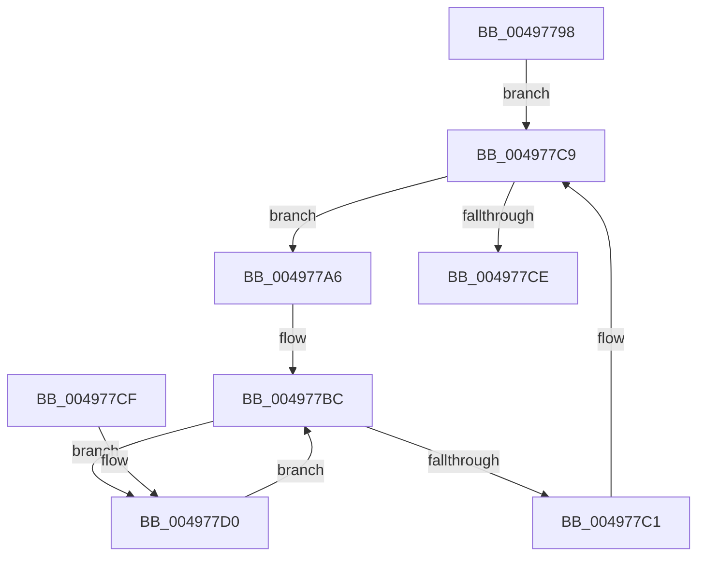

# FlattenEventEntryTree

- RVA: `0x00497798`–`0x004977D9` (길이 `65` bytes)
- VA: `0x0000000140497798`
- 실행 섹션: `.text`
- PDB 이름 있음: `예`; PDB Function 태그: `예`
- unwind 정보 RVA: `0x000DB714`
- 디코드: `22`개 명령, `65/65` bytes 표시
- 미해석 바이트: `0` (있으면 어셈블리에 `.byte`로 보존)

> 이 문서는 커널 이미지의 기계어와 PDB 기호를 분석해 생성했습니다. 4번과 5번은 함수 원형과 자료형을 바이너리 사용 방식에서 추정한 C 해석이며 원본 소스 복구 결과는 아닙니다.

## 1. Dependencies

- 직접 호출 지점: **0**; 고유 호출 대상: **0**
- 직접 호출자로 확인된 함수: **1**
- RIP 상대 이미지 참조: **0**

### Outgoing calls
- 직접 디코드된 call 명령이 없습니다.

### Direct callers
- [FlushLookUpTableBucket](FlushLookUpTableBucket_function_00497690.md) at `0x00497730`

### Static image references
- 디코드된 RIP-relative 메모리 참조가 없습니다.

## 2. Other-region calls and transfers

- 다른 실행 섹션으로 향하는 call: **0**
- 별도 외부 분기/꼬리 이동을 확인하지 못했습니다.

## 3. Assembly (complete function range)

```asm
00497798  48 89 4C 24 08                  mov qword ptr [rsp + 8], rcx
0049779D  48 8D 54 24 08                  lea rdx, [rsp + 8]
004977A2  33 C0                           xor eax, eax
004977A4  EB 23                           jmp 0x1404977c9
004977A6  4C 8B 49 20                     mov r9, qword ptr [rcx + 0x20]
004977AA  48 83 61 20 00                  and qword ptr [rcx + 0x20], 0
004977AF  48 8B 12                        mov rdx, qword ptr [rdx]
004977B2  48 83 C2 18                     add rdx, 0x18
004977B6  4C 8B C2                        mov r8, rdx
004977B9  48 8B 0A                        mov rcx, qword ptr [rdx]
004977BC  48 85 C9                        test rcx, rcx
004977BF  75 0F                           jne 0x1404977d0
004977C1  4D 89 08                        mov qword ptr [r8], r9
004977C4  FF C0                           inc eax
004977C6  48 8B 0A                        mov rcx, qword ptr [rdx]
004977C9  48 85 C9                        test rcx, rcx
004977CC  75 D8                           jne 0x1404977a6
004977CE  C3                              ret
004977CF  CC                              int3
004977D0  4C 8D 41 20                     lea r8, [rcx + 0x20]
004977D4  49 8B 08                        mov rcx, qword ptr [r8]
004977D7  EB E3                           jmp 0x1404977bc
```

## 4. C-style interpretation (structured pseudocode)

```c
__int64 __fastcall FlattenEventEntryTree(__int64 a1)
{
    __int64 result;
    unsigned __int64 v_stack_p8;

    v_stack_p8 = a1;
    result = 0;
    goto loc_004977C9;
loc_004977A6:
    a2 = (*(unsigned __int64 *)(v_stack_p8)) + (24);
loc_004977BC:
    if (*(unsigned __int64 *)(a2) != 0) goto loc_004977D0;
    *(unsigned __int64 *)(a2) = *(unsigned __int64 *)(a1 + 32);
    result = (unsigned int)((result) + 1);
loc_004977C9:
    if (*(unsigned __int64 *)(a2) != 0) goto loc_004977A6;
    return result;
loc_004977D0:
    goto loc_004977BC;
}
```

## 5. (Beta) C Style

```c
int64_t FlattenEventEntryTree(int64_t Arg1)
{
    int64_t result;
    uint64_t v_stack_p8;

    v_stack_p8 = Arg1;
    result = 0;
    goto loc_004977C9;
loc_004977A6:
    a2 = (*(uint64_t *)(v_stack_p8)) + (24);
loc_004977BC:
    if (*(uint64_t *)(a2) != 0) goto loc_004977D0;
    *(uint64_t *)(a2) = *(uint64_t *)(Arg1 + 0x20);
    result = (uint32_t)((result) + 1);
loc_004977C9:
    if (*(uint64_t *)(a2) != 0) goto loc_004977A6;
    return result;
loc_004977D0:
    goto loc_004977BC;
}
```

## 6. Execution-region graph

[열기: 2D/3D 그래프와 함수 탐색 컨트롤 패널](../../../control-panel.html?section=text&rva=0x00497798&view=graph)

- 2D 그래프는 위에서 아래로 흐르고, 3D 그래프는 빈 공간을 드래그해 회전합니다. Shift+드래그는 이동, 휠은 확대·축소, 함수 노드 선택은 대상 보고서 이동입니다.

### Static fallback


