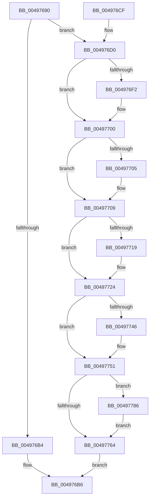

# FlushLookUpTableBucket

- RVA: `0x00497690`–`0x00497790` (길이 `256` bytes)
- VA: `0x0000000140497690`
- 실행 섹션: `.text`
- PDB 이름 있음: `예`; PDB Function 태그: `예`
- unwind 정보 RVA: `0x000B3E30`
- 디코드: `70`개 명령, `256/256` bytes 표시
- 미해석 바이트: `0` (있으면 어셈블리에 `.byte`로 보존)

> 이 문서는 커널 이미지의 기계어와 PDB 기호를 분석해 생성했습니다. 4번과 5번은 함수 원형과 자료형을 바이너리 사용 방식에서 추정한 C 해석이며 원본 소스 복구 결과는 아닙니다.

## 1. Dependencies

- 직접 호출 지점: **8**; 고유 호출 대상: **8**
- 직접 호출자로 확인된 함수: **2**
- RIP 상대 이미지 참조: **0**

### Outgoing calls
- `0x004976E2` → [KeAbPreAcquire](../21/KeAbPreAcquire_function_00210230.md) (function, `0x00210230`)
- `0x004976FB` → [ExfAcquirePushLockExclusiveEx](../20/ExfAcquirePushLockExclusiveEx_function_0020FC90.md) (function, `0x0020FC90`)
- `0x0049771C` → [ExAcquireSpinLockExclusive](../24/ExAcquireSpinLockExclusive_function_00248690.md) (function, `0x00248690`)
- `0x00497730` → [FlattenEventEntryTree](FlattenEventEntryTree_function_00497798.md) (function, `0x00497798`)
- `0x0049774C` → [ExReleaseSpinLockExclusive](../2C/ExReleaseSpinLockExclusive_function_002C0EF0.md) (function, `0x002C0EF0`)
- `0x00497767` → [KeAbPostRelease](../2E/KeAbPostRelease_function_002E1600.md) (function, `0x002E1600`)
- `0x0049777A` → [FlushEventEntryList](../../page/A6/FlushEventEntryList_function_00A601A4.md) (function, `0x00A601A4`)
- `0x00497789` → [ExfTryToWakePushLock](../26/ExfTryToWakePushLock_function_00265DD0.md) (function, `0x00265DD0`)

### Direct callers
- [LookUpTableFlushPartial](../../page/A6/LookUpTableFlushPartial_function_00A69438.md) at `0x00A6946F`
- [LookUpTableFlushComplete](../../page/A6/LookUpTableFlushComplete_function_00A6957C.md) at `0x00A69635`

### Static image references
- 디코드된 RIP-relative 메모리 참조가 없습니다.

## 2. Other-region calls and transfers

- 다른 실행 섹션으로 향하는 call: **1**
  - `0x0049777A` → [FlushEventEntryList](../../page/A6/FlushEventEntryList_function_00A601A4.md) (`.text` → `PAGE`)
- 별도 외부 분기/꼬리 이동을 확인하지 못했습니다.

## 3. Assembly (complete function range)

```asm
00497690  48 89 5C 24 08                  mov qword ptr [rsp + 8], rbx
00497695  48 89 6C 24 10                  mov qword ptr [rsp + 0x10], rbp
0049769A  48 89 74 24 18                  mov qword ptr [rsp + 0x18], rsi
0049769F  57                              push rdi
004976A0  41 56                           push r14
004976A2  41 57                           push r15
004976A4  48 83 EC 20                     sub rsp, 0x20
004976A8  8B EA                           mov ebp, edx
004976AA  48 8B D9                        mov rbx, rcx
004976AD  48 83 3C E9 00                  cmp qword ptr [rcx + rbp*8], 0
004976B2  75 1C                           jne 0x1404976d0
004976B4  33 C0                           xor eax, eax
004976B6  48 8B 5C 24 40                  mov rbx, qword ptr [rsp + 0x40]
004976BB  48 8B 6C 24 48                  mov rbp, qword ptr [rsp + 0x48]
004976C0  48 8B 74 24 50                  mov rsi, qword ptr [rsp + 0x50]
004976C5  48 83 C4 20                     add rsp, 0x20
004976C9  41 5F                           pop r15
004976CB  41 5E                           pop r14
004976CD  5F                              pop rdi
004976CE  C3                              ret
004976CF  CC                              int3
004976D0  48 8D B9 10 01 00 00            lea rdi, [rcx + 0x110]
004976D7  45 33 C0                        xor r8d, r8d
004976DA  48 8B CF                        mov rcx, rdi
004976DD  33 D2                           xor edx, edx
004976DF  45 32 FF                        xor r15b, r15b
004976E2  E8 49 8B D7 FF                  call 0x140210230
004976E7  F0 48 0F BA 2F 00               lock bts qword ptr [rdi], 0
004976ED  48 8B F0                        mov rsi, rax
004976F0  73 0E                           jae 0x140497700
004976F2  4C 8B C7                        mov r8, rdi
004976F5  48 8B D0                        mov rdx, rax
004976F8  48 8B CF                        mov rcx, rdi
004976FB  E8 90 85 D7 FF                  call 0x14020fc90
00497700  48 85 F6                        test rsi, rsi
00497703  74 04                           je 0x140497709
00497705  C6 46 0A 01                     mov byte ptr [rsi + 0xa], 1
00497709  48 8D B3 18 01 00 00            lea rsi, [rbx + 0x118]
00497710  44 38 BB 75 01 00 00            cmp byte ptr [rbx + 0x175], r15b
00497717  75 0B                           jne 0x140497724
00497719  48 8B CE                        mov rcx, rsi
0049771C  E8 6F 0F DB FF                  call 0x140248690
00497721  44 8A F8                        mov r15b, al
00497724  4C 8B 34 EB                     mov r14, qword ptr [rbx + rbp*8]
00497728  48 83 24 EB 00                  and qword ptr [rbx + rbp*8], 0
0049772D  49 8B CE                        mov rcx, r14
00497730  E8 63 00 00 00                  call 0x140497798
00497735  29 83 00 01 00 00               sub dword ptr [rbx + 0x100], eax
0049773B  8B E8                           mov ebp, eax
0049773D  80 BB 75 01 00 00 00            cmp byte ptr [rbx + 0x175], 0
00497744  75 0B                           jne 0x140497751
00497746  41 8A D7                        mov dl, r15b
00497749  48 8B CE                        mov rcx, rsi
0049774C  E8 9F 97 E2 FF                  call 0x1402c0ef0
00497751  49 83 C8 FF                     or r8, 0xffffffffffffffff
00497755  F0 4C 0F C1 07                  lock xadd qword ptr [rdi], r8
0049775A  41 80 E0 06                     and r8b, 6
0049775E  41 80 F8 02                     cmp r8b, 2
00497762  74 22                           je 0x140497786
00497764  48 8B CF                        mov rcx, rdi
00497767  E8 94 9E E4 FF                  call 0x1402e1600
0049776C  48 8B 8B 58 01 00 00            mov rcx, qword ptr [rbx + 0x158]
00497773  49 8B D6                        mov rdx, r14
00497776  48 8B 49 20                     mov rcx, qword ptr [rcx + 0x20]
0049777A  E8 25 8A 5C 00                  call 0x140a601a4
0049777F  8B C5                           mov eax, ebp
00497781  E9 30 FF FF FF                  jmp 0x1404976b6
00497786  48 8B CF                        mov rcx, rdi
00497789  E8 42 E6 DC FF                  call 0x140265dd0
0049778E  EB D4                           jmp 0x140497764
```

## 4. C-style interpretation (structured pseudocode)

```c
__int64 __fastcall FlushLookUpTableBucket(__int64 a1, int a2, int a3)
{
    __int64 result;
    __int64 v_r15;
    __int64 v_rsp;
    unsigned __int64 v_stack_p10;
    unsigned __int64 v_stack_p18;
    unsigned __int64 v_stack_p8;

    v_stack_p8 = v_rbx;
    v_stack_p10 = v_rbp;
    v_stack_p18 = v_rsi;
    v_rsp = (v_rsp) - (32);
    if ((*(unsigned __int64 *)(a1 + (unsigned int)(a2) * 8)) != 0) goto loc_004976D0;
    result = 0;
loc_004976B6:
    v_rsp = (v_rsp) + (32);
    return result;
loc_004976D0:
    a3 = 0;
    a2 = 0;
    v_r15 = 0;
    result = KeAbPreAcquire(a1 + 272, a2, a3, a4);
    if (!(condition_is_above_or_equal)) {
        a3 = a1 + 272;
        a2 = result;
        a1 = a1 + 272;
        result = ExfAcquirePushLockExclusiveEx(a1, a2, a3, a4);
    }
    if (result != 0) {
        *(unsigned __int8 *)(result + 10) = 1;
    }
    if ((*(unsigned __int8 *)(v_stack_p8 + 373)) == 0) {
        a1 = v_stack_p8 + 280;
        result = ExAcquireSpinLockExclusive(a1, a2, a3, a4);
        v_r15 = (unsigned __int8)(result);
    }
    result = FlattenEventEntryTree(*(unsigned __int64 *)(v_stack_p8 + v_stack_p10 * 8), a2, a3, a4);
    if ((*(unsigned __int8 *)(v_stack_p8 + 373)) == 0) {
        a2 = (unsigned __int8)(v_r15);
        a1 = v_stack_p8 + 280;
        result = ExReleaseSpinLockExclusive(a1, a2, a3, a4);
    }
    a3 = (a3) | (-1);
    a3 = (unsigned __int8)((a3) & (6));
    if (((unsigned __int8)(a3)) == 2) goto loc_00497786;
loc_00497764:
    result = KeAbPostRelease(a1 + 272, a2, a3, a4);
    result = FlushEventEntryList(*(unsigned __int64 *)(*(unsigned __int64 *)(v_stack_p8 + 344) + 32), *(unsigned __int64 *)(v_stack_p8 + v_stack_p10 * 8), a3, a4);
    goto loc_004976B6;
loc_00497786:
    result = ExfTryToWakePushLock(a1 + 272, *(unsigned __int64 *)(v_stack_p8 + v_stack_p10 * 8), a3, a4);
    goto loc_00497764;
}
```

## 5. (Beta) C Style

```c
int64_t FlushLookUpTableBucket(void *Arg1, int32_t Arg2, int32_t Arg3)
{
    uint8_t *arg1 = (uint8_t *)Arg1;

    int64_t result;
    int64_t local_r15;
    int64_t local_rsp;
    uint64_t v_stack_p10;
    uint64_t v_stack_p18;
    uint64_t v_stack_p8;

    v_stack_p8 = local_rbx;
    v_stack_p10 = local_rbp;
    v_stack_p18 = local_rsi;
    local_rsp = (local_rsp) - (32);
    if ((*(uint64_t *)(arg1 + (uint32_t)(Arg2) * 8)) != 0) goto loc_004976D0;
    result = 0;
loc_004976B6:
    local_rsp = (local_rsp) + (32);
    return result;
loc_004976D0:
    Arg3 = 0;
    Arg2 = 0;
    local_r15 = 0;
    result = KeAbPreAcquire(Arg1 + 272, Arg2, Arg3, a4);
    if (!(condition_is_above_or_equal)) {
        Arg3 = Arg1 + 272;
        Arg2 = result;
        Arg1 = Arg1 + 272;
        result = ExfAcquirePushLockExclusiveEx(Arg1, Arg2, Arg3, a4);
    }
    if (result != 0) {
        *(uint8_t *)(result + 0xA) = 1;
    }
    if ((*(uint8_t *)(v_stack_p8 + 0x175)) == 0) {
        Arg1 = v_stack_p8 + 280;
        result = ExAcquireSpinLockExclusive(Arg1, Arg2, Arg3, a4);
        local_r15 = (uint8_t)(result);
    }
    result = FlattenEventEntryTree(*(uint64_t *)(v_stack_p8 + v_stack_p10 * 8), Arg2, Arg3, a4);
    if ((*(uint8_t *)(v_stack_p8 + 0x175)) == 0) {
        Arg2 = (uint8_t)(local_r15);
        Arg1 = v_stack_p8 + 280;
        result = ExReleaseSpinLockExclusive(Arg1, Arg2, Arg3, a4);
    }
    Arg3 = (Arg3) | (-1);
    Arg3 = (uint8_t)((Arg3) & (6));
    if (((uint8_t)(Arg3)) == 2) goto loc_00497786;
loc_00497764:
    result = KeAbPostRelease(Arg1 + 272, Arg2, Arg3, a4);
    result = FlushEventEntryList(*(uint64_t *)(*(uint64_t *)(v_stack_p8 + 0x158) + 0x20), *(uint64_t *)(v_stack_p8 + v_stack_p10 * 8), Arg3, a4);
    goto loc_004976B6;
loc_00497786:
    result = ExfTryToWakePushLock(Arg1 + 272, *(uint64_t *)(v_stack_p8 + v_stack_p10 * 8), Arg3, a4);
    goto loc_00497764;
}
```

### 관측된 메모리 오프셋

구조체 형식이 확인되지 않은 접근은 인자 기준의 오프셋으로만 기록했습니다.

| 기준 인자 | 오프셋 표현 | 폭 (bit) | 접근 |
|---|---:|---:|---|
| `Arg1` | `+ 0x0` | `64` | `R/W` |
| `Arg1` | `+ 0x0 + rbp*8` | `64` | `R` |
| `Arg1` | `+ 0x0 + rbp*8` | `64` | `R/W` |
| `Arg1` | `+ 0x100` | `32` | `R/W` |
| `Arg1` | `+ 0x110` | `64` | `R` |
| `Arg1` | `+ 0x118` | `64` | `R` |
| `Arg1` | `+ 0x158` | `64` | `R` |
| `Arg1` | `+ 0x175` | `8` | `R` |

## 6. Execution-region graph

[열기: 2D/3D 그래프와 함수 탐색 컨트롤 패널](../../../control-panel.html?section=text&rva=0x00497690&view=graph)

- 2D 그래프는 위에서 아래로 흐르고, 3D 그래프는 빈 공간을 드래그해 회전합니다. Shift+드래그는 이동, 휠은 확대·축소, 함수 노드 선택은 대상 보고서 이동입니다.

### Static fallback


