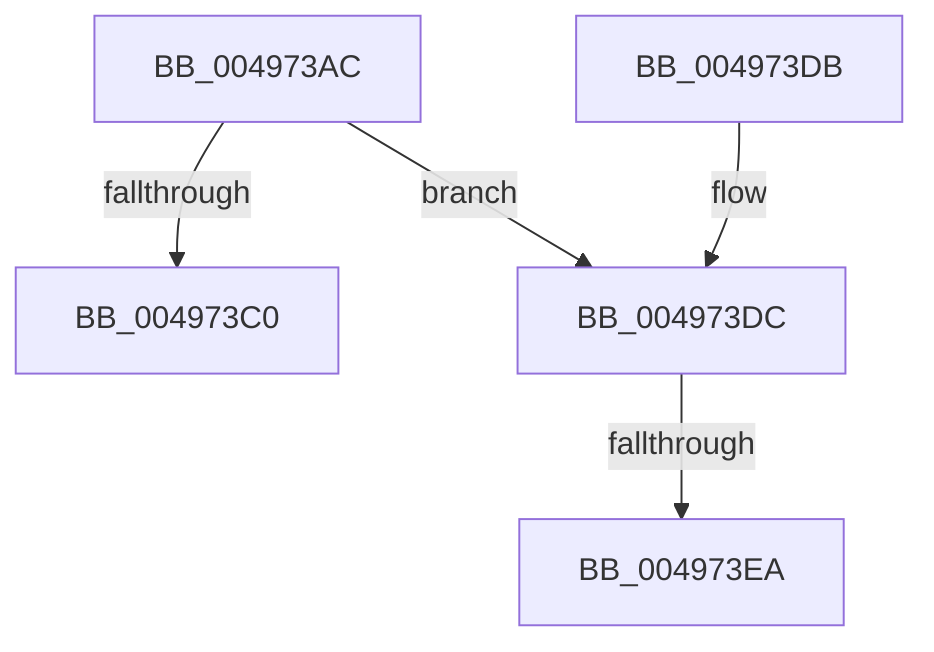

# FsRtlCompleteLockIrpReal

- RVA: `0x004973AC`–`0x004973F4` (길이 `72` bytes)
- VA: `0x00000001404973AC`
- 실행 섹션: `.text`
- PDB 이름 있음: `예`; PDB Function 태그: `예`
- unwind 정보 RVA: `0x0008C174`
- 디코드: `22`개 명령, `72/72` bytes 표시
- 미해석 바이트: `0` (있으면 어셈블리에 `.byte`로 보존)

> 이 문서는 커널 이미지의 기계어와 PDB 기호를 분석해 생성했습니다. 4번과 5번은 함수 원형과 자료형을 바이너리 사용 방식에서 추정한 C 해석이며 원본 소스 복구 결과는 아닙니다.

## 1. Dependencies

- 직접 호출 지점: **1**; 고유 호출 대상: **1**
- 직접 호출자로 확인된 함수: **6**
- RIP 상대 이미지 참조: **0**

### Outgoing calls
- `0x004973C9` → [IofCompleteRequest](../29/IofCompleteRequest_function_0029B5C0.md) (function, `0x0029B5C0`)

### Direct callers
- [FsRtlPrivateCheckWaitingLocks](../38/FsRtlPrivateCheckWaitingLocks_function_0038DCBC.md) at `0x0038DE25`
- [FsRtlPrivateCancelFileLockIrp](../4D/FsRtlPrivateCancelFileLockIrp_function_004D4B70.md) at `0x004D4C50`
- [FsRtlPrivateLock$fin$0](../6D/FsRtlPrivateLock_fin_0_function_006D2360.md) at `0x006D23EB`
- [sub_006E4D86](../6E/Unknown_function_006E4D86.md) at `0x006E4E08`
- [sub_006EBCF4](../6E/Unknown_function_006EBCF4.md) at `0x006EBD36`
- [sub_006EBD42](../6E/Unknown_function_006EBD42.md) at `0x006EBE31`

### Static image references
- 디코드된 RIP-relative 메모리 참조가 없습니다.

## 2. Other-region calls and transfers

- 다른 실행 섹션으로 향하는 call: **0**
- call이 아닌 외부 분기/꼬리 이동: **2**
  - `0x004973E4` → [sub_006F77C0](../6F/Unknown_function_006F77C0.md) (`tail-transfer`)
  - `0x004973EF` → [sub_006F77C0](../6F/Unknown_function_006F77C0.md) (`tail-transfer`)

## 3. Assembly (complete function range)

```asm
004973AC  40 53                           push rbx
004973AE  48 83 EC 20                     sub rsp, 0x20
004973B2  41 8B D9                        mov ebx, r9d
004973B5  4C 8B C9                        mov r9, rcx
004973B8  4C 8B D2                        mov r10, rdx
004973BB  48 85 C9                        test rcx, rcx
004973BE  75 1C                           jne 0x1404973dc
004973C0  B2 01                           mov dl, 1
004973C2  41 89 58 30                     mov dword ptr [r8 + 0x30], ebx
004973C6  49 8B C8                        mov rcx, r8
004973C9  E8 F2 41 E0 FF                  call 0x14029b5c0
004973CE  48 8B 44 24 50                  mov rax, qword ptr [rsp + 0x50]
004973D3  89 18                           mov dword ptr [rax], ebx
004973D5  48 83 C4 20                     add rsp, 0x20
004973D9  5B                              pop rbx
004973DA  C3                              ret
004973DB  CC                              int3
004973DC  48 8B 44 24 58                  mov rax, qword ptr [rsp + 0x58]
004973E1  48 85 C0                        test rax, rax
004973E4  0F 84 D6 03 26 00               je 0x1406f77c0
004973EA  48 83 60 78 00                  and qword ptr [rax + 0x78], 0
004973EF  E9 CC 03 26 00                  jmp 0x1406f77c0
```

## 4. C-style interpretation (structured pseudocode)

```c
__int64 __fastcall FsRtlCompleteLockIrpReal(__int64 a1, __int64 a2, __int64 a3, int a4, __int64 a5, __int64 a6)
{
    __int64 result;
    __int64 v_rsp;

    v_rsp = (v_rsp) - (32);
    if (a1 != 0) goto loc_004973DC;
    *(unsigned int *)(a3 + 48) = (unsigned int)((unsigned int)(a4));
    result = IofCompleteRequest(a3, 1, a3, a1);
    *(unsigned int *)(a5) = (unsigned int)((unsigned int)(a4));
    v_rsp = (v_rsp) + (32);
    return a5;
loc_004973DC:
}
```

## 5. (Beta) C Style

```c
void *FsRtlCompleteLockIrpReal(int64_t Arg1, int64_t Arg2, void *Arg3, int32_t Arg4, void *Arg5, int64_t Arg6)
{
    uint8_t *arg3 = (uint8_t *)Arg3;
    uint8_t *arg5 = (uint8_t *)Arg5;

    int64_t result;
    int64_t local_rsp;

    local_rsp = (local_rsp) - (32);
    if (Arg1 != 0) goto loc_004973DC;
    *(uint32_t *)(arg3 + 0x30) = (uint32_t)((uint32_t)(Arg4));
    result = IofCompleteRequest(Arg3, 1, Arg3, Arg1);
    *(uint32_t *)(arg5) = (uint32_t)((uint32_t)(Arg4));
    local_rsp = (local_rsp) + (32);
    return Arg5;
loc_004973DC:
}
```

### 관측된 메모리 오프셋

구조체 형식이 확인되지 않은 접근은 인자 기준의 오프셋으로만 기록했습니다.

| 기준 인자 | 오프셋 표현 | 폭 (bit) | 접근 |
|---|---:|---:|---|
| `Arg3` | `+ 0x30` | `32` | `W` |
| `Arg5` | `+ 0x0` | `32` | `W` |

## 6. Execution-region graph

[열기: 2D/3D 그래프와 함수 탐색 컨트롤 패널](../../../control-panel.html?section=text&rva=0x004973AC&view=graph)

- 2D 그래프는 위에서 아래로 흐르고, 3D 그래프는 빈 공간을 드래그해 회전합니다. Shift+드래그는 이동, 휠은 확대·축소, 함수 노드 선택은 대상 보고서 이동입니다.

### Static fallback


