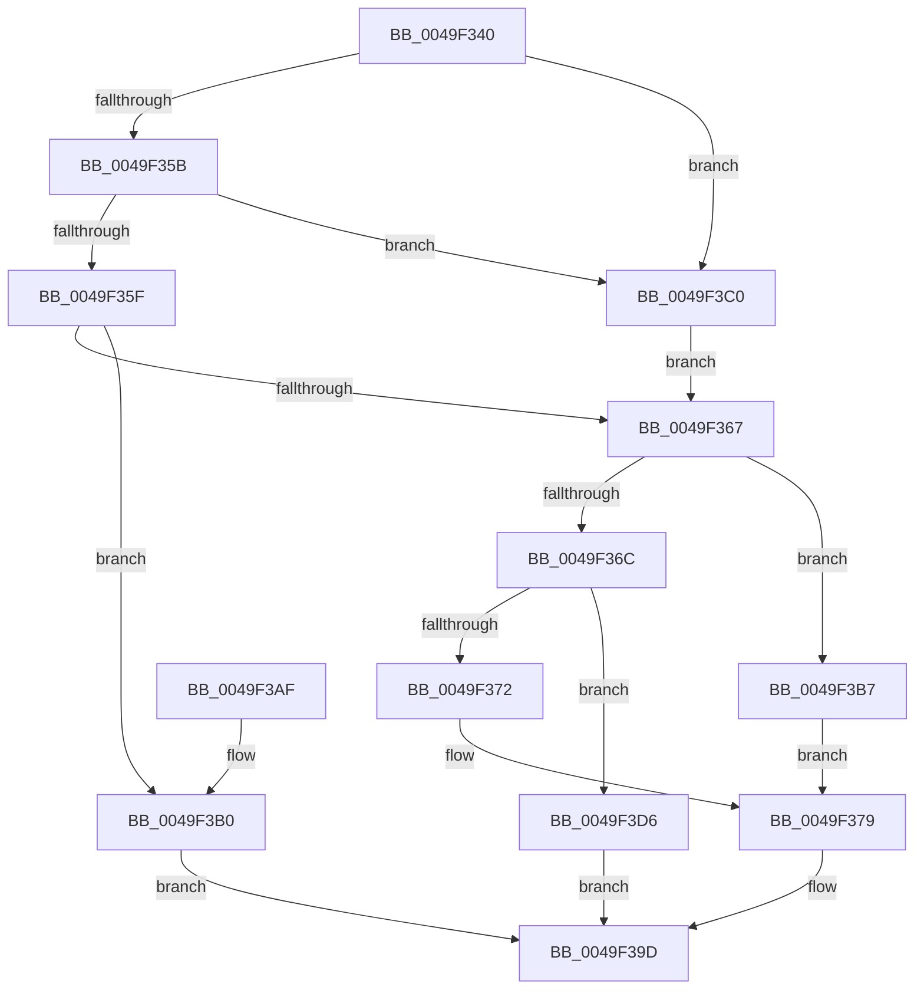

# FsRtlSendModernAppTermination

- RVA: `0x0049F340`–`0x0049F3DD` (길이 `157` bytes)
- VA: `0x000000014049F340`
- 실행 섹션: `.text`
- PDB 이름 있음: `예`; PDB Function 태그: `아니요`
- unwind 정보 RVA: `0x000B5438`
- 디코드: `41`개 명령, `157/157` bytes 표시
- 미해석 바이트: `0` (있으면 어셈블리에 `.byte`로 보존)

> 이 문서는 커널 이미지의 기계어와 PDB 기호를 분석해 생성했습니다. 4번과 5번은 함수 원형과 자료형을 바이너리 사용 방식에서 추정한 C 해석이며 원본 소스 복구 결과는 아닙니다.

## 1. Dependencies

- 직접 호출 지점: **2**; 고유 호출 대상: **2**
- 직접 호출자로 확인된 함수: **2**
- RIP 상대 이미지 참조: **3**

### Outgoing calls
- `0x0049F398` → [ZwUpdateWnfStateData](../6B/ZwUpdateWnfStateData_function_006B0D10.md) (function, `0x006B0D10`)
- `0x0049F3A5` → [_security_check_cookie](../6A/_security_check_cookie_function_006AC640.md) (function, `0x006AC640`)

### Direct callers
- [FsRtlpOplockSendModernAppTermination](FsRtlpOplockSendModernAppTermination_function_0049F22C.md) at `0x0049F292`
- [Phase1InitializationDiscard](../../init/C1/Phase1InitializationDiscard_function_00C1C728.md) at `0x00C1D6A1`

### Static image references
- `0x0049F344` → RVA `0x00E0A740` (`.data`; read)
- `0x0049F372` → RVA `0x0001AF88` (`.rdata`; read)
- `0x0049F3B7` → RVA `0x0001AF90` (`.rdata`; read)

## 2. Other-region calls and transfers

- 다른 실행 섹션으로 향하는 call: **0**
- 별도 외부 분기/꼬리 이동을 확인하지 못했습니다.

## 3. Assembly (complete function range)

```asm
0049F340  48 83 EC 68                     sub rsp, 0x68
0049F344  48 8B 05 F5 B3 96 00            mov rax, qword ptr [rip + 0x96b3f5]
0049F34B  48 33 C4                        xor rax, rsp
0049F34E  48 89 44 24 50                  mov qword ptr [rsp + 0x50], rax
0049F353  45 33 C9                        xor r9d, r9d
0049F356  48 85 C9                        test rcx, rcx
0049F359  74 65                           je 0x14049f3c0
0049F35B  85 D2                           test edx, edx
0049F35D  74 61                           je 0x14049f3c0
0049F35F  81 FA 00 10 00 00               cmp edx, 0x1000
0049F365  77 49                           ja 0x14049f3b0
0049F367  45 85 C0                        test r8d, r8d
0049F36A  74 4B                           je 0x14049f3b7
0049F36C  41 83 F8 01                     cmp r8d, 1
0049F370  75 64                           jne 0x14049f3d6
0049F372  48 8B 05 0F BC B7 FF            mov rax, qword ptr [rip - 0x4843f1]
0049F379  44 89 4C 24 30                  mov dword ptr [rsp + 0x30], r9d
0049F37E  44 8B C2                        mov r8d, edx
0049F381  48 8B D1                        mov rdx, rcx
0049F384  44 89 4C 24 28                  mov dword ptr [rsp + 0x28], r9d
0049F389  48 8D 4C 24 48                  lea rcx, [rsp + 0x48]
0049F38E  48 89 44 24 48                  mov qword ptr [rsp + 0x48], rax
0049F393  4C 89 4C 24 20                  mov qword ptr [rsp + 0x20], r9
0049F398  E8 73 19 21 00                  call 0x1406b0d10
0049F39D  48 8B 4C 24 50                  mov rcx, qword ptr [rsp + 0x50]
0049F3A2  48 33 CC                        xor rcx, rsp
0049F3A5  E8 96 D2 20 00                  call 0x1406ac640
0049F3AA  48 83 C4 68                     add rsp, 0x68
0049F3AE  C3                              ret
0049F3AF  CC                              int3
0049F3B0  B8 05 00 00 80                  mov eax, 0x80000005
0049F3B5  EB E6                           jmp 0x14049f39d
0049F3B7  48 8B 05 D2 BB B7 FF            mov rax, qword ptr [rip - 0x48442e]
0049F3BE  EB B9                           jmp 0x14049f379
0049F3C0  83 4C 24 40 FF                  or dword ptr [rsp + 0x40], 0xffffffff
0049F3C5  48 8D 4C 24 40                  lea rcx, [rsp + 0x40]
0049F3CA  44 89 4C 24 44                  mov dword ptr [rsp + 0x44], r9d
0049F3CF  BA 04 00 00 00                  mov edx, 4
0049F3D4  EB 91                           jmp 0x14049f367
0049F3D6  B8 0D 00 00 C0                  mov eax, 0xc000000d
0049F3DB  EB C0                           jmp 0x14049f39d
```

## 4. C-style interpretation (structured pseudocode)

```c
__int64 __fastcall FsRtlSendModernAppTermination(__int64 a1, int a2, int a3, int a4)
{
    __int64 result;
    __int64 v_rsp;
    unsigned __int64 v_stack_m18;
    unsigned __int64 v_stack_m20;
    unsigned int v_stack_m38;
    unsigned int v_stack_m40;
    unsigned __int64 v_stack_m48;
    unsigned int v_stack_p40;
    unsigned int v_stack_p44;

    v_rsp = (v_rsp) - (104);
    result = (*(unsigned __int64 *)(v_rip + 9876469)) ^ (v_rsp);
    v_stack_m18 = result;
    a4 = 0;
    if (a1 == 0) goto loc_0049F3C0;
    if (a2 == 0) goto loc_0049F3C0;
    if (a2 > 0x1000ULL) goto loc_0049F3B0;
loc_0049F367:
    if (a3 == 0) goto loc_0049F3B7;
    if (a3 != 1) goto loc_0049F3D6;
loc_0049F379:
    v_stack_m38 = 0;
    v_stack_m40 = 0;
    v_stack_m20 = *(unsigned __int64 *)(v_rip - 4735985);
    v_stack_m48 = 0;
    result = ZwUpdateWnfStateData(v_stack_m20, a1, (unsigned int)(a2), a4);
loc_0049F39D:
    a1 = (v_stack_m18) ^ (v_rsp);
    result = _security_check_cookie(a1, a1, (unsigned int)(a2), a4);
    v_rsp = (v_rsp) + (104);
    return result;
loc_0049F3B0:
    goto loc_0049F39D;
loc_0049F3B7:
    goto loc_0049F379;
loc_0049F3C0:
    v_stack_p44 = 0;
    goto loc_0049F367;
loc_0049F3D6:
    goto loc_0049F39D;
}
```

## 5. (Beta) C Style

```c
int64_t FsRtlSendModernAppTermination(int64_t Arg1, int32_t Arg2, int32_t Arg3, int32_t Arg4)
{
    int64_t result;
    int64_t local_rsp;
    uint64_t v_stack_m18;
    uint64_t v_stack_m20;
    uint32_t v_stack_m38;
    uint32_t v_stack_m40;
    uint64_t v_stack_m48;
    uint32_t v_stack_p40;
    uint32_t v_stack_p44;

    local_rsp = (local_rsp) - (104);
    result = (*(uint64_t *)(v_rip + 0x96B3F5)) ^ (local_rsp);
    v_stack_m18 = result;
    Arg4 = 0;
    if (Arg1 == 0) goto loc_0049F3C0;
    if (Arg2 == 0) goto loc_0049F3C0;
    if (Arg2 > 0x1000ULL) goto loc_0049F3B0;
loc_0049F367:
    if (Arg3 == 0) goto loc_0049F3B7;
    if (Arg3 != 1) goto loc_0049F3D6;
loc_0049F379:
    v_stack_m38 = 0;
    v_stack_m40 = 0;
    v_stack_m20 = *(uint64_t *)(v_rip - 0x4843F1);
    v_stack_m48 = 0;
    result = ZwUpdateWnfStateData(v_stack_m20, Arg1, (uint32_t)(Arg2), Arg4);
loc_0049F39D:
    Arg1 = (v_stack_m18) ^ (local_rsp);
    result = _security_check_cookie(Arg1, Arg1, (uint32_t)(Arg2), Arg4);
    local_rsp = (local_rsp) + (104);
    return result;
loc_0049F3B0:
    goto loc_0049F39D;
loc_0049F3B7:
    goto loc_0049F379;
loc_0049F3C0:
    v_stack_p44 = 0;
    goto loc_0049F367;
loc_0049F3D6:
    goto loc_0049F39D;
}
```

## 6. Execution-region graph

[열기: 2D/3D 그래프와 함수 탐색 컨트롤 패널](../../../control-panel.html?section=text&rva=0x0049F340&view=graph)

- 2D 그래프는 위에서 아래로 흐르고, 3D 그래프는 빈 공간을 드래그해 회전합니다. Shift+드래그는 이동, 휠은 확대·축소, 함수 노드 선택은 대상 보고서 이동입니다.

### Static fallback


