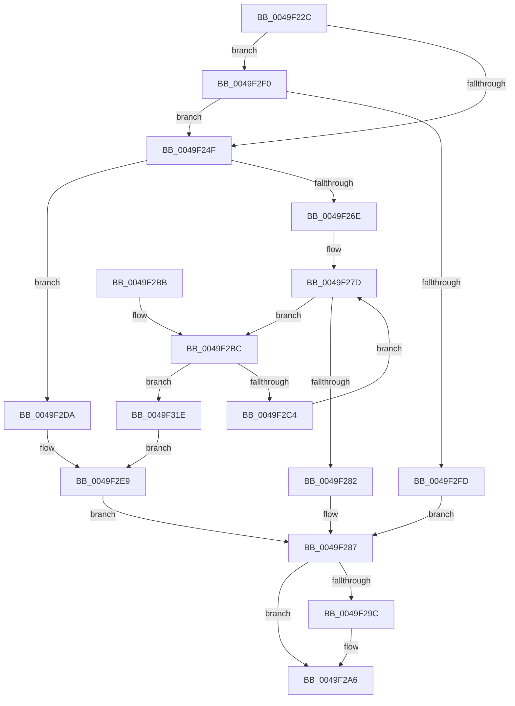

# FsRtlpOplockSendModernAppTermination

- RVA: `0x0049F22C`–`0x0049F334` (길이 `264` bytes)
- VA: `0x000000014049F22C`
- 실행 섹션: `.text`
- PDB 이름 있음: `예`; PDB Function 태그: `아니요`
- unwind 정보 RVA: `0x000B5420`
- 디코드: `70`개 명령, `264/264` bytes 표시
- 미해석 바이트: `0` (있으면 어셈블리에 `.byte`로 보존)

> 이 문서는 커널 이미지의 기계어와 PDB 기호를 분석해 생성했습니다. 4번과 5번은 함수 원형과 자료형을 바이너리 사용 방식에서 추정한 C 해석이며 원본 소스 복구 결과는 아닙니다.

## 1. Dependencies

- 직접 호출 지점: **4**; 고유 호출 대상: **4**
- 직접 호출자로 확인된 함수: **5**
- RIP 상대 이미지 참조: **0**

### Outgoing calls
- `0x0049F261` → [ExAllocatePoolWithTag](../../poolcode/B8/ExAllocatePoolWithTag_function_00B82010.md) (function, `0x00B82010`)
- `0x0049F292` → [FsRtlSendModernAppTermination](FsRtlSendModernAppTermination_function_0049F340.md) (function, `0x0049F340`)
- `0x0049F2A1` → [ExFreePoolWithTag](../../poolcode/B8/ExFreePoolWithTag_function_00B82870.md) (function, `0x00B82870`)
- `0x0049F32A` → [memset](../6C/memset_function_006C6C40.md) (function, `0x006C6C40`)

### Direct callers
- [FsRtlpRemoveAndCompleteRHIrp](../42/FsRtlpRemoveAndCompleteRHIrp_function_00425964.md) at `0x00425C71`
- [FsRtlpOplockBreakToII](../4B/FsRtlpOplockBreakToII_function_004BB824.md) at `0x004BB9FA`
- [FsRtlpOplockBreakByCacheFlags](../4E/FsRtlpOplockBreakByCacheFlags_function_004E4990.md) at `0x004E6D22`
- [FsRtlpOplockBreakToNone](../4F/FsRtlpOplockBreakToNone_function_004F8354.md) at `0x004F8591`
- [FsRtlpOplockBreakNotify](../../page/71/FsRtlpOplockBreakNotify_function_00714E10.md) at `0x00714EF7`

### Static image references
- 디코드된 RIP-relative 메모리 참조가 없습니다.

## 2. Other-region calls and transfers

- 다른 실행 섹션으로 향하는 call: **2**
  - `0x0049F261` → [ExAllocatePoolWithTag](../../poolcode/B8/ExAllocatePoolWithTag_function_00B82010.md) (`.text` → `POOLCODE`)
  - `0x0049F2A1` → [ExFreePoolWithTag](../../poolcode/B8/ExFreePoolWithTag_function_00B82870.md) (`.text` → `POOLCODE`)
- 별도 외부 분기/꼬리 이동을 확인하지 못했습니다.

## 3. Assembly (complete function range)

```asm
0049F22C  48 89 5C 24 08                  mov qword ptr [rsp + 8], rbx
0049F231  48 89 6C 24 18                  mov qword ptr [rsp + 0x18], rbp
0049F236  48 89 74 24 20                  mov qword ptr [rsp + 0x20], rsi
0049F23B  57                              push rdi
0049F23C  48 83 EC 20                     sub rsp, 0x20
0049F240  40 32 ED                        xor bpl, bpl
0049F243  48 8B F1                        mov rsi, rcx
0049F246  48 85 D2                        test rdx, rdx
0049F249  0F 84 A1 00 00 00               je 0x14049f2f0
0049F24F  BF 00 10 00 00                  mov edi, 0x1000
0049F254  41 B8 46 53 72 74               mov r8d, 0x74725346
0049F25A  8B D7                           mov edx, edi
0049F25C  B9 01 04 00 00                  mov ecx, 0x401
0049F261  E8 AA 2D 6E 00                  call 0x140b82010
0049F266  48 8B D8                        mov rbx, rax
0049F269  48 85 C0                        test rax, rax
0049F26C  74 6C                           je 0x14049f2da
0049F26E  48 83 C6 48                     add rsi, 0x48
0049F272  40 B5 01                        mov bpl, 1
0049F275  BA 01 00 00 00                  mov edx, 1
0049F27A  4C 8B 06                        mov r8, qword ptr [rsi]
0049F27D  4C 3B C6                        cmp r8, rsi
0049F280  75 3A                           jne 0x14049f2bc
0049F282  8D 42 FF                        lea eax, [rdx - 1]
0049F285  89 03                           mov dword ptr [rbx], eax
0049F287  41 B8 01 00 00 00               mov r8d, 1
0049F28D  8B D7                           mov edx, edi
0049F28F  48 8B CB                        mov rcx, rbx
0049F292  E8 A9 00 00 00                  call 0x14049f340
0049F297  40 84 ED                        test bpl, bpl
0049F29A  74 0A                           je 0x14049f2a6
0049F29C  33 D2                           xor edx, edx
0049F29E  48 8B CB                        mov rcx, rbx
0049F2A1  E8 CA 35 6E 00                  call 0x140b82870
0049F2A6  48 8B 5C 24 30                  mov rbx, qword ptr [rsp + 0x30]
0049F2AB  48 8B 6C 24 40                  mov rbp, qword ptr [rsp + 0x40]
0049F2B0  48 8B 74 24 48                  mov rsi, qword ptr [rsp + 0x48]
0049F2B5  48 83 C4 20                     add rsp, 0x20
0049F2B9  5F                              pop rdi
0049F2BA  C3                              ret
0049F2BB  CC                              int3
0049F2BC  81 FA 00 04 00 00               cmp edx, 0x400
0049F2C2  73 5A                           jae 0x14049f31e
0049F2C4  49 8B 40 20                     mov rax, qword ptr [r8 + 0x20]
0049F2C8  8B CA                           mov ecx, edx
0049F2CA  FF C2                           inc edx
0049F2CC  8B 80 D0 01 00 00               mov eax, dword ptr [rax + 0x1d0]
0049F2D2  89 04 8B                        mov dword ptr [rbx + rcx*4], eax
0049F2D5  4D 8B 00                        mov r8, qword ptr [r8]
0049F2D8  EB A3                           jmp 0x14049f27d
0049F2DA  83 4C 24 38 FF                  or dword ptr [rsp + 0x38], 0xffffffff
0049F2DF  48 8D 5C 24 38                  lea rbx, [rsp + 0x38]
0049F2E4  83 64 24 3C 00                  and dword ptr [rsp + 0x3c], 0
0049F2E9  BF 04 00 00 00                  mov edi, 4
0049F2EE  EB 97                           jmp 0x14049f287
0049F2F0  48 8B 41 10                     mov rax, qword ptr [rcx + 0x10]
0049F2F4  48 85 C0                        test rax, rax
0049F2F7  0F 84 52 FF FF FF               je 0x14049f24f
0049F2FD  C7 44 24 38 01 00 00 00         mov dword ptr [rsp + 0x38], 1
0049F305  48 8D 5C 24 38                  lea rbx, [rsp + 0x38]
0049F30A  8B 80 D0 01 00 00               mov eax, dword ptr [rax + 0x1d0]
0049F310  BF 08 00 00 00                  mov edi, 8
0049F315  89 44 24 3C                     mov dword ptr [rsp + 0x3c], eax
0049F319  E9 69 FF FF FF                  jmp 0x14049f287
0049F31E  48 8D 4B 04                     lea rcx, [rbx + 4]
0049F322  33 D2                           xor edx, edx
0049F324  41 B8 FC 0F 00 00               mov r8d, 0xffc
0049F32A  E8 11 79 22 00                  call 0x1406c6c40
0049F32F  83 0B FF                        or dword ptr [rbx], 0xffffffff
0049F332  EB B5                           jmp 0x14049f2e9
```

## 4. C-style interpretation (structured pseudocode)

```c
__int64 __fastcall FsRtlpOplockSendModernAppTermination(__int64 a1, __int64 a2)
{
    __int64 result;
    __int64 v_rbp;
    __int64 v_rsi;
    __int64 v_rsp;
    unsigned __int64 v_stack_p18;
    unsigned __int64 v_stack_p20;
    unsigned int v_stack_p38;
    unsigned int v_stack_p3C;
    unsigned __int64 v_stack_p8;

    v_stack_p8 = v_rbx;
    v_stack_p18 = v_rbp;
    v_stack_p20 = v_rsi;
    v_rsp = (v_rsp) - (32);
    v_rbp = 0;
    if (a2 == 0) goto loc_0049F2F0;
loc_0049F24F:
    result = ExAllocatePoolWithTag((unsigned int)(0x401ULL), (unsigned int)((unsigned int)((unsigned int)(0x1000ULL))), (unsigned int)(0x74725346ULL), a4);
    if (result == 0) goto loc_0049F2DA;
    v_rsi = (a1) + (72);
loc_0049F27D:
    if ((*(unsigned __int64 *)(v_rsi)) != v_rsi) goto loc_0049F2BC;
    *(unsigned int *)(result) = (unsigned int)(1 - 1);
loc_0049F287:
    result = FsRtlSendModernAppTermination(result, (unsigned int)((unsigned int)((unsigned int)(0x1000ULL))), 1, a4);
    if (1 != 0) {
        a2 = 0;
        a1 = result;
        result = ExFreePoolWithTag(a1, a2, 1, a4);
    }
    v_rsp = (v_rsp) + (32);
    return result;
loc_0049F2BC:
    if (0 >= 0x400ULL) goto loc_0049F31E;
    a2 = (unsigned int)((a2) + 1);
    *(unsigned int *)(v_stack_p8 + 0 * 4) = (unsigned int)((unsigned int)(*(unsigned int *)(*(unsigned __int64 *)(1 + 32) + 464)));
    goto loc_0049F27D;
loc_0049F2DA:
loc_0049F2E9:
    goto loc_0049F287;
loc_0049F2F0:
    if (*(unsigned __int64 *)(0 + 16) == 0) goto loc_0049F24F;
    v_stack_p38 = 1;
    v_stack_p3C = (unsigned int)((unsigned int)(*(unsigned int *)(*(unsigned __int64 *)(0 + 16) + 464)));
    goto loc_0049F287;
loc_0049F31E:
    a2 = 0;
    result = memset(v_stack_p38 + 4, a2, (unsigned int)(0xFFCULL), a4);
    goto loc_0049F2E9;
}
```

## 5. (Beta) C Style

```c
int64_t FsRtlpOplockSendModernAppTermination(void *Arg1, int64_t Arg2)
{
    uint8_t *arg1 = (uint8_t *)Arg1;

    int64_t result;
    int64_t local_rbp;
    int64_t local_rsi;
    int64_t local_rsp;
    uint64_t v_stack_p18;
    uint64_t v_stack_p20;
    uint32_t v_stack_p38;
    uint32_t v_stack_p3C;
    uint64_t v_stack_p8;

    v_stack_p8 = local_rbx;
    v_stack_p18 = local_rbp;
    v_stack_p20 = local_rsi;
    local_rsp = (local_rsp) - (32);
    local_rbp = 0;
    if (Arg2 == 0) goto loc_0049F2F0;
loc_0049F24F:
    result = ExAllocatePoolWithTag((uint32_t)(0x401ULL), (uint32_t)((uint32_t)((uint32_t)(0x1000ULL))), (uint32_t)(0x74725346ULL), a4);
    if (result == 0) goto loc_0049F2DA;
    local_rsi = (Arg1) + (72);
loc_0049F27D:
    if ((*(uint64_t *)(local_rsi)) != local_rsi) goto loc_0049F2BC;
    *(uint32_t *)(result) = (uint32_t)(1 - 1);
loc_0049F287:
    result = FsRtlSendModernAppTermination(result, (uint32_t)((uint32_t)((uint32_t)(0x1000ULL))), 1, a4);
    if (1 != 0) {
        Arg2 = 0;
        Arg1 = result;
        result = ExFreePoolWithTag(Arg1, Arg2, 1, a4);
    }
    local_rsp = (local_rsp) + (32);
    return result;
loc_0049F2BC:
    if (0 >= 0x400ULL) goto loc_0049F31E;
    Arg2 = (uint32_t)((Arg2) + 1);
    *(uint32_t *)(v_stack_p8 + 0x0 * 4) = (uint32_t)((uint32_t)(*(uint32_t *)(*(uint64_t *)(1 + 0x20) + 0x1D0)));
    goto loc_0049F27D;
loc_0049F2DA:
loc_0049F2E9:
    goto loc_0049F287;
loc_0049F2F0:
    if (*(uint64_t *)(0 + 0x10) == 0) goto loc_0049F24F;
    v_stack_p38 = 1;
    v_stack_p3C = (uint32_t)((uint32_t)(*(uint32_t *)(*(uint64_t *)(0 + 0x10) + 0x1D0)));
    goto loc_0049F287;
loc_0049F31E:
    Arg2 = 0;
    result = memset(v_stack_p38 + 4, Arg2, (uint32_t)(0xFFCULL), a4);
    goto loc_0049F2E9;
}
```

### 관측된 메모리 오프셋

구조체 형식이 확인되지 않은 접근은 인자 기준의 오프셋으로만 기록했습니다.

| 기준 인자 | 오프셋 표현 | 폭 (bit) | 접근 |
|---|---:|---:|---|
| `Arg1` | `+ 0x0` | `64` | `R` |
| `Arg1` | `+ 0x10` | `64` | `R` |

## 6. Execution-region graph

[열기: 2D/3D 그래프와 함수 탐색 컨트롤 패널](../../../control-panel.html?section=text&rva=0x0049F22C&view=graph)

- 2D 그래프는 위에서 아래로 흐르고, 3D 그래프는 빈 공간을 드래그해 회전합니다. Shift+드래그는 이동, 휠은 확대·축소, 함수 노드 선택은 대상 보고서 이동입니다.

### Static fallback


