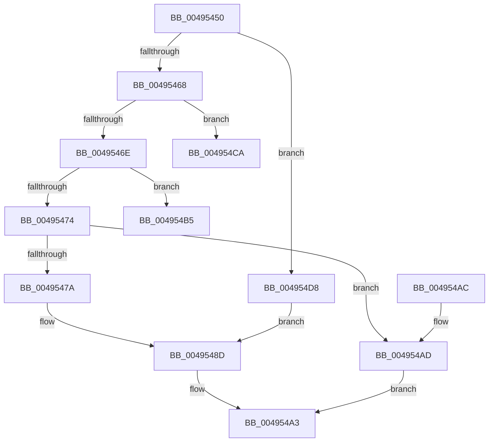

# GxpGetRotatedPixelOffset

- RVA: `0x00495450`–`0x004954E4` (길이 `148` bytes)
- VA: `0x0000000140495450`
- 실행 섹션: `.text`
- PDB 이름 있음: `예`; PDB Function 태그: `예`
- unwind 정보 RVA: `0x0008CDB0`
- 디코드: `45`개 명령, `148/148` bytes 표시
- 미해석 바이트: `0` (있으면 어셈블리에 `.byte`로 보존)

> 이 문서는 커널 이미지의 기계어와 PDB 기호를 분석해 생성했습니다. 4번과 5번은 함수 원형과 자료형을 바이너리 사용 방식에서 추정한 C 해석이며 원본 소스 복구 결과는 아닙니다.

## 1. Dependencies

- 직접 호출 지점: **0**; 고유 호출 대상: **0**
- 직접 호출자로 확인된 함수: **1**
- RIP 상대 이미지 참조: **1**

### Outgoing calls
- 직접 디코드된 call 명령이 없습니다.

### Direct callers
- [sub_00BC6824](../../pagebgfx/BC/Unknown_function_00BC6824.md) at `0x00BC687D`

### Static image references
- `0x00495455` → RVA `0x00EF03E2` (`.data`; read)

## 2. Other-region calls and transfers

- 다른 실행 섹션으로 향하는 call: **0**
- call이 아닌 외부 분기/꼬리 이동: **2**
  - `0x004954C5` → [sub_006F753A](../6F/Unknown_function_006F753A.md) (`tail-transfer`)
  - `0x004954D3` → [sub_006F753A](../6F/Unknown_function_006F753A.md) (`tail-transfer`)

## 3. Assembly (complete function range)

```asm
00495450  48 89 5C 24 08                  mov qword ptr [rsp + 8], rbx
00495455  44 0F B6 15 85 AF A5 00         movzx r10d, byte ptr [rip + 0xa5af85]
0049545D  45 33 DB                        xor r11d, r11d
00495460  49 8B D8                        mov rbx, r8
00495463  45 85 D2                        test r10d, r10d
00495466  74 70                           je 0x1404954d8
00495468  41 83 EA 01                     sub r10d, 1
0049546C  74 5C                           je 0x1404954ca
0049546E  41 83 EA 01                     sub r10d, 1
00495472  74 41                           je 0x1404954b5
00495474  41 83 FA 01                     cmp r10d, 1
00495478  75 33                           jne 0x1404954ad
0049547A  44 8B 42 04                     mov r8d, dword ptr [rdx + 4]
0049547E  48 8B C1                        mov rax, rcx
00495481  48 C1 E8 20                     shr rax, 0x20
00495485  44 2B C0                        sub r8d, eax
00495488  8B C1                           mov eax, ecx
0049548A  41 FF C8                        dec r8d
0049548D  8B 53 04                        mov edx, dword ptr [rbx + 4]
00495490  48 8B 4C 24 28                  mov rcx, qword ptr [rsp + 0x28]
00495495  03 D0                           add edx, eax
00495497  41 0F AF 51 08                  imul edx, dword ptr [r9 + 8]
0049549C  03 13                           add edx, dword ptr [rbx]
0049549E  41 03 D0                        add edx, r8d
004954A1  89 11                           mov dword ptr [rcx], edx
004954A3  48 8B 5C 24 08                  mov rbx, qword ptr [rsp + 8]
004954A8  41 8B C3                        mov eax, r11d
004954AB  C3                              ret
004954AC  CC                              int3
004954AD  41 BB BB 00 00 C0               mov r11d, 0xc00000bb
004954B3  EB EE                           jmp 0x1404954a3
004954B5  44 8B 02                        mov r8d, dword ptr [rdx]
004954B8  8B 42 04                        mov eax, dword ptr [rdx + 4]
004954BB  44 2B C1                        sub r8d, ecx
004954BE  41 FF C8                        dec r8d
004954C1  48 C1 E9 20                     shr rcx, 0x20
004954C5  E9 70 20 26 00                  jmp 0x1406f753a
004954CA  8B 02                           mov eax, dword ptr [rdx]
004954CC  4C 8B C1                        mov r8, rcx
004954CF  49 C1 E8 20                     shr r8, 0x20
004954D3  E9 62 20 26 00                  jmp 0x1406f753a
004954D8  48 8B C1                        mov rax, rcx
004954DB  44 8B C1                        mov r8d, ecx
004954DE  48 C1 E8 20                     shr rax, 0x20
004954E2  EB A9                           jmp 0x14049548d
```

## 4. C-style interpretation (structured pseudocode)

```c
__int64 __fastcall GxpGetRotatedPixelOffset(__int64 a1, __int64 a2, __int64 a3, __int64 a4, __int64 a5)
{
    __int64 result;
    __int64 v_r10;
    __int64 v_r11;
    unsigned __int64 v_stack_p8;

    v_stack_p8 = v_rbx;
    v_r11 = 0;
    if ((unsigned int)(*(unsigned __int8 *)(v_rip + 10858373)) == 0) goto loc_004954D8;
    v_r10 = (unsigned int)((*(unsigned __int8 *)(v_rip + 10858373)) - (1));
    if (condition_is_equal) goto loc_004954CA;
    v_r10 = (unsigned int)((v_r10) - (1));
    if (condition_is_equal) goto loc_004954B5;
    if (((unsigned int)(v_r10)) != 1) goto loc_004954AD;
    result = (a1) >> (32);
    a3 = (unsigned int)(((unsigned int)(*(unsigned int *)(a2 + 4))) - ((unsigned int)(result)));
    a3 = (unsigned int)((a3) - 1);
loc_0049548D:
    a2 = (unsigned int)(((unsigned int)(*(unsigned int *)(a3 + 4))) + ((unsigned int)((unsigned int)((unsigned int)(a1)))));
    a2 = (unsigned int)((a2) * (*(unsigned int *)(a4 + 8)));
    a2 = (unsigned int)((a2) + (*(unsigned int *)(a3)));
    a2 = (unsigned int)((a2) + ((unsigned int)(a3)));
    *(unsigned int *)(a5) = (unsigned int)(a2);
loc_004954A3:
    return 0;
loc_004954AD:
    goto loc_004954A3;
loc_004954B5:
    a3 = (unsigned int)(((unsigned int)(*(unsigned int *)(a2))) - ((unsigned int)(a5)));
    a3 = (unsigned int)((a3) - 1);
    a1 = (a5) >> (32);
loc_004954CA:
    a3 = (a1) >> (32);
loc_004954D8:
    result = (a1) >> (32);
    goto loc_0049548D;
}
```

## 5. (Beta) C Style

```c
int64_t GxpGetRotatedPixelOffset(int64_t Arg1, void *Arg2, void *Arg3, void *Arg4, void *Arg5)
{
    uint8_t *arg2 = (uint8_t *)Arg2;
    uint8_t *arg3 = (uint8_t *)Arg3;
    uint8_t *arg4 = (uint8_t *)Arg4;
    uint8_t *arg5 = (uint8_t *)Arg5;

    int64_t result;
    int64_t local_r10;
    int64_t local_r11;
    uint64_t v_stack_p8;

    v_stack_p8 = local_rbx;
    local_r11 = 0;
    if ((uint32_t)(*(uint8_t *)(v_rip + 0xA5AF85)) == 0) goto loc_004954D8;
    local_r10 = (uint32_t)((*(uint8_t *)(v_rip + 0xA5AF85)) - (1));
    if (condition_is_equal) goto loc_004954CA;
    local_r10 = (uint32_t)((local_r10) - (1));
    if (condition_is_equal) goto loc_004954B5;
    if (((uint32_t)(local_r10)) != 1) goto loc_004954AD;
    result = (Arg1) >> (32);
    Arg3 = (uint32_t)(((uint32_t)(*(uint32_t *)(arg2 + 0x4))) - ((uint32_t)(result)));
    Arg3 = (uint32_t)((Arg3) - 1);
loc_0049548D:
    Arg2 = (uint32_t)(((uint32_t)(*(uint32_t *)(arg3 + 0x4))) + ((uint32_t)((uint32_t)((uint32_t)(Arg1)))));
    Arg2 = (uint32_t)((Arg2) * (*(uint32_t *)(arg4 + 0x8)));
    Arg2 = (uint32_t)((Arg2) + (*(uint32_t *)(arg3)));
    Arg2 = (uint32_t)((Arg2) + ((uint32_t)(Arg3)));
    *(uint32_t *)(arg5) = (uint32_t)(Arg2);
loc_004954A3:
    return 0;
loc_004954AD:
    goto loc_004954A3;
loc_004954B5:
    Arg3 = (uint32_t)(((uint32_t)(*(uint32_t *)(arg2))) - ((uint32_t)(Arg5)));
    Arg3 = (uint32_t)((Arg3) - 1);
    Arg1 = (Arg5) >> (32);
loc_004954CA:
    Arg3 = (Arg1) >> (32);
loc_004954D8:
    result = (Arg1) >> (32);
    goto loc_0049548D;
}
```

### 관측된 메모리 오프셋

구조체 형식이 확인되지 않은 접근은 인자 기준의 오프셋으로만 기록했습니다.

| 기준 인자 | 오프셋 표현 | 폭 (bit) | 접근 |
|---|---:|---:|---|
| `Arg2` | `+ 0x0` | `32` | `R` |
| `Arg2` | `+ 0x4` | `32` | `R` |
| `Arg3` | `+ 0x0` | `32` | `R` |
| `Arg3` | `+ 0x4` | `32` | `R` |
| `Arg4` | `+ 0x8` | `32` | `R` |
| `Arg5` | `+ 0x0` | `32` | `W` |

## 6. Execution-region graph

[열기: 2D/3D 그래프와 함수 탐색 컨트롤 패널](../../../control-panel.html?section=text&rva=0x00495450&view=graph)

- 2D 그래프는 위에서 아래로 흐르고, 3D 그래프는 빈 공간을 드래그해 회전합니다. Shift+드래그는 이동, 휠은 확대·축소, 함수 노드 선택은 대상 보고서 이동입니다.

### Static fallback


