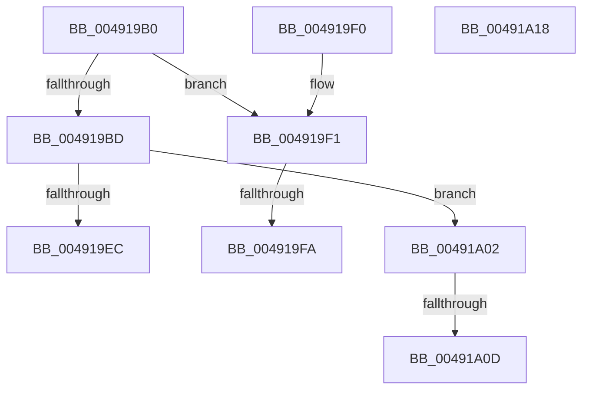

# HalpArtQueryCounter

- RVA: `0x004919B0`–`0x00491A19` (길이 `105` bytes)
- VA: `0x00000001404919B0`
- 실행 섹션: `.text`
- PDB 이름 있음: `예`; PDB Function 태그: `예`
- unwind 정보 RVA: `0x000DB714`
- 디코드: `34`개 명령, `105/105` bytes 표시
- 미해석 바이트: `0` (있으면 어셈블리에 `.byte`로 보존)

> 이 문서는 커널 이미지의 기계어와 PDB 기호를 분석해 생성했습니다. 4번과 5번은 함수 원형과 자료형을 바이너리 사용 방식에서 추정한 C 해석이며 원본 소스 복구 결과는 아닙니다.

## 1. Dependencies

- 직접 호출 지점: **0**; 고유 호출 대상: **0**
- 직접 호출자로 확인된 함수: **0**
- RIP 상대 이미지 참조: **1**

### Outgoing calls
- 직접 디코드된 call 명령이 없습니다.

### Direct callers
- 이 함수 시작 RVA로 연결되는 직접 call은 확인되지 않았습니다. 간접 호출은 완전히 역산할 수 없습니다.

### Static image references
- `0x004919B0` → RVA `0x00F8FB94` (`.data`; read)

## 2. Other-region calls and transfers

- 다른 실행 섹션으로 향하는 call: **0**
- call이 아닌 외부 분기/꼬리 이동: **3**
  - `0x004919F4` → `0x006F7068` (`tail-transfer`)
  - `0x004919FD` → `0x006F7070` (`tail-transfer`)
  - `0x00491A07` → `0x006F7077` (`tail-transfer`)

## 3. Assembly (complete function range)

```asm
004919B0  8B 05 DE E1 AF 00               mov eax, dword ptr [rip + 0xafe1de]
004919B6  4C 8B C9                        mov r9, rcx
004919B9  85 C0                           test eax, eax
004919BB  75 34                           jne 0x1404919f1
004919BD  0F 01 F9                        rdtscp
004919C0  48 C1 E2 20                     shl rdx, 0x20
004919C4  B9 3B 00 00 00                  mov ecx, 0x3b
004919C9  48 0B C2                        or rax, rdx
004919CC  4C 8B C0                        mov r8, rax
004919CF  0F 32                           rdmsr
004919D1  41 8B 09                        mov ecx, dword ptr [r9]
004919D4  45 8B 49 04                     mov r9d, dword ptr [r9 + 4]
004919D8  48 C1 E2 20                     shl rdx, 0x20
004919DC  48 0B C2                        or rax, rdx
004919DF  4C 2B C0                        sub r8, rax
004919E2  8B C1                           mov eax, ecx
004919E4  49 F7 E0                        mul r8
004919E7  48 85 D2                        test rdx, rdx
004919EA  75 16                           jne 0x140491a02
004919EC  49 F7 F1                        div r9
004919EF  C3                              ret
004919F0  CC                              int3
004919F1  83 F8 01                        cmp eax, 1
004919F4  0F 85 6E 56 26 00               jne 0x1406f7068
004919FA  0F AE E8                        lfence
004919FD  E9 6E 56 26 00                  jmp 0x1406f7070
00491A02  33 D2                           xor edx, edx
00491A04  4C 3B C1                        cmp r8, rcx
00491A07  0F 86 6A 56 26 00               jbe 0x1406f7077
00491A0D  49 8B C0                        mov rax, r8
00491A10  49 F7 F1                        div r9
00491A13  48 0F AF C1                     imul rax, rcx
00491A17  C3                              ret
00491A18  CC                              int3
```

## 4. C-style interpretation (structured pseudocode)

```c
__int64 __fastcall HalpArtQueryCounter(__int64 a1, __int64 a2)
{
    __int64 result;

    if ((unsigned int)((unsigned int)(*(unsigned int *)(v_rip + 11526622))) != 0) goto loc_004919F1;
    a2 = (a2) << (32);
    result = ((unsigned int)(*(unsigned int *)(v_rip + 11526622))) | (a2);
    a2 = (a2) << (32);
    result = (result) | (a2);
    a3 = (result) - (result);
    if (a2 != 0) goto loc_00491A02;
    return (unsigned int)((unsigned int)((unsigned int)(*(unsigned int *)(a1))));
loc_004919F1:
loc_00491A02:
    a2 = 0;
    result = (a3) * ((unsigned int)(*(unsigned int *)(a1)));
    return result;
}
```

## 5. (Beta) C Style

```c
int64_t HalpArtQueryCounter(void *Arg1, int64_t Arg2)
{
    uint8_t *arg1 = (uint8_t *)Arg1;

    int64_t result;

    if ((uint32_t)((uint32_t)(*(uint32_t *)(v_rip + 0xAFE1DE))) != 0) goto loc_004919F1;
    Arg2 = (Arg2) << (32);
    result = ((uint32_t)(*(uint32_t *)(v_rip + 0xAFE1DE))) | (Arg2);
    Arg2 = (Arg2) << (32);
    result = (result) | (Arg2);
    a3 = (result) - (result);
    if (Arg2 != 0) goto loc_00491A02;
    return (uint32_t)((uint32_t)((uint32_t)(*(uint32_t *)(arg1))));
loc_004919F1:
loc_00491A02:
    Arg2 = 0;
    result = (a3) * ((uint32_t)(*(uint32_t *)(arg1)));
    return result;
}
```

### 관측된 메모리 오프셋

구조체 형식이 확인되지 않은 접근은 인자 기준의 오프셋으로만 기록했습니다.

| 기준 인자 | 오프셋 표현 | 폭 (bit) | 접근 |
|---|---:|---:|---|
| `Arg1` | `+ 0x0` | `32` | `R` |
| `Arg1` | `+ 0x4` | `32` | `R` |

## 6. Execution-region graph

[열기: 2D/3D 그래프와 함수 탐색 컨트롤 패널](../../../control-panel.html?section=text&rva=0x004919B0&view=graph)

- 2D 그래프는 위에서 아래로 흐르고, 3D 그래프는 빈 공간을 드래그해 회전합니다. Shift+드래그는 이동, 휠은 확대·축소, 함수 노드 선택은 대상 보고서 이동입니다.

### Static fallback


