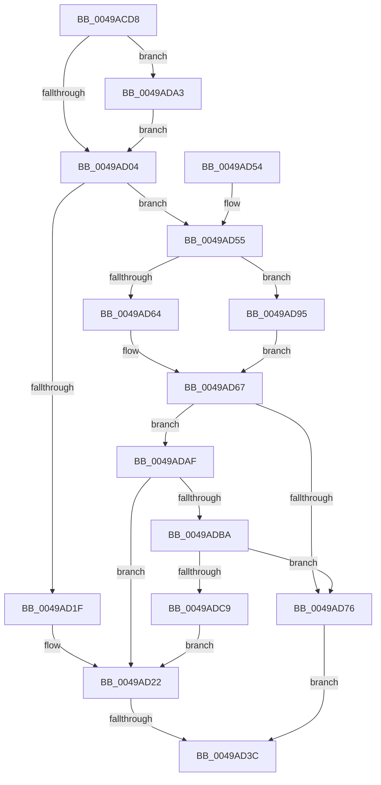

# HalpDmaAllocateNewTranslationBuffer

- RVA: `0x0049ACD8`–`0x0049ADCE` (길이 `246` bytes)
- VA: `0x000000014049ACD8`
- 실행 섹션: `.text`
- PDB 이름 있음: `예`; PDB Function 태그: `예`
- unwind 정보 RVA: `0x000B4818`
- 디코드: `73`개 명령, `246/246` bytes 표시
- 미해석 바이트: `0` (있으면 어셈블리에 `.byte`로 보존)

> 이 문서는 커널 이미지의 기계어와 PDB 기호를 분석해 생성했습니다. 4번과 5번은 함수 원형과 자료형을 바이너리 사용 방식에서 추정한 C 해석이며 원본 소스 복구 결과는 아닙니다.

## 1. Dependencies

- 직접 호출 지점: **3**; 고유 호출 대상: **1**
- 직접 호출자로 확인된 함수: **1**
- RIP 상대 이미지 참조: **0**

### Outgoing calls
- `0x0049AD09` → [HalpMmAllocCtxAlloc](../3E/HalpMmAllocCtxAlloc_function_003E10B8.md) (function, `0x003E10B8`)
- `0x0049AD69` → [HalpMmAllocCtxAlloc](../3E/HalpMmAllocCtxAlloc_function_003E10B8.md) (function, `0x003E10B8`)
- `0x0049ADBC` → [HalpMmAllocCtxAlloc](../3E/HalpMmAllocCtxAlloc_function_003E10B8.md) (function, `0x003E10B8`)

### Direct callers
- [HalpDmaGetTranslationEntries](HalpDmaGetTranslationEntries_function_0049AB3C.md) at `0x0049AC5F`

### Static image references
- 디코드된 RIP-relative 메모리 참조가 없습니다.

## 2. Other-region calls and transfers

- 다른 실행 섹션으로 향하는 call: **0**
- call이 아닌 외부 분기/꼬리 이동: **1**
  - `0x0049AD36` → [sub_006F79F4](../6F/Unknown_function_006F79F4.md) (`tail-transfer`)

## 3. Assembly (complete function range)

```asm
0049ACD8  48 89 5C 24 10                  mov qword ptr [rsp + 0x10], rbx
0049ACDD  55                              push rbp
0049ACDE  56                              push rsi
0049ACDF  57                              push rdi
0049ACE0  41 54                           push r12
0049ACE2  41 55                           push r13
0049ACE4  41 56                           push r14
0049ACE6  41 57                           push r15
0049ACE8  48 83 EC 30                     sub rsp, 0x30
0049ACEC  83 64 24 70 00                  and dword ptr [rsp + 0x70], 0
0049ACF1  44 8B F2                        mov r14d, edx
0049ACF4  80 B9 98 00 00 00 00            cmp byte ptr [rcx + 0x98], 0
0049ACFB  48 8B E9                        mov rbp, rcx
0049ACFE  0F 84 9F 00 00 00               je 0x14049ada3
0049AD04  BA 18 00 00 00                  mov edx, 0x18
0049AD09  E8 AA 63 F4 FF                  call 0x1403e10b8
0049AD0E  45 33 C0                        xor r8d, r8d
0049AD11  48 8B F8                        mov rdi, rax
0049AD14  41 BF 00 10 00 00               mov r15d, 0x1000
0049AD1A  48 85 C0                        test rax, rax
0049AD1D  75 36                           jne 0x14049ad55
0049AD1F  45 8A E0                        mov r12b, r8b
0049AD22  49 8B F0                        mov rsi, r8
0049AD25  4C 89 84 24 80 00 00 00         mov qword ptr [rsp + 0x80], r8
0049AD2D  45 8B F8                        mov r15d, r8d
0049AD30  4D 8B E8                        mov r13, r8
0049AD33  45 85 F6                        test r14d, r14d
0049AD36  0F 85 B8 CC 25 00               jne 0x1406f79f4
0049AD3C  48 8B C7                        mov rax, rdi
0049AD3F  48 8B 5C 24 78                  mov rbx, qword ptr [rsp + 0x78]
0049AD44  48 83 C4 30                     add rsp, 0x30
0049AD48  41 5F                           pop r15
0049AD4A  41 5E                           pop r14
0049AD4C  41 5D                           pop r13
0049AD4E  41 5C                           pop r12
0049AD50  5F                              pop rdi
0049AD51  5E                              pop rsi
0049AD52  5D                              pop rbp
0049AD53  C3                              ret
0049AD54  CC                              int3
0049AD55  43 8D 34 F6                     lea esi, [r14 + r14*8]
0049AD59  41 B4 01                        mov r12b, 1
0049AD5C  C1 E6 03                        shl esi, 3
0049AD5F  41 3B F7                        cmp esi, r15d
0049AD62  73 31                           jae 0x14049ad95
0049AD64  41 8B DF                        mov ebx, r15d
0049AD67  8B D3                           mov edx, ebx
0049AD69  E8 4A 63 F4 FF                  call 0x1403e10b8
0049AD6E  45 33 C0                        xor r8d, r8d
0049AD71  48 85 C0                        test rax, rax
0049AD74  74 39                           je 0x14049adaf
0049AD76  48 89 47 10                     mov qword ptr [rdi + 0x10], rax
0049AD7A  48 B8 8F E3 38 8E E3 38 8E E3   movabs rax, 0xe38e38e38e38e38f
0049AD84  8B CB                           mov ecx, ebx
0049AD86  48 F7 E1                        mul rcx
0049AD89  4C 89 07                        mov qword ptr [rdi], r8
0049AD8C  48 C1 EA 06                     shr rdx, 6
0049AD90  89 57 08                        mov dword ptr [rdi + 8], edx
0049AD93  EB A7                           jmp 0x14049ad3c
0049AD95  8D 9E FF 0F 00 00               lea ebx, [rsi + 0xfff]
0049AD9B  81 E3 00 F0 FF FF               and ebx, 0xfffff000
0049ADA1  EB C4                           jmp 0x14049ad67
0049ADA3  48 8B A9 A0 00 00 00            mov rbp, qword ptr [rcx + 0xa0]
0049ADAA  E9 55 FF FF FF                  jmp 0x14049ad04
0049ADAF  8B DE                           mov ebx, esi
0049ADB1  41 3B F7                        cmp esi, r15d
0049ADB4  0F 83 68 FF FF FF               jae 0x14049ad22
0049ADBA  8B D3                           mov edx, ebx
0049ADBC  E8 F7 62 F4 FF                  call 0x1403e10b8
0049ADC1  45 33 C0                        xor r8d, r8d
0049ADC4  48 85 C0                        test rax, rax
0049ADC7  75 AD                           jne 0x14049ad76
0049ADC9  E9 54 FF FF FF                  jmp 0x14049ad22
```

## 4. C-style interpretation (structured pseudocode)

```c
__int64 __fastcall HalpDmaAllocateNewTranslationBuffer(__int64 a1, int a2, int a3)
{
    __int64 result;
    __int64 v_rbx;
    __int64 v_rsi;
    __int64 v_rsp;
    unsigned __int64 v_stack_p10;
    unsigned __int64 v_stack_p18;
    unsigned int v_stack_p8;

    v_stack_p10 = v_rbx;
    v_rsp = (v_rsp) - (48);
    if ((*(unsigned __int8 *)(a1 + 152)) == 0) goto loc_0049ADA3;
loc_0049AD04:
    result = HalpMmAllocCtxAlloc(a1, 24, a3, a4);
    a3 = 0;
    if (result != 0) goto loc_0049AD55;
loc_0049AD22:
    v_stack_p18 = 0;
loc_0049AD3C:
    v_rsp = (v_rsp) + (48);
    return result;
loc_0049AD55:
    v_rsi = (unsigned int)(((unsigned int)(a2) + (unsigned int)(a2) * 8) << (3));
    if (((unsigned int)(v_rsi)) >= 0) goto loc_0049AD95;
loc_0049AD67:
    result = HalpMmAllocCtxAlloc(a1, 0, a3, a4);
    a3 = 0;
    if (result == 0) goto loc_0049ADAF;
loc_0049AD76:
    *(unsigned __int64 *)(result + 16) = result;
    *(unsigned __int64 *)(result) = 0;
    a2 = (0) >> (6);
    *(unsigned int *)(result + 8) = a2;
    goto loc_0049AD3C;
loc_0049AD95:
    v_rbx = (unsigned int)((v_rsi + 4095) & (0xFFFFF000ULL));
    goto loc_0049AD67;
loc_0049ADA3:
    goto loc_0049AD04;
loc_0049ADAF:
    if (((unsigned int)(v_rsi)) >= 0) goto loc_0049AD22;
    result = HalpMmAllocCtxAlloc(0, (unsigned int)((unsigned int)((unsigned int)((unsigned int)(v_rsi)))), a3, a4);
    a3 = 0;
    if (result != 0) goto loc_0049AD76;
    goto loc_0049AD22;
}
```

## 5. (Beta) C Style

```c
int64_t HalpDmaAllocateNewTranslationBuffer(void *Arg1, void *Arg2, int32_t Arg3)
{
    uint8_t *arg1 = (uint8_t *)Arg1;
    uint8_t *arg2 = (uint8_t *)Arg2;

    int64_t result;
    int64_t local_rbx;
    int64_t local_rsi;
    int64_t local_rsp;
    uint64_t v_stack_p10;
    uint64_t v_stack_p18;
    uint32_t v_stack_p8;

    v_stack_p10 = local_rbx;
    local_rsp = (local_rsp) - (48);
    if ((*(uint8_t *)(arg1 + 0x98)) == 0) goto loc_0049ADA3;
loc_0049AD04:
    result = HalpMmAllocCtxAlloc(Arg1, 24, Arg3, a4);
    Arg3 = 0;
    if (result != 0) goto loc_0049AD55;
loc_0049AD22:
    v_stack_p18 = 0;
loc_0049AD3C:
    local_rsp = (local_rsp) + (48);
    return result;
loc_0049AD55:
    local_rsi = (uint32_t)(((uint32_t)(Arg2) + (uint32_t)(Arg2) * 8) << (3));
    if (((uint32_t)(local_rsi)) >= 0) goto loc_0049AD95;
loc_0049AD67:
    result = HalpMmAllocCtxAlloc(Arg1, 0, Arg3, a4);
    Arg3 = 0;
    if (result == 0) goto loc_0049ADAF;
loc_0049AD76:
    *(uint64_t *)(result + 0x10) = result;
    *(uint64_t *)(result) = 0;
    Arg2 = (0) >> (6);
    *(uint32_t *)(result + 0x8) = Arg2;
    goto loc_0049AD3C;
loc_0049AD95:
    local_rbx = (uint32_t)((local_rsi + 4095) & (0xFFFFF000ULL));
    goto loc_0049AD67;
loc_0049ADA3:
    goto loc_0049AD04;
loc_0049ADAF:
    if (((uint32_t)(local_rsi)) >= 0) goto loc_0049AD22;
    result = HalpMmAllocCtxAlloc(0, (uint32_t)((uint32_t)((uint32_t)((uint32_t)(local_rsi)))), Arg3, a4);
    Arg3 = 0;
    if (result != 0) goto loc_0049AD76;
    goto loc_0049AD22;
}
```

### 관측된 메모리 오프셋

구조체 형식이 확인되지 않은 접근은 인자 기준의 오프셋으로만 기록했습니다.

| 기준 인자 | 오프셋 표현 | 폭 (bit) | 접근 |
|---|---:|---:|---|
| `Arg1` | `+ 0x98` | `8` | `R` |
| `Arg1` | `+ 0xA0` | `64` | `R` |
| `Arg2` | `+ 0x0 + r14*8` | `32` | `R` |

## 6. Execution-region graph

[열기: 2D/3D 그래프와 함수 탐색 컨트롤 패널](../../../control-panel.html?section=text&rva=0x0049ACD8&view=graph)

- 2D 그래프는 위에서 아래로 흐르고, 3D 그래프는 빈 공간을 드래그해 회전합니다. Shift+드래그는 이동, 휠은 확대·축소, 함수 노드 선택은 대상 보고서 이동입니다.

### Static fallback


