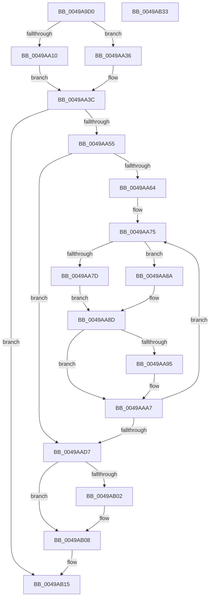

# HalpDmaCommitScatterMapBuffers

- RVA: `0x0049A9D0`–`0x0049AB34` (길이 `356` bytes)
- VA: `0x000000014049A9D0`
- 실행 섹션: `.text`
- PDB 이름 있음: `예`; PDB Function 태그: `아니요`
- unwind 정보 RVA: `0x000AC264`
- 디코드: `101`개 명령, `356/356` bytes 표시
- 미해석 바이트: `0` (있으면 어셈블리에 `.byte`로 보존)

> 이 문서는 커널 이미지의 기계어와 PDB 기호를 분석해 생성했습니다. 4번과 5번은 함수 원형과 자료형을 바이너리 사용 방식에서 추정한 C 해석이며 원본 소스 복구 결과는 아닙니다.

## 1. Dependencies

- 직접 호출 지점: **4**; 고유 호출 대상: **4**
- 직접 호출자로 확인된 함수: **2**
- RIP 상대 이미지 참조: **0**

### Outgoing calls
- `0x0049AA44` → [HalpDmaGetTranslationEntries](HalpDmaGetTranslationEntries_function_0049AB3C.md) (function, `0x0049AB3C`)
- `0x0049AAE3` → [KeAcquireInStackQueuedSpinLock](../27/KeAcquireInStackQueuedSpinLock_function_002757A0.md) (function, `0x002757A0`)
- `0x0049AAF1` → [HalpDmaPrependTranslations](../3D/HalpDmaPrependTranslations_function_003DC3C8.md) (function, `0x003DC3C8`)
- `0x0049AB0D` → [KeReleaseInStackQueuedSpinLock](../34/KeReleaseInStackQueuedSpinLock_function_00342CE0.md) (function, `0x00342CE0`)

### Direct callers
- [HalpDmaAllocateLocalScatterPool](../../page/70/HalpDmaAllocateLocalScatterPool_function_007091D4.md) at `0x00709282`
- [HalpDmaGrowScatterMapBuffers](../../page/AA/HalpDmaGrowScatterMapBuffers_function_00AA2CF0.md) at `0x00AA2D28`

### Static image references
- 디코드된 RIP-relative 메모리 참조가 없습니다.

## 2. Other-region calls and transfers

- 다른 실행 섹션으로 향하는 call: **0**
- 별도 외부 분기/꼬리 이동을 확인하지 못했습니다.

## 3. Assembly (complete function range)

```asm
0049A9D0  4C 8B DC                        mov r11, rsp
0049A9D3  49 89 5B 08                     mov qword ptr [r11 + 8], rbx
0049A9D7  49 89 6B 10                     mov qword ptr [r11 + 0x10], rbp
0049A9DB  49 89 73 18                     mov qword ptr [r11 + 0x18], rsi
0049A9DF  57                              push rdi
0049A9E0  41 54                           push r12
0049A9E2  41 55                           push r13
0049A9E4  41 56                           push r14
0049A9E6  41 57                           push r15
0049A9E8  48 83 EC 40                     sub rsp, 0x40
0049A9EC  48 8B B4 24 90 00 00 00         mov rsi, qword ptr [rsp + 0x90]
0049A9F4  33 C0                           xor eax, eax
0049A9F6  0F 57 C0                        xorps xmm0, xmm0
0049A9F9  4D 8B E0                        mov r12, r8
0049A9FC  4C 8B FA                        mov r15, rdx
0049A9FF  48 8B F9                        mov rdi, rcx
0049AA02  0F 11 44 24 20                  movups xmmword ptr [rsp + 0x20], xmm0
0049AA07  49 89 43 C8                     mov qword ptr [r11 - 0x38], rax
0049AA0B  48 85 F6                        test rsi, rsi
0049AA0E  74 26                           je 0x14049aa36
0049AA10  44 8B 4E 2C                     mov r9d, dword ptr [rsi + 0x2c]
0049AA14  4C 8D 76 30                     lea r14, [rsi + 0x30]
0049AA18  44 03 4E 20                     add r9d, dword ptr [rsi + 0x20]
0049AA1C  8B 5E 28                        mov ebx, dword ptr [rsi + 0x28]
0049AA1F  41 81 E1 FF 0F 00 00            and r9d, 0xfff
0049AA26  48 81 C3 FF 0F 00 00            add rbx, 0xfff
0049AA2D  49 03 D9                        add rbx, r9
0049AA30  48 C1 EB 0C                     shr rbx, 0xc
0049AA34  EB 06                           jmp 0x14049aa3c
0049AA36  41 8B D9                        mov ebx, r9d
0049AA39  45 33 F6                        xor r14d, r14d
0049AA3C  44 8B C3                        mov r8d, ebx
0049AA3F  BA 01 00 00 00                  mov edx, 1
0049AA44  E8 F3 00 00 00                  call 0x14049ab3c
0049AA49  48 8B E8                        mov rbp, rax
0049AA4C  48 85 C0                        test rax, rax
0049AA4F  0F 84 C0 00 00 00               je 0x14049ab15
0049AA55  44 0F B6 AF 98 00 00 00         movzx r13d, byte ptr [rdi + 0x98]
0049AA5D  48 8B D5                        mov rdx, rbp
0049AA60  85 DB                           test ebx, ebx
0049AA62  74 73                           je 0x14049aad7
0049AA64  4E 8D 14 AD 00 00 00 00         lea r10, [r13*4]
0049AA6C  44 8B CB                        mov r9d, ebx
0049AA6F  41 BB 00 10 00 00               mov r11d, 0x1000
0049AA75  49 8B C4                        mov rax, r12
0049AA78  48 85 F6                        test rsi, rsi
0049AA7B  74 0D                           je 0x14049aa8a
0049AA7D  49 8B 06                        mov rax, qword ptr [r14]
0049AA80  49 83 C6 08                     add r14, 8
0049AA84  48 C1 E0 0C                     shl rax, 0xc
0049AA88  EB 03                           jmp 0x14049aa8d
0049AA8A  4D 03 E3                        add r12, r11
0049AA8D  48 89 02                        mov qword ptr [rdx], rax
0049AA90  4D 85 FF                        test r15, r15
0049AA93  74 12                           je 0x14049aaa7
0049AA95  8B 42 30                        mov eax, dword ptr [rdx + 0x30]
0049AA98  25 FF 0F 00 00                  and eax, 0xfff
0049AA9D  49 0B C7                        or rax, r15
0049AAA0  48 89 42 30                     mov qword ptr [rdx + 0x30], rax
0049AAA4  4D 03 FB                        add r15, r11
0049AAA7  48 8B 42 30                     mov rax, qword ptr [rdx + 0x30]
0049AAAB  49 8B CD                        mov rcx, r13
0049AAAE  83 E1 01                        and ecx, 1
0049AAB1  48 83 E0 FA                     and rax, 0xfffffffffffffffa
0049AAB5  48 33 C8                        xor rcx, rax
0049AAB8  49 8B C2                        mov rax, r10
0049AABB  48 83 C9 02                     or rcx, 2
0049AABF  83 E0 04                        and eax, 4
0049AAC2  48 33 C8                        xor rcx, rax
0049AAC5  48 83 C9 08                     or rcx, 8
0049AAC9  48 89 4A 30                     mov qword ptr [rdx + 0x30], rcx
0049AACD  48 8B 52 08                     mov rdx, qword ptr [rdx + 8]
0049AAD1  49 83 E9 01                     sub r9, 1
0049AAD5  75 9E                           jne 0x14049aa75
0049AAD7  48 8D 8F 80 00 00 00            lea rcx, [rdi + 0x80]
0049AADE  48 8D 54 24 20                  lea rdx, [rsp + 0x20]
0049AAE3  E8 B8 AC DD FF                  call 0x1402757a0
0049AAE8  4C 8B 47 20                     mov r8, qword ptr [rdi + 0x20]
0049AAEC  8B D3                           mov edx, ebx
0049AAEE  48 8B CD                        mov rcx, rbp
0049AAF1  E8 D2 18 F4 FF                  call 0x1403dc3c8
0049AAF6  01 5F 28                        add dword ptr [rdi + 0x28], ebx
0049AAF9  48 89 47 20                     mov qword ptr [rdi + 0x20], rax
0049AAFD  45 84 ED                        test r13b, r13b
0049AB00  74 06                           je 0x14049ab08
0049AB02  01 9F E0 00 00 00               add dword ptr [rdi + 0xe0], ebx
0049AB08  48 8D 4C 24 20                  lea rcx, [rsp + 0x20]
0049AB0D  E8 CE 81 EA FF                  call 0x140342ce0
0049AB12  48 8B C5                        mov rax, rbp
0049AB15  4C 8D 5C 24 40                  lea r11, [rsp + 0x40]
0049AB1A  49 8B 5B 30                     mov rbx, qword ptr [r11 + 0x30]
0049AB1E  49 8B 6B 38                     mov rbp, qword ptr [r11 + 0x38]
0049AB22  49 8B 73 40                     mov rsi, qword ptr [r11 + 0x40]
0049AB26  49 8B E3                        mov rsp, r11
0049AB29  41 5F                           pop r15
0049AB2B  41 5E                           pop r14
0049AB2D  41 5D                           pop r13
0049AB2F  41 5C                           pop r12
0049AB31  5F                              pop rdi
0049AB32  C3                              ret
0049AB33  CC                              int3
```

## 4. C-style interpretation (structured pseudocode)

```c
__int64 __fastcall HalpDmaCommitScatterMapBuffers(__int64 a1, __int64 a2, __int64 a3, __int64 a4, __int64 a5)
{
    __int64 result;
    __int64 v_r12;
    __int64 v_r14;
    __int64 v_r15;
    __int64 v_rbx;
    __int64 v_rsp;
    unsigned __int64 v_stack_m28;
    unsigned __int64 v_stack_m48;

    *(unsigned __int64 *)(v_rsp + 8) = v_rbx;
    *(unsigned __int64 *)(v_rsp + 16) = v_rbp;
    *(unsigned __int64 *)(v_rsp + 24) = v_rsi;
    v_rsp = (v_rsp) - (64);
    result = 0;
    v_stack_m48 = v_xmm0;
    *(unsigned __int64 *)(v_rsp - 56) = 0;
    if (a5 == 0) goto loc_0049AA36;
    a4 = (unsigned int)(((unsigned int)(*(unsigned int *)(a5 + 44))) + (*(unsigned int *)(a5 + 32)));
    a4 = (unsigned int)((a4) & (0xFFFULL));
    v_rbx = ((unsigned int)(*(unsigned int *)(a5 + 40))) + (0xFFFULL);
    v_rbx = (v_rbx) + (a4);
    v_rbx = (v_rbx) >> (12);
    goto loc_0049AA3C;
loc_0049AA36:
    v_r14 = 0;
loc_0049AA3C:
    result = HalpDmaGetTranslationEntries(a1, 1, (unsigned int)((unsigned int)((unsigned int)((unsigned int)(a4)))), a4);
    if (result == 0) goto loc_0049AB15;
    if ((unsigned int)((unsigned int)((unsigned int)(a4))) == 0) goto loc_0049AAD7;
loc_0049AA75:
    if (a5 == 0) goto loc_0049AA8A;
    v_r14 = (v_r14) + (8);
    result = (*(unsigned __int64 *)(v_r14)) << (12);
    goto loc_0049AA8D;
loc_0049AA8A:
    v_r12 = (a3) + ((unsigned int)(0x1000ULL));
loc_0049AA8D:
    *(unsigned __int64 *)(result) = result;
    v_r15 = a2;
    if (a2 != 0) {
        result = *(unsigned int *)(result + 48);
        result = (unsigned int)((result) & (0xFFFULL));
        result = (result) | (a2);
        *(unsigned __int64 *)(result + 48) = result;
        v_r15 = (a2) + ((unsigned int)(0x1000ULL));
    }
    a1 = (unsigned int)((*(unsigned __int8 *)(a1 + 152)) & (1));
    result = (*(unsigned __int64 *)(result + 48)) & (-6);
    a1 = (a1) ^ (result);
    a1 = (a1) | (2);
    result = (unsigned int)((*(unsigned __int8 *)(a1 + 152) * 4) & (4));
    a1 = (a1) ^ (result);
    a1 = (a1) | (8);
    *(unsigned __int64 *)(result + 48) = a1;
    a4 = ((unsigned int)((unsigned int)((unsigned int)((unsigned int)(a4))))) - (1);
    if (condition_is_not_equal) goto loc_0049AA75;
loc_0049AAD7:
    result = KeAcquireInStackQueuedSpinLock(a1 + 128, v_stack_m48, (unsigned int)((unsigned int)((unsigned int)((unsigned int)(a4)))), a4);
    result = HalpDmaPrependTranslations(result, (unsigned int)((unsigned int)((unsigned int)((unsigned int)(a4)))), *(unsigned __int64 *)(a1 + 32), a4);
    *(unsigned __int64 *)(a1 + 32) = result;
    if ((unsigned __int8)(*(unsigned __int8 *)(a1 + 152)) != 0) {
    }
    result = KeReleaseInStackQueuedSpinLock(v_stack_m48, (unsigned int)((unsigned int)((unsigned int)((unsigned int)(a4)))), *(unsigned __int64 *)(a1 + 32), a4);
loc_0049AB15:
    return result;
}
```

## 5. (Beta) C Style

```c
int64_t HalpDmaCommitScatterMapBuffers(void *Arg1, int64_t Arg2, int64_t Arg3, int64_t Arg4, int64_t Arg5)
{
    uint8_t *arg1 = (uint8_t *)Arg1;

    int64_t result;
    int64_t local_r12;
    int64_t local_r14;
    int64_t local_r15;
    int64_t local_rbx;
    int64_t local_rsp;
    uint64_t v_stack_m28;
    uint64_t v_stack_m48;

    *(uint64_t *)(local_rsp + 0x8) = local_rbx;
    *(uint64_t *)(local_rsp + 0x10) = local_rbp;
    *(uint64_t *)(local_rsp + 0x18) = local_rsi;
    local_rsp = (local_rsp) - (64);
    result = 0;
    v_stack_m48 = v_xmm0;
    *(uint64_t *)(local_rsp - 0x38) = 0;
    if (Arg5 == 0) goto loc_0049AA36;
    Arg4 = (uint32_t)(((uint32_t)(*(uint32_t *)(Arg5 + 0x2C))) + (*(uint32_t *)(Arg5 + 0x20)));
    Arg4 = (uint32_t)((Arg4) & (0xFFFULL));
    local_rbx = ((uint32_t)(*(uint32_t *)(Arg5 + 0x28))) + (0xFFFULL);
    local_rbx = (local_rbx) + (Arg4);
    local_rbx = (local_rbx) >> (12);
    goto loc_0049AA3C;
loc_0049AA36:
    local_r14 = 0;
loc_0049AA3C:
    result = HalpDmaGetTranslationEntries(Arg1, 1, (uint32_t)((uint32_t)((uint32_t)((uint32_t)(Arg4)))), Arg4);
    if (result == 0) goto loc_0049AB15;
    if ((uint32_t)((uint32_t)((uint32_t)(Arg4))) == 0) goto loc_0049AAD7;
loc_0049AA75:
    if (Arg5 == 0) goto loc_0049AA8A;
    local_r14 = (local_r14) + (8);
    result = (*(uint64_t *)(local_r14)) << (12);
    goto loc_0049AA8D;
loc_0049AA8A:
    local_r12 = (Arg3) + ((uint32_t)(0x1000ULL));
loc_0049AA8D:
    *(uint64_t *)(result) = result;
    local_r15 = Arg2;
    if (Arg2 != 0) {
        result = *(uint32_t *)(result + 0x30);
        result = (uint32_t)((result) & (0xFFFULL));
        result = (result) | (Arg2);
        *(uint64_t *)(result + 0x30) = result;
        local_r15 = (Arg2) + ((uint32_t)(0x1000ULL));
    }
    Arg1 = (uint32_t)((*(uint8_t *)(arg1 + 0x98)) & (1));
    result = (*(uint64_t *)(result + 0x30)) & (-6);
    Arg1 = (Arg1) ^ (result);
    Arg1 = (Arg1) | (2);
    result = (uint32_t)((*(uint8_t *)(arg1 + 0x98) * 4) & (4));
    Arg1 = (Arg1) ^ (result);
    Arg1 = (Arg1) | (8);
    *(void **)(result + 0x30) = Arg1;
    Arg4 = ((uint32_t)((uint32_t)((uint32_t)((uint32_t)(Arg4))))) - (1);
    if (condition_is_not_equal) goto loc_0049AA75;
loc_0049AAD7:
    result = KeAcquireInStackQueuedSpinLock(Arg1 + 128, v_stack_m48, (uint32_t)((uint32_t)((uint32_t)((uint32_t)(Arg4)))), Arg4);
    result = HalpDmaPrependTranslations(result, (uint32_t)((uint32_t)((uint32_t)((uint32_t)(Arg4)))), *(uint64_t *)(arg1 + 0x20), Arg4);
    *(uint64_t *)(arg1 + 0x20) = result;
    if ((uint8_t)(*(uint8_t *)(arg1 + 0x98)) != 0) {
    }
    result = KeReleaseInStackQueuedSpinLock(v_stack_m48, (uint32_t)((uint32_t)((uint32_t)((uint32_t)(Arg4)))), *(uint64_t *)(arg1 + 0x20), Arg4);
loc_0049AB15:
    return result;
}
```

### 관측된 메모리 오프셋

구조체 형식이 확인되지 않은 접근은 인자 기준의 오프셋으로만 기록했습니다.

| 기준 인자 | 오프셋 표현 | 폭 (bit) | 접근 |
|---|---:|---:|---|
| `Arg1` | `+ 0x20` | `64` | `R` |
| `Arg1` | `+ 0x20` | `64` | `W` |
| `Arg1` | `+ 0x28` | `32` | `R/W` |
| `Arg1` | `+ 0x80` | `64` | `R` |
| `Arg1` | `+ 0x98` | `8` | `R` |
| `Arg1` | `+ 0xE0` | `32` | `R/W` |

## 6. Execution-region graph

[열기: 2D/3D 그래프와 함수 탐색 컨트롤 패널](../../../control-panel.html?section=text&rva=0x0049A9D0&view=graph)

- 2D 그래프는 위에서 아래로 흐르고, 3D 그래프는 빈 공간을 드래그해 회전합니다. Shift+드래그는 이동, 휠은 확대·축소, 함수 노드 선택은 대상 보고서 이동입니다.

### Static fallback


