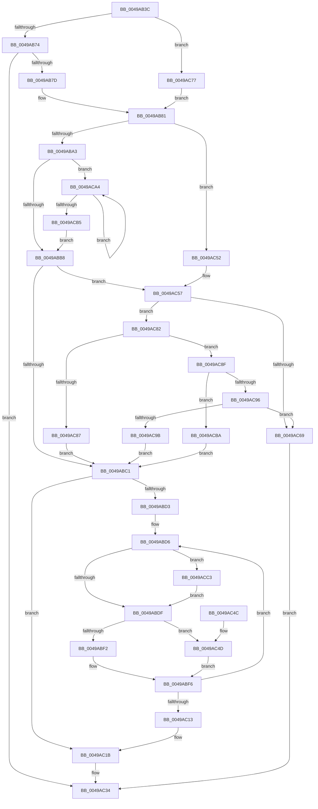

# HalpDmaGetTranslationEntries

- RVA: `0x0049AB3C`–`0x0049ACD1` (길이 `405` bytes)
- VA: `0x000000014049AB3C`
- 실행 섹션: `.text`
- PDB 이름 있음: `예`; PDB Function 태그: `아니요`
- unwind 정보 RVA: `0x000B47FC`
- 디코드: `121`개 명령, `405/405` bytes 표시
- 미해석 바이트: `0` (있으면 어셈블리에 `.byte`로 보존)

> 이 문서는 커널 이미지의 기계어와 PDB 기호를 분석해 생성했습니다. 4번과 5번은 함수 원형과 자료형을 바이너리 사용 방식에서 추정한 C 해석이며 원본 소스 복구 결과는 아닙니다.

## 1. Dependencies

- 직접 호출 지점: **5**; 고유 호출 대상: **4**
- 직접 호출자로 확인된 함수: **3**
- RIP 상대 이미지 참조: **0**

### Outgoing calls
- `0x0049AB8D` → [KeAcquireInStackQueuedSpinLock](../27/KeAcquireInStackQueuedSpinLock_function_002757A0.md) (function, `0x002757A0`)
- `0x0049ABFF` → [memset](../6C/memset_function_006C6C40.md) (function, `0x006C6C40`)
- `0x0049AC2C` → [KeReleaseInStackQueuedSpinLock](../34/KeReleaseInStackQueuedSpinLock_function_00342CE0.md) (function, `0x00342CE0`)
- `0x0049AC5F` → [HalpDmaAllocateNewTranslationBuffer](HalpDmaAllocateNewTranslationBuffer_function_0049ACD8.md) (function, `0x0049ACD8`)
- `0x0049AC6E` → [KeReleaseInStackQueuedSpinLock](../34/KeReleaseInStackQueuedSpinLock_function_00342CE0.md) (function, `0x00342CE0`)

### Direct callers
- [HalpDmaAllocateMapRegisters](../3D/HalpDmaAllocateMapRegisters_function_003DDA0C.md) at `0x003DDC24`
- [HalpDmaCommitScatterMapBuffers](HalpDmaCommitScatterMapBuffers_function_0049A9D0.md) at `0x0049AA44`
- [HalpDmaCommitContiguousMapBuffers](../55/HalpDmaCommitContiguousMapBuffers_function_00550A84.md) at `0x00550B16`

### Static image references
- 디코드된 RIP-relative 메모리 참조가 없습니다.

## 2. Other-region calls and transfers

- 다른 실행 섹션으로 향하는 call: **0**
- 별도 외부 분기/꼬리 이동을 확인하지 못했습니다.

## 3. Assembly (complete function range)

```asm
0049AB3C  48 89 5C 24 18                  mov qword ptr [rsp + 0x18], rbx
0049AB41  48 89 4C 24 08                  mov qword ptr [rsp + 8], rcx
0049AB46  55                              push rbp
0049AB47  56                              push rsi
0049AB48  57                              push rdi
0049AB49  41 54                           push r12
0049AB4B  41 55                           push r13
0049AB4D  41 56                           push r14
0049AB4F  41 57                           push r15
0049AB51  48 83 EC 40                     sub rsp, 0x40
0049AB55  33 C0                           xor eax, eax
0049AB57  45 8B E8                        mov r13d, r8d
0049AB5A  48 89 44 24 30                  mov qword ptr [rsp + 0x30], rax
0049AB5F  0F 57 C0                        xorps xmm0, xmm0
0049AB62  8B F2                           mov esi, edx
0049AB64  4C 8B F1                        mov r14, rcx
0049AB67  0F 11 44 24 20                  movups xmmword ptr [rsp + 0x20], xmm0
0049AB6C  85 D2                           test edx, edx
0049AB6E  0F 84 03 01 00 00               je 0x14049ac77
0049AB74  83 FA 01                        cmp edx, 1
0049AB77  0F 85 B7 00 00 00               jne 0x14049ac34
0049AB7D  44 8D 62 4F                     lea r12d, [rdx + 0x4f]
0049AB81  48 81 C1 88 00 00 00            add rcx, 0x88
0049AB88  48 8D 54 24 20                  lea rdx, [rsp + 0x20]
0049AB8D  E8 0E AC DD FF                  call 0x1402757a0
0049AB92  4B 8B 3C 34                     mov rdi, qword ptr [r12 + r14]
0049AB96  4B 8D 1C 34                     lea rbx, [r12 + r14]
0049AB9A  48 85 FF                        test rdi, rdi
0049AB9D  0F 84 AF 00 00 00               je 0x14049ac52
0049ABA3  8B 4F 08                        mov ecx, dword ptr [rdi + 8]
0049ABA6  4C 8B FF                        mov r15, rdi
0049ABA9  2B 4B 08                        sub ecx, dword ptr [rbx + 8]
0049ABAC  48 8B 17                        mov rdx, qword ptr [rdi]
0049ABAF  48 85 D2                        test rdx, rdx
0049ABB2  0F 85 EC 00 00 00               jne 0x14049aca4
0049ABB8  41 3B CD                        cmp ecx, r13d
0049ABBB  0F 82 96 00 00 00               jb 0x14049ac57
0049ABC1  8B 6B 08                        mov ebp, dword ptr [rbx + 8]
0049ABC4  45 33 FF                        xor r15d, r15d
0049ABC7  8B 47 08                        mov eax, dword ptr [rdi + 8]
0049ABCA  33 D2                           xor edx, edx
0049ABCC  33 F6                           xor esi, esi
0049ABCE  45 85 ED                        test r13d, r13d
0049ABD1  74 48                           je 0x14049ac1b
0049ABD3  44 8B F0                        mov r14d, eax
0049ABD6  41 3B EE                        cmp ebp, r14d
0049ABD9  0F 83 E4 00 00 00               jae 0x14049acc3
0049ABDF  8B C5                           mov eax, ebp
0049ABE1  48 8D 0C C0                     lea rcx, [rax + rax*8]
0049ABE5  48 8B 47 10                     mov rax, qword ptr [rdi + 0x10]
0049ABE9  48 8D 34 C8                     lea rsi, [rax + rcx*8]
0049ABED  4D 85 FF                        test r15, r15
0049ABF0  74 5B                           je 0x14049ac4d
0049ABF2  48 89 72 08                     mov qword ptr [rdx + 8], rsi
0049ABF6  33 D2                           xor edx, edx
0049ABF8  48 8B CE                        mov rcx, rsi
0049ABFB  44 8D 42 48                     lea r8d, [rdx + 0x48]
0049ABFF  E8 3C C0 22 00                  call 0x1406c6c40
0049AC04  FF C5                           inc ebp
0049AC06  48 89 76 38                     mov qword ptr [rsi + 0x38], rsi
0049AC0A  48 8B D6                        mov rdx, rsi
0049AC0D  49 83 ED 01                     sub r13, 1
0049AC11  75 C3                           jne 0x14049abd6
0049AC13  4C 8B B4 24 80 00 00 00         mov r14, qword ptr [rsp + 0x80]
0049AC1B  4B 89 3C 34                     mov qword ptr [r12 + r14], rdi
0049AC1F  48 8D 4C 24 20                  lea rcx, [rsp + 0x20]
0049AC24  89 6B 08                        mov dword ptr [rbx + 8], ebp
0049AC27  48 83 66 08 00                  and qword ptr [rsi + 8], 0
0049AC2C  E8 AF 80 EA FF                  call 0x140342ce0
0049AC31  49 8B C7                        mov rax, r15
0049AC34  48 8B 9C 24 90 00 00 00         mov rbx, qword ptr [rsp + 0x90]
0049AC3C  48 83 C4 40                     add rsp, 0x40
0049AC40  41 5F                           pop r15
0049AC42  41 5E                           pop r14
0049AC44  41 5D                           pop r13
0049AC46  41 5C                           pop r12
0049AC48  5F                              pop rdi
0049AC49  5E                              pop rsi
0049AC4A  5D                              pop rbp
0049AC4B  C3                              ret
0049AC4C  CC                              int3
0049AC4D  4C 8B FE                        mov r15, rsi
0049AC50  EB A4                           jmp 0x14049abf6
0049AC52  33 C9                           xor ecx, ecx
0049AC54  45 33 FF                        xor r15d, r15d
0049AC57  41 8B D5                        mov edx, r13d
0049AC5A  2B D1                           sub edx, ecx
0049AC5C  49 8B CE                        mov rcx, r14
0049AC5F  E8 74 00 00 00                  call 0x14049acd8
0049AC64  48 85 C0                        test rax, rax
0049AC67  75 19                           jne 0x14049ac82
0049AC69  48 8D 4C 24 20                  lea rcx, [rsp + 0x20]
0049AC6E  E8 6D 80 EA FF                  call 0x140342ce0
0049AC73  33 C0                           xor eax, eax
0049AC75  EB BD                           jmp 0x14049ac34
0049AC77  41 BC 40 00 00 00               mov r12d, 0x40
0049AC7D  E9 FF FE FF FF                  jmp 0x14049ab81
0049AC82  4D 85 FF                        test r15, r15
0049AC85  74 08                           je 0x14049ac8f
0049AC87  49 89 07                        mov qword ptr [r15], rax
0049AC8A  E9 32 FF FF FF                  jmp 0x14049abc1
0049AC8F  48 8B F8                        mov rdi, rax
0049AC92  85 F6                           test esi, esi
0049AC94  74 24                           je 0x14049acba
0049AC96  83 FE 01                        cmp esi, 1
0049AC99  75 CE                           jne 0x14049ac69
0049AC9B  49 89 46 38                     mov qword ptr [r14 + 0x38], rax
0049AC9F  E9 1D FF FF FF                  jmp 0x14049abc1
0049ACA4  03 4A 08                        add ecx, dword ptr [rdx + 8]
0049ACA7  4C 8B FA                        mov r15, rdx
0049ACAA  48 8B 02                        mov rax, qword ptr [rdx]
0049ACAD  48 8B D0                        mov rdx, rax
0049ACB0  48 85 C0                        test rax, rax
0049ACB3  75 EF                           jne 0x14049aca4
0049ACB5  E9 FE FE FF FF                  jmp 0x14049abb8
0049ACBA  49 89 46 30                     mov qword ptr [r14 + 0x30], rax
0049ACBE  E9 FE FE FF FF                  jmp 0x14049abc1
0049ACC3  48 8B 3F                        mov rdi, qword ptr [rdi]
0049ACC6  33 ED                           xor ebp, ebp
0049ACC8  44 8B 77 08                     mov r14d, dword ptr [rdi + 8]
0049ACCC  E9 0E FF FF FF                  jmp 0x14049abdf
```

## 4. C-style interpretation (structured pseudocode)

```c
__int64 __fastcall HalpDmaGetTranslationEntries(__int64 a1, __int64 a2, int a3)
{
    __int64 result;
    __int64 v_r13;
    __int64 v_r15;
    __int64 v_rbp;
    __int64 v_rsi;
    __int64 v_rsp;
    unsigned __int64 v_stack_m48;
    unsigned __int64 v_stack_m58;
    unsigned __int64 v_stack_p18;
    unsigned __int64 v_stack_p20;
    unsigned __int64 v_stack_p8;

    v_stack_p18 = v_rbx;
    v_stack_p8 = a1;
    v_rsp = (v_rsp) - (64);
    result = 0;
    v_stack_m48 = 0;
    v_stack_m58 = v_xmm0;
    if ((unsigned int)(a2) == 0) goto loc_0049AC77;
    if (((unsigned int)(a2)) != 1) goto loc_0049AC34;
loc_0049AB81:
    a1 = (a1) + (136);
    result = KeAcquireInStackQueuedSpinLock(a1, v_stack_m58, a3, a4);
    if (*(unsigned __int64 *)(a2 + 79 + a1 * 1) == 0) goto loc_0049AC52;
    a1 = (unsigned int)(((unsigned int)(*(unsigned int *)(*(unsigned __int64 *)(a2 + 79 + a1 * 1) + 8))) - (*(unsigned int *)(a2 + 79 + a1 * 1 + 8)));
    if (*(unsigned __int64 *)(*(unsigned __int64 *)(a2 + 79 + a1 * 1)) != 0) goto loc_0049ACA4;
loc_0049ABB8:
    if (((unsigned int)(a1)) < ((unsigned int)((unsigned int)(a3)))) goto loc_0049AC57;
loc_0049ABC1:
    v_r15 = 0;
    a2 = 0;
    v_rsi = 0;
    if ((unsigned int)((unsigned int)(a3)) == 0) goto loc_0049AC1B;
loc_0049ABD6:
    if (((unsigned int)((unsigned int)(*(unsigned int *)(a2 + 79 + a1 * 1 + 8)))) >= ((unsigned int)((unsigned int)((unsigned int)((unsigned int)(*(unsigned int *)(*(unsigned __int64 *)(a2 + 79 + a1 * 1) + 8))))))) goto loc_0049ACC3;
loc_0049ABDF:
    if (0 == 0) goto loc_0049AC4D;
    *(unsigned __int64 *)(a2 + 8) = *(unsigned __int64 *)(*(unsigned __int64 *)(a2 + 79 + a1 * 1) + 16) + (unsigned int)((unsigned int)((unsigned int)(*(unsigned int *)(a2 + 79 + a1 * 1 + 8)))) + (unsigned int)((unsigned int)((unsigned int)(*(unsigned int *)(a2 + 79 + a1 * 1 + 8)))) * 8 * 8;
loc_0049ABF6:
    a2 = 0;
    result = memset(*(unsigned __int64 *)(*(unsigned __int64 *)(a2 + 79 + a1 * 1) + 16) + (unsigned int)((unsigned int)((unsigned int)(*(unsigned int *)(a2 + 79 + a1 * 1 + 8)))) + (unsigned int)((unsigned int)((unsigned int)(*(unsigned int *)(a2 + 79 + a1 * 1 + 8)))) * 8 * 8, a2, a2 + 72, a4);
    v_rbp = (unsigned int)(((unsigned int)(*(unsigned int *)(a2 + 79 + a1 * 1 + 8))) + 1);
    *(unsigned __int64 *)(*(unsigned __int64 *)(*(unsigned __int64 *)(a2 + 79 + a1 * 1) + 16) + (unsigned int)((unsigned int)((unsigned int)(*(unsigned int *)(a2 + 79 + a1 * 1 + 8)))) + (unsigned int)((unsigned int)((unsigned int)(*(unsigned int *)(a2 + 79 + a1 * 1 + 8)))) * 8 * 8 + 56) = *(unsigned __int64 *)(*(unsigned __int64 *)(a2 + 79 + a1 * 1) + 16) + (unsigned int)((unsigned int)((unsigned int)(*(unsigned int *)(a2 + 79 + a1 * 1 + 8)))) + (unsigned int)((unsigned int)((unsigned int)(*(unsigned int *)(a2 + 79 + a1 * 1 + 8)))) * 8 * 8;
    v_r13 = ((unsigned int)(a3)) - (1);
    if (condition_is_not_equal) goto loc_0049ABD6;
loc_0049AC1B:
    *(unsigned __int64 *)(a2 + 79 + v_stack_p8 * 1) = *(unsigned __int64 *)(a2 + 79 + a1 * 1);
    *(unsigned int *)(a2 + 79 + a1 * 1 + 8) = (unsigned int)(v_rbp);
    result = KeReleaseInStackQueuedSpinLock(v_stack_m58, *(unsigned __int64 *)(*(unsigned __int64 *)(a2 + 79 + a1 * 1) + 16) + (unsigned int)((unsigned int)((unsigned int)(*(unsigned int *)(a2 + 79 + a1 * 1 + 8)))) + (unsigned int)((unsigned int)((unsigned int)(*(unsigned int *)(a2 + 79 + a1 * 1 + 8)))) * 8 * 8, a2 + 72, a4);
loc_0049AC34:
    v_rsp = (v_rsp) + (64);
    return 0;
loc_0049AC4D:
    goto loc_0049ABF6;
loc_0049AC52:
    a1 = 0;
    v_r15 = 0;
loc_0049AC57:
    a2 = (unsigned int)(((unsigned int)((unsigned int)(v_r13))) - (0));
    result = HalpDmaAllocateNewTranslationBuffer(v_stack_p8, a2, a2 + 72, a4);
    if (result != 0) goto loc_0049AC82;
loc_0049AC69:
    result = KeReleaseInStackQueuedSpinLock(v_stack_p20, a2, a2 + 72, a4);
    result = 0;
    goto loc_0049AC34;
loc_0049AC77:
    goto loc_0049AB81;
loc_0049AC82:
    if (0 == 0) goto loc_0049AC8F;
    *(unsigned __int64 *)(v_r15) = 0;
    goto loc_0049ABC1;
loc_0049AC8F:
    if ((unsigned int)(*(unsigned __int64 *)(*(unsigned __int64 *)(a2 + 79 + a1 * 1) + 16) + (unsigned int)((unsigned int)((unsigned int)(*(unsigned int *)(a2 + 79 + a1 * 1 + 8)))) + (unsigned int)((unsigned int)((unsigned int)(*(unsigned int *)(a2 + 79 + a1 * 1 + 8)))) * 8 * 8) == 0) goto loc_0049ACBA;
    if (((unsigned int)(*(unsigned __int64 *)(*(unsigned __int64 *)(a2 + 79 + a1 * 1) + 16) + (unsigned int)((unsigned int)((unsigned int)(*(unsigned int *)(a2 + 79 + a1 * 1 + 8)))) + (unsigned int)((unsigned int)((unsigned int)(*(unsigned int *)(a2 + 79 + a1 * 1 + 8)))) * 8 * 8)) != 1) goto loc_0049AC69;
    *(unsigned __int64 *)(v_stack_p8 + 56) = 0;
    goto loc_0049ABC1;
loc_0049ACA4:
    a1 = (unsigned int)((v_stack_p20) + (*(unsigned int *)(a2 + 8)));
    if (*(unsigned __int64 *)(a2) != 0) goto loc_0049ACA4;
    goto loc_0049ABB8;
loc_0049ACBA:
    *(unsigned __int64 *)(v_stack_p8 + 48) = *(unsigned __int64 *)(a2);
    goto loc_0049ABC1;
loc_0049ACC3:
    v_rbp = 0;
    goto loc_0049ABDF;
}
```

## 5. (Beta) C Style

```c
int64_t HalpDmaGetTranslationEntries(void *Arg1, int64_t Arg2, int32_t Arg3)
{
    uint8_t *arg1 = (uint8_t *)Arg1;

    int64_t result;
    int64_t local_r13;
    int64_t local_r15;
    int64_t local_rbp;
    int64_t local_rsi;
    int64_t local_rsp;
    uint64_t v_stack_m48;
    uint64_t v_stack_m58;
    uint64_t v_stack_p18;
    uint64_t v_stack_p20;
    uint64_t v_stack_p8;

    v_stack_p18 = local_rbx;
    v_stack_p8 = Arg1;
    local_rsp = (local_rsp) - (64);
    result = 0;
    v_stack_m48 = 0;
    v_stack_m58 = v_xmm0;
    if ((uint32_t)(Arg2) == 0) goto loc_0049AC77;
    if (((uint32_t)(Arg2)) != 1) goto loc_0049AC34;
loc_0049AB81:
    Arg1 = (Arg1) + (136);
    result = KeAcquireInStackQueuedSpinLock(Arg1, v_stack_m58, Arg3, a4);
    if (*(uint64_t *)(Arg2 + 0x4F + arg1 * 1) == 0) goto loc_0049AC52;
    Arg1 = (uint32_t)(((uint32_t)(*(uint32_t *)(*(uint64_t *)(Arg2 + 0x4F + arg1 * 1) + 0x8))) - (*(uint32_t *)(Arg2 + 0x4F + arg1 * 1 + 0x8)));
    if (*(uint64_t *)(*(uint64_t *)(Arg2 + 0x4F + arg1 * 1)) != 0) goto loc_0049ACA4;
loc_0049ABB8:
    if (((uint32_t)(Arg1)) < ((uint32_t)((uint32_t)(Arg3)))) goto loc_0049AC57;
loc_0049ABC1:
    local_r15 = 0;
    Arg2 = 0;
    local_rsi = 0;
    if ((uint32_t)((uint32_t)(Arg3)) == 0) goto loc_0049AC1B;
loc_0049ABD6:
    if (((uint32_t)((uint32_t)(*(uint32_t *)(Arg2 + 0x4F + arg1 * 1 + 0x8)))) >= ((uint32_t)((uint32_t)((uint32_t)((uint32_t)(*(uint32_t *)(*(uint64_t *)(Arg2 + 0x4F + arg1 * 1) + 0x8))))))) goto loc_0049ACC3;
loc_0049ABDF:
    if (0 == 0) goto loc_0049AC4D;
    *(uint64_t *)(Arg2 + 0x8) = *(uint64_t *)(*(uint64_t *)(Arg2 + 0x4F + arg1 * 1) + 0x10) + (uint32_t)((uint32_t)((uint32_t)(*(uint32_t *)(Arg2 + 0x4F + arg1 * 1 + 0x8)))) + (uint32_t)((uint32_t)((uint32_t)(*(uint32_t *)(Arg2 + 0x4F + arg1 * 1 + 0x8)))) * 8 * 8;
loc_0049ABF6:
    Arg2 = 0;
    result = memset(*(uint64_t *)(*(uint64_t *)(Arg2 + 0x4F + arg1 * 1) + 0x10) + (uint32_t)((uint32_t)((uint32_t)(*(uint32_t *)(Arg2 + 0x4F + arg1 * 1 + 0x8)))) + (uint32_t)((uint32_t)((uint32_t)(*(uint32_t *)(Arg2 + 0x4F + arg1 * 1 + 0x8)))) * 8 * 8, Arg2, Arg2 + 72, a4);
    local_rbp = (uint32_t)(((uint32_t)(*(uint32_t *)(Arg2 + 0x4F + arg1 * 1 + 0x8))) + 1);
    *(uint64_t *)(*(uint64_t *)(*(uint64_t *)(Arg2 + 0x4F + arg1 * 1) + 0x10) + (uint32_t)((uint32_t)((uint32_t)(*(uint32_t *)(Arg2 + 0x4F + arg1 * 1 + 0x8)))) + (uint32_t)((uint32_t)((uint32_t)(*(uint32_t *)(Arg2 + 0x4F + arg1 * 1 + 0x8)))) * 8 * 8 + 0x38) = *(uint64_t *)(*(uint64_t *)(Arg2 + 0x4F + arg1 * 1) + 0x10) + (uint32_t)((uint32_t)((uint32_t)(*(uint32_t *)(Arg2 + 0x4F + arg1 * 1 + 0x8)))) + (uint32_t)((uint32_t)((uint32_t)(*(uint32_t *)(Arg2 + 0x4F + arg1 * 1 + 0x8)))) * 8 * 8;
    local_r13 = ((uint32_t)(Arg3)) - (1);
    if (condition_is_not_equal) goto loc_0049ABD6;
loc_0049AC1B:
    *(uint64_t *)(Arg2 + 0x4F + v_stack_p8 * 1) = *(uint64_t *)(Arg2 + 0x4F + arg1 * 1);
    *(uint32_t *)(Arg2 + 0x4F + arg1 * 1 + 0x8) = (uint32_t)(local_rbp);
    result = KeReleaseInStackQueuedSpinLock(v_stack_m58, *(uint64_t *)(*(uint64_t *)(Arg2 + 0x4F + arg1 * 1) + 0x10) + (uint32_t)((uint32_t)((uint32_t)(*(uint32_t *)(Arg2 + 0x4F + arg1 * 1 + 0x8)))) + (uint32_t)((uint32_t)((uint32_t)(*(uint32_t *)(Arg2 + 0x4F + arg1 * 1 + 0x8)))) * 8 * 8, Arg2 + 72, a4);
loc_0049AC34:
    local_rsp = (local_rsp) + (64);
    return 0;
loc_0049AC4D:
    goto loc_0049ABF6;
loc_0049AC52:
    Arg1 = 0;
    local_r15 = 0;
loc_0049AC57:
    Arg2 = (uint32_t)(((uint32_t)((uint32_t)(local_r13))) - (0));
    result = HalpDmaAllocateNewTranslationBuffer(v_stack_p8, Arg2, Arg2 + 72, a4);
    if (result != 0) goto loc_0049AC82;
loc_0049AC69:
    result = KeReleaseInStackQueuedSpinLock(v_stack_p20, Arg2, Arg2 + 72, a4);
    result = 0;
    goto loc_0049AC34;
loc_0049AC77:
    goto loc_0049AB81;
loc_0049AC82:
    if (0 == 0) goto loc_0049AC8F;
    *(uint64_t *)(local_r15) = 0;
    goto loc_0049ABC1;
loc_0049AC8F:
    if ((uint32_t)(*(uint64_t *)(*(uint64_t *)(Arg2 + 0x4F + arg1 * 1) + 0x10) + (uint32_t)((uint32_t)((uint32_t)(*(uint32_t *)(Arg2 + 0x4F + arg1 * 1 + 0x8)))) + (uint32_t)((uint32_t)((uint32_t)(*(uint32_t *)(Arg2 + 0x4F + arg1 * 1 + 0x8)))) * 8 * 8) == 0) goto loc_0049ACBA;
    if (((uint32_t)(*(uint64_t *)(*(uint64_t *)(Arg2 + 0x4F + arg1 * 1) + 0x10) + (uint32_t)((uint32_t)((uint32_t)(*(uint32_t *)(Arg2 + 0x4F + arg1 * 1 + 0x8)))) + (uint32_t)((uint32_t)((uint32_t)(*(uint32_t *)(Arg2 + 0x4F + arg1 * 1 + 0x8)))) * 8 * 8)) != 1) goto loc_0049AC69;
    *(uint64_t *)(v_stack_p8 + 0x38) = 0;
    goto loc_0049ABC1;
loc_0049ACA4:
    Arg1 = (uint32_t)((v_stack_p20) + (*(uint32_t *)(Arg2 + 0x8)));
    if (*(uint64_t *)(Arg2) != 0) goto loc_0049ACA4;
    goto loc_0049ABB8;
loc_0049ACBA:
    *(uint64_t *)(v_stack_p8 + 0x30) = *(uint64_t *)(Arg2);
    goto loc_0049ABC1;
loc_0049ACC3:
    local_rbp = 0;
    goto loc_0049ABDF;
}
```

### 관측된 메모리 오프셋

구조체 형식이 확인되지 않은 접근은 인자 기준의 오프셋으로만 기록했습니다.

| 기준 인자 | 오프셋 표현 | 폭 (bit) | 접근 |
|---|---:|---:|---|
| `Arg1` | `+ 0x30` | `64` | `W` |
| `Arg1` | `+ 0x38` | `64` | `W` |

## 6. Execution-region graph

[열기: 2D/3D 그래프와 함수 탐색 컨트롤 패널](../../../control-panel.html?section=text&rva=0x0049AB3C&view=graph)

- 2D 그래프는 위에서 아래로 흐르고, 3D 그래프는 빈 공간을 드래그해 회전합니다. Shift+드래그는 이동, 휠은 확대·축소, 함수 노드 선택은 대상 보고서 이동입니다.

### Static fallback


