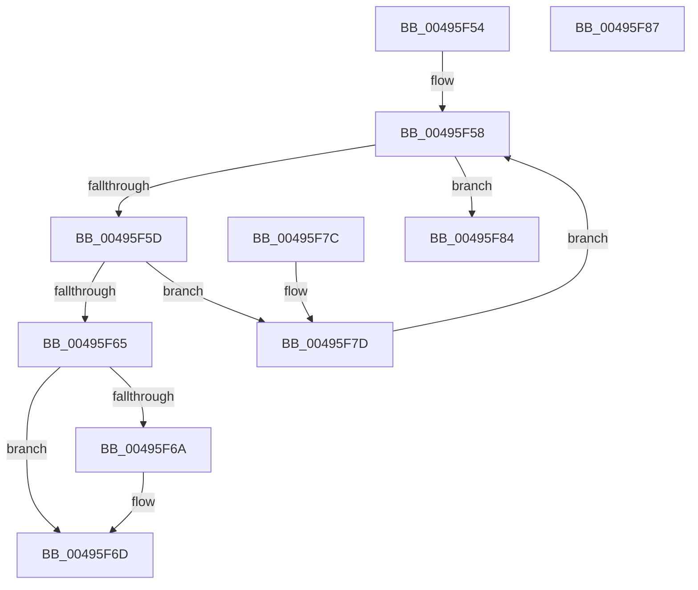

# HalpDmaIndexToTranslationEntry

- RVA: `0x00495F54`–`0x00495F88` (길이 `52` bytes)
- VA: `0x0000000140495F54`
- 실행 섹션: `.text`
- PDB 이름 있음: `예`; PDB Function 태그: `아니요`
- unwind 정보 RVA: `0x000DB714`
- 디코드: `21`개 명령, `52/52` bytes 표시
- 미해석 바이트: `0` (있으면 어셈블리에 `.byte`로 보존)

> 이 문서는 커널 이미지의 기계어와 PDB 기호를 분석해 생성했습니다. 4번과 5번은 함수 원형과 자료형을 바이너리 사용 방식에서 추정한 C 해석이며 원본 소스 복구 결과는 아닙니다.

## 1. Dependencies

- 직접 호출 지점: **0**; 고유 호출 대상: **0**
- 직접 호출자로 확인된 함수: **3**
- RIP 상대 이미지 참조: **0**

### Outgoing calls
- 직접 디코드된 call 명령이 없습니다.

### Direct callers
- [HalpDmaAllocateScatterPagesFromContiguousPoolV3](../4E/HalpDmaAllocateScatterPagesFromContiguousPoolV3_function_004E380C.md) at `0x004E38D5`
- [HalpDmaAllocateScatterPagesFromContiguousPoolAtHighLevelV3](../53/HalpDmaAllocateScatterPagesFromContiguousPoolAtHighLevelV3_function_0053DF40.md) at `0x0053DF9F`
- [HalpDmaAllocateScatterPagesFromContiguousPoolAtHighLevelV2](../55/HalpDmaAllocateScatterPagesFromContiguousPoolAtHighLevelV2_function_00553E70.md) at `0x00553ECC`

### Static image references
- 디코드된 RIP-relative 메모리 참조가 없습니다.

## 2. Other-region calls and transfers

- 다른 실행 섹션으로 향하는 call: **0**
- 별도 외부 분기/꼬리 이동을 확인하지 못했습니다.

## 3. Assembly (complete function range)

```asm
00495F54  4C 8B 49 30                     mov r9, qword ptr [rcx + 0x30]
00495F58  4D 85 C9                        test r9, r9
00495F5B  74 27                           je 0x140495f84
00495F5D  41 8B 41 08                     mov eax, dword ptr [r9 + 8]
00495F61  3B D0                           cmp edx, eax
00495F63  73 18                           jae 0x140495f7d
00495F65  4D 85 C0                        test r8, r8
00495F68  74 03                           je 0x140495f6d
00495F6A  4D 89 08                        mov qword ptr [r8], r9
00495F6D  8B C2                           mov eax, edx
00495F6F  48 8D 0C C0                     lea rcx, [rax + rax*8]
00495F73  49 8B 41 10                     mov rax, qword ptr [r9 + 0x10]
00495F77  48 8D 04 C8                     lea rax, [rax + rcx*8]
00495F7B  C3                              ret
00495F7C  CC                              int3
00495F7D  4D 8B 09                        mov r9, qword ptr [r9]
00495F80  2B D0                           sub edx, eax
00495F82  EB D4                           jmp 0x140495f58
00495F84  33 C0                           xor eax, eax
00495F86  C3                              ret
00495F87  CC                              int3
```

## 4. C-style interpretation (structured pseudocode)

```c
__int64 __fastcall HalpDmaIndexToTranslationEntry(__int64 a1, int a2, __int64 a3)
{
    __int64 result;

loc_00495F58:
    if (*(unsigned __int64 *)(a1 + 48) == 0) goto loc_00495F84;
    if (a2 >= ((unsigned int)((unsigned int)(*(unsigned int *)(*(unsigned __int64 *)(a1 + 48) + 8))))) goto loc_00495F7D;
    if (a3 != 0) {
        *(unsigned __int64 *)(a3) = *(unsigned __int64 *)(a1 + 48);
    }
    return *(unsigned __int64 *)(*(unsigned __int64 *)(a1 + 48) + 16) + (unsigned int)(a2) + (unsigned int)(a2) * 8 * 8;
loc_00495F7D:
    a2 = (unsigned int)((a2) - ((unsigned int)(*(unsigned __int64 *)(*(unsigned __int64 *)(a1 + 48) + 16) + (unsigned int)(a2) + (unsigned int)(a2) * 8 * 8)));
    goto loc_00495F58;
loc_00495F84:
    result = 0;
    return result;
}
```

## 5. (Beta) C Style

```c
int64_t HalpDmaIndexToTranslationEntry(void *Arg1, int32_t Arg2, int64_t Arg3)
{
    uint8_t *arg1 = (uint8_t *)Arg1;

    int64_t result;

loc_00495F58:
    if (*(uint64_t *)(arg1 + 0x30) == 0) goto loc_00495F84;
    if (Arg2 >= ((uint32_t)((uint32_t)(*(uint32_t *)(*(uint64_t *)(arg1 + 0x30) + 0x8))))) goto loc_00495F7D;
    if (Arg3 != 0) {
        *(uint64_t *)(Arg3) = *(uint64_t *)(arg1 + 0x30);
    }
    return *(uint64_t *)(*(uint64_t *)(arg1 + 0x30) + 0x10) + (uint32_t)(Arg2) + (uint32_t)(Arg2) * 8 * 8;
loc_00495F7D:
    Arg2 = (uint32_t)((Arg2) - ((uint32_t)(*(uint64_t *)(*(uint64_t *)(arg1 + 0x30) + 0x10) + (uint32_t)(Arg2) + (uint32_t)(Arg2) * 8 * 8)));
    goto loc_00495F58;
loc_00495F84:
    result = 0;
    return result;
}
```

### 관측된 메모리 오프셋

구조체 형식이 확인되지 않은 접근은 인자 기준의 오프셋으로만 기록했습니다.

| 기준 인자 | 오프셋 표현 | 폭 (bit) | 접근 |
|---|---:|---:|---|
| `Arg1` | `+ 0x30` | `64` | `R` |

## 6. Execution-region graph

[열기: 2D/3D 그래프와 함수 탐색 컨트롤 패널](../../../control-panel.html?section=text&rva=0x00495F54&view=graph)

- 2D 그래프는 위에서 아래로 흐르고, 3D 그래프는 빈 공간을 드래그해 회전합니다. Shift+드래그는 이동, 휠은 확대·축소, 함수 노드 선택은 대상 보고서 이동입니다.

### Static fallback


