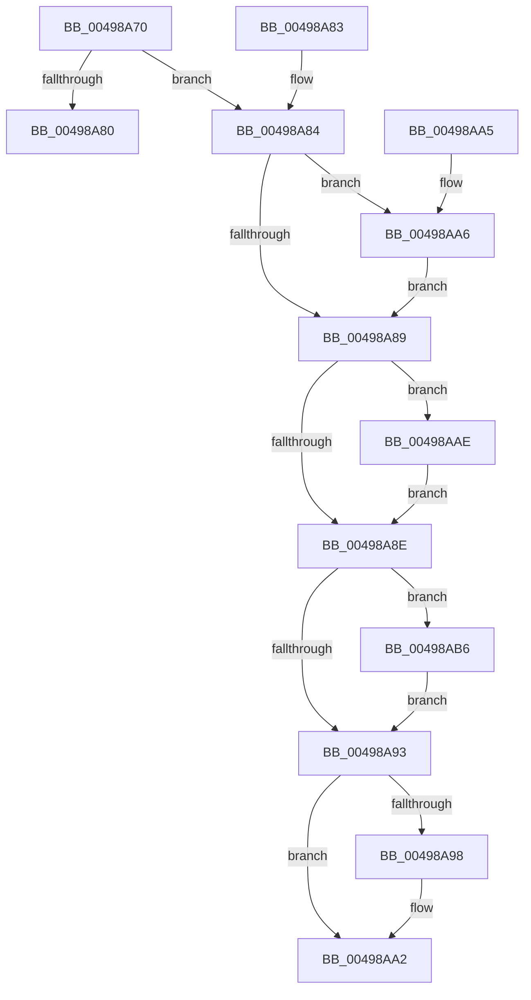

# HalpGetCpuInfo

- RVA: `0x00498A70`–`0x00498ABF` (길이 `79` bytes)
- VA: `0x0000000140498A70`
- 실행 섹션: `.text`
- PDB 이름 있음: `예`; PDB Function 태그: `아니요`
- unwind 정보 RVA: `0x000DB714`
- 디코드: `28`개 명령, `79/79` bytes 표시
- 미해석 바이트: `0` (있으면 어셈블리에 `.byte`로 보존)

> 이 문서는 커널 이미지의 기계어와 PDB 기호를 분석해 생성했습니다. 4번과 5번은 함수 원형과 자료형을 바이너리 사용 방식에서 추정한 C 해석이며 원본 소스 복구 결과는 아닙니다.

## 1. Dependencies

- 직접 호출 지점: **0**; 고유 호출 대상: **0**
- 직접 호출자로 확인된 함수: **17**
- RIP 상대 이미지 참조: **0**

### Outgoing calls
- 직접 디코드된 call 명령이 없습니다.

### Direct callers
- [HalpInterruptIsMsiSupported](../4C/HalpInterruptIsMsiSupported_function_004C225C.md) at `0x004C22DD`
- [HalpDmaGetDefaultRemappingDomainPolicy](../53/HalpDmaGetDefaultRemappingDomainPolicy_function_0053E240.md) at `0x0053E263`
- [HalpInterruptIsDeferredErrorSupported](../54/HalpInterruptIsDeferredErrorSupported_function_005441A4.md) at `0x005441B9`
- [HalpTscReserveResources](../54/HalpTscReserveResources_function_0054AE20.md) at `0x0054AF5C`
- [HalpTimerConfigureQpcBypass](../54/HalpTimerConfigureQpcBypass_function_0054BDAC.md) at `0x0054BE21`
- [HalpProcGetFeatureBits](../54/HalpProcGetFeatureBits_function_0054E890.md) at `0x0054E8D3`
- [HalpIommuAllocateDmaDomain](../55/HalpIommuAllocateDmaDomain_function_00554904.md) at `0x00554A47`
- [HalpIommuGetPageTableType](../55/HalpIommuGetPageTableType_function_00555220.md) at `0x00555246`
- [HalpInterruptIsProcessorCacheFlushOptimizationSupported](../55/HalpInterruptIsProcessorCacheFlushOptimizationSupported_function_0055A884.md) at `0x0055A8A5`
- [IommupDeviceEnablePasidTaggedDma](../../page/70/IommupDeviceEnablePasidTaggedDma_function_00708B74.md) at `0x00708BED`
- [HalpSetSystemInformation](../../page/AB/HalpSetSystemInformation_function_00AB0850.md) at `0x00AB0936`
- [HalpDpPostReplaceInitialization](../../pagelk/B5/HalpDpPostReplaceInitialization_function_00B5FE3C.md) at `0x00B5FEDA`
- [HalpLbrInitialize](../../pagelk/B6/HalpLbrInitialize_function_00B60F78.md) at `0x00B60FE6`
- [HalpPiix4Detect](../../pagelk/B7/HalpPiix4Detect_function_00B79E00.md) at `0x00B79FA7`
- [HalpErrataApplyPerProcessor](../../pagelk/B7/HalpErrataApplyPerProcessor_function_00B7E46C.md) at `0x00B7E495`
- [HalpProcIsSmtDisabled](../../init/C1/HalpProcIsSmtDisabled_function_00C1FBF4.md) at `0x00C1FC17`
- [HalpProcIsSmtDisabled](../../init/C1/HalpProcIsSmtDisabled_function_00C1FBF4.md) at `0x00C1FC5B`
- [HalpMiscGetParameters](../../init/C1/HalpMiscGetParameters_function_00C1FD30.md) at `0x00C1FFBD`

### Static image references
- 디코드된 RIP-relative 메모리 참조가 없습니다.

## 2. Other-region calls and transfers

- 다른 실행 섹션으로 향하는 call: **0**
- 별도 외부 분기/꼬리 이동을 확인하지 못했습니다.

## 3. Assembly (complete function range)

```asm
00498A70  65 4C 8B 14 25 20 00 00 00      mov r10, qword ptr gs:[0x20]
00498A79  41 80 7A 41 00                  cmp byte ptr [r10 + 0x41], 0
00498A7E  75 04                           jne 0x140498a84
00498A80  32 C0                           xor al, al
00498A82  C3                              ret
00498A83  CC                              int3
00498A84  48 85 C9                        test rcx, rcx
00498A87  75 1D                           jne 0x140498aa6
00498A89  48 85 D2                        test rdx, rdx
00498A8C  75 20                           jne 0x140498aae
00498A8E  4D 85 C0                        test r8, r8
00498A91  75 23                           jne 0x140498ab6
00498A93  4D 85 C9                        test r9, r9
00498A96  74 0A                           je 0x140498aa2
00498A98  41 8A 82 8D 00 00 00            mov al, byte ptr [r10 + 0x8d]
00498A9F  41 88 01                        mov byte ptr [r9], al
00498AA2  B0 01                           mov al, 1
00498AA4  C3                              ret
00498AA5  CC                              int3
00498AA6  41 8A 42 40                     mov al, byte ptr [r10 + 0x40]
00498AAA  88 01                           mov byte ptr [rcx], al
00498AAC  EB DB                           jmp 0x140498a89
00498AAE  41 8A 42 42                     mov al, byte ptr [r10 + 0x42]
00498AB2  88 02                           mov byte ptr [rdx], al
00498AB4  EB D8                           jmp 0x140498a8e
00498AB6  41 8A 42 43                     mov al, byte ptr [r10 + 0x43]
00498ABA  41 88 00                        mov byte ptr [r8], al
00498ABD  EB D4                           jmp 0x140498a93
```

## 4. C-style interpretation (structured pseudocode)

```c
__int64 __fastcall HalpGetCpuInfo(__int64 a1, __int64 a2, __int64 a3, __int64 a4)
{
    __int64 result;

    if ((*(unsigned __int8 *)(*(unsigned __int64 *)(gs_base + (0 + 32)) + 65)) != 0) goto loc_00498A84;
    result = 0;
    return result;
loc_00498A84:
    if (a1 != 0) goto loc_00498AA6;
loc_00498A89:
    if (a2 != 0) goto loc_00498AAE;
loc_00498A8E:
    if (a3 != 0) goto loc_00498AB6;
loc_00498A93:
    if (a4 != 0) {
        result = *(unsigned __int8 *)(*(unsigned __int64 *)(gs_base + (0 + 32)) + 141);
        *(unsigned __int8 *)(a4) = (unsigned __int8)(result);
    }
    return 1;
loc_00498AA6:
    *(unsigned __int8 *)(a1) = (unsigned __int8)(*(unsigned __int8 *)(*(unsigned __int64 *)(gs_base + (0 + 32)) + 64));
    goto loc_00498A89;
loc_00498AAE:
    *(unsigned __int8 *)(a2) = (unsigned __int8)(*(unsigned __int8 *)(*(unsigned __int64 *)(gs_base + (0 + 32)) + 66));
    goto loc_00498A8E;
loc_00498AB6:
    *(unsigned __int8 *)(a3) = (unsigned __int8)(*(unsigned __int8 *)(*(unsigned __int64 *)(gs_base + (0 + 32)) + 67));
    goto loc_00498A93;
}
```

## 5. (Beta) C Style

```c
int64_t HalpGetCpuInfo(int64_t Arg1, int64_t Arg2, int64_t Arg3, int64_t Arg4)
{
    int64_t result;

    if ((*(uint8_t *)(*(uint64_t *)(gs_base + (0 + 0x20)) + 0x41)) != 0) goto loc_00498A84;
    result = 0;
    return result;
loc_00498A84:
    if (Arg1 != 0) goto loc_00498AA6;
loc_00498A89:
    if (Arg2 != 0) goto loc_00498AAE;
loc_00498A8E:
    if (Arg3 != 0) goto loc_00498AB6;
loc_00498A93:
    if (Arg4 != 0) {
        result = *(uint8_t *)(*(uint64_t *)(gs_base + (0 + 0x20)) + 0x8D);
        *(uint8_t *)(Arg4) = (uint8_t)(result);
    }
    return 1;
loc_00498AA6:
    *(uint8_t *)(Arg1) = (uint8_t)(*(uint8_t *)(*(uint64_t *)(gs_base + (0 + 0x20)) + 0x40));
    goto loc_00498A89;
loc_00498AAE:
    *(uint8_t *)(Arg2) = (uint8_t)(*(uint8_t *)(*(uint64_t *)(gs_base + (0 + 0x20)) + 0x42));
    goto loc_00498A8E;
loc_00498AB6:
    *(uint8_t *)(Arg3) = (uint8_t)(*(uint8_t *)(*(uint64_t *)(gs_base + (0 + 0x20)) + 0x43));
    goto loc_00498A93;
}
```

## 6. Execution-region graph

[열기: 2D/3D 그래프와 함수 탐색 컨트롤 패널](../../../control-panel.html?section=text&rva=0x00498A70&view=graph)

- 2D 그래프는 위에서 아래로 흐르고, 3D 그래프는 빈 공간을 드래그해 회전합니다. Shift+드래그는 이동, 휠은 확대·축소, 함수 노드 선택은 대상 보고서 이동입니다.

### Static fallback


