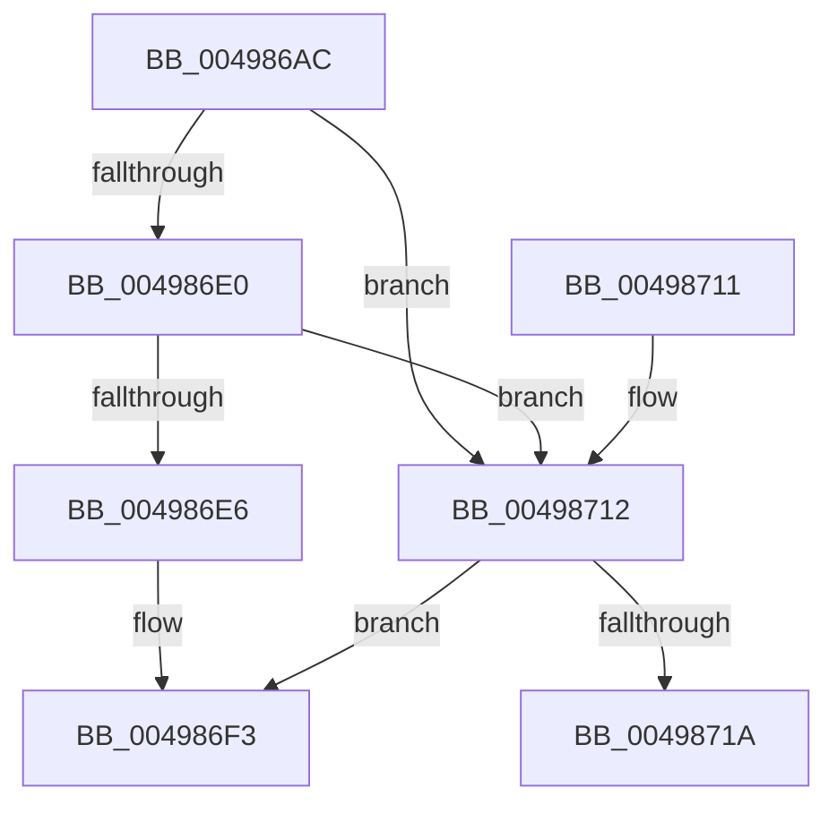

# HalpIommuDomainMapIdentityRange

- RVA: `0x004986AC`–`0x0049871F` (길이 `115` bytes)
- VA: `0x00000001404986AC`
- 실행 섹션: `.text`
- PDB 이름 있음: `예`; PDB Function 태그: `예`
- unwind 정보 RVA: `0x000B418C`
- 디코드: `39`개 명령, `115/115` bytes 표시
- 미해석 바이트: `0` (있으면 어셈블리에 `.byte`로 보존)

> 이 문서는 커널 이미지의 기계어와 PDB 기호를 분석해 생성했습니다. 4번과 5번은 함수 원형과 자료형을 바이너리 사용 방식에서 추정한 C 해석이며 원본 소스 복구 결과는 아닙니다.

## 1. Dependencies

- 직접 호출 지점: **1**; 고유 호출 대상: **1**
- 직접 호출자로 확인된 함수: **2**
- RIP 상대 이미지 참조: **1**

### Outgoing calls
- `0x004986EE` → [IommupHvMapDeviceIdentityRange](IommupHvMapDeviceIdentityRange_function_00498728.md) (function, `0x00498728`)

### Direct callers
- [IommuMapIdentityRangeEx](../30/IommuMapIdentityRangeEx_function_00307C10.md) at `0x00307D29`
- [IommuMapIdentityRange](../56/IommuMapIdentityRange_function_00568000.md) at `0x00568052`

### Static image references
- `0x004986CD` → RVA `0x00FC1710` (`.data`; read)

## 2. Other-region calls and transfers

- 다른 실행 섹션으로 향하는 call: **0**
- call이 아닌 외부 분기/꼬리 이동: **1**
  - `0x0049871A` → [sub_006F785E](../6F/Unknown_function_006F785E.md) (`tail-transfer`)

## 3. Assembly (complete function range)

```asm
004986AC  4C 8B DC                        mov r11, rsp
004986AF  49 89 5B 08                     mov qword ptr [r11 + 8], rbx
004986B3  49 89 6B 10                     mov qword ptr [r11 + 0x10], rbp
004986B7  49 89 73 18                     mov qword ptr [r11 + 0x18], rsi
004986BB  57                              push rdi
004986BC  41 54                           push r12
004986BE  41 55                           push r13
004986C0  41 56                           push r14
004986C2  41 57                           push r15
004986C4  48 83 EC 50                     sub rsp, 0x50
004986C8  33 F6                           xor esi, esi
004986CA  49 8B E9                        mov rbp, r9
004986CD  40 38 35 3C 90 B2 00            cmp byte ptr [rip + 0xb2903c], sil
004986D4  4D 8B E0                        mov r12, r8
004986D7  8B FA                           mov edi, edx
004986D9  4C 8B E9                        mov r13, rcx
004986DC  8B C6                           mov eax, esi
004986DE  74 32                           je 0x140498712
004986E0  40 38 71 34                     cmp byte ptr [rcx + 0x34], sil
004986E4  75 2C                           jne 0x140498712
004986E6  4D 89 4B C0                     mov qword ptr [r11 - 0x40], r9
004986EA  4D 8D 4B C0                     lea r9, [r11 - 0x40]
004986EE  E8 35 00 00 00                  call 0x140498728
004986F3  4C 8D 5C 24 50                  lea r11, [rsp + 0x50]
004986F8  49 8B 5B 30                     mov rbx, qword ptr [r11 + 0x30]
004986FC  49 8B 6B 38                     mov rbp, qword ptr [r11 + 0x38]
00498700  49 8B 73 40                     mov rsi, qword ptr [r11 + 0x40]
00498704  49 8B E3                        mov rsp, r11
00498707  41 5F                           pop r15
00498709  41 5E                           pop r14
0049870B  41 5D                           pop r13
0049870D  41 5C                           pop r12
0049870F  5F                              pop rdi
00498710  C3                              ret
00498711  CC                              int3
00498712  4C 8B FE                        mov r15, rsi
00498715  48 85 ED                        test rbp, rbp
00498718  74 D9                           je 0x1404986f3
0049871A  E9 3F F1 25 00                  jmp 0x1406f785e
```

## 4. C-style interpretation (structured pseudocode)

```c
__int64 __fastcall HalpIommuDomainMapIdentityRange(__int64 a1, int a2, __int64 a3, __int64 a4)
{
    __int64 result;
    __int64 v_rsi;
    __int64 v_rsp;
    unsigned __int64 v_stack_m28;

    *(unsigned __int64 *)(v_rsp + 8) = v_rbx;
    *(unsigned __int64 *)(v_rsp + 16) = v_rbp;
    *(unsigned __int64 *)(v_rsp + 24) = v_rsi;
    v_rsp = (v_rsp) - (80);
    v_rsi = 0;
    if ((*(unsigned __int8 *)(v_rip + 11702332)) == 0) goto loc_00498712;
    if ((*(unsigned __int8 *)(a1 + 52)) != 0) goto loc_00498712;
    *(unsigned __int64 *)(v_rsp - 64) = a4;
    result = IommupHvMapDeviceIdentityRange(a1, a2, a3, v_rsp - 64);
loc_004986F3:
    return result;
loc_00498712:
    if (*(unsigned __int64 *)(v_stack_m28 + 56) == 0) goto loc_004986F3;
}
```

## 5. (Beta) C Style

```c
int64_t HalpIommuDomainMapIdentityRange(void *Arg1, int32_t Arg2, int64_t Arg3, int64_t Arg4)
{
    uint8_t *arg1 = (uint8_t *)Arg1;

    int64_t result;
    int64_t local_rsi;
    int64_t local_rsp;
    uint64_t v_stack_m28;

    *(uint64_t *)(local_rsp + 0x8) = local_rbx;
    *(uint64_t *)(local_rsp + 0x10) = local_rbp;
    *(uint64_t *)(local_rsp + 0x18) = local_rsi;
    local_rsp = (local_rsp) - (80);
    local_rsi = 0;
    if ((*(uint8_t *)(v_rip + 0xB2903C)) == 0) goto loc_00498712;
    if ((*(uint8_t *)(arg1 + 0x34)) != 0) goto loc_00498712;
    *(uint64_t *)(local_rsp - 0x40) = Arg4;
    result = IommupHvMapDeviceIdentityRange(Arg1, Arg2, Arg3, local_rsp - 64);
loc_004986F3:
    return result;
loc_00498712:
    if (*(uint64_t *)(v_stack_m28 + 0x38) == 0) goto loc_004986F3;
}
```

### 관측된 메모리 오프셋

구조체 형식이 확인되지 않은 접근은 인자 기준의 오프셋으로만 기록했습니다.

| 기준 인자 | 오프셋 표현 | 폭 (bit) | 접근 |
|---|---:|---:|---|
| `Arg1` | `+ 0x34` | `8` | `R` |

## 6. Execution-region graph

[열기: 2D/3D 그래프와 함수 탐색 컨트롤 패널](../../../control-panel.html?section=text&rva=0x004986AC&view=graph)

- 2D 그래프는 위에서 아래로 흐르고, 3D 그래프는 빈 공간을 드래그해 회전합니다. Shift+드래그는 이동, 휠은 확대·축소, 함수 노드 선택은 대상 보고서 이동입니다.

### Static fallback


