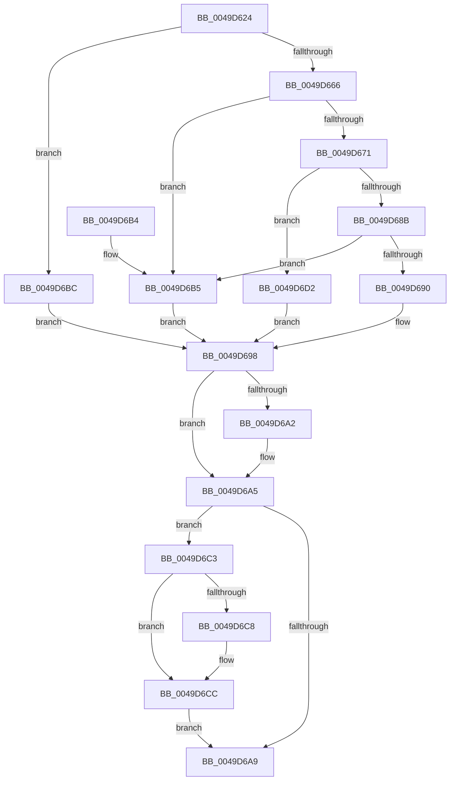

# HalpTimerConvertAuxiliaryCounter

- RVA: `0x0049D624`–`0x0049D6ED` (길이 `201` bytes)
- VA: `0x000000014049D624`
- 실행 섹션: `.text`
- PDB 이름 있음: `예`; PDB Function 태그: `아니요`
- unwind 정보 RVA: `0x000B4F70`
- 디코드: `62`개 명령, `201/201` bytes 표시
- 미해석 바이트: `0` (있으면 어셈블리에 `.byte`로 보존)

> 이 문서는 커널 이미지의 기계어와 PDB 기호를 분석해 생성했습니다. 4번과 5번은 함수 원형과 자료형을 바이너리 사용 방식에서 추정한 C 해석이며 원본 소스 복구 결과는 아닙니다.

## 1. Dependencies

- 직접 호출 지점: **0**; 고유 호출 대상: **0**
- 직접 호출자로 확인된 함수: **1**
- RIP 상대 이미지 참조: **0**

### Outgoing calls
- 직접 디코드된 call 명령이 없습니다.

### Direct callers
- [HalpTimerConvertPerformanceCounterToAuxiliaryCounter](../53/HalpTimerConvertPerformanceCounterToAuxiliaryCounter_function_0053C4E0.md) at `0x0053C5C2`

### Static image references
- 디코드된 RIP-relative 메모리 참조가 없습니다.

## 2. Other-region calls and transfers

- 다른 실행 섹션으로 향하는 call: **0**
- 별도 외부 분기/꼬리 이동을 확인하지 못했습니다.

## 3. Assembly (complete function range)

```asm
0049D624  48 89 5C 24 10                  mov qword ptr [rsp + 0x10], rbx
0049D629  48 89 74 24 18                  mov qword ptr [rsp + 0x18], rsi
0049D62E  4D 8B D0                        mov r10, r8
0049D631  45 33 DB                        xor r11d, r11d
0049D634  4C 8B 44 24 28                  mov r8, qword ptr [rsp + 0x28]
0049D639  48 8B F2                        mov rsi, rdx
0049D63C  4C 2B C1                        sub r8, rcx
0049D63F  48 8B C1                        mov rax, rcx
0049D642  48 2B 44 24 28                  sub rax, qword ptr [rsp + 0x28]
0049D647  49 8B D9                        mov rbx, r9
0049D64A  48 3B 4C 24 28                  cmp rcx, qword ptr [rsp + 0x28]
0049D64F  4C 8B 4C 24 30                  mov r9, qword ptr [rsp + 0x30]
0049D654  4C 0F 43 C0                     cmovae r8, rax
0049D658  33 D2                           xor edx, edx
0049D65A  49 8B C0                        mov rax, r8
0049D65D  48 F7 F6                        div rsi
0049D660  48 83 F8 0A                     cmp rax, 0xa
0049D664  73 56                           jae 0x14049d6bc
0049D666  49 8B C0                        mov rax, r8
0049D669  48 F7 E3                        mul rbx
0049D66C  48 85 D2                        test rdx, rdx
0049D66F  75 44                           jne 0x14049d6b5
0049D671  48 F7 F6                        div rsi
0049D674  33 D2                           xor edx, edx
0049D676  4C 8B C0                        mov r8, rax
0049D679  B8 00 CA 9A 3B                  mov eax, 0x3b9aca00
0049D67E  48 F7 F3                        div rbx
0049D681  4C 8B D8                        mov r11, rax
0049D684  48 3B 4C 24 28                  cmp rcx, qword ptr [rsp + 0x28]
0049D689  72 47                           jb 0x14049d6d2
0049D68B  4D 3B D0                        cmp r10, r8
0049D68E  72 25                           jb 0x14049d6b5
0049D690  33 C0                           xor eax, eax
0049D692  4D 2B D0                        sub r10, r8
0049D695  4D 89 11                        mov qword ptr [r9], r10
0049D698  48 8B 4C 24 38                  mov rcx, qword ptr [rsp + 0x38]
0049D69D  48 85 C9                        test rcx, rcx
0049D6A0  74 03                           je 0x14049d6a5
0049D6A2  4C 89 19                        mov qword ptr [rcx], r11
0049D6A5  85 C0                           test eax, eax
0049D6A7  78 1A                           js 0x14049d6c3
0049D6A9  48 8B 5C 24 10                  mov rbx, qword ptr [rsp + 0x10]
0049D6AE  48 8B 74 24 18                  mov rsi, qword ptr [rsp + 0x18]
0049D6B3  C3                              ret
0049D6B4  CC                              int3
0049D6B5  B8 01 00 00 C0                  mov eax, 0xc0000001
0049D6BA  EB DC                           jmp 0x14049d698
0049D6BC  B8 0D 00 00 C0                  mov eax, 0xc000000d
0049D6C1  EB D5                           jmp 0x14049d698
0049D6C3  48 85 C9                        test rcx, rcx
0049D6C6  74 04                           je 0x14049d6cc
0049D6C8  48 83 21 00                     and qword ptr [rcx], 0
0049D6CC  49 83 21 00                     and qword ptr [r9], 0
0049D6D0  EB D7                           jmp 0x14049d6a9
0049D6D2  48 83 C9 FF                     or rcx, 0xffffffffffffffff
0049D6D6  4B 8D 14 10                     lea rdx, [r8 + r10]
0049D6DA  49 3B D0                        cmp rdx, r8
0049D6DD  48 0F 43 CA                     cmovae rcx, rdx
0049D6E1  1B C0                           sbb eax, eax
0049D6E3  25 95 00 00 C0                  and eax, 0xc0000095
0049D6E8  49 89 09                        mov qword ptr [r9], rcx
0049D6EB  EB AB                           jmp 0x14049d698
```

## 4. C-style interpretation (structured pseudocode)

```c
__int64 __fastcall HalpTimerConvertAuxiliaryCounter(__int64 a1, __int64 a2, __int64 a3, __int64 a4, __int64 a5, __int64 a6, __int64 a7)
{
    __int64 result;
    __int64 v_r10;
    __int64 v_r11;
    unsigned __int64 v_stack_p10;
    unsigned __int64 v_stack_p18;

    v_stack_p10 = v_rbx;
    v_stack_p18 = v_rsi;
    v_r11 = 0;
    a3 = (a5) - (a1);
    result = (a1) - (a5);
    if (a1 >= a5) { a3 = result; }
    a2 = 0;
    if (a3 >= 10) goto loc_0049D6BC;
    if (0 != 0) goto loc_0049D6B5;
    a2 = 0;
    if (a1 < a5) goto loc_0049D6D2;
    if (a3 < a3) goto loc_0049D6B5;
    result = 0;
    v_r10 = (a3) - (a3);
    *(unsigned __int64 *)(a6) = v_r10;
loc_0049D698:
    if (a7 != 0) {
        *(unsigned __int64 *)(a7) = (unsigned int)(0x3B9ACA00ULL);
    }
    if (sign_flag) goto loc_0049D6C3;
loc_0049D6A9:
    return result;
loc_0049D6B5:
    goto loc_0049D698;
loc_0049D6BC:
    goto loc_0049D698;
loc_0049D6C3:
    if (a7 != 0) {
    }
    goto loc_0049D6A9;
loc_0049D6D2:
    a1 = (a7) | (-1);
    if ((a3 + v_r10 * 1) >= a3) { a1 = a3 + v_r10 * 1; }
    result = (unsigned int)(((unsigned int)(0xC000000DULL)) & (0xC0000095ULL));
    *(unsigned __int64 *)(a6) = a1;
    goto loc_0049D698;
}
```

## 5. (Beta) C Style

```c
int64_t HalpTimerConvertAuxiliaryCounter(int64_t Arg1, int64_t Arg2, int64_t Arg3, int64_t Arg4, int64_t Arg5, void *Arg6, int64_t Arg7)
{
    uint8_t *arg6 = (uint8_t *)Arg6;

    int64_t result;
    int64_t local_r10;
    int64_t local_r11;
    uint64_t v_stack_p10;
    uint64_t v_stack_p18;

    v_stack_p10 = local_rbx;
    v_stack_p18 = local_rsi;
    local_r11 = 0;
    Arg3 = (Arg5) - (Arg1);
    result = (Arg1) - (Arg5);
    if (Arg1 >= Arg5) { Arg3 = result; }
    Arg2 = 0;
    if (Arg3 >= 10) goto loc_0049D6BC;
    if (0 != 0) goto loc_0049D6B5;
    Arg2 = 0;
    if (Arg1 < Arg5) goto loc_0049D6D2;
    if (Arg3 < Arg3) goto loc_0049D6B5;
    result = 0;
    local_r10 = (Arg3) - (Arg3);
    *(uint64_t *)(arg6) = local_r10;
loc_0049D698:
    if (Arg7 != 0) {
        *(uint64_t *)(Arg7) = (uint32_t)(0x3B9ACA00ULL);
    }
    if (sign_flag) goto loc_0049D6C3;
loc_0049D6A9:
    return result;
loc_0049D6B5:
    goto loc_0049D698;
loc_0049D6BC:
    goto loc_0049D698;
loc_0049D6C3:
    if (Arg7 != 0) {
    }
    goto loc_0049D6A9;
loc_0049D6D2:
    Arg1 = (Arg7) | (-1);
    if ((Arg3 + local_r10 * 1) >= Arg3) { Arg1 = Arg3 + local_r10 * 1; }
    result = (uint32_t)(((uint32_t)(0xC000000DULL)) & (0xC0000095ULL));
    *(uint64_t *)(arg6) = Arg1;
    goto loc_0049D698;
}
```

### 관측된 메모리 오프셋

구조체 형식이 확인되지 않은 접근은 인자 기준의 오프셋으로만 기록했습니다.

| 기준 인자 | 오프셋 표현 | 폭 (bit) | 접근 |
|---|---:|---:|---|
| `Arg6` | `+ 0x0` | `64` | `R/W` |
| `Arg6` | `+ 0x0` | `64` | `W` |

## 6. Execution-region graph

[열기: 2D/3D 그래프와 함수 탐색 컨트롤 패널](../../../control-panel.html?section=text&rva=0x0049D624&view=graph)

- 2D 그래프는 위에서 아래로 흐르고, 3D 그래프는 빈 공간을 드래그해 회전합니다. Shift+드래그는 이동, 휠은 확대·축소, 함수 노드 선택은 대상 보고서 이동입니다.

### Static fallback


