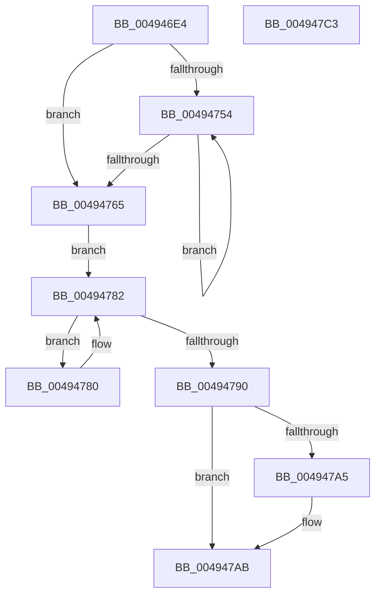

# HalpTscAdvSynchCalculateRemoteDelta

- RVA: `0x004946E4`–`0x004947C4` (길이 `224` bytes)
- VA: `0x00000001404946E4`
- 실행 섹션: `.text`
- PDB 이름 있음: `예`; PDB Function 태그: `아니요`
- unwind 정보 RVA: `0x0005CAAC`
- 디코드: `56`개 명령, `224/224` bytes 표시
- 미해석 바이트: `0` (있으면 어셈블리에 `.byte`로 보존)

> 이 문서는 커널 이미지의 기계어와 PDB 기호를 분석해 생성했습니다. 4번과 5번은 함수 원형과 자료형을 바이너리 사용 방식에서 추정한 C 해석이며 원본 소스 복구 결과는 아닙니다.

## 1. Dependencies

- 직접 호출 지점: **1**; 고유 호출 대상: **1**
- 직접 호출자로 확인된 함수: **3**
- RIP 상대 이미지 참조: **1**

### Outgoing calls
- `0x00494776` → [HalpTscAdvSynchComputeMinimumDeltaAlternate](HalpTscAdvSynchComputeMinimumDeltaAlternate_function_004947CC.md) (function, `0x004947CC`)

### Direct callers
- [HalpTscAdvSynchToLeader](HalpTscAdvSynchToLeader_function_00494494.md) at `0x004944CA`
- [HalpTscAdvSynchToLeader](HalpTscAdvSynchToLeader_function_00494494.md) at `0x00494557`
- [HalpTscAdvSynchToLeader](HalpTscAdvSynchToLeader_function_00494494.md) at `0x004945BC`
- [HalpTscAdvSynchCalculateRemoteDeltas](../54/HalpTscAdvSynchCalculateRemoteDeltas_function_0054A5B0.md) at `0x0054A624`
- [HalpTscAdvSynchToTarget](../54/HalpTscAdvSynchToTarget_function_0054A978.md) at `0x0054A9B0`
- [HalpTscAdvSynchToTarget](../54/HalpTscAdvSynchToTarget_function_0054A978.md) at `0x0054A9FA`
- [HalpTscAdvSynchToTarget](../54/HalpTscAdvSynchToTarget_function_0054A978.md) at `0x0054AA94`

### Static image references
- `0x00494704` → RVA `0x00FC2238` (`.data`; read)

## 2. Other-region calls and transfers

- 다른 실행 섹션으로 향하는 call: **0**
- 별도 외부 분기/꼬리 이동을 확인하지 못했습니다.

## 3. Assembly (complete function range)

```asm
004946E4  48 89 5C 24 08                  mov qword ptr [rsp + 8], rbx
004946E9  57                              push rdi
004946EA  48 83 EC 20                     sub rsp, 0x20
004946EE  65 48 8B 04 25 20 00 00 00      mov rax, qword ptr gs:[0x20]
004946F7  48 8B FA                        mov rdi, rdx
004946FA  8B D9                           mov ebx, ecx
004946FC  48 C1 E3 07                     shl rbx, 7
00494700  44 8B 40 24                     mov r8d, dword ptr [rax + 0x24]
00494704  48 8B 05 2D DB B2 00            mov rax, qword ptr [rip + 0xb2db2d]
0049470B  45 8B C8                        mov r9d, r8d
0049470E  49 C1 E1 07                     shl r9, 7
00494712  48 8B 4C 03 10                  mov rcx, qword ptr [rbx + rax + 0x10]
00494717  44 89 44 03 04                  mov dword ptr [rbx + rax + 4], r8d
0049471C  48 C7 01 00 00 00 00            mov qword ptr [rcx], 0
00494723  48 8B 05 0E DB B2 00            mov rax, qword ptr [rip + 0xb2db0e]
0049472A  49 8B 4C 01 10                  mov rcx, qword ptr [r9 + rax + 0x10]
0049472F  B8 04 00 00 00                  mov eax, 4
00494734  48 C7 01 FF FF FF FF            mov qword ptr [rcx], 0xffffffffffffffff
0049473B  48 8B 0D F6 DA B2 00            mov rcx, qword ptr [rip + 0xb2daf6]
00494742  87 04 0B                        xchg dword ptr [rbx + rcx], eax
00494745  48 8B 0D EC DA B2 00            mov rcx, qword ptr [rip + 0xb2daec]
0049474C  8B 04 0B                        mov eax, dword ptr [rbx + rcx]
0049474F  83 F8 04                        cmp eax, 4
00494752  75 11                           jne 0x140494765
00494754  F3 90                           pause
00494756  48 8B 05 DB DA B2 00            mov rax, qword ptr [rip + 0xb2dadb]
0049475D  8B 14 03                        mov edx, dword ptr [rbx + rax]
00494760  83 FA 04                        cmp edx, 4
00494763  74 EF                           je 0x140494754
00494765  48 8B 0D CC DA B2 00            mov rcx, qword ptr [rip + 0xb2dacc]
0049476C  48 8B 54 0B 10                  mov rdx, qword ptr [rbx + rcx + 0x10]
00494771  49 8B 4C 09 10                  mov rcx, qword ptr [r9 + rcx + 0x10]
00494776  E8 51 00 00 00                  call 0x1404947cc
0049477B  4C 8B C0                        mov r8, rax
0049477E  EB 02                           jmp 0x140494782
00494780  F3 90                           pause
00494782  48 8B 0D AF DA B2 00            mov rcx, qword ptr [rip + 0xb2daaf]
00494789  8B 14 0B                        mov edx, dword ptr [rbx + rcx]
0049478C  85 D2                           test edx, edx
0049478E  75 F0                           jne 0x140494780
00494790  F0 09 14 24                     lock or dword ptr [rsp], edx
00494794  48 8B 05 9D DA B2 00            mov rax, qword ptr [rip + 0xb2da9d]
0049479B  48 8B 44 03 08                  mov rax, qword ptr [rbx + rax + 8]
004947A0  48 85 FF                        test rdi, rdi
004947A3  74 06                           je 0x1404947ab
004947A5  41 8D 0C 00                     lea ecx, [r8 + rax]
004947A9  89 0F                           mov dword ptr [rdi], ecx
004947AB  48 8B 5C 24 30                  mov rbx, qword ptr [rsp + 0x30]
004947B0  49 2B C0                        sub rax, r8
004947B3  48 99                           cqo
004947B5  B9 02 00 00 00                  mov ecx, 2
004947BA  48 F7 F9                        idiv rcx
004947BD  48 83 C4 20                     add rsp, 0x20
004947C1  5F                              pop rdi
004947C2  C3                              ret
004947C3  CC                              int3
```

## 4. C-style interpretation (structured pseudocode)

```c
__int64 __fastcall HalpTscAdvSynchCalculateRemoteDelta(int a1, __int64 a2)
{
    __int64 result;
    __int64 v_rbx;
    __int64 v_rsp;
    unsigned int v_stack_m28;
    unsigned __int64 v_stack_p8;

    v_stack_p8 = v_rbx;
    v_rsp = (v_rsp) - (32);
    v_rbx = ((unsigned int)(a1)) << (7);
    a4 = ((unsigned int)((unsigned int)((unsigned int)(*(unsigned int *)(*(unsigned __int64 *)(gs_base + (0 + 32)) + 36))))) << (7);
    *(unsigned int *)(v_rbx + *(unsigned __int64 *)(v_rip + 11721517) * 1 + 4) = (unsigned int)((unsigned int)(*(unsigned int *)(*(unsigned __int64 *)(gs_base + (0 + 32)) + 36)));
    *(unsigned __int64 *)(*(unsigned __int64 *)(v_rbx + *(unsigned __int64 *)(v_rip + 11721517) * 1 + 16)) = 0;
    *(unsigned __int64 *)(*(unsigned __int64 *)(a4 + *(unsigned __int64 *)(v_rip + 11721486) * 1 + 16)) = -1;
    if (((unsigned int)((unsigned int)(*(unsigned int *)(v_rbx + *(unsigned __int64 *)(v_rip + 11721452) * 1)))) != 4) goto loc_00494765;
loc_00494754:
    if (((unsigned int)((unsigned int)(*(unsigned int *)(v_rbx + *(unsigned __int64 *)(v_rip + 11721435) * 1)))) == 4) goto loc_00494754;
loc_00494765:
    result = HalpTscAdvSynchComputeMinimumDeltaAlternate(*(unsigned __int64 *)(a4 + *(unsigned __int64 *)(v_rip + 11721420) * 1 + 16), *(unsigned __int64 *)(v_rbx + *(unsigned __int64 *)(v_rip + 11721420) * 1 + 16), (unsigned int)(*(unsigned int *)(*(unsigned __int64 *)(gs_base + (0 + 32)) + 36)), a4);
    goto loc_00494782;
loc_00494780:
loc_00494782:
    if ((unsigned int)((unsigned int)(*(unsigned int *)(v_rbx + *(unsigned __int64 *)(v_rip + 11721391) * 1))) != 0) goto loc_00494780;
    if (a2 != 0) {
        a1 = result + *(unsigned __int64 *)(v_rbx + *(unsigned __int64 *)(v_rip + 11721373) * 1 + 8) * 1;
        *(unsigned int *)(a2) = a1;
    }
    result = (*(unsigned __int64 *)(v_rbx + *(unsigned __int64 *)(v_rip + 11721373) * 1 + 8)) - (result);
    v_rsp = (v_rsp) + (32);
    return result;
}
```

## 5. (Beta) C Style

```c
int64_t HalpTscAdvSynchCalculateRemoteDelta(int32_t Arg1, int64_t Arg2)
{
    int64_t result;
    int64_t local_rbx;
    int64_t local_rsp;
    uint32_t v_stack_m28;
    uint64_t v_stack_p8;

    v_stack_p8 = local_rbx;
    local_rsp = (local_rsp) - (32);
    local_rbx = ((uint32_t)(Arg1)) << (7);
    a4 = ((uint32_t)((uint32_t)((uint32_t)(*(uint32_t *)(*(uint64_t *)(gs_base + (0 + 0x20)) + 0x24))))) << (7);
    *(uint32_t *)(local_rbx + *(uint64_t *)(v_rip + 0xB2DB2D) * 1 + 0x4) = (uint32_t)((uint32_t)(*(uint32_t *)(*(uint64_t *)(gs_base + (0 + 0x20)) + 0x24)));
    *(uint64_t *)(*(uint64_t *)(local_rbx + *(uint64_t *)(v_rip + 0xB2DB2D) * 1 + 0x10)) = 0;
    *(uint64_t *)(*(uint64_t *)(a4 + *(uint64_t *)(v_rip + 0xB2DB0E) * 1 + 0x10)) = -1;
    if (((uint32_t)((uint32_t)(*(uint32_t *)(local_rbx + *(uint64_t *)(v_rip + 0xB2DAEC) * 1)))) != 4) goto loc_00494765;
loc_00494754:
    if (((uint32_t)((uint32_t)(*(uint32_t *)(local_rbx + *(uint64_t *)(v_rip + 0xB2DADB) * 1)))) == 4) goto loc_00494754;
loc_00494765:
    result = HalpTscAdvSynchComputeMinimumDeltaAlternate(*(uint64_t *)(a4 + *(uint64_t *)(v_rip + 0xB2DACC) * 1 + 0x10), *(uint64_t *)(local_rbx + *(uint64_t *)(v_rip + 0xB2DACC) * 1 + 0x10), (uint32_t)(*(uint32_t *)(*(uint64_t *)(gs_base + (0 + 0x20)) + 0x24)), a4);
    goto loc_00494782;
loc_00494780:
loc_00494782:
    if ((uint32_t)((uint32_t)(*(uint32_t *)(local_rbx + *(uint64_t *)(v_rip + 0xB2DAAF) * 1))) != 0) goto loc_00494780;
    if (Arg2 != 0) {
        Arg1 = result + *(uint64_t *)(local_rbx + *(uint64_t *)(v_rip + 0xB2DA9D) * 1 + 0x8) * 1;
        *(uint32_t *)(Arg2) = Arg1;
    }
    result = (*(uint64_t *)(local_rbx + *(uint64_t *)(v_rip + 0xB2DA9D) * 1 + 0x8)) - (result);
    local_rsp = (local_rsp) + (32);
    return result;
}
```

## 6. Execution-region graph

[열기: 2D/3D 그래프와 함수 탐색 컨트롤 패널](../../../control-panel.html?section=text&rva=0x004946E4&view=graph)

- 2D 그래프는 위에서 아래로 흐르고, 3D 그래프는 빈 공간을 드래그해 회전합니다. Shift+드래그는 이동, 휠은 확대·축소, 함수 노드 선택은 대상 보고서 이동입니다.

### Static fallback


