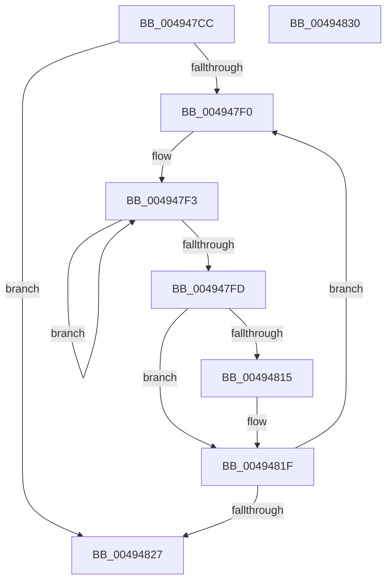

# HalpTscAdvSynchComputeMinimumDeltaAlternate

- RVA: `0x004947CC`–`0x00494831` (길이 `101` bytes)
- VA: `0x00000001404947CC`
- 실행 섹션: `.text`
- PDB 이름 있음: `예`; PDB Function 태그: `아니요`
- unwind 정보 RVA: `0x00071750`
- 디코드: `31`개 명령, `101/101` bytes 표시
- 미해석 바이트: `0` (있으면 어셈블리에 `.byte`로 보존)

> 이 문서는 커널 이미지의 기계어와 PDB 기호를 분석해 생성했습니다. 4번과 5번은 함수 원형과 자료형을 바이너리 사용 방식에서 추정한 C 해석이며 원본 소스 복구 결과는 아닙니다.

## 1. Dependencies

- 직접 호출 지점: **0**; 고유 호출 대상: **0**
- 직접 호출자로 확인된 함수: **2**
- RIP 상대 이미지 참조: **1**

### Outgoing calls
- 직접 디코드된 call 명령이 없습니다.

### Direct callers
- [HalpTscAdvSynchTarget](HalpTscAdvSynchTarget_function_00492A44.md) at `0x00492AF2`
- [HalpTscAdvSynchCalculateRemoteDelta](HalpTscAdvSynchCalculateRemoteDelta_function_004946E4.md) at `0x00494776`

### Static image references
- `0x004947D1` → RVA `0x00E0A7FC` (`.data`; read)

## 2. Other-region calls and transfers

- 다른 실행 섹션으로 향하는 call: **0**
- 별도 외부 분기/꼬리 이동을 확인하지 못했습니다.

## 3. Assembly (complete function range)

```asm
004947CC  48 89 5C 24 08                  mov qword ptr [rsp + 8], rbx
004947D1  44 8B 1D 24 60 97 00            mov r11d, dword ptr [rip + 0x976024]
004947D8  45 33 C0                        xor r8d, r8d
004947DB  48 8B DA                        mov rbx, rdx
004947DE  49 BA FF FF FF FF FF FF FF 7F   movabs r10, 0x7fffffffffffffff
004947E8  45 8B C8                        mov r9d, r8d
004947EB  45 85 DB                        test r11d, r11d
004947EE  74 37                           je 0x140494827
004947F0  49 8B C0                        mov rax, r8
004947F3  F3 90                           pause
004947F5  4C 8B 03                        mov r8, qword ptr [rbx]
004947F8  4C 3B C0                        cmp r8, rax
004947FB  74 F6                           je 0x1404947f3
004947FD  0F 20 D0                        mov rax, cr2
00494800  0F 22 D0                        mov cr2, rax
00494803  0F 31                           rdtsc
00494805  48 C1 E2 20                     shl rdx, 0x20
00494809  48 0B C2                        or rax, rdx
0049480C  48 89 01                        mov qword ptr [rcx], rax
0049480F  41 83 F9 02                     cmp r9d, 2
00494813  72 0A                           jb 0x14049481f
00494815  49 2B C0                        sub rax, r8
00494818  49 3B C2                        cmp rax, r10
0049481B  4C 0F 4C D0                     cmovl r10, rax
0049481F  41 FF C1                        inc r9d
00494822  45 3B CB                        cmp r9d, r11d
00494825  72 C9                           jb 0x1404947f0
00494827  48 8B 5C 24 08                  mov rbx, qword ptr [rsp + 8]
0049482C  49 8B C2                        mov rax, r10
0049482F  C3                              ret
00494830  CC                              int3
```

## 4. C-style interpretation (structured pseudocode)

```c
__int64 __fastcall HalpTscAdvSynchComputeMinimumDeltaAlternate(__int64 a1, __int64 a2, int a3)
{
    __int64 result;
    __int64 v_r10;
    unsigned __int64 v_stack_p8;

    v_stack_p8 = v_rbx;
    a3 = 0;
    if ((unsigned int)((unsigned int)(*(unsigned int *)(v_rip + 9920548))) == 0) goto loc_00494827;
loc_004947F0:
loc_004947F3:
    if ((*(unsigned __int64 *)(a2)) == 0) goto loc_004947F3;
    a2 = (a2) << (32);
    result = (v_cr2) | (a2);
    *(unsigned __int64 *)(a1) = result;
    if (0 >= 2) {
        result = (result) - (*(unsigned __int64 *)(a2));
        if (result < v_r10) { v_r10 = result; }
    }
    a4 = (unsigned int)((0) + 1);
    if (((unsigned int)(a4)) < ((unsigned int)((unsigned int)(*(unsigned int *)(v_rip + 9920548))))) goto loc_004947F0;
loc_00494827:
    return v_r10;
}
```

## 5. (Beta) C Style

```c
int64_t HalpTscAdvSynchComputeMinimumDeltaAlternate(void *Arg1, void *Arg2, int32_t Arg3)
{
    uint8_t *arg1 = (uint8_t *)Arg1;
    uint8_t *arg2 = (uint8_t *)Arg2;

    int64_t result;
    int64_t local_r10;
    uint64_t v_stack_p8;

    v_stack_p8 = local_rbx;
    Arg3 = 0;
    if ((uint32_t)((uint32_t)(*(uint32_t *)(v_rip + 0x976024))) == 0) goto loc_00494827;
loc_004947F0:
loc_004947F3:
    if ((*(uint64_t *)(arg2)) == 0) goto loc_004947F3;
    Arg2 = (Arg2) << (32);
    result = (v_cr2) | (Arg2);
    *(uint64_t *)(arg1) = result;
    if (0 >= 2) {
        result = (result) - (*(uint64_t *)(arg2));
        if (result < local_r10) { local_r10 = result; }
    }
    a4 = (uint32_t)((0) + 1);
    if (((uint32_t)(a4)) < ((uint32_t)((uint32_t)(*(uint32_t *)(v_rip + 0x976024))))) goto loc_004947F0;
loc_00494827:
    return local_r10;
}
```

### 관측된 메모리 오프셋

구조체 형식이 확인되지 않은 접근은 인자 기준의 오프셋으로만 기록했습니다.

| 기준 인자 | 오프셋 표현 | 폭 (bit) | 접근 |
|---|---:|---:|---|
| `Arg1` | `+ 0x0` | `64` | `W` |
| `Arg2` | `+ 0x0` | `64` | `R` |

## 6. Execution-region graph

[열기: 2D/3D 그래프와 함수 탐색 컨트롤 패널](../../../control-panel.html?section=text&rva=0x004947CC&view=graph)

- 2D 그래프는 위에서 아래로 흐르고, 3D 그래프는 빈 공간을 드래그해 회전합니다. Shift+드래그는 이동, 휠은 확대·축소, 함수 노드 선택은 대상 보고서 이동입니다.

### Static fallback


