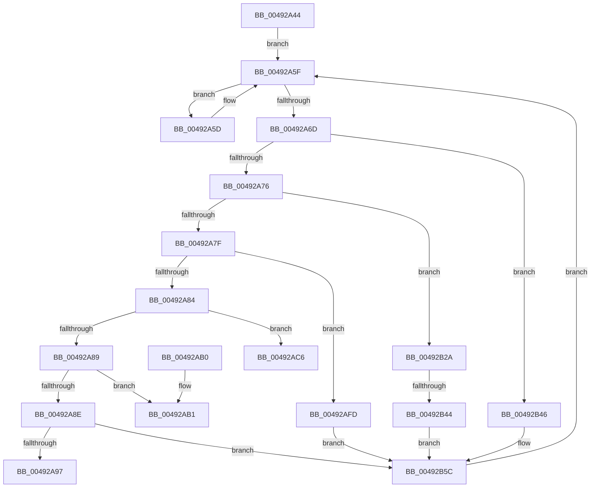

# HalpTscAdvSynchTarget

- RVA: `0x00492A44`–`0x00492B74` (길이 `304` bytes)
- VA: `0x0000000140492A44`
- 실행 섹션: `.text`
- PDB 이름 있음: `예`; PDB Function 태그: `예`
- unwind 정보 RVA: `0x000B3024`
- 디코드: `74`개 명령, `304/304` bytes 표시
- 미해석 바이트: `0` (있으면 어셈블리에 `.byte`로 보존)

> 이 문서는 커널 이미지의 기계어와 PDB 기호를 분석해 생성했습니다. 4번과 5번은 함수 원형과 자료형을 바이너리 사용 방식에서 추정한 C 해석이며 원본 소스 복구 결과는 아닙니다.

## 1. Dependencies

- 직접 호출 지점: **2**; 고유 호출 대상: **2**
- 직접 호출자로 확인된 함수: **1**
- RIP 상대 이미지 참조: **1**

### Outgoing calls
- `0x00492AF2` → [HalpTscAdvSynchComputeMinimumDeltaAlternate](HalpTscAdvSynchComputeMinimumDeltaAlternate_function_004947CC.md) (function, `0x004947CC`)
- `0x00492B57` → [HalpTscAdvSynchSkewCounter](../54/HalpTscAdvSynchSkewCounter_function_0054A950.md) (function, `0x0054A950`)

### Direct callers
- [HalpTscSynchronizationWorker](../54/HalpTscSynchronizationWorker_function_0054B090.md) at `0x0054B150`

### Static image references
- `0x00492A5F` → RVA `0x00FC2238` (`.data`; read)

## 2. Other-region calls and transfers

- 다른 실행 섹션으로 향하는 call: **0**
- call이 아닌 외부 분기/꼬리 이동: **3**
  - `0x00492AC1` → [sub_006F7118](../6F/Unknown_function_006F7118.md) (`tail-transfer`)
  - `0x00492AF8` → [sub_006F7118](../6F/Unknown_function_006F7118.md) (`tail-transfer`)
  - `0x00492B3E` → [sub_006F7118 + 0x11](../6F/Unknown_function_006F7118.md) (`tail-transfer`)

## 3. Assembly (complete function range)

```asm
00492A44  40 53                           push rbx
00492A46  48 83 EC 20                     sub rsp, 0x20
00492A4A  65 48 8B 04 25 20 00 00 00      mov rax, qword ptr gs:[0x20]
00492A53  48 63 58 24                     movsxd rbx, dword ptr [rax + 0x24]
00492A57  48 C1 E3 07                     shl rbx, 7
00492A5B  EB 02                           jmp 0x140492a5f
00492A5D  F3 90                           pause
00492A5F  48 8B 05 D2 F7 B2 00            mov rax, qword ptr [rip + 0xb2f7d2]
00492A66  8B 0C 03                        mov ecx, dword ptr [rbx + rax]
00492A69  85 C9                           test ecx, ecx
00492A6B  74 F0                           je 0x140492a5d
00492A6D  83 E9 01                        sub ecx, 1
00492A70  0F 84 D0 00 00 00               je 0x140492b46
00492A76  83 E9 01                        sub ecx, 1
00492A79  0F 84 AB 00 00 00               je 0x140492b2a
00492A7F  83 E9 01                        sub ecx, 1
00492A82  74 79                           je 0x140492afd
00492A84  83 E9 01                        sub ecx, 1
00492A87  74 3D                           je 0x140492ac6
00492A89  83 E9 02                        sub ecx, 2
00492A8C  74 23                           je 0x140492ab1
00492A8E  83 F9 01                        cmp ecx, 1
00492A91  0F 85 C5 00 00 00               jne 0x140492b5c
00492A97  F0 83 0C 24 00                  lock or dword ptr [rsp], 0
00492A9C  48 8B 05 95 F7 B2 00            mov rax, qword ptr [rip + 0xb2f795]
00492AA3  C7 04 03 00 00 00 00            mov dword ptr [rbx + rax], 0
00492AAA  48 83 C4 20                     add rsp, 0x20
00492AAE  5B                              pop rbx
00492AAF  C3                              ret
00492AB0  CC                              int3
00492AB1  90                              nop
00492AB2  0F 20 D0                        mov rax, cr2
00492AB5  0F 22 D0                        mov cr2, rax
00492AB8  0F 31                           rdtsc
00492ABA  48 C1 E2 20                     shl rdx, 0x20
00492ABE  48 0B C2                        or rax, rdx
00492AC1  E9 52 46 26 00                  jmp 0x1406f7118
00492AC6  F0 83 0C 24 00                  lock or dword ptr [rsp], 0
00492ACB  48 8B 05 66 F7 B2 00            mov rax, qword ptr [rip + 0xb2f766]
00492AD2  C7 04 03 05 00 00 00            mov dword ptr [rbx + rax], 5
00492AD9  8B 54 03 04                     mov edx, dword ptr [rbx + rax + 4]
00492ADD  48 8B 0D 54 F7 B2 00            mov rcx, qword ptr [rip + 0xb2f754]
00492AE4  48 C1 E2 07                     shl rdx, 7
00492AE8  48 8B 54 0A 10                  mov rdx, qword ptr [rdx + rcx + 0x10]
00492AED  48 8B 4C 0B 10                  mov rcx, qword ptr [rbx + rcx + 0x10]
00492AF2  E8 D5 1C 00 00                  call 0x1404947cc
00492AF7  90                              nop
00492AF8  E9 1B 46 26 00                  jmp 0x1406f7118
00492AFD  F0 83 0C 24 00                  lock or dword ptr [rsp], 0
00492B02  48 8B 05 2F F7 B2 00            mov rax, qword ptr [rip + 0xb2f72f]
00492B09  B9 3B 00 00 00                  mov ecx, 0x3b
00492B0E  4C 8B 44 03 08                  mov r8, qword ptr [rbx + rax + 8]
00492B13  0F 32                           rdmsr
00492B15  48 C1 E2 20                     shl rdx, 0x20
00492B19  48 0B C2                        or rax, rdx
00492B1C  49 03 C0                        add rax, r8
00492B1F  48 8B D0                        mov rdx, rax
00492B22  48 C1 EA 20                     shr rdx, 0x20
00492B26  0F 30                           wrmsr
00492B28  EB 32                           jmp 0x140492b5c
00492B2A  F0 83 0C 24 00                  lock or dword ptr [rsp], 0
00492B2F  48 8B 05 02 F7 B2 00            mov rax, qword ptr [rip + 0xb2f702]
00492B36  44 8B 44 03 04                  mov r8d, dword ptr [rbx + rax + 4]
00492B3B  45 85 C0                        test r8d, r8d
00492B3E  0F 85 E5 45 26 00               jne 0x1406f7129
00492B44  EB 16                           jmp 0x140492b5c
00492B46  F0 83 0C 24 00                  lock or dword ptr [rsp], 0
00492B4B  48 8B 0D E6 F6 B2 00            mov rcx, qword ptr [rip + 0xb2f6e6]
00492B52  48 8B 4C 0B 08                  mov rcx, qword ptr [rbx + rcx + 8]
00492B57  E8 F4 7D 0B 00                  call 0x14054a950
00492B5C  F0 83 0C 24 00                  lock or dword ptr [rsp], 0
00492B61  48 8B 05 D0 F6 B2 00            mov rax, qword ptr [rip + 0xb2f6d0]
00492B68  C7 04 03 00 00 00 00            mov dword ptr [rbx + rax], 0
00492B6F  E9 EB FE FF FF                  jmp 0x140492a5f
```

## 4. C-style interpretation (structured pseudocode)

```c
__int64 __fastcall HalpTscAdvSynchTarget(__int64 a1, __int64 a2)
{
    __int64 result;
    __int64 v_rbx;
    __int64 v_rsp;
    unsigned int v_stack_m28;
    unsigned int v_stack_p0;

    v_rsp = (v_rsp) - (32);
    v_rbx = ((int)(*(unsigned int *)(*(unsigned __int64 *)(gs_base + (0 + 32)) + 36))) << (7);
    goto loc_00492A5F;
loc_00492A5D:
loc_00492A5F:
    if ((unsigned int)((unsigned int)(*(unsigned int *)(v_rbx + *(unsigned __int64 *)(v_rip + 11728850) * 1))) == 0) goto loc_00492A5D;
    a1 = (unsigned int)(((unsigned int)(*(unsigned int *)(v_rbx + *(unsigned __int64 *)(v_rip + 11728850) * 1))) - (1));
    if (condition_is_equal) goto loc_00492B46;
    a1 = (unsigned int)((a1) - (1));
    if (condition_is_equal) goto loc_00492B2A;
    a1 = (unsigned int)((a1) - (1));
    if (condition_is_equal) goto loc_00492AFD;
    a1 = (unsigned int)((a1) - (1));
    if (condition_is_equal) goto loc_00492AC6;
    a1 = (unsigned int)((a1) - (2));
    if (condition_is_equal) goto loc_00492AB1;
    if (((unsigned int)(a1)) != 1) goto loc_00492B5C;
    *(unsigned int *)(v_rbx + *(unsigned __int64 *)(v_rip + 11728789) * 1) = 0;
    v_rsp = (v_rsp) + (32);
    return *(unsigned __int64 *)(v_rip + 11728789);
loc_00492AB1:
    a2 = (a2) << (32);
    result = (v_cr2) | (a2);
loc_00492AC6:
    *(unsigned int *)(v_rbx + *(unsigned __int64 *)(v_rip + 11728742) * 1) = 5;
    a2 = ((unsigned int)(*(unsigned int *)(v_rbx + *(unsigned __int64 *)(v_rip + 11728742) * 1 + 4))) << (7);
    result = HalpTscAdvSynchComputeMinimumDeltaAlternate(*(unsigned __int64 *)(v_rbx + *(unsigned __int64 *)(v_rip + 11728724) * 1 + 16), *(unsigned __int64 *)(a2 + *(unsigned __int64 *)(v_rip + 11728724) * 1 + 16), a3, a4);
loc_00492AFD:
    a2 = (*(unsigned __int64 *)(a2 + *(unsigned __int64 *)(v_rip + 11728724) * 1 + 16)) << (32);
    result = (*(unsigned __int64 *)(v_rip + 11728687)) | (a2);
    result = (result) + (*(unsigned __int64 *)(v_rbx + *(unsigned __int64 *)(v_rip + 11728687) * 1 + 8));
    a2 = (result) >> (32);
    goto loc_00492B5C;
loc_00492B2A:
    goto loc_00492B5C;
loc_00492B46:
    result = HalpTscAdvSynchSkewCounter(*(unsigned __int64 *)(v_rbx + *(unsigned __int64 *)(v_rip + 11728614) * 1 + 8), a2, (unsigned int)(*(unsigned int *)(v_rbx + *(unsigned __int64 *)(v_rip + 11728642) * 1 + 4)), a4);
loc_00492B5C:
    *(unsigned int *)(v_rbx + *(unsigned __int64 *)(v_rip + 11728592) * 1) = 0;
    goto loc_00492A5F;
}
```

## 5. (Beta) C Style

```c
int64_t HalpTscAdvSynchTarget(int64_t Arg1, int64_t Arg2)
{
    int64_t result;
    int64_t local_rbx;
    int64_t local_rsp;
    uint32_t v_stack_m28;
    uint32_t v_stack_p0;

    local_rsp = (local_rsp) - (32);
    local_rbx = ((int32_t)(*(uint32_t *)(*(uint64_t *)(gs_base + (0 + 0x20)) + 0x24))) << (7);
    goto loc_00492A5F;
loc_00492A5D:
loc_00492A5F:
    if ((uint32_t)((uint32_t)(*(uint32_t *)(local_rbx + *(uint64_t *)(v_rip + 0xB2F7D2) * 1))) == 0) goto loc_00492A5D;
    Arg1 = (uint32_t)(((uint32_t)(*(uint32_t *)(local_rbx + *(uint64_t *)(v_rip + 0xB2F7D2) * 1))) - (1));
    if (condition_is_equal) goto loc_00492B46;
    Arg1 = (uint32_t)((Arg1) - (1));
    if (condition_is_equal) goto loc_00492B2A;
    Arg1 = (uint32_t)((Arg1) - (1));
    if (condition_is_equal) goto loc_00492AFD;
    Arg1 = (uint32_t)((Arg1) - (1));
    if (condition_is_equal) goto loc_00492AC6;
    Arg1 = (uint32_t)((Arg1) - (2));
    if (condition_is_equal) goto loc_00492AB1;
    if (((uint32_t)(Arg1)) != 1) goto loc_00492B5C;
    *(uint32_t *)(local_rbx + *(uint64_t *)(v_rip + 0xB2F795) * 1) = 0;
    local_rsp = (local_rsp) + (32);
    return *(uint64_t *)(v_rip + 0xB2F795);
loc_00492AB1:
    Arg2 = (Arg2) << (32);
    result = (v_cr2) | (Arg2);
loc_00492AC6:
    *(uint32_t *)(local_rbx + *(uint64_t *)(v_rip + 0xB2F766) * 1) = 5;
    Arg2 = ((uint32_t)(*(uint32_t *)(local_rbx + *(uint64_t *)(v_rip + 0xB2F766) * 1 + 0x4))) << (7);
    result = HalpTscAdvSynchComputeMinimumDeltaAlternate(*(uint64_t *)(local_rbx + *(uint64_t *)(v_rip + 0xB2F754) * 1 + 0x10), *(uint64_t *)(Arg2 + *(uint64_t *)(v_rip + 0xB2F754) * 1 + 0x10), a3, a4);
loc_00492AFD:
    Arg2 = (*(uint64_t *)(Arg2 + *(uint64_t *)(v_rip + 0xB2F754) * 1 + 0x10)) << (32);
    result = (*(uint64_t *)(v_rip + 0xB2F72F)) | (Arg2);
    result = (result) + (*(uint64_t *)(local_rbx + *(uint64_t *)(v_rip + 0xB2F72F) * 1 + 0x8));
    Arg2 = (result) >> (32);
    goto loc_00492B5C;
loc_00492B2A:
    goto loc_00492B5C;
loc_00492B46:
    result = HalpTscAdvSynchSkewCounter(*(uint64_t *)(local_rbx + *(uint64_t *)(v_rip + 0xB2F6E6) * 1 + 0x8), Arg2, (uint32_t)(*(uint32_t *)(local_rbx + *(uint64_t *)(v_rip + 0xB2F702) * 1 + 0x4)), a4);
loc_00492B5C:
    *(uint32_t *)(local_rbx + *(uint64_t *)(v_rip + 0xB2F6D0) * 1) = 0;
    goto loc_00492A5F;
}
```

## 6. Execution-region graph

[열기: 2D/3D 그래프와 함수 탐색 컨트롤 패널](../../../control-panel.html?section=text&rva=0x00492A44&view=graph)

- 2D 그래프는 위에서 아래로 흐르고, 3D 그래프는 빈 공간을 드래그해 회전합니다. Shift+드래그는 이동, 휠은 확대·축소, 함수 노드 선택은 대상 보고서 이동입니다.

### Static fallback


